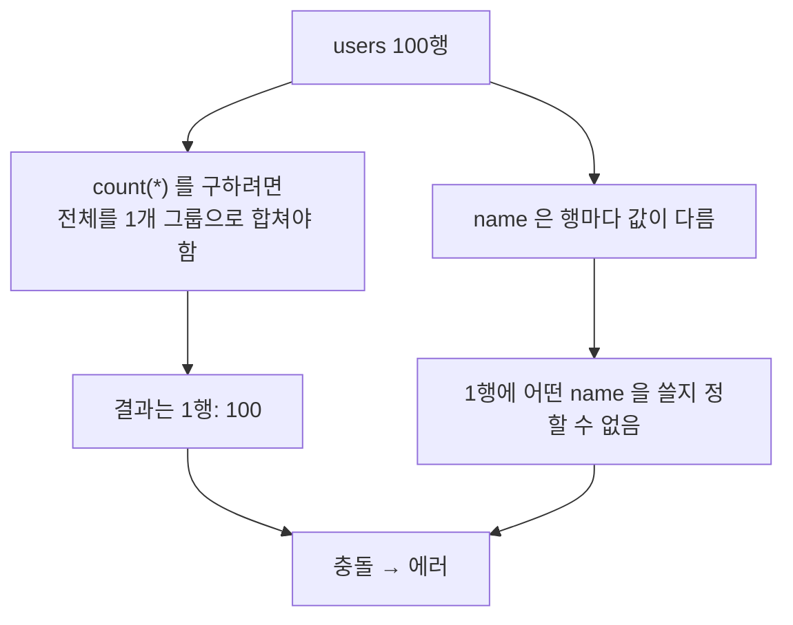
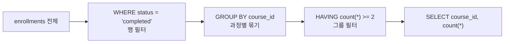

## 들어가며 (Situation)

"우리 서비스의 총 사용자 수는?", "강좌를 가장 많이 개설한 교육자는?" 같은 질문은 행 하나하나가 아니라 **행들의 묶음**에 대한 질문입니다. 수업 `06_grouping.sql`은 LMS(학습 관리 시스템) 데이터베이스의 `users`, `courses`, `grades`, `enrollments` 테이블로 집계 함수, `group by`, `having`을 다룹니다.

> 실제 서비스에서 겪은 문제가 아니라, 수업 실습을 정리한 글입니다. 쿼리는 수업에서 직접 실행하며 확인했고, 동작 설명은 MySQL 공식 문서로 보완했습니다.

## 문제 상황 (Task)

수업에서 일부러 에러를 내는 케이스가 있었습니다.

```sql
select
    name,
    count(*) as '총 사용자 수'
from
    users;
```

- 이 쿼리는 왜 에러가 날까요? 수업 주석은 "집계가 불가능한 컬럼(문자열 등)"이라고 설명하는데 정확한 설명일까요?
- `where`와 `having`은 둘 다 조건절인데 무엇이 다를까요? 언제 둘 다 써야 할까요?

## 해결 과정 (Action)

### 1. 집계 함수

| 함수 | 계산 | NULL 처리 |
|------|------|-----------|
| `count(*)` | 행 수 | `null` 행도 **센다** |
| `count(컬럼)` | 해당 컬럼의 값 개수 | `null`은 **제외** |
| `count(distinct 컬럼)` | 중복 없는 값 개수 | `null` 제외 |
| `sum`, `avg` | 합계, 평균 | `null` 무시 |
| `max`, `min` | 최댓값, 최솟값 | `null` 무시 |

수업 예제 `count(distinct author_id)`는 "과정을 등록한 교육자 수"입니다. 교육자 한 명이 여러 과정을 만들 수 있어서 `count(*)`로 세면 과정 수가 나오기 때문에 `distinct`가 필요합니다.

`avg(score)`는 `null`인 점수를 평균 계산에서 **뺍니다**. 미제출을 `null`로 저장했다면 평균이 높게 나올 수 있으니, 데이터에 `null`이 어떤 의미인지 먼저 확인해야 합니다.

### 2. 에러의 원인: 문자열이라서가 아니다

수업 주석은 "비집계 컬럼과 집계함수를 동시에 사용 시 발생한다"와 "집계가 불가능한 컬럼(문자열 등)"을 함께 적고 있습니다. 앞 문장이 정확한 설명이고, 뒤 문장은 오해의 여지가 있습니다. 숫자 컬럼이라도 `group by` 없이 `count(*)`와 같이 쓰면 똑같이 에러가 나기 때문입니다.



MySQL 5.7.5부터 `ONLY_FULL_GROUP_BY` SQL 모드가 기본으로 켜져 있어서, `select` 목록의 **집계되지 않은 컬럼은 `group by`에 있거나 집계 함수 안에 있어야** 합니다. 에러 메시지는 "비집계 컬럼이 있고 `sql_mode=only_full_group_by`와 호환되지 않는다"는 내용입니다. 수업이 말한 "어떤 name 값을 묶어야 할지 모르기 때문"이 바로 이 규칙의 이유입니다.

### 3. GROUP BY: 묶고 나서 계산한다

```sql
select
    status,
    count(*) as '사용자 수'
from
    users
group by
    status;
```

`status` 값이 같은 행끼리 한 그룹이 되고, 그룹마다 `count(*)`가 계산됩니다. 그래서 `select`에 `status`와 `count(*)`를 함께 쓸 수 있습니다. 위 에러 쿼리를 고치는 방법은 두 가지입니다. (예시 코드)

```sql
-- 1) 이름별로 몇 명인지 (동명이인 확인)
select name, count(*) from users group by name;

-- 2) 총 사용자 수만 필요하면 name 을 빼기
select count(*) from users;
```

### 4. WHERE vs HAVING: 실행 시점이 다르다

| 구분 | `where` | `having` |
|------|---------|----------|
| 실행 시점 | 그룹화 **전** (행 필터) | 그룹화 **후** (그룹 필터) |
| 집계 함수 사용 | 불가 | 가능 |
| 용도 | 어떤 행을 집계 대상으로 할지 | 어떤 그룹을 결과에 남길지 |



수업의 마지막 문제가 두 조건을 모두 필요로 합니다.

```sql
select
    course_id,
    count(*) as '학생 수'
from
    enrollments
where
    status = 'completed'
group by
    course_id
having
    count(*) >= 2;
```

"수강 상태가 completed인 과정 중, 2명 이상이 등록한 과정"에서 `completed`는 **행**의 조건이라 `where`, "2명 이상"은 **그룹**의 조건이라 `having`입니다. 행 조건을 `having`으로 쓸 수 있는 경우도 있지만, `where`로 먼저 걸러야 그룹화할 행 수가 줄어듭니다. 그룹화 대상이 줄어 효율적이라고 공식 문서와 일반적인 가이드에서 권합니다.

### 5. 시행착오 방지: 별칭 따옴표

수업 마지막 쿼리는 `count(*) '학생 수'`처럼 `as` 없이 별칭을 붙였습니다. 동작은 하지만 열 목록에서 쉼표를 빠뜨리면 별칭으로 오해되는 실수가 생길 수 있으므로 `as`를 쓰는 편이 안전합니다.

## 결과 (Result)

정량 지표는 없고, 아래를 정리했습니다.

- 에러의 정확한 원인: 컬럼의 **타입**이 아니라 **집계되지 않은 컬럼이 그룹 규칙을 위반**해서입니다. (`ONLY_FULL_GROUP_BY`)
- `select` 목록 = `group by`에 있는 컬럼 + 집계 함수라고 외우면 대부분 해결됩니다.
- 행 조건은 `where`, 그룹(집계값) 조건은 `having`으로 나눕니다.
- 집계 함수는 `count(*)`를 제외하면 `null`을 무시합니다.

## 더 학습하면 좋은 개념

- **`ONLY_FULL_GROUP_BY`와 함수적 종속성** — 기본키로 그룹화하면 다른 컬럼을 `select`에 써도 되는 이유(MySQL 5.7.5+)입니다.
- **윈도우 함수(`OVER`, `ROW_NUMBER`, `RANK`)** — 그룹으로 합치지 않고 행을 유지한 채 순위·누적합을 구합니다. "가장 신고를 많이 당한 사람" 같은 문제의 다음 단계입니다.
- **`GROUP BY ... WITH ROLLUP`** — 그룹별 소계와 총계를 한 번에 구합니다.
- **서브쿼리와 CTE** — 집계 결과를 다시 조건으로 쓰는 쿼리를 읽기 좋게 만듭니다.
- **인덱스와 `GROUP BY` 최적화** — 그룹화 컬럼에 인덱스가 있으면 정렬·임시 테이블이 줄어듭니다.

## 참고 자료

- [MySQL 8.4 - MySQL Handling of GROUP BY](https://dev.mysql.com/doc/refman/8.4/en/group-by-handling.html)
- [MySQL 8.4 - Aggregate Function Descriptions](https://dev.mysql.com/doc/refman/8.4/en/aggregate-functions.html)
- [MySQL 8.4 - SELECT Statement (HAVING)](https://dev.mysql.com/doc/refman/8.4/en/select.html)
- [MySQL 8.4 - Server SQL Modes (ONLY_FULL_GROUP_BY)](https://dev.mysql.com/doc/refman/8.4/en/sql-mode.html)
- [MySQL 8.4 - GROUP BY Optimization](https://dev.mysql.com/doc/refman/8.4/en/group-by-optimization.html)
