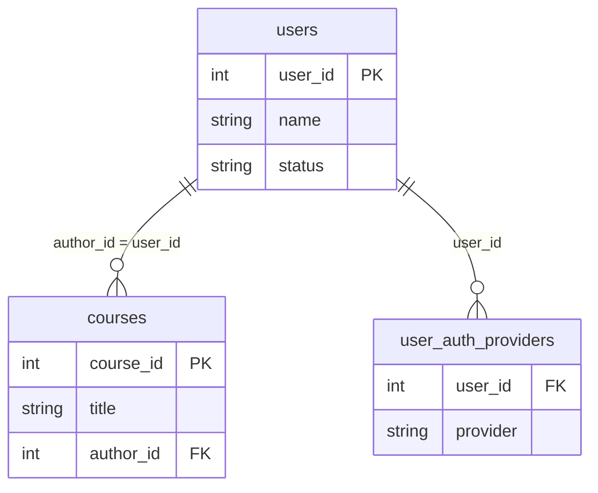

## 들어가며 (Situation)

수업 `07_Join.sql` 첫 줄의 주석은 "Join (굉장히 중요!!!!!!!)"입니다. 실제 데이터베이스는 의미가 다른 데이터를 테이블별로 나눠 저장하기 때문에, 화면에 필요한 정보를 만들려면 테이블을 합쳐야 합니다. LMS 데이터베이스의 `courses`, `users`, `user_auth_providers` 테이블로 실습했습니다.

> 실제 서비스에서 겪은 문제가 아니라, 수업 실습을 정리한 글입니다. 쿼리는 수업에서 직접 실행하며 확인했고, 동작 설명은 MySQL 공식 문서로 보완했습니다. 실습 데이터의 실제 행 수나 값은 싣지 않았습니다.

## 문제 상황 (Task)

- "과정 제목과 그 과정을 만든 교육자 이름"은 `courses`에 제목이, `users`에 이름이 있어서 한 번에 조회할 수 없습니다.
- `left join`과 `right join`은 테이블 순서만 바꾸면 같은 결과가 되는 걸까요?
- 수업이 나열한 `inner / left / right / self / outer join`은 모두 MySQL에서 쓸 수 있을까요?

## 해결 과정 (Action)

### 1. 외래키로 테이블을 잇는다



위 ER 다이어그램은 수업 주석("`courses.author_id`는 `users.user_id`를 가져온 값, 즉 FK")과 쿼리의 `on` 조건에서 추정해 그린 것입니다. 이 테이블들의 전체 컬럼과 정확한 관계(예: 한 사용자가 소셜 로그인 제공자를 여러 개 가질 수 있는지)는 `desc`로 확인하지 않았습니다. 수업에서도 `desc courses; desc users;`로 구조부터 확인했습니다.

### 2. INNER JOIN: 양쪽에 모두 있는 행만

```sql
select
    c.title as '과정 제목',
    u.name as '교육자 이름'
from
    courses as c
join
    users as u
on c.author_id = u.user_id;
```

`join`만 쓰면 `inner join`입니다. `on` 조건이 맞는 행만 결과에 나옵니다. 컬럼 이름이 겹칠 수 있어서 테이블 별칭(`c`, `u`)을 붙여 `c.title`처럼 출처를 밝힙니다.

### 3. LEFT JOIN: 왼쪽 테이블은 전부 남긴다

```sql
select
    u.name as '사용자 이름',
    uap.provider as '소셜 로그인 제공자'
from users as u
left join user_auth_providers as uap
on u.user_id = uap.user_id;
```

왼쪽(`users`)의 모든 행이 나오고, 오른쪽에 짝이 없으면 오른쪽 컬럼이 `null`로 채워집니다. 즉 "소셜 로그인을 한 번도 안 쓴 사용자"도 목록에 남습니다.

| 종류 | 기준 테이블 | 짝이 없는 행 |
|------|-------------|--------------|
| `inner join` | 없음 (교집합) | 양쪽 모두 제외 |
| `left join` | 왼쪽 | 왼쪽은 유지, 오른쪽 컬럼은 `null` |
| `right join` | 오른쪽 | 오른쪽은 유지, 왼쪽 컬럼은 `null` |

### 4. RIGHT JOIN은 LEFT JOIN의 거울

수업은 같은 쿼리의 `left`를 `right`로만 바꿔 보여 줍니다. 이 경우 기준이 `user_auth_providers`가 되어, **소셜 로그인 기록은 전부 나오고** 짝이 없는 사용자는 빠집니다. (외래키로 모든 기록이 사용자와 연결돼 있다면 inner join과 결과가 같을 수도 있습니다. 데이터를 확인해야 하는 부분입니다.) 아래 두 쿼리는 같은 결과입니다. (예시 코드)

```sql
from users u right join user_auth_providers uap on u.user_id = uap.user_id
from user_auth_providers uap left join users u on u.user_id = uap.user_id
```

그래서 실무에서는 읽는 순서가 자연스러운 `left join`으로 통일하는 경우가 많습니다.

### 5. "outer join"은 별도 종류가 아니다

수업의 종류 나열에는 `outer join`이 따로 있지만, MySQL에서 `left join`과 `right join`이 곧 **outer join**입니다. `left outer join`처럼 `outer`를 써도 되고 생략해도 됩니다. 한쪽을 기준으로 하지 않고 양쪽을 모두 남기는 `FULL OUTER JOIN`은 MySQL에서 지원하지 않습니다. 필요하면 `left join`과 `right join`을 `union`으로 합쳐 흉내 냅니다. `self join`(한 테이블을 자기 자신과 join)은 수업 주석에 이름만 나왔고 예제는 없었습니다.

### 6. 시행착오 방지: ON과 WHERE의 위치

`left join`에서는 오른쪽 테이블에 거는 조건을 `on`에 쓰느냐 `where`에 쓰느냐로 결과가 달라집니다. (예시 코드)

```sql
-- on 에 쓰면: 모든 사용자 유지, provider 가 google 인 것만 붙임 (나머지는 null)
left join user_auth_providers uap
  on u.user_id = uap.user_id and uap.provider = 'google'

-- where 에 쓰면: join 후에 필터되어 null 행이 사라짐 → 사실상 inner join
where uap.provider = 'google'
```

`left join`의 목적이 "짝 없는 행 보존"이라면 오른쪽 테이블 조건은 `on`에 두어야 합니다.

## 결과 (Result)

정량 지표는 없고, 아래를 정리했습니다.

- `on`의 조건은 FK 관계를 그대로 적는 것이고, `inner`는 교집합, `left`/`right`는 기준 테이블 보존입니다.
- `right join`은 `left join`에서 테이블 순서만 바꾼 것과 같습니다.
- MySQL에서 `outer join`은 `left`/`right`를 가리키고, `full outer join`은 없습니다.
- `left join`한 뒤 오른쪽 테이블을 `where`로 거르면 `inner join`이 된다는 점은 가장 자주 하는 실수로 기억해 둡니다.

## 더 학습하면 좋은 개념

- **외래키 제약(FOREIGN KEY)과 참조 무결성** — `courses.author_id`가 존재하지 않는 사용자를 가리키지 못하게 막는 장치로, join 결과의 신뢰도를 좌우합니다.
- **정규화(1NF~3NF)** — 데이터를 왜 테이블로 쪼개는지에 대한 이유이자 join이 필요한 근본 원인입니다.
- **`self join`과 `cross join`** — 계층 구조(상위 카테고리)와 모든 조합 생성에 쓰입니다. `tbl_category.ref_category_code`가 대표적인 예입니다.
- **서브쿼리 vs JOIN** — 같은 결과를 내는 두 방식의 읽기 쉬움과 성능 차이를 `EXPLAIN`으로 비교해 볼 수 있습니다.
- **join 컬럼의 인덱스** — `on`에 쓰는 컬럼에 인덱스가 없으면 데이터가 많을 때 급격히 느려집니다.

## 참고 자료

- [MySQL 8.4 - JOIN Clause](https://dev.mysql.com/doc/refman/8.4/en/join.html)
- [MySQL 8.4 - Using Foreign Keys (Tutorial)](https://dev.mysql.com/doc/refman/8.4/en/example-foreign-keys.html)
- [MySQL 8.4 - FOREIGN KEY Constraints](https://dev.mysql.com/doc/refman/8.4/en/create-table-foreign-keys.html)
- [MySQL 8.4 - Outer Join Optimization](https://dev.mysql.com/doc/refman/8.4/en/outer-join-optimization.html)
- [MySQL 8.4 - UNION Clause](https://dev.mysql.com/doc/refman/8.4/en/union.html)
