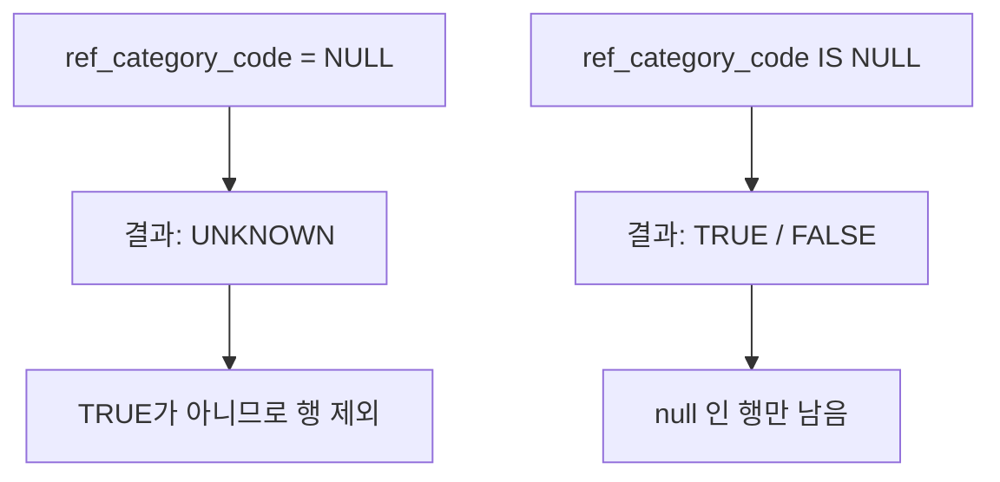

## 들어가며 (Situation)

[SELECT 편]()에서 "어떤 열을 가져올 것인가"를 봤다면, `where`는 "어떤 **행**을 가져올 것인가"를 정합니다. 수업 `03_where.sql`은 비교 연산자, `and`/`or`, `between`, `like`, `in`, `null` 처리를 한 파일에 담고 있습니다.

> 실제 서비스에서 겪은 문제가 아니라, 수업 실습을 정리한 글입니다. 쿼리는 수업에서 직접 실행하며 확인했고, 동작 설명은 MySQL 공식 문서로 보완했습니다.

## 문제 상황 (Task)

조건절을 연습하면서 아래 세 가지를 더 확인해 보고 싶었습니다.

- `like`의 `%` 위치(`'마늘%'`, `'%마늘'`, `'%마늘%'`)에 따라 결과가 어떻게 달라질까요?
- `and`와 `or`를 섞으면 어떤 순서로 계산될까요?
- `category_code not in (4, 5, 6)`은 `category_code`가 `null`인 행을 어떻게 처리할까요?

## 해결 과정 (Action)

### 1. 비교 연산자 정리

| 연산자 | 의미 | 예시 |
|--------|------|------|
| `=` | 같다 | `orderable_status = 'Y'` |
| `!=`, `<>` | 같지 않다 | `menu_price <> 0` |
| `>`, `<`, `>=`, `<=` | 대소 비교 | `menu_price <= 13000` |
| `between a and b` | a 이상 b 이하 (**양 끝 포함**) | `between 10000 and 20000` |
| `in (...)` | 목록 중 하나와 일치 | `category_code in (4, 5, 6)` |
| `like` | 패턴 일치 | `menu_name like '%마늘%'` |
| `is null`, `is not null` | `null` 여부 | `ref_category_code is not null` |

`between 10000 and 20000`은 10000과 20000을 **모두 포함**합니다. 수업에서 "10000원 이상 20000원 **미만**"은 `>= and <`로 따로 썼는데, 끝 값을 빼야 한다면 `between`을 쓸 수 없다는 뜻입니다.

### 2. AND / OR와 우선순위

```sql
select * from tbl_menu
where orderable_status = 'Y'
   or category_code = 10;
```

`or`는 한쪽만 만족해도, `and`는 모두 만족해야 행이 나옵니다. 둘을 섞으면 **`and`가 `or`보다 먼저 계산**되므로, 의도한 묶음이 있다면 괄호를 씁니다. (예시 코드)

```sql
-- category_code 가 10 이거나 4 인 메뉴 중에서, 판매 중인 것만
where (category_code = 10 or category_code = 4)
  and orderable_status = 'Y';
```

괄호를 빼면 `category_code = 10 or (category_code = 4 and orderable_status = 'Y')`로 해석됩니다.

### 3. LIKE: `%` 위치에 따른 차이

| 패턴 | 의미 |
|------|------|
| `'마늘%'` | 마늘**로 시작** |
| `'%마늘'` | 마늘**로 끝남** |
| `'%마늘%'` | 마늘을 **포함** |

수업 쿼리의 `'생마늘%'`는 "생마늘로 시작"하는 메뉴만 찾습니다. "마늘이 어디에 있든 포함"하는 메뉴를 찾으려면 `'%마늘%'`을 써야 합니다. 앞뒤에 `%`를 붙이면 인덱스를 못 타서 데이터가 많을수록 느려질 수 있다는 점(앞이 `%`인 패턴)도 알아 둘 만합니다.

수업의 `orderable_status = 'Y'`에도 사소한 점이 있습니다. MySQL 기본 collation(`utf8mb4_0900_ai_ci`)은 대소문자를 구분하지 않아서 `'y'`도 일치합니다. 이 값은 서버·테이블 설정에 따라 달라질 수 있어 확인이 필요합니다.

### 4. NULL은 `=`로 비교할 수 없다

`null`은 "값이 없음"이 아니라 "알 수 없음"이라서, `null = null`도 참이 아니라 **UNKNOWN**입니다. `where`는 결과가 TRUE인 행만 남깁니다.



그래서 수업의 `ref_category_code is not null`처럼 반드시 `is null`/`is not null`을 씁니다.

### 5. NOT IN과 NULL: 눈에 안 띄는 함정

수업 쿼리 `category_code not in (4, 5, 6)`에서는 **`category_code`가 `null`인 행**이 결과에서 빠집니다. `null not in (4,5,6)`은 UNKNOWN이기 때문입니다. `null`이 있는 열이라면 이렇게 명시해야 합니다. (예시 코드)

```sql
where category_code not in (4, 5, 6)
   or category_code is null;
```

더 위험한 경우는 **목록 안**에 `null`이 있을 때입니다. `x not in (1, null)`은 어떤 `x`에 대해서도 TRUE가 되지 않아 결과가 비게 됩니다. 서브쿼리로 `not in`을 쓸 때 자주 만나는 버그로 알려져 있습니다.

## 결과 (Result)

정량 지표는 없고, 아래를 점검 목록으로 얻었습니다.

- `like`는 `%`의 위치(시작/끝/포함)에 따라 찾는 범위가 달라진다.
- `between`은 양 끝 포함이고, `and`가 `or`보다 우선이므로 섞을 때는 괄호를 쓴다.
- `null`은 `=` 대신 `is null`로 비교하고, `not in`을 쓰는 열에 `null`이 있는지 확인한다.
## 더 학습하면 좋은 개념

- **3값 논리(TRUE/FALSE/UNKNOWN)** — `where`에서 행이 사라지는 이유를 일반화한 개념입니다. `null` 관련 버그의 대부분을 설명합니다.
- **`NOT EXISTS` vs `NOT IN`** — `null`이 섞인 데이터에서 안전한 부정 조건을 쓰는 방법입니다.
- **인덱스와 sargable 조건** — `like '%마늘%'`나 `where 함수(열) = ...`가 인덱스를 못 타는 이유입니다.
- **`REGEXP`와 FULLTEXT 검색** — `like`로 부족한 검색 요구를 다룰 때의 다음 단계입니다.
- **`COLLATE`와 대소문자 비교** — `'Y'`와 `'y'`가 같은지 다른지를 결정합니다.

## 참고 자료

- [MySQL 8.4 - Comparison Functions and Operators](https://dev.mysql.com/doc/refman/8.4/en/comparison-operators.html)
- [MySQL 8.4 - Pattern Matching](https://dev.mysql.com/doc/refman/8.4/en/pattern-matching.html)
- [MySQL 8.4 - Working with NULL Values](https://dev.mysql.com/doc/refman/8.4/en/working-with-null.html)
- [MySQL 8.4 - Problems with NULL Values](https://dev.mysql.com/doc/refman/8.4/en/problems-with-null.html)
- [MySQL 8.4 - Operator Precedence](https://dev.mysql.com/doc/refman/8.4/en/operator-precedence.html)
