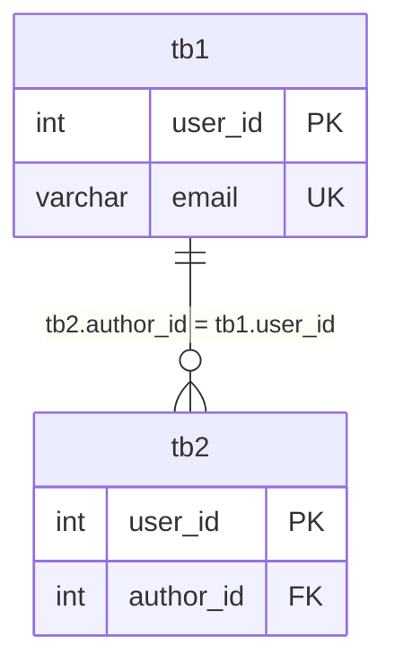

## 들어가며 (Situation)

수업 `09_ddl.sql`의 주석은 "테이블을 만드는 것은 단순히 칸을 나누는 작업이 아니다. 데이터가 지켜야 할 규칙을 정의하는 과정"이라고 시작합니다. 테이블 생성(`create`), 구조 변경(`alter`), 삭제(`drop`, `truncate`)를 실습했습니다.

> 실제 서비스에서 겪은 문제가 아니라, 수업 실습을 정리한 글입니다. 동작 설명은 MySQL 공식 문서로 보완했습니다.

## 문제 상황 (Task)

- '나이' 칸에 `스무살` 같은 글자가 들어가는 일을 어떻게 막을까요?
- 부모 테이블에 없는 값을 자식 테이블이 가리키는 "고아 데이터"는 어떻게 막을까요?
- `drop`과 `truncate`는 둘 다 데이터를 지우는데 무엇이 다를까요?

## 해결 과정 (Action)

### 1. 데이터 타입과 제약 조건

| 구분 | 항목 | 역할 |
|------|------|------|
| 타입 | `INT` / `BIGINT` | 정수 |
| 타입 | `VARCHAR(n)` | 최대 n글자의 가변 길이 문자열 |
| 타입 | `TEXT` | 긴 텍스트 |
| 타입 | `DATE` / `DATETIME` / `TIMESTAMP` | 날짜 / 날짜+시간 |
| 제약 | `NOT NULL` | 비워 둘 수 없음 |
| 제약 | `UNIQUE` | 중복 불가 |
| 제약 | `PRIMARY KEY` | `NOT NULL` + `UNIQUE`, 대표 식별자 |
| 제약 | `FOREIGN KEY` | 다른 테이블의 기본 키를 참조 |
| 제약 | `DEFAULT` | 값이 없을 때의 기본값 |

### 2. 부모 테이블 만들기

```sql
create table tb1(
    user_id int primary key,
    user_pwd varchar(12) not null comment '사용자 비밀번호',
    email varchar(30) not null unique comment '이메일',
    user_status varchar(10) default 'active' comment '계정 활성 상태',
    created_at timestamp not null default current_timestamp comment '가입 일시'
) comment '서비스 유저 정보 테이블';

describe tb1;
```

### 3. 자식 테이블과 외래키

```sql
create table tb2(
    user_id int primary key,
    author_id int not null comment 'tb1 에서 전달 받는 외래키',
    -- (나머지 컬럼은 tb1과 동일)
    foreign key(`author_id`) references `tb1`(`user_id`)
) comment '서비스 유저 정보 테이블2';
```



`foreign key(author_id) references tb1(user_id)`는 `tb2.author_id`가 `tb1.user_id`에 있는 값이어야 한다는 규칙입니다. 없는 값을 넣으려 하면 데이터베이스가 차단하고, 이것이 **참조 무결성**을 지키는 방식입니다.

### 4. 시행착오: 삭제 순서

수업에서는 `drop table tb1;` 다음에 `drop table tb2;`를 적었습니다. 하지만 `tb2`가 `tb1`을 참조하는 동안은 부모 테이블을 `drop`하면 외래키 때문에 거부될 수 있습니다. 자식(`tb2`)을 먼저 지우고 부모(`tb1`)를 지우는 순서가 안전합니다. (MySQL 공식 문서: 외래키가 참조하는 테이블은 제약을 먼저 제거하지 않으면 `drop`할 수 없음.) 수업 코드의 순서대로 실행했을 때의 오류 여부는 직접 확인하지 못했으므로, 직접 실행해 확인하시길 권합니다.

### 5. alter: 구조 변경

```sql
create table courses_temp as select * from courses;  -- 복제 (제약조건은 복사되지 않을 수 있음)

alter table courses_temp add column price int not null default 0;
alter table courses_temp modify column price varchar(200) not null default '0원';
alter table courses_temp drop column price;
```

| 명령 | 용도 |
|------|------|
| `add column` | 컬럼 추가 |
| `modify column` | 컬럼 타입·제약 수정 |
| `drop column` | 컬럼 삭제 |

`create table ... as select`로 만든 테이블은 데이터는 복제되지만 기본 키·인덱스 같은 정의는 그대로 따라오지 않는 것으로 알려져 있습니다. 공식 문서에서 확인해 두세요.

### 6. drop vs truncate

| 구분 | `drop table` | `truncate table` |
|------|--------------|------------------|
| 데이터 | 삭제 | 삭제 |
| 테이블 구조 | 삭제 | 유지 |
| 롤백 | 불가 | 불가(DDL이라 암묵적 커밋 발생) |

수업은 `drop`을 "매우 빠르지만 롤백이 불가해 신중해야 한다"고 정리했습니다. MySQL에서 `truncate`도 DDL로 분류되어 트랜잭션 안에서 롤백할 수 없습니다.

## 결과 (Result)

정량 지표는 없고, 아래를 정리했습니다.

- 타입은 "어떤 종류의 값만 담을지", 제약 조건은 "값들 사이의 논리 규칙"을 데이터베이스가 스스로 강제하게 합니다.
- 외래키는 부모에 없는 값을 자식에 넣는 것을 막아 참조 무결성을 지킵니다.
- 부모-자식 관계가 있는 테이블은 자식부터 지웁니다.
- `drop`은 구조까지, `truncate`는 데이터만 지우며 둘 다 되돌릴 수 없습니다.

## 더 학습하면 좋은 개념

- **참조 동작(`ON DELETE CASCADE` / `SET NULL`)** — 부모 삭제 시 자식을 어떻게 처리할지 정하는 옵션으로, 다음 글의 삭제 거부 오류와 이어집니다.
- **정규화** — 테이블을 왜 이렇게 쪼개 외래키로 잇는지에 대한 설계 원칙입니다.
- **`CHECK` 제약** — 값의 범위를 직접 지정하는 제약입니다(MySQL 8.0.16+에서 강제).
- **암묵적 커밋(Implicit Commit)** — DDL이 트랜잭션에 미치는 영향을 이해하는 데 필요합니다.
- **`INT` vs `BIGINT`, `VARCHAR` vs `TEXT` 선택 기준** — 저장 공간과 인덱스 크기에 영향을 줍니다.

## 참고 자료

- [MySQL 8.4 - CREATE TABLE Statement](https://dev.mysql.com/doc/refman/8.4/en/create-table.html)
- [MySQL 8.4 - ALTER TABLE Statement](https://dev.mysql.com/doc/refman/8.4/en/alter-table.html)
- [MySQL 8.4 - FOREIGN KEY Constraints](https://dev.mysql.com/doc/refman/8.4/en/create-table-foreign-keys.html)
- [MySQL 8.4 - TRUNCATE TABLE Statement](https://dev.mysql.com/doc/refman/8.4/en/truncate-table.html)
- [MySQL 8.4 - Statements That Cause an Implicit Commit](https://dev.mysql.com/doc/refman/8.4/en/implicit-commit.html)
