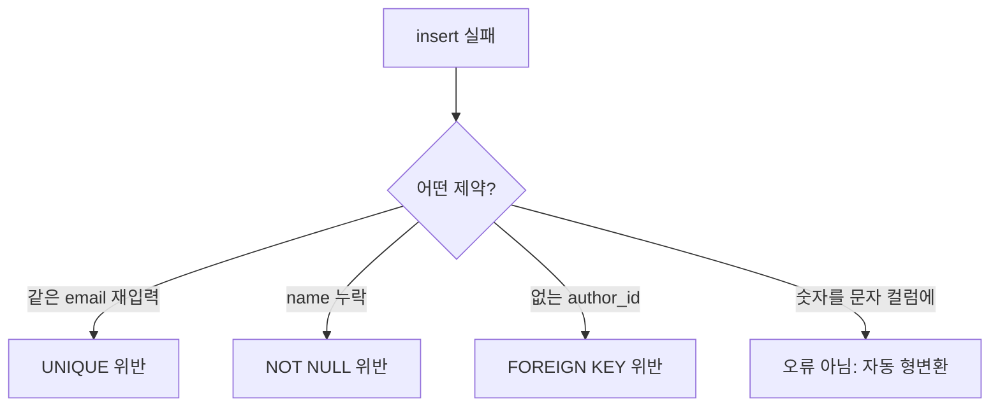

## 들어가며 (Situation)

수업 `10_dml.sql`은 `insert`, `update`, `delete`를 다룹니다. 수업 주석이 반복해서 강조한 문장은 "데이터를 삽입할 때 Error가 무지막지하게 많이 발생한다. 이럴 때 확인해야 하는 건 테이블의 **제약조건과 데이터 타입**"이었습니다.

> 실제 서비스에서 겪은 문제가 아니라, 수업 실습을 정리한 글입니다. 에러 메시지의 원문은 직접 실행한 결과가 아니므로 싣지 않고, 위반한 제약 조건 중심으로 정리했습니다.

## 문제 상황 (Task)

- `insert`가 실패할 때 어떤 순서로 원인을 찾아야 할까요?
- `update`와 `delete`에서 가장 위험한 실수는 무엇일까요?

## 해결 과정 (Action)

### 1. 정상 INSERT

```sql
insert into users (`email`, `name`) values ('email@gmail.com', '조평훈');
```

### 2. 실패 케이스 4가지



| 실습 | 위반 | 설명 |
|------|------|------|
| 같은 `email`로 두 번 insert | `UNIQUE` | 중복 이메일 불허 |
| `name` 없이 `email`만 insert | `NOT NULL` | 필수 컬럼 누락 |
| 존재하지 않는 `author_id = 999`로 `courses` insert | `FOREIGN KEY` | 부모에 없는 값이라 차단, 고아 데이터 방지 |
| `name`에 정수 `123` insert | (에러 아님) | DB가 문자열로 자동 형변환 후 저장 |

네 번째 케이스가 가장 의외였습니다. 수업은 "정수를 넣어도 DB가 문자열로 바꿔 저장해 버린다. 예외 처리는 DB가 아닌 front, back에서 해야 한다"고 정리했습니다. 제약 조건이 모든 잘못된 값을 막아 주지는 않는다는 뜻입니다.

### 3. UPDATE: WHERE가 전부다

```sql
update users set `name` = '조평훈';                       -- where 없음!
update users set `name` = '조평순' where `user_id` = 1;
```

첫 문장은 **모든 행**의 `name`을 바꿉니다. 수업은 "수정·삭제에서 가장 필수적으로 생각해야 하는 것은 where 조건절", 그리고 조건은 한 행을 식별할 수 있는 값(PK, UNIQUE)으로 거는 것을 권장했습니다. MySQL 클라이언트의 안전 모드(`--safe-updates`)는 키를 쓰지 않는 `update`/`delete`를 거부하도록 설정할 수 있습니다. (MySQL 공식 문서)

### 4. DELETE와 외래키

```sql
delete from users where email = 'email@gmail.com';  -- 성공
delete from users where user_id = 1;                -- 실패
```

두 번째 문장은 `courses.author_id`가 `user_id = 1`을 참조하고 있어 거부됩니다. 부모(FK를 주는 테이블)의 행을 지우면 자식에 고아 데이터가 생기기 때문입니다.

| 용어 | 의미 |
|------|------|
| 부모 테이블 | FK를 주는 테이블 (`users`) |
| 자식 테이블 | FK를 받는 테이블 (`courses`) |

삭제하려면 자식 행을 먼저 지우거나, 외래키에 `ON DELETE CASCADE` 같은 참조 동작을 정의해야 합니다.

## 결과 (Result)

정량 지표는 없고, 아래를 정리했습니다.

- `insert` 오류는 `UNIQUE`, `NOT NULL`, `FOREIGN KEY`, 데이터 타입 순으로 점검합니다.
- DB가 자동 형변환을 하는 경우도 있어서 입력 검증은 애플리케이션에서 해야 합니다.
- `update`/`delete`는 `where`와 함께, 가능하면 PK로 조건을 겁니다.
- 부모 행은 자식이 참조하는 동안 지울 수 없습니다.

## 더 학습하면 좋은 개념

- **SQL 모드(`STRICT_TRANS_TABLES`)** — 형변환·길이 초과를 오류로 볼지 경고로 볼지를 결정합니다. 자동 형변환 동작의 배경입니다.
- **`ON DELETE` / `ON UPDATE` 참조 동작** — 부모 삭제 시 자식을 함께 지우거나 NULL로 바꾸는 설정입니다.
- **트랜잭션과 롤백** — 잘못 실행한 `update`를 되돌리는 안전망이며, 마지막 글에서 다룹니다.
- **`INSERT ... ON DUPLICATE KEY UPDATE`** — 중복 키 오류를 업서트로 처리하는 패턴입니다.
- **소프트 삭제(Soft Delete)** — 실제 삭제 대신 상태 컬럼을 바꾸는 설계로, 참조 무결성 문제를 피하는 방법입니다.

## 참고 자료

- [MySQL 8.4 - INSERT Statement](https://dev.mysql.com/doc/refman/8.4/en/insert.html)
- [MySQL 8.4 - UPDATE Statement](https://dev.mysql.com/doc/refman/8.4/en/update.html)
- [MySQL 8.4 - DELETE Statement](https://dev.mysql.com/doc/refman/8.4/en/delete.html)
- [MySQL 8.4 - mysql Client Options (--safe-updates)](https://dev.mysql.com/doc/refman/8.4/en/mysql-command-options.html)
- [MySQL 8.4 - Server SQL Modes](https://dev.mysql.com/doc/refman/8.4/en/sql-mode.html)
