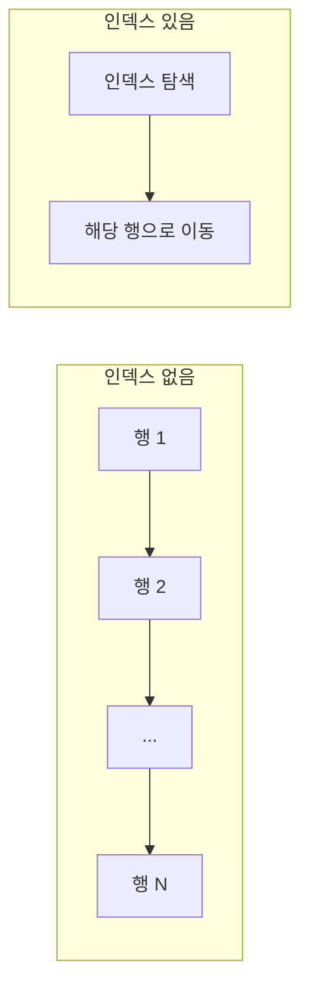

## 들어가며 (Situation)

수업 `13_index.sql`은 인덱스를 "SQL 구문의 성능을 좌우하는 기능"이라고 소개합니다. 출발 질문은 이렇습니다. "100만 명이 있는 `users`에서 홍길동을 찾아야 한다면?"

> 실제 서비스에서 겪은 문제가 아니라, 수업 실습을 정리한 글입니다. 수업 주석에 적힌 스캔 행 수(120 → 1)는 수업 환경의 `explain` 결과를 옮긴 것이며 제가 따로 측정한 값이 아닙니다.

## 문제 상황 (Task)

- 인덱스가 없으면 데이터베이스는 첫 행부터 마지막 행까지 하나씩 비교합니다(**full table scan**).
- 인덱스는 빠르게 해 주지만 공짜가 아니라고 합니다. 어떤 대가가 있고, 어디에 적용해야 할까요?

## 해결 과정 (Action)

### 1. 인덱스란 목차

수업은 인덱스(index)가 "목차"라는 뜻이라고 설명합니다. 특정 컬럼의 값과 그 데이터의 물리적 위치를 미리 목차처럼 만들어 두면, 쿼리가 목차를 거쳐 원하는 위치로 바로 이동합니다.



MySQL(InnoDB)의 인덱스는 일반적으로 B-Tree 구조입니다. 이 구조는 수업에서 다루지 않았고 공식 문서 내용입니다.

### 2. EXPLAIN으로 전후 비교

```sql
explain select * from users where name = '홍길동';   -- 인덱스 적용 전

create index idx_users_name on users(name);

explain select * from users where name = '홍길동';   -- 인덱스 적용 후
```

| 구분 | 수업 주석의 관찰 |
|------|------------------|
| 적용 전 | 120 row를 full scan |
| 적용 후 | 1개의 row만 scan |

`explain`은 쿼리를 실행하지 않고 **실행 계획**을 보여 줍니다. 읽을 때는 `type`(ALL이면 full scan), `key`(사용한 인덱스), `rows`(예상 스캔 행 수)를 먼저 봅니다. 여기서 `rows`는 정확한 값이 아니라 옵티마이저의 **추정치**입니다.

### 3. 인덱스의 대가 (Trade-off)

수업은 "인덱스는 양날의 검"이라고 정리했습니다.

| 단점 | 이유 |
|------|------|
| 저장 공간 | 테이블과 별도의 데이터 구조를 차지함 (책의 목차 10~20쪽에 비유) |
| `insert` 성능 저하 | 인덱스에도 정렬된 위치를 찾아 항목을 추가해야 함 |
| `delete` 성능 저하 | 인덱스에서도 항목을 찾아 삭제해야 함 |
| `update` 성능 저하 | 인덱스 컬럼 값이 바뀌면 삭제 + 재삽입이 필요해 최악 |

### 4. 어디에 적용할까

수업이 제시한 기준은 두 가지입니다.

1. 조회 비율이 압도적으로 높은 테이블. DML 지연은 감수합니다.
2. DML 중에서도 수정이 빈번하지 않은 컬럼.

### 5. 이미 있는 인덱스

`primary key`와 `unique` 제약이 걸린 컬럼은 유일성을 보장해야 하므로 테이블 생성 시 **자동으로 인덱스가 만들어집니다**. 그래서 이메일처럼 `unique`인 컬럼에는 따로 `create index`를 만들 필요가 없습니다. 또 `name` 인덱스는 `name` 조건에 쓰일 때 효과가 있고, `year(created_at)`처럼 컬럼에 함수를 씌운 조건은 인덱스를 쓰지 못할 수 있습니다. 앞선 서브쿼리 글의 `year(created_at) = ...` 조건이 그런 예입니다.

## 결과 (Result)

수업 환경의 `explain` 기준 비교입니다.

| 항목 | 인덱스 전 | 인덱스 후 |
|------|-----------|-----------|
| 스캔한 행 수(수업 주석) | 120 | 1 |

작은 실습 테이블이라 실제 시간 차이는 의미가 작습니다. 데이터가 커질수록 차이가 커지는 것이 인덱스의 요점입니다. 그리고 쓰기 비용이 늘어나므로, 조회가 많고 수정이 적은 컬럼에만 적용합니다.

## 더 학습하면 좋은 개념

- **B-Tree 인덱스 구조** — 왜 검색이 빠르고 쓰기는 느려지는지의 동작 원리입니다.
- **복합 인덱스와 선두 컬럼 규칙** — 여러 컬럼 인덱스는 컬럼 순서에 따라 쓰이는지가 갈립니다.
- **클러스터형 vs 보조 인덱스(InnoDB)** — PK 인덱스가 데이터 저장 방식 자체와 연결되는 이유입니다.
- **카디널리티(선택도)** — 값이 몇 종류 없는 컬럼(예: 성별)에 인덱스가 효과 없는 이유입니다.
- **`EXPLAIN ANALYZE`** — 추정이 아닌 실제 실행 시간까지 보는 도구입니다(MySQL 8.0.18+).

## 참고 자료

- [MySQL 8.4 - How MySQL Uses Indexes](https://dev.mysql.com/doc/refman/8.4/en/mysql-indexes.html)
- [MySQL 8.4 - CREATE INDEX Statement](https://dev.mysql.com/doc/refman/8.4/en/create-index.html)
- [MySQL 8.4 - EXPLAIN Output Format](https://dev.mysql.com/doc/refman/8.4/en/explain-output.html)
- [MySQL 8.4 - Clustered and Secondary Indexes](https://dev.mysql.com/doc/refman/8.4/en/innodb-index-types.html)
