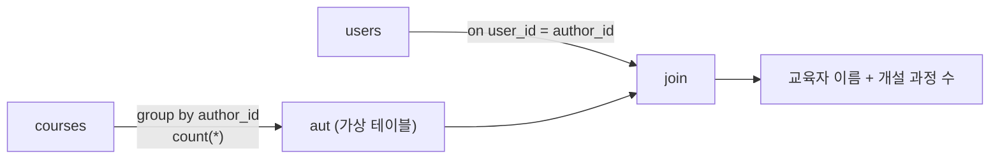

## 들어가며 (Situation)

수업 `08_subqueries.sql`의 첫 줄은 "쿼리문 내부에 또 다른 쿼리문"입니다. LMS 데이터베이스(`wanted_lms`)의 `users`, `courses` 테이블로 서브쿼리를 실습했습니다.

> 실제 서비스에서 겪은 문제가 아니라, 수업 실습을 정리한 글입니다. 동작 설명은 MySQL 공식 문서로 보완했고, 실습 데이터의 실제 행 수나 결과 값은 싣지 않았습니다.

## 문제 상황 (Task)

수업이 낸 문제는 이렇습니다.

- '홍길동'과 **같은 연도에 가입한** 모든 사용자의 이름과 가입일을 조회하라.
- 교육자 이름과 **그가 개설한 과정 수**를 함께 보여라.

두 문제 모두 쿼리 한 번으로는 조건이 충분하지 않습니다. 첫 문제는 "홍길동의 가입 연도"를 먼저 알아야 하고, 둘째는 `courses`를 집계한 결과를 `users`와 이어야 합니다.

## 해결 과정 (Action)

### 1. 쿼리를 둘로 쪼개 본다

수업은 먼저 단계를 나눠 적었습니다.

```sql
-- 1. 홍길동의 가입 연도
select year(created_at) from users where name = '홍길동';

-- 2. 그 연도에 가입한 사용자 (수업에서는 where 없이 틀만 작성)
select name, created_at from users;
```

1번의 결과를 사람이 눈으로 읽고 2번에 숫자를 직접 적으면 풀 수는 있습니다. 하지만 데이터가 바뀔 때마다 손으로 고쳐야 합니다. 서브쿼리는 이 두 쿼리를 하나로 조합하는 방법입니다.

### 2. WHERE절 서브쿼리

```sql
select name, created_at
from users
where year(created_at) = (
    select year(created_at)
    from users
    where name = '홍길동'
);
```


안쪽 쿼리가 값을 하나 돌려주고, 바깥 쿼리가 그 값을 조건에 씁니다. 여기서 주의할 점이 있습니다. `=`는 값이 **하나**일 때만 쓸 수 있습니다. 같은 이름의 사용자가 둘 이상이면 서브쿼리가 여러 행을 반환해 오류가 납니다. (MySQL 공식 문서: 스칼라 서브쿼리는 한 행, 한 컬럼만 반환해야 함.) 여러 행이 나올 수 있다면 `in`을 써야 합니다. (예시 코드)

```sql
where year(created_at) in (select year(created_at) from users where name = '홍길동')
```

### 3. FROM절 서브쿼리: 가상 테이블

수업은 "select 결과를 마치 하나의 테이블처럼 사용하는 것, 가상 테이블"이라고 설명합니다. MySQL 공식 문서에서는 이를 **파생 테이블(derived table)** 이라고 부릅니다.

```sql
select
    u.name as '교육자 이름',
    aut.course_count as '교육자 개설 과정 수'
from users u
join (
    select author_id, count(*) as course_count
    from courses
    group by author_id
) as aut on u.user_id = aut.author_id
order by `교육자 개설 과정 수` desc;
```



### 4. 시행착오 포인트

| 항목 | 내용 |
|------|------|
| 별칭 필수 | FROM절의 서브쿼리에는 반드시 별칭(`as aut`)을 붙여야 합니다. MySQL은 파생 테이블에 별칭이 없으면 오류를 냅니다. |
| 컬럼 별칭 재사용 | `order by`에서 한글 별칭을 쓰려면 백틱(`` ` ``)으로 감쌌습니다. 수업 코드에서는 `select`의 별칭이 `order by`에서 쓰이는 점을 확인했습니다. |
| 집계 후 join | `courses`를 먼저 `group by`로 줄이고 join하는 방식이라, 과정이 없는 사용자는 inner join 때문에 빠집니다. 과정이 없는 사용자까지 보려면 `left join`이 필요합니다. |

수업 상단에 적힌 "SQL 기초 강의 수강생 평균 점수보다 높은 점수를 받은 학생" 문제는 질문만 남기고 쿼리는 작성하지 않았습니다. 같은 구조(안쪽에서 평균, 바깥에서 비교)로 풀 수 있다고 정리만 해 둡니다.

## 결과 (Result)

정량 지표는 없고, 아래를 정리했습니다.

- 서브쿼리는 "조건이 충분하지 않을 때" 여러 쿼리를 하나로 조합하는 방법입니다.
- WHERE절 서브쿼리는 값(또는 값의 집합)을 돌려주는 조건이고, FROM절 서브쿼리는 가상 테이블입니다.
- `=`에는 단일 값, 여러 행이 올 수 있으면 `in`을 씁니다.
- 파생 테이블에는 별칭이 필수입니다.

## 더 학습하면 좋은 개념

- **상관 서브쿼리(Correlated Subquery)** — 바깥 쿼리의 행마다 안쪽 쿼리가 다시 실행되는 형태입니다. 성능 특성이 달라서 구분해 둬야 합니다.
- **`IN` / `EXISTS` / `ANY` / `ALL`** — 여러 행을 반환하는 서브쿼리를 다루는 연산자입니다. `=`의 한계를 넘는 다음 단계입니다.
- **CTE(`WITH`)** — 파생 테이블을 이름 붙여 앞쪽에 선언하는 방식(MySQL 8.0+)으로, 중첩이 깊어질 때 가독성을 높여 줍니다.
- **서브쿼리 vs JOIN 성능 비교** — 같은 결과를 내는 두 방식을 `EXPLAIN`으로 비교하는 습관을 들이면 좋습니다.
- **윈도우 함수** — "평균보다 높은 사람" 같은 문제를 서브쿼리 없이 푸는 대안입니다.

## 참고 자료

- [MySQL 8.4 - Subqueries](https://dev.mysql.com/doc/refman/8.4/en/subqueries.html)
- [MySQL 8.4 - Subqueries as Scalar Operands](https://dev.mysql.com/doc/refman/8.4/en/scalar-subqueries.html)
- [MySQL 8.4 - Derived Tables](https://dev.mysql.com/doc/refman/8.4/en/derived-tables.html)
- [MySQL 8.4 - Subqueries with ANY, IN, or SOME](https://dev.mysql.com/doc/refman/8.4/en/any-in-some-subqueries.html)
