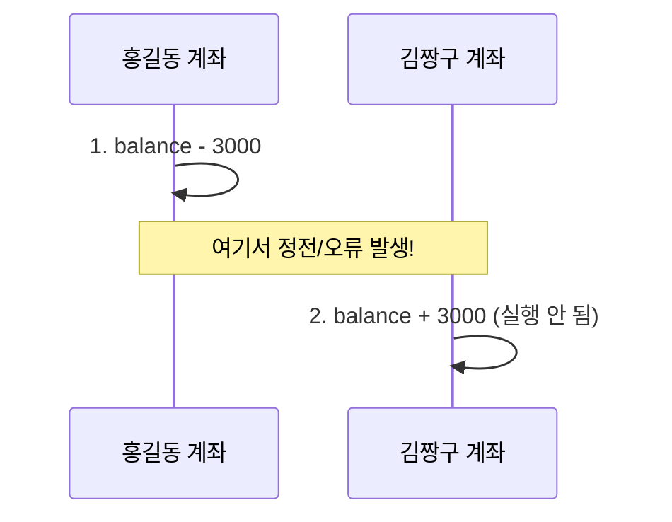
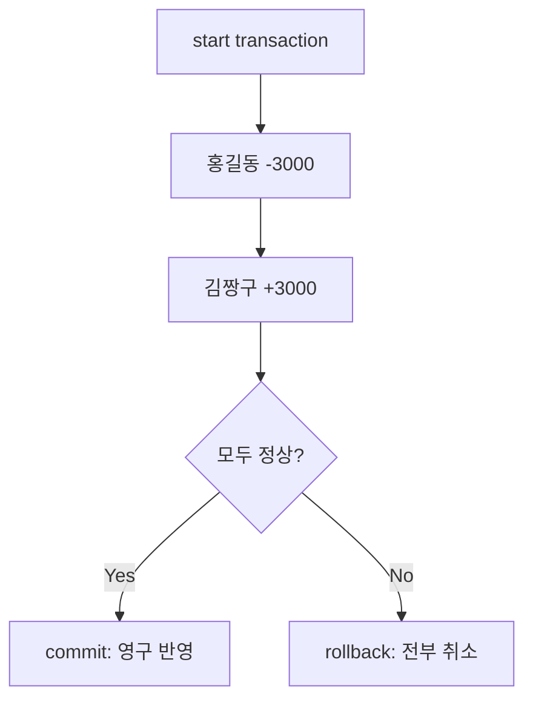

## 들어가며 (Situation)

수업 `14_transctional.sql`은 계좌이체 예제로 트랜잭션을 설명합니다. 홍길동 계좌에서 김짱구 계좌로 3000원을 보내는 일은 논리적으로 하나의 작업이지만, 실제로는 `update`가 두 번 일어납니다.

> 실제 서비스에서 겪은 문제가 아니라, 수업 실습을 정리한 글입니다. 동작 설명은 MySQL 공식 문서로 보완했습니다. 수업 파일명(`transctional`)과 테이블명(`accouts`)은 오타가 있는 이름이라 코드는 그대로 옮겼습니다.

## 문제 상황 (Task)



1번만 반영되고 2번이 실행되지 않으면 3000원이 사라집니다. 두 작업을 **전부 반영하거나 전부 취소**하려면 어떻게 해야 할까요?

## 해결 과정 (Action)

### 1. 트랜잭션: 여러 작업을 하나의 단위로

| 명령 | 역할 |
|------|------|
| `start transaction` | 트랜잭션 시작 |
| `commit` | 지금까지의 작업을 영구 반영 |
| `rollback` | 시작 이후의 작업을 모두 취소 |

### 2. 정상 흐름

```sql
create table accouts(
    id int primary key,
    owner varchar(50),
    balance decimal(10,2)
);
insert into accouts(id, owner, balance)
values (1, '홍길동', 10000.00), (2, '김짱구', 5000.00);

start transaction;
update accouts set balance = balance - 3000 where id = 1;
update accouts set balance = balance + 3000 where id = 2;
select * from accouts;   -- 중간 확인
commit;
```

수업이 강조한 주의점은 "중간 확인(`select`) 결과는 **영구 반영이 아니다**"였습니다. 같은 세션에서는 변경이 보이지만, `commit` 전에는 다른 세션에서 그 값을 볼 수 없는 것이 기본 동작입니다. (격리 수준에 따라 다름.)

### 3. 비정상 흐름과 rollback

```sql
start transaction;
update accouts set balance = balance - 3000 where id = 1;
update accouts set balance = balance + 3000 where id = 99;   -- 없는 계좌
select * from accouts;
rollback;
select * from accouts;   -- 홍길동 잔액이 원래대로
```

여기에 핵심 포인트가 있습니다. `where id = 99`인 `update`는 **오류가 아니라 0행 변경으로 성공**합니다. 데이터베이스가 알아서 롤백해 주지 않습니다. 변경된 행 수가 0이면 롤백하겠다는 판단은 애플리케이션 코드가 해야 하고, 이 예제에서는 사람이 중간 확인 후 `rollback`을 직접 실행했습니다.



### 4. 수업 코드의 "은행 정전" 주석

정상 흐름 중간에 "은행 정전"이라는 주석이 있습니다. `commit` 전에 연결이 끊기거나 서버가 죽으면 커밋되지 않은 변경은 취소됩니다. InnoDB는 이를 복구 과정에서 롤백합니다. 다만 이 동작은 InnoDB 같은 트랜잭션 지원 엔진에서만 성립하고, 실제 정전 상황은 수업에서 재현하지 않았습니다.

### 5. 주의할 점

| 항목 | 내용 |
|------|------|
| 자동 커밋 | MySQL은 기본이 `autocommit = 1`이라 `start transaction` 없이 실행한 문장은 즉시 커밋됩니다. |
| DDL | `create table`, `drop` 등은 암묵적 커밋을 일으켜 롤백할 수 없습니다. |
| 동시성 | 여러 세션이 같은 행을 바꾸면 잠금과 격리 수준이 영향을 줍니다. 수업은 다루지 않았습니다. |

## 결과 (Result)

정량 지표는 없고, 아래를 정리했습니다.

- 트랜잭션은 여러 작업을 하나의 논리적 단위로 묶어 전부 성공하거나 전부 취소하게 합니다.
- `commit` 전의 중간 확인 결과는 영구 반영이 아닙니다.
- 0행 변경은 오류가 아니므로, 롤백 여부는 개발자가 판단하고 코드로 처리해야 합니다.
- 이체처럼 서로 의존하는 `update`는 반드시 하나의 트랜잭션으로 묶습니다.

## 더 학습하면 좋은 개념

- **ACID** — 원자성·일관성·격리성·지속성으로, 트랜잭션이 보장하는 성질을 정리한 기본 개념입니다.
- **격리 수준(Isolation Level)** — `READ COMMITTED`, `REPEATABLE READ`(MySQL 기본) 등으로, 동시 접근 시 어떤 값이 보이는지를 정합니다.
- **잠금(Lock)과 데드락** — 두 계좌를 서로 반대 방향으로 동시에 이체할 때 생기는 문제입니다.
- **`SAVEPOINT`** — 트랜잭션 일부만 되돌리는 기능입니다.
- **애플리케이션의 트랜잭션 관리(Spring `@Transactional` 등)** — 코드에서 commit/rollback을 선언적으로 처리하는 방법입니다.

## 참고 자료

- [MySQL 8.4 - START TRANSACTION, COMMIT, and ROLLBACK Statements](https://dev.mysql.com/doc/refman/8.4/en/commit.html)
- [MySQL 8.4 - InnoDB and the ACID Model](https://dev.mysql.com/doc/refman/8.4/en/mysql-acid.html)
- [MySQL 8.4 - Transaction Isolation Levels](https://dev.mysql.com/doc/refman/8.4/en/innodb-transaction-isolation-levels.html)
- [MySQL 8.4 - Autocommit, Commit, and Rollback](https://dev.mysql.com/doc/refman/8.4/en/innodb-autocommit-commit-rollback.html)
- [MySQL 8.4 - Statements That Cause an Implicit Commit](https://dev.mysql.com/doc/refman/8.4/en/implicit-commit.html)
