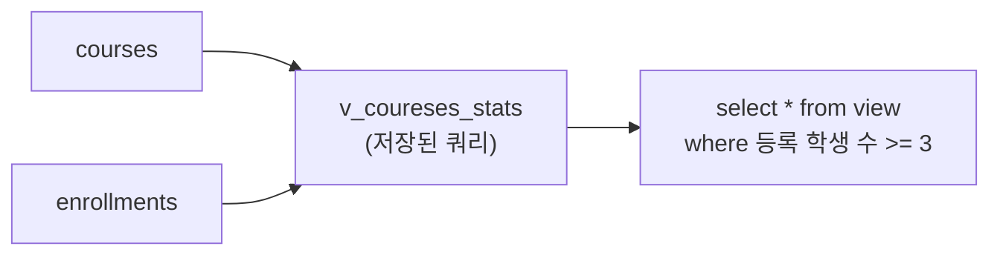

## 들어가며 (Situation)

수업 `12_view.sql`은 View를 "가상의 테이블"이라고 정의합니다. 시나리오는 다음과 같습니다. LMS 데이터 분석팀은 '과정별 등록 학생 수'를 매일 확인하고, 마케팅팀에게는 사용자 전체 정보 대신 이메일·이름만 전달하고 싶습니다.

> 실제 서비스에서 겪은 문제가 아니라, 수업 실습을 정리한 글입니다. 동작 설명은 MySQL 공식 문서로 보완했습니다.

## 문제 상황 (Task)

- 매일 같은 집계 쿼리(`left join` + `group by`)를 반복해서 작성해야 합니다.
- 원본 테이블을 열어 주지 않고도 필요한 컬럼만 공유해야 합니다.

## 해결 과정 (Action)

### 1. View를 쓰는 이유

| 이유 | 설명 |
|------|------|
| 편의성 | 복잡한 쿼리를 뷰로 만들면 단순한 테이블처럼 조회 |
| 보안성 | 민감한 컬럼을 숨기고 허용한 컬럼만 노출 |
| 가독성 | 자주 쓰는 컬럼만 모아 구성 |

수업은 세 번째로 "조회 속도가 빨라진다"고 적었습니다. 다만 MySQL의 일반 뷰는 데이터를 저장하지 않고 **뷰를 조회할 때마다 정의된 쿼리를 실행**하는 방식이라, 속도 향상을 기대하기보다 가독성·재사용 측면으로 이해하는 것이 정확합니다. (MySQL은 구체화 뷰(materialized view)를 기본 제공하지 않음.)

### 2. 뷰 생성과 조회

```sql
create view v_coureses_stats as
select
    c.course_id,
    c.title,
    count(e.enrollment_id) as '등록 학생 수'
from courses as c
left join enrollments as e on c.course_id = e.course_id
group by c.course_id, c.title;

select * from v_coureses_stats;
```



`left join`을 쓴 덕분에 등록자가 0명인 과정도 통계에 남습니다. 뷰를 이용한 조회는 일반 테이블과 같습니다.

```sql
select * from v_coureses_stats where `등록 학생 수` >= 3;
```

### 3. 뷰 수정과 삭제

```sql
drop view v_coureses_stats;

create or replace view v_coureses_stats as
select c.course_id, c.title, c.status, count(e.enrollment_id) as '등록 학생 수'
from courses as c
left join enrollments as e on c.course_id = e.course_id
group by c.course_id, c.title;
```

`create or replace view`는 뷰가 있으면 교체하고 없으면 만듭니다. 수업 코드에서는 `status`를 추가했는데 `group by`에는 넣지 않았습니다. `course_id`가 기본 키라면 `status`는 함수적으로 종속되어 MySQL이 허용할 수 있습니다. `courses`의 기본 키 설정은 이번에 `desc`로 확인하지 못했으므로, 오류가 나면 `group by`에 `c.status`를 추가하면 됩니다.

### 4. 보안 목적의 뷰 (예시 코드)

수업은 마케팅팀 시나리오의 쿼리를 작성하지 않았습니다. 같은 방식으로 이렇게 만들 수 있습니다.

```sql
create view v_marketing_users as
select name, email from users;
```

여기에 마케팅팀 계정에는 이 뷰에만 `select` 권한을 부여하면 원본 테이블은 숨겨집니다. 권한 부여(`grant`)는 수업 범위 밖이라 개념만 정리합니다.

### 5. 주의: 뷰 이름 오타

수업 코드의 뷰 이름은 `v_coureses_stats`(courses가 아닌 coureses)입니다. 뷰 이름도 한 번 정하면 쿼리·권한에 퍼지므로, 만들 때 오타를 확인해야 합니다.

## 결과 (Result)

정량 지표는 없고, 아래를 정리했습니다.

- 뷰는 쿼리를 저장해 둔 가상 테이블이고, 편의성과 보안성이 핵심 이점입니다.
- 일반 뷰는 데이터를 저장하지 않고 조회 때마다 쿼리가 실행되므로, 속도 개선을 보장하지 않습니다.
- 수정은 `create or replace view`, 삭제는 `drop view`입니다.

## 더 학습하면 좋은 개념

- **구체화 뷰(Materialized View)** — 결과를 실제로 저장해 속도를 높이는 방식으로, MySQL에서는 테이블과 스케줄러로 직접 구현합니다.
- **갱신 가능한 뷰(Updatable View)** — 어떤 뷰는 `insert`/`update`가 가능하고 `group by` 등이 있으면 불가능합니다.
- **`GRANT`와 권한 관리** — 뷰의 보안 이점을 실제로 완성하는 단계입니다.
- **`SQL SECURITY DEFINER / INVOKER`** — 뷰가 누구의 권한으로 실행되는지를 정합니다.
- **CTE(`WITH`)** — 한 쿼리 안에서만 쓰는 임시 뷰와 같은 역할입니다.

## 참고 자료

- [MySQL 8.4 - CREATE VIEW Statement](https://dev.mysql.com/doc/refman/8.4/en/create-view.html)
- [MySQL 8.4 - Using Views (Restrictions)](https://dev.mysql.com/doc/refman/8.4/en/views.html)
- [MySQL 8.4 - Updatable and Insertable Views](https://dev.mysql.com/doc/refman/8.4/en/view-updatability.html)
- [MySQL 8.4 - GRANT Statement](https://dev.mysql.com/doc/refman/8.4/en/grant.html)
