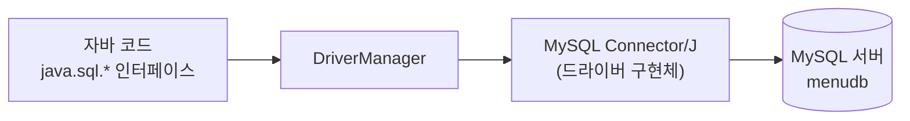

## 들어가며 (Situation)

MySQL 수업을 마치고 이제 자바 코드에서 데이터베이스를 다루는 **JDBC(Java Database Connectivity)** 수업에 들어갔습니다. IntelliJ에서 Gradle 프로젝트(`chap01-jdbc-connection`)를 만들고 `menudb` 데이터베이스에 접속하는 것이 첫 실습이었습니다.

> 실제 서비스에서 겪은 문제가 아니라, 수업 실습을 정리한 글입니다. 동작 설명은 공식 문서로 보완했습니다. 접속 계정 정보는 싣지 않았고, 실행 출력도 따로 기록하지 않았습니다.

## 문제 상황 (Task)

- 자바 프로그램이 MySQL 서버와 통신하려면 무엇이 필요할까요?
- `Connection`은 인터페이스인데, 객체는 어떻게 얻을까요?
- 수업 코드에서 연결을 "해제"하는 부분은 정말 연결을 닫고 있을까요?

## 해결 과정 (Action)

### 1. 드라이버 의존성 추가

JDBC는 자바가 정한 **규약(인터페이스)** 이고, 실제 통신은 DB 제조사가 만든 **드라이버**가 구현합니다. 그래서 `build.gradle`에 MySQL용 드라이버를 추가합니다.

```groovy
dependencies {
    // mysql 연동을 위한 외부 api 의존성
    implementation 'com.mysql:mysql-connector-j:8.4.0'
}
```



`implementation`은 컴파일과 실행에 모두 필요한 의존성이라는 뜻입니다. 의존성을 추가한 뒤 IntelliJ에서 Gradle 새로 고침을 해야 `com.mysql` 클래스가 인식됩니다.

### 2. Connection 객체 만들기

```java
Connection con = null;

try {
    // MySQL 을 연결하기 위한 드라이버
    Class.forName("com.mysql.cj.jdbc.Driver");

    con = DriverManager.getConnection(
            "jdbc:mysql://localhost/menudb",
            "계정",      // 실제 값은 생략
            "비밀번호"   // 실제 값은 생략
    );

    System.out.println("con = " + con);
} catch (ClassNotFoundException | SQLException e) {
    throw new RuntimeException(e);
}
```

수업 주석은 "`Connection`은 인터페이스라 직접 생성하지 못하므로 `DriverManager`를 통해 연결 객체를 만든다"고 설명했습니다.

| 구성 요소 | 역할 |
|-----------|------|
| `Class.forName("com.mysql.cj.jdbc.Driver")` | 드라이버 클래스를 로딩 |
| `DriverManager.getConnection(url, user, password)` | URL에 맞는 드라이버로 연결을 만들어 `Connection` 반환 |
| `jdbc:mysql://localhost/menudb` | `jdbc:` 프로토콜 + DB 종류 + 호스트 + 접속할 데이터베이스 |

URL에 포트를 적지 않으면 MySQL의 기본 포트(3306)가 쓰입니다. 이 부분은 수업에서 따로 설명하지 않았고 Connector/J 문서의 내용입니다.

### 3. `Class.forName`은 꼭 필요할까?

JDBC 4.0 이후의 드라이버는 `DriverManager`가 클래스패스에서 자동으로 찾아 등록합니다. Connector/J 8.x도 그 방식이라 `Class.forName(...)` 한 줄이 없어도 연결되는 것으로 알고 있습니다. 수업은 드라이버를 "로딩한다"는 개념을 보여 주려고 이 줄을 남긴 것으로 이해했고, 제거했을 때의 동작은 직접 실행해 확인하지 않았습니다. 공식 문서에서 확인하시길 권합니다.

### 4. 시행착오가 될 뻔한 부분: finally의 `con = null`

수업 코드의 `finally` 주석은 "생성된 자원을 해체하는 데 많이 쓴다"인데, 실제 코드는 이렇습니다.

```java
} finally {
    con = null;
}
```

변수에 `null`을 대입하는 것은 연결을 닫는 것이 아닙니다. 참조만 끊을 뿐, DB와의 연결(소켓)은 닫히지 않고 프로그램이 끝날 때까지 남을 수 있습니다. 연결을 닫으려면 `close()`를 호출해야 합니다. 다음 실습에서 이를 메서드로 분리합니다. 아래는 `close()` 호출을 자동화하는 **try-with-resources** 방식입니다. (예시 코드, 수업에서는 사용하지 않음)

```java
try (Connection con = DriverManager.getConnection(url, user, password)) {
    System.out.println("con = " + con);
}   // 블록이 끝나면 con.close() 자동 호출
```

## 결과 (Result)

정량 지표는 없고, 아래를 정리했습니다.

- JDBC는 인터페이스, MySQL Connector/J는 그 구현체이며 Gradle 의존성으로 추가합니다.
- `Connection`은 `DriverManager.getConnection`으로 얻고, URL은 `jdbc:mysql://호스트/DB명` 형식입니다.
- `con = null`은 연결을 닫지 않습니다. 반드시 `close()`를 호출해야 합니다.
- 코드에 DB 주소와 계정이 그대로 적혀 있다는 한계는 다음 글에서 다룹니다.

## 더 학습하면 좋은 개념

- **JDBC 4.0 드라이버 자동 로딩(`ServiceLoader`)** — `Class.forName`이 왜 생략 가능한지 이해하는 열쇠입니다.
- **try-with-resources와 `AutoCloseable`** — 자원 해제를 빠뜨리지 않게 해 주는 문법입니다.
- **커넥션 풀(HikariCP)** — 매번 연결을 새로 만드는 비용을 줄이는 실무 방식입니다.
- **JDBC URL 옵션(타임존, SSL 등)** — Connector/J 8.x에서 접속이 안 될 때 가장 먼저 확인하는 부분입니다.
- **Gradle 의존성 설정(`implementation` vs `runtimeOnly`)** — 드라이버를 왜 컴파일 시점에 쓰지 않아도 되는지와 연결됩니다.

## 참고 자료

- [MySQL Connector/J 8.4 - Developer Guide](https://dev.mysql.com/doc/connector-j/en/)
- [MySQL Connector/J - Connection URL Syntax](https://dev.mysql.com/doc/connector-j/en/connector-j-reference-jdbc-url-format.html)
- [Java SE API - java.sql.DriverManager](https://docs.oracle.com/en/java/javase/21/docs/api/java.sql/java/sql/DriverManager.html)
- [Java SE API - java.sql.Connection](https://docs.oracle.com/en/java/javase/21/docs/api/java.sql/java/sql/Connection.html)
- [Gradle - Java Library Plugin (implementation)](https://docs.gradle.org/current/userguide/java_library_plugin.html)
