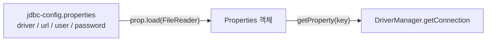

## 들어가며 (Situation)

앞선 글에서 `DriverManager`로 연결에 성공했습니다. 수업은 곧바로 이 코드의 문제점을 짚고 두 단계로 개선합니다. `Application02`는 접속 정보를 파일로 분리하고, `b_template` 패키지는 반복 코드를 메서드로 분리합니다.

> 실제 서비스에서 겪은 문제가 아니라, 수업 실습을 정리한 글입니다. 접속 정보가 들어 있는 properties 파일의 내용은 열어 보지 않았고 글에도 싣지 않았습니다.

## 문제 상황 (Task)

수업 주석이 꼽은 문제는 두 가지입니다.

| 문제 | 수업 주석 |
|------|-----------|
| 민감정보 노출 | 데이터베이스 접근 정보(주소, 계정, 비밀번호)가 클래스에 그대로 노출됨 |
| 반복 코드 | 회원가입, 로그인, 정보 수정, 삭제는 4번의 DB 접근이 필요하고, 매번 연결 코드를 반복해야 함 |

반복되는 코드는 커넥션 생성, 프로퍼티 객체 생성, 커넥션 자원 해제입니다.

## 해결 과정 (Action)

### 1. 설정을 파일로 분리: Properties



```java
Properties prop = new Properties();
prop.load(new FileReader("src/main/java/com/wanted/a_connection/jdbc-config.properties"));

String driver   = prop.getProperty("driver");
String url      = prop.getProperty("url");
String user     = prop.getProperty("user");
String password = prop.getProperty("password");

Class.forName(driver);
con = DriverManager.getConnection(url, user, password);
```

`Properties`는 `키=값` 형식의 파일을 읽는 클래스입니다. 수업에서 배운 파일 입출력(`FileReader`)과 연결되는 부분입니다. 코드에는 키 이름만 남고, 실제 값은 파일에 있습니다.

주의할 점이 두 가지 있었습니다.

- **경로는 실행 위치 기준입니다.** `"src/main/java/..."`는 상대 경로라서 프로젝트 루트에서 실행할 때 맞습니다. 실행 위치가 다르면 `FileNotFoundException`이 납니다.
- **파일을 분리해도 저장소에 올리면 노출됩니다.** 민감정보를 코드에서 파일로 옮긴 것만으로 숨겨지지는 않습니다. properties 파일을 `.gitignore`에 넣거나, 값이 빠진 예시 파일만 올리는 방식을 써야 합니다. 수업 프로젝트의 `.gitignore` 내용은 확인하지 않았습니다.

### 2. 반복 코드를 메서드로: JDBCTemplate

```java
public class JDBCTemplate {

    public static Connection getConnection() {
        // properties 로드 + 드라이버 로딩 + 연결 생성
    }

    public static void close(Connection con) {
        try {
            // 커넥션이 존재하거나, 닫혀있지 않다면
            if (con != null && !con.isClosed()) {
                con.close();
            }
        } catch (SQLException e) {
            throw new RuntimeException(e);
        }
    }
}
```

호출하는 쪽은 한 줄이 됩니다.

```java
import static com.wanted.b_template.JDBCTemplate.close;
import static com.wanted.b_template.JDBCTemplate.getConnection;

Connection con = getConnection();
// con 을 활용해서 회원가입 진행
close(con);
```

| 항목 | 개선 전 (`Application02`) | 개선 후 (`JDBCTemplate`) |
|------|---------------------------|--------------------------|
| 호출 코드 | 매번 15줄 안팎 반복 | `getConnection()` 한 줄 |
| 해제 | 코드마다 직접 작성(앞선 글의 `con = null` 문제) | `close(con)`으로 통일 |
| 변경 지점 | DB 정보 변경 시 모든 호출부 점검 | `JDBCTemplate`과 properties 한 곳 |

`static` 메서드라서 객체 없이 `클래스명.메서드명()`으로 호출하고, `import static`을 쓰면 클래스명도 생략됩니다. `close`는 `con != null && !con.isClosed()`로 확인한 뒤 닫아서, 이미 닫혔거나 생성에 실패한 경우에도 예외가 나지 않게 했습니다.

### 3. 수업 코드에서 눈에 띈 점

- **비밀번호가 콘솔에 출력됩니다.** `getConnection()` 안에 `System.out.println("prop = " + prop);`가 있어서 `Properties`에 담긴 모든 값이 출력됩니다. 설정 파일로 숨겨 놓고 로그로 내보내는 셈입니다. 확인용 출력이라면 실습이 끝난 뒤 지우는 것이 좋겠습니다.
- **같은 문제를 반복하고 있습니다.** `getConnection()`은 호출될 때마다 파일을 읽고 연결을 새로 만듭니다. 실무에서는 커넥션 풀을 쓰는 이유입니다.
- **설정 파일 위치가 달라졌습니다.** `chap01`의 템플릿은 `a_connection` 패키지의 properties를 가리키는 반면, 다음 장(`chap02`)에서는 `common`(템플릿)과 `config`(설정)로 분리했습니다. 공용 코드와 설정을 따로 두는 구조로 정리되는 과정이었습니다.

## 결과 (Result)

정량 지표는 없고, 아래를 정리했습니다.

- 접속 정보는 `Properties`로 코드 밖으로 뺄 수 있지만, 파일 자체를 저장소에 올리지 않는 것까지 해야 보호가 됩니다.
- 반복되는 연결 생성·해제는 `static` 메서드로 분리해 호출부를 한 줄로 줄였습니다.
- 로그나 출력에 접속 정보를 남기지 않는 습관이 필요합니다.

## 더 학습하면 좋은 개념

- **환경변수와 시크릿 관리** — 파일 대신 환경변수나 시크릿 매니저로 민감정보를 주입하는 방식입니다.
- **클래스패스 리소스(`src/main/resources`)** — Gradle은 일반적으로 이 폴더의 파일만 빌드 결과에 포함합니다. 실행 위치와 무관하게 설정을 읽는 표준적인 방법입니다.
- **커넥션 풀(HikariCP)** — 호출마다 연결을 만드는 비용을 없애는 방법입니다.
- **싱글톤과 유틸리티 클래스 설계** — `JDBCTemplate`처럼 `static` 메서드만 있는 클래스의 장단점을 이해하는 데 필요합니다.
- **`.gitignore`와 시크릿 유출 대응** — 이미 올라간 민감정보는 삭제해도 이력에 남는다는 점을 알아 두어야 합니다.

## 참고 자료

- [Java SE API - java.util.Properties](https://docs.oracle.com/en/java/javase/21/docs/api/java.base/java/util/Properties.html)
- [Java SE API - java.sql.Connection](https://docs.oracle.com/en/java/javase/21/docs/api/java.sql/java/sql/Connection.html)
- [MySQL Connector/J 8.4 - Developer Guide](https://dev.mysql.com/doc/connector-j/en/)
- [Gradle - Java Plugin (processResources)](https://docs.gradle.org/current/userguide/java_plugin.html)
- [Git - gitignore Documentation](https://git-scm.com/docs/gitignore)
