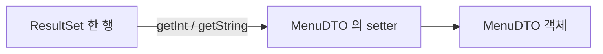

## 들어가며 (Situation)

앞선 글에서는 `ResultSet`에서 값을 꺼내 바로 출력했습니다. `Application03`부터는 방향이 바뀝니다. 수업 주석은 "데이터베이스의 정보를 단순 출력으로 끝내는 게 아니라 Java 객체로 옮겨 담아 추가적인 작업을 할 준비를 해보자"고 했습니다.

> 실제 서비스에서 겪은 문제가 아니라, 수업 실습을 정리한 글입니다. 수업 폴더의 `LinkedHashMap_설명.md`(Map 선언 문법과 배열 비교 정리)도 참고했고, 조회 데이터와 실행 결과는 싣지 않았습니다.

## 문제 상황 (Task)

- 한 행을 담을 객체와 여러 행을 담을 자료구조가 필요합니다.
- `ResultSet`은 전체 행 수를 미리 알려 주지 않는데, 어떤 자료구조가 어울릴까요?

## 해결 과정 (Action)

### 1. 한 행을 담는 DTO

수업이 정리한 **DTO(Data Transfer Object)** 의 기본 구성은 다섯 가지입니다.

| 구성 | `MenuDTO`의 예 |
|------|----------------|
| 필드 | `menuCode`, `menuName`, `menuPrice`, `categoryCode`, `orderableStatus` |
| 기본 생성자 | `public MenuDTO() {}` |
| 전체 필드 생성자 | 5개 필드를 모두 받는 생성자 |
| Getter / Setter | 필드별 접근 메서드 |
| `toString` | 객체 내용 출력용 |

필드는 `private`이고, 컬럼 타입에 맞춰 `int`, `String`, `char`를 썼습니다. 테이블 컬럼(`MENU_CODE`)은 대문자 스네이크 표기이고, 자바 필드(`menuCode`)는 카멜 표기로 맞춘 점이 눈에 띄었습니다.

### 2. 한 행 → DTO (`Application03`)

```java
MenuDTO menu = null;

if (rset.next()) {
    menu = new MenuDTO();
    menu.setMenuCode(rset.getInt("MENU_CODE"));
    menu.setMenuName(rset.getString("MENU_NAME"));
    menu.setMenuPrice(rset.getInt("MENU_PRICE"));
    menu.setCategoryCode(rset.getInt("CATEGORY_CODE"));
    menu.setOrderableStatus(rset.getString("ORDERABLE_STATUS").charAt(0));
}
```



앞선 글의 `getString`과 달리 컬럼 타입에 맞는 `getInt`, `getString`을 사용했습니다. `ORDERABLE_STATUS`는 문자열로 읽은 뒤 `charAt(0)`으로 첫 글자(`Y`/`N`)만 `char`에 담았습니다.

주의할 점이 있습니다. 컬럼 값이 `NULL`이면 `getString`이 `null`을 반환하고 `charAt(0)`에서 `NullPointerException`이 납니다. 이 컬럼이 `NOT NULL`인지는 확인하지 않았습니다. 또한 `menu`를 `null`로 시작해서, 일치하는 메뉴가 없으면 `menu = null`이 출력됩니다.

### 3. 여러 행 → List (`Application04`)

```java
List<MenuDTO> menuList = new ArrayList<>();

while (rset.next()) {
    MenuDTO menu = new MenuDTO();
    menu.setMenuCode(rset.getInt("MENU_CODE"));
    // ... 나머지 setter
    menuList.add(menu);
}
```

`if`가 `while`로 바뀌고, DTO를 만들 때마다 리스트에 `add`합니다. 이 실습은 수업에서 하부르타 과제로도 나왔습니다. (메뉴 전체 조회 결과를 자바 객체로 옮겨 담기, EmployeeDB에서 1개 이상 조회해 객체에 담기)

### 4. 여러 행 → Map (`Application05`)

```java
Map<Integer, MenuDTO> menuMap = new LinkedHashMap<>();

while (rset.next()) {
    MenuDTO menu = new MenuDTO(
            rset.getInt("MENU_CODE"),
            rset.getString("MENU_NAME"),
            rset.getInt("MENU_PRICE"),
            rset.getInt("CATEGORY_CODE"),
            rset.getString("ORDERABLE_STATUS").charAt(0)
    );
    menuMap.put(menu.getMenuCode(), menu);
}

System.out.println("1번 메뉴 = " + menuMap.get(1));
```

이번에는 전체 필드 생성자를 써서 setter 5줄이 한 번의 생성자 호출이 되었습니다. key는 PK인 `MENU_CODE`입니다.

### 5. 자료구조 비교

수업 폴더의 정리 문서를 바탕으로 비교하면 이렇습니다.

| 항목 | 객체 배열 | `List<MenuDTO>` | `Map<Integer, MenuDTO>` |
|------|-----------|-----------------|--------------------------|
| 크기 | 생성 시 고정 | 자동 확장 | 자동 확장 |
| 특정 메뉴 찾기 | 전체 순회 | 전체 순회 | `get(key)`로 바로 접근 (평균 O(1)) |
| 순서 | 인덱스 순 | 삽입 순 | `LinkedHashMap`은 삽입 순 |
| 중복 방지 | 직접 검사 | 허용 | 같은 key는 덮어씀 |

`ResultSet`은 `next()`로 끝까지 가 봐야 행 수를 알 수 있습니다. 배열로 풀려면 `COUNT(*)` 쿼리를 한 번 더 실행하거나 넉넉하게 잡은 뒤 복사해야 합니다. 컬렉션은 `add`/`put`만 호출하면 됩니다.

### 6. 그렇다면 항상 Map이 정답일까

정리 문서도 그렇게 말하지 않습니다.

- 순서대로 출력만 한다면 **List가 더 단순**합니다.
- 중복될 수 있는 컬럼(`CATEGORY_CODE` 등)을 key로 쓰면 같은 카테고리의 메뉴가 서로 덮어써집니다. 이때는 `Map<Integer, List<MenuDTO>>`로 묶어야 합니다.
- `HashMap`은 순회 순서를 보장하지 않습니다. 조회 순서를 유지하려고 `LinkedHashMap`을 썼습니다.

## 결과 (Result)

정량 지표는 없고, 아래를 정리했습니다.

- 한 행은 DTO 한 개, 여러 행은 `List`나 `Map`에 담습니다.
- 컬럼 타입에 맞는 `getInt`/`getString`으로 읽고, 생성자를 쓰면 setter 호출을 줄일 수 있습니다.
- 용도에 맞춰 순서 출력은 `List`, PK로 찾을 때는 `LinkedHashMap`을 선택합니다.
- `NULL` 값과 결과 없음(`menu = null`)은 별도로 처리해야 합니다.

## 더 학습하면 좋은 개념

- **DTO와 VO, Entity의 차이** — 데이터를 옮기는 객체와 도메인 객체의 역할을 구분하는 설계 기본입니다.
- **`equals()` / `hashCode()`** — 직접 만든 객체를 Map의 key로 쓰거나 Set에 넣을 때 필수입니다.
- **`Optional`** — `null`이 될 수 있는 조회 결과를 안전하게 다루는 방법입니다.
- **`ResultSet.getObject`와 `wasNull()`** — 숫자 컬럼이 `NULL`일 때 0과 구분하는 방법입니다.
- **ORM(JPA/MyBatis)** — 이 반복적인 매핑 작업을 자동화하는 다음 단계의 기술입니다.

## 참고 자료

- [Java SE API - java.sql.ResultSet](https://docs.oracle.com/en/java/javase/21/docs/api/java.sql/java/sql/ResultSet.html)
- [Java SE API - java.util.LinkedHashMap](https://docs.oracle.com/en/java/javase/21/docs/api/java.base/java/util/LinkedHashMap.html)
- [Java SE API - java.util.Map](https://docs.oracle.com/en/java/javase/21/docs/api/java.base/java/util/Map.html)
- [Oracle - The Java Tutorials, Collections](https://docs.oracle.com/javase/tutorial/collections/index.html)
- [Oracle - JDBC Basics: Retrieving Values from Result Sets](https://docs.oracle.com/javase/tutorial/jdbc/basics/retrieving.html)
