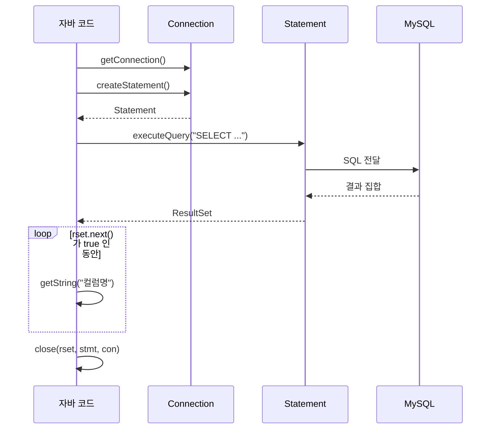

## 들어가며 (Situation)

연결(`Connection`)과 `JDBCTemplate`을 갖췄으니, 이제 SQL을 실행하고 결과를 받아 볼 차례입니다. `chap02-statement` 프로젝트에서 `menudb`의 `TBL_MENU` 테이블을 조회했습니다. 수업은 JDBC의 핵심 인터페이스 두 가지로 시작합니다.

| 인터페이스 | 수업 주석의 설명 |
|------------|------------------|
| `Statement` | SQL 쿼리문을 저장하고 실행할 수 있는 기능을 가진 인터페이스 |
| `ResultSet` | SQL 쿼리문의 결과를 결과 집합으로 받아올 수 있는 인터페이스 |

> 실제 서비스에서 겪은 문제가 아니라, 수업 실습을 정리한 글입니다. 조회된 메뉴 데이터와 실행 결과는 싣지 않았습니다. 보안 관련 부분은 공식 문서와 일반적인 원리로 보완했습니다.

## 문제 상황 (Task)

- 메뉴 전체를 조회해 이름과 가격을 출력합니다.
- `Scanner`로 메뉴 이름을 입력받아 그 메뉴의 번호, 가격, 판매 상태를 출력합니다. 출력 예시는 `날치알스크류바 의 정보 : 1 , 3000 원 , Y` 형태였습니다.

## 해결 과정 (Action)

### 1. 실행 흐름



### 2. 전체 조회

```java
Connection con = getConnection();
Statement stmt = null;
ResultSet rset = null;

try {
    stmt = con.createStatement();
    rset = stmt.executeQuery("SELECT * FROM TBL_MENU");

    while (rset.next()) {
        System.out.println(
                rset.getString("MENU_NAME") + " 은/는 "
                + rset.getString("MENU_PRICE") + "원 입니다. "
        );
    }
} catch (SQLException e) {
    throw new RuntimeException(e);
} finally {
    close(con);
    close(rset);
    close(stmt);
}
```

- `Statement`도 인터페이스라서 `Connection`의 `createStatement()`로 얻습니다.
- `executeQuery()`는 SQL 문자열을 받아 실행하고 `ResultSet`을 반환합니다. `SELECT`처럼 결과 집합이 있는 쿼리에 쓰입니다.
- `ResultSet`의 커서는 처음에 첫 행의 **앞**에 있습니다. `next()`가 한 행씩 이동하며, 다음 행이 있으면 `true`, 없으면 `false`를 반환합니다. 그래서 `while (rset.next())`로 순회합니다.
- 컬럼 값은 `getString("컬럼명")`처럼 이름으로 꺼냅니다. 숫자 컬럼도 `getString`으로 읽을 수 있고, 타입에 맞는 `getInt`는 뒤의 글에서 씁니다.

### 3. 자원 해제 메서드 오버로딩

`chap02`의 `JDBCTemplate`에는 `close`가 세 개 있습니다. `Connection`, `Statement`, `ResultSet` 타입별로 매개변수만 다른 **오버로딩**입니다. 각각 `null`이 아니고 닫혀 있지 않을 때만 닫습니다.

수업 코드는 `close(con)` → `close(rset)` → `close(stmt)` 순서입니다. 보통은 만든 순서의 반대(`rset` → `stmt` → `con`)로 닫습니다. `Connection`을 닫으면 그 아래 `Statement`, `ResultSet`도 함께 닫히므로 이 코드도 동작합니다. 다만 순서를 지키는 편이 안전하고, 그래서 try-with-resources가 선호되는 것으로 알고 있습니다.

### 4. 입력값으로 조회하기와 그 위험

```java
String menuName = sc.nextLine();

rset = stmt.executeQuery(
    "SELECT MENU_CODE, MENU_PRICE , ORDERABLE_STATUS FROM TBL_MENU WHERE MENU_NAME = '" + menuName + "'"
);

if (rset.next()) {
    System.out.println(
            menuName + " 의 정보 : " +
            rset.getString("MENU_CODE") + " , " +
            rset.getString("MENU_PRICE") + " 원 , " +
            rset.getString("ORDERABLE_STATUS")
    );
}
```

요구사항은 만족하지만, 사용자 입력을 SQL 문자열에 그대로 이어 붙이는 방식입니다. 만약 입력이 `x' OR '1'='1`이라면 완성되는 쿼리는 다음과 같습니다. (예시, 수업에서 실행하지 않음)

```sql
SELECT MENU_CODE, MENU_PRICE , ORDERABLE_STATUS FROM TBL_MENU WHERE MENU_NAME = 'x' OR '1'='1'
```

`WHERE` 조건이 항상 참이 되어 의도하지 않은 행이 조회됩니다. 이것이 **SQL Injection**입니다. 입력이 쿼리의 구조를 바꿔 버리기 때문에 생기고, 로그인이나 삭제 쿼리라면 피해가 훨씬 큽니다.

| 방식 | 사용자 입력의 취급 | 방어 |
|------|--------------------|------|
| `Statement` + 문자열 연결 | SQL 코드의 일부가 됨 | 취약 |
| `PreparedStatement` + `?` 바인딩 | 값으로만 전달됨 | 일반적인 해결책 |

이번 수업 범위에는 `PreparedStatement`가 없었고, 실무에서는 이 방식을 써야 한다는 점만 기억해 두었습니다. `PreparedStatement`의 동작은 공식 문서로 따로 학습할 예정입니다.

### 5. 입력 결과가 없을 때

`if (rset.next())`로 감싼 덕분에 결과 행이 없으면 아무것도 출력되지 않습니다. 메뉴가 없다는 안내 문구가 없으므로, 사용자는 오류인지 결과가 없는 것인지 알 수 없습니다. 실무라면 `else` 분기가 필요합니다.

## 결과 (Result)

정량 지표는 없고, 아래를 정리했습니다.

- 흐름은 `Connection` → `Statement` → `executeQuery` → `ResultSet` → `next()` 순회 → 자원 해제입니다.
- 사용자 입력을 문자열로 이어 붙인 쿼리는 SQL Injection에 취약하므로, 다음 단계로 `PreparedStatement`를 학습해야 합니다.
- 자원은 만든 순서의 반대로 닫는 것이 안전합니다.

## 더 학습하면 좋은 개념

- **`PreparedStatement`와 바인딩** — SQL Injection을 막는 표준 방법이며, 쿼리를 미리 컴파일해 재사용하기도 합니다.
- **SQL Injection (OWASP)** — 웹 보안에서 가장 오래되고 기본적인 취약점이라 원리를 알아 두어야 합니다.
- **try-with-resources** — `ResultSet`, `Statement`, `Connection`을 자동으로 역순 해제해 줍니다.
- **`ResultSet` 커서와 타입(`TYPE_FORWARD_ONLY` 등)** — 기본은 앞으로만 이동하며, 되감기는 별도 설정이 필요합니다.
- **`executeUpdate()`** — `INSERT`, `UPDATE`, `DELETE`처럼 결과 집합이 없는 쿼리의 실행 메서드입니다.

## 참고 자료

- [Java SE API - java.sql.Statement](https://docs.oracle.com/en/java/javase/21/docs/api/java.sql/java/sql/Statement.html)
- [Java SE API - java.sql.ResultSet](https://docs.oracle.com/en/java/javase/21/docs/api/java.sql/java/sql/ResultSet.html)
- [Java SE API - java.sql.PreparedStatement](https://docs.oracle.com/en/java/javase/21/docs/api/java.sql/java/sql/PreparedStatement.html)
- [Oracle - JDBC Basics Tutorial](https://docs.oracle.com/javase/tutorial/jdbc/basics/index.html)
- [OWASP - SQL Injection](https://owasp.org/www-community/attacks/SQL_Injection)
