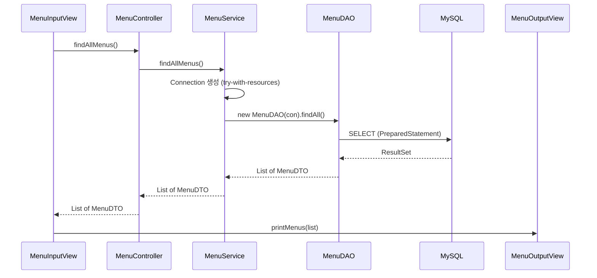

## 들어가며 (Situation)

지금까지의 JDBC 실습은 `main` 메서드 하나에 입력, 쿼리, 결과 변환, 출력이 모두 들어 있었습니다. `chap03-crud` 프로젝트는 같은 일을 **계층별로 나눠** 구성하는 방식을 다룹니다. 식당 메뉴(`restaurant`) 프로그램의 첫 기능으로 "메뉴 전체 조회"만 구현한 상태입니다.

> 실제 서비스에서 겪은 문제가 아니라, 수업 실습을 정리한 글입니다. 이 프로젝트에서 구현된 기능은 전체 조회뿐이라, 등록·수정·삭제(CRUD의 나머지)는 다루지 않습니다. DB 접속 정보 파일(`db-info.properties`)은 열어 보지 않았고 글에도 싣지 않았습니다.

## 문제 상황 (Task)

- 한 클래스가 입력 받기, SQL 실행, 비즈니스 규칙, 출력까지 모두 맡으면 기능이 늘수록 수정이 어려워집니다.
- 각 코드가 어디에 있어야 하는지 기준이 필요합니다.
- 앞선 실습의 약점(실행 위치에 따라 깨지는 파일 경로, 커넥션을 호출마다 직접 닫기)을 이번에는 어떻게 다룰까요?

## 해결 과정 (Action)

### 1. 패키지 구조

```
com.wanted.restaurant
├─ Application.java                 (객체 조립, 실행)
├─ global
│  ├─ common/QueryUtil.java         (XML 쿼리 로딩)
│  └─ config/JDBCTemplate.java      (커넥션 생성)
└─ menu
   ├─ view/input/MenuInputView      (입력)
   ├─ view/output/MenuOutputView    (출력)
   ├─ controller/MenuController
   ├─ model/service/MenuService
   ├─ model/dao/MenuDAO
   └─ model/dto/MenuDTO
```

### 2. 계층별 책임



수업 주석이 정리한 책임을 표로 옮기면 이렇습니다.

| 계층 | 해야 할 일 | 하면 안 되는 일 |
|------|------------|-----------------|
| View (`MenuInputView`) | `Scanner` 사용, Controller에 입력값 전달, OutputView에 출력 요청 | SQL 작성, 비즈니스 로직, commit/rollback |
| Controller | View의 요청 처리, 적절한 Service 호출, 필요 시 DTO 조립·간단한 유효성 검사 | `Scanner` 입력, 비즈니스 로직, SQL |
| Service | DAO 호출, 데이터 검증·가공, 여러 DAO 조합, **트랜잭션과 `Connection` 생성**, 예외 처리 | (SQL 직접 실행) |
| DAO | SQL 실행, `Statement` 생성, 파라미터 바인딩, `ResultSet` 받기, 결과를 자바 객체로 변환 | (비즈니스 규칙) |
| DTO | 계층 사이로 데이터를 옮기는 객체 | - |

Controller에 SQL이 없고 DAO에 `Scanner`가 없다는 식으로, 위치를 보면 역할이 보입니다.

### 3. 객체 조립: Application

```java
MenuService service = new MenuService();
MenuController controller = new MenuController(service);
MenuOutputView outputView = new MenuOutputView();
MenuInputView inputView = new MenuInputView(controller, outputView);

inputView.displayMainView();
```

각 계층은 생성자로 다음 계층을 전달받습니다. 수업 주석은 "추후 배울 Spring에서는 Application이 실행되면 모든 객체가 조립된다. 지금은 그 구조를 미리 맛보기 형태로 작성한다"고 했습니다. 의존하는 객체를 직접 `new` 하지 않고 바깥에서 넣어 주는 형태라서, 이후 Spring의 의존성 주입(DI)과 이어지는 구조로 이해했습니다.

### 4. 앞 실습의 약점을 개선한 부분

| 항목 | 이전(`chap02`) | 이번(`chap03`) |
|------|----------------|----------------|
| 설정·쿼리 파일 위치 | 상대 경로(`src/main/java/...`)로 `FileReader`/`FileInputStream` | `src/main/resources`에 두고 클래스패스에서 읽음 |
| 파일 읽기 | 호출할 때마다 읽음 | `static` 블록에서 클래스 로딩 시 한 번 읽음 |
| 자원 해제 | `close()` 메서드를 `finally`에서 호출 | `try-with-resources`로 자동 해제 |
| 쿼리 접근 | `Properties` 직접 사용 | `QueryUtil.getQuery("menu.findAll")` |

클래스패스에서 읽는 코드는 이렇습니다.

```java
static {
    try (InputStream inputStream =
             QueryUtil.class.getClassLoader().getResourceAsStream("queries.xml")) {
        queries.loadFromXML(inputStream);
    } catch (Exception e) {
        throw new RuntimeException("쿼리 로딩 중 오류 발생", e);
    }
}

public static String getQuery(String key) {
    return queries.getProperty(key).trim();
}
```

`static` 블록은 클래스가 로드될 때 한 번만 실행됩니다. 빌드 후에는 `src/main/resources`의 파일이 클래스패스로 복사되므로, 실행 위치와 상관없이 읽을 수 있습니다. 쿼리 key는 `menu.findAll`처럼 도메인 이름을 붙여 구분합니다. 쿼리 XML이 `<entry>` 안에서 줄바꿈과 공백을 포함하므로 `trim()`으로 앞뒤 공백을 정리합니다.

`JDBCTemplate`도 같은 방식으로 `db-info.properties`를 읽고, 이번에는 `getConnection()`만 제공합니다. `close()`는 없습니다. 수업 주석은 "커넥션 풀 없이 `DriverManager`로 직접 커넥션을 생성한다. 호출할 때마다 새 물리 연결이 만들어지고 `close()`를 호출하면 실제로 연결이 끊어진다"고 설명했습니다.

### 5. 커넥션의 주인은 Service

```java
public List<MenuDTO> findAllMenus() {
    try (Connection con = JDBCTemplate.getConnection()) {
        return new MenuDAO(con).findAll();
    } catch (SQLException e) {
        throw new RuntimeException(e);
    }
}
```

`Connection`을 만들고 닫는 곳은 Service이고, DAO는 생성자로 받은 커넥션을 쓰기만 합니다. 이유는 트랜잭션입니다. 여러 DAO 메서드가 **같은 `Connection`** 을 공유해야 `commit`/`rollback`으로 한 단위로 묶을 수 있기 때문입니다. 수업 주석의 "여러 DAO 조합(메뉴 생성 시 카테고리도 같이 삽입)", "트랜잭션 처리 & Connection 생성"이 이 설계의 이유입니다. 이번 실습은 조회뿐이라 트랜잭션 코드는 아직 없습니다.

```java
try (PreparedStatement pstmt = connection.prepareStatement(query)) {
    ResultSet rset = pstmt.executeQuery();
    while (rset.next()) {
        menus.add(new MenuDTO(
            rset.getInt("MENU_CODE"), rset.getString("MENU_NAME"),
            rset.getInt("MENU_PRICE"), rset.getInt("CATEGORY_CODE"),
            rset.getString("ORDERABLE_STATUS")));
    }
}
```

DAO에서는 `ResultSet`을 따로 닫지 않습니다. `Statement`를 닫으면 그 `Statement`가 만든 `ResultSet`도 함께 닫힌다는 것이 JDBC 명세의 동작입니다. 다만 `ResultSet`까지 try-with-resources에 넣는 편이 읽는 사람에게 더 명확합니다. 이 코드는 `MenuDTO`의 `orderableStatus`를 `char`가 아니라 `String`으로 바꿔, 이전의 `charAt(0)`과 `NullPointerException` 우려도 없앴습니다.

### 6. 수업 코드에서 눈에 띈 점

- `queries.getProperty(key)`가 `null`이면 `trim()`에서 `NullPointerException`이 납니다. key 오타가 원인인지 알기 어려운 오류라서, `null` 검사 후 의미 있는 메시지를 던지는 편이 좋습니다. (예시 개선)
- `MenuInputView`의 `switch`에는 1번만 있고 잘못된 번호를 받는 `default`가 없습니다. 기능이 늘면 채워야 할 부분입니다.
- `Application.java`에 `import java.awt.*;`가 남아 있습니다. 쓰이지 않는 import라 지워도 됩니다.
- 이 프로젝트에서 구현된 것은 전체 조회뿐이라, 계층 구조가 CRUD 전체에서 어떻게 확장되는지는 아직 확인하지 못했습니다.

## 결과 (Result)

정량 지표는 없고, 아래를 정리했습니다.

- 요청은 `View → Controller → Service → DAO` 순으로 내려가고, 결과는 DTO로 올라옵니다.
- 계층마다 "해야 할 일 / 하면 안 되는 일"이 정해져 있어 코드의 위치가 곧 역할입니다.
- 설정·쿼리 파일은 클래스패스에서 한 번 읽어 실행 위치 문제를 피하고, 자원은 try-with-resources로 해제합니다.
- `Connection`은 Service가 소유하고 DAO에 전달해야 트랜잭션을 묶을 수 있습니다.

## 더 학습하면 좋은 개념

- **의존성 주입(DI)과 IoC** — `Application`의 수동 조립이 Spring에서 어떻게 자동화되는지의 출발점입니다.
- **계층형 아키텍처와 관심사의 분리** — 이 구조가 왜 유지보수에 유리한지, 계층을 건너뛰는 호출이 왜 문제인지 이해하는 기본 원칙입니다.
- **JDBC 트랜잭션(`setAutoCommit(false)`, `commit`, `rollback`)** — Service가 `Connection`을 소유하는 이유를 코드로 확인하는 단계입니다.
- **커넥션 풀(HikariCP)** — `getConnection()`마다 물리 연결을 새로 만드는 비용을 없애는 방법입니다.
- **클래스패스와 `getResourceAsStream`** — 빌드 후 `resources`가 어디로 복사되는지 알면 파일을 못 찾는 오류를 빨리 해결합니다.

## 참고 자료

- [Java SE API - java.sql.Connection](https://docs.oracle.com/en/java/javase/21/docs/api/java.sql/java/sql/Connection.html)
- [Java SE API - java.sql.Statement (close)](https://docs.oracle.com/en/java/javase/21/docs/api/java.sql/java/sql/Statement.html)
- [Oracle - The try-with-resources Statement](https://docs.oracle.com/javase/tutorial/essential/exceptions/tryResourceClose.html)
- [Oracle - JDBC Basics: Using Transactions](https://docs.oracle.com/javase/tutorial/jdbc/basics/transactions.html)
- [Gradle - Java Plugin (processResources)](https://docs.gradle.org/current/userguide/java_plugin.html)
- [Spring Framework - Dependency Injection](https://docs.spring.io/spring-framework/reference/core/beans/dependencies/factory-collaborators.html)
