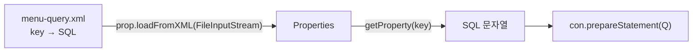

## 들어가며 (Situation)

`PreparedStatement`로 입력값을 안전하게 바인딩했지만, 쿼리 문자열은 여전히 자바 코드 안에 있습니다. `b_preparedstatements`의 `Application03`, `04`는 두 가지를 다룹니다. SQL을 XML 파일로 분리하는 것, 그리고 조회가 아닌 데이터 변경(`UPDATE`)을 실행하는 것입니다.

> 실제 서비스에서 겪은 문제가 아니라, 수업 실습을 정리한 글입니다. 동작 설명은 공식 문서로 보완했고, 조회·수정 결과는 싣지 않았습니다.

## 문제 상황 (Task)

- 수업 주석에 따르면 SQL이 한 문장이면 문자열로 써도 큰 무리가 없지만, `join`을 하거나 `where` 조건이 길어지면 **문자열 합치기가 굉장히 복잡**해집니다.
- 조회는 `executeQuery()`로 `ResultSet`을 받았는데, `INSERT`/`UPDATE`/`DELETE`는 어떻게 실행하고 성공 여부는 어떻게 알까요?

## 해결 과정 (Action)

### 1. 쿼리를 XML로 분리

`Properties`는 `.properties` 외에 XML 형식도 읽을 수 있습니다. 수업은 `DOCTYPE`을 `properties`로 지정한 XML 파일에 쿼리를 `key`별로 적었습니다.

```xml
<?xml version="1.0" encoding="UTF-8" ?>
<!DOCTYPE properties SYSTEM "http://java.sun.com/dtd/properties.dtd">
<properties>

    <entry key="findMenuByMenuName">
        SELECT * FROM TBL_MENU WHERE MENU_NAME = ?
    </entry>

    <entry key="modifyMenuPriceByMenuName">
        UPDATE TBL_MENU SET MENU_PRICE = ? WHERE MENU_NAME = ?
    </entry>

</properties>
```

(위 쿼리는 수업 파일의 줄바꿈을 줄여 옮긴 것입니다.)



```java
Properties prop = new Properties();
prop.loadFromXML(new FileInputStream("src/main/java/com/wanted/b_preparedstatements/menu-query.xml"));

String query = prop.getProperty("findMenuByMenuName");
pstmt = con.prepareStatement(query);
```

이전 글의 `prop.load(FileReader)`는 `.properties`용이고, XML은 `loadFromXML(InputStream)`입니다. 이름이 비슷하지만 읽는 스트림 종류가 다릅니다.

| 방식 | 장점 | 한계 |
|------|------|------|
| 자바 문자열 | 한눈에 코드와 함께 보임 | 긴 쿼리는 `+`로 합치기 복잡, 줄바꿈·공백 실수 |
| XML 파일 | 긴 쿼리도 그대로 읽기 쉬움, SQL만 따로 관리 | 키 이름 오타는 실행 시점에야 발견, 파일 경로 관리 필요 |

실습 코드의 `?`와 `setString(1, menuName)`은 그대로 쓸 수 있어서, 쿼리를 옮겨도 바인딩 방식은 바뀌지 않았습니다. 이 방식은 뒤에 배울 MyBatis 같은 도구의 SQL 매퍼 XML과 같은 발상으로 이해했습니다. 이 연결은 수업에서 직접 언급한 것은 아닙니다.

주의할 점이 있습니다.

- **경로는 실행 위치 기준입니다.** `"src/main/java/..."`는 상대 경로라서 프로젝트 루트에서 실행할 때만 맞습니다.
- **키가 틀리면 `null`입니다.** `getProperty("없는키")`는 `null`을 반환하고, 이어지는 `prepareStatement(null)`에서 오류가 납니다.

### 2. 조회와 수정의 차이: executeQuery vs executeUpdate

수업 주석은 CRUD를 이렇게 나눴습니다. READ(조회)는 `SELECT`이고, 나머지 C·U·D는 데이터를 조작하는 DML입니다.

| 구분 | 메서드 | 반환 |
|------|--------|------|
| 조회 (`SELECT`) | `executeQuery()` | `ResultSet` |
| 등록·수정·삭제 (`INSERT`/`UPDATE`/`DELETE`) | `executeUpdate()` | `int` (영향을 받은 행의 수) |

DML은 조회가 아니라서 `ResultSet`이 필요 없고, 그래서 `Application04`에는 `ResultSet` 변수도 `close(rset)`도 없습니다.

### 3. 가격 수정

```java
System.out.print("수정 메뉴 이름을 입력해주세요 : ");
String menuName = sc.nextLine();

System.out.print("변경 할 가격을 입력해주세요 : ");
int price = sc.nextInt();

String query = prop.getProperty("modifyMenuPriceByMenuName");

pstmt = con.prepareStatement(query);
pstmt.setInt(1, price);          // 첫 번째 ? : MENU_PRICE
pstmt.setString(2, menuName);    // 두 번째 ? : MENU_NAME

result = pstmt.executeUpdate();  // 영향을 받은 행의 수
```

쿼리의 `?` 순서(가격, 이름)와 `set` 인덱스(1, 2)가 맞아야 합니다. 순서를 바꿔 넣으면 타입이 맞지 않아 오류가 나거나, 이름 자리에 가격이 들어가 아무 행도 수정되지 않을 수 있습니다.

### 4. 성공 여부는 반환값으로 판단

```java
if (result > 0) {
    System.out.println(menuName + " 메뉴 가격 수정 성공 (영향 받은 행 : " + result + ")");
} else {
    System.out.println(menuName + "메뉴 가격 변경 실패, 메뉴 이름을 다시 확인해주세요");
}
```

수업 주석은 "정상이면 0 초과, 비정상이면 0"이라고 설명했습니다. 정확히는 **존재하지 않는 메뉴 이름을 입력해도 예외는 나지 않고 반환값이 0이 될 뿐**입니다. MySQL 수업의 트랜잭션 글에서 본 "`where id = 99` 업데이트는 오류가 아니라 0행 변경"과 같은 현상입니다. 그래서 `result`를 확인하는 코드가 반드시 필요합니다.

이름 컬럼이 유일하다는 보장이 없다면 같은 이름의 메뉴가 여러 개일 때 `result`가 1보다 커집니다. 수업 주석 문구처럼 "성공/실패"만 구분하면 몇 건이 바뀌었는지 놓칠 수 있고, 수정 조건은 PK로 거는 것이 안전합니다. `TBL_MENU`의 `MENU_NAME`에 `UNIQUE`가 있는지는 확인하지 않았습니다.

### 5. 한 가지 더: Scanner 입력 순서

`nextLine()`으로 이름을 읽은 뒤 `nextInt()`로 가격을 읽는 순서라서 문제가 없었습니다. 반대로 `nextInt()` 다음에 `nextLine()`을 쓰면 줄바꿈이 남아 빈 문자열이 읽힙니다. 입력 순서를 바꿀 때 주의할 부분입니다.

## 결과 (Result)

정량 지표는 없고, 아래를 정리했습니다.

- SQL을 XML 파일로 분리하고 `Properties.loadFromXML`로 읽으면 긴 쿼리를 문자열로 합치지 않아도 됩니다.
- 조회는 `executeQuery()`, 등록·수정·삭제는 `executeUpdate()`이며 후자는 영향 받은 행 수를 반환합니다.
- 조건에 맞는 행이 없어도 예외가 아니라 `0`이 반환되므로 반환값 확인이 필수입니다.
- 키 오타와 상대 경로는 실행 시점에야 드러나는 약점입니다.

## 더 학습하면 좋은 개념

- **XML 파싱과 DTD** — `DOCTYPE properties`가 무엇을 검증하는지, 왜 이 형식을 지켜야 하는지 이해하는 기초입니다.
- **MyBatis(SQL 매퍼)** — SQL을 XML로 분리한다는 같은 발상을 체계화한 프레임워크입니다.
- **`executeUpdate`와 `executeLargeUpdate`, 생성 키(`RETURN_GENERATED_KEYS`)** — `INSERT` 후 자동 증가 PK를 받는 방법입니다.
- **트랜잭션과 `setAutoCommit(false)`** — JDBC에서 여러 DML을 하나로 묶어 `commit`/`rollback`하는 방법입니다. MySQL 트랜잭션 글과 직접 연결됩니다.
- **`Scanner`의 개행 처리** — `nextInt()` 뒤의 `nextLine()` 문제를 이해하면 콘솔 입력 버그를 줄일 수 있습니다.

## 참고 자료

- [Java SE API - java.util.Properties (loadFromXML)](https://docs.oracle.com/en/java/javase/21/docs/api/java.base/java/util/Properties.html)
- [Java SE API - java.sql.PreparedStatement (executeUpdate)](https://docs.oracle.com/en/java/javase/21/docs/api/java.sql/java/sql/PreparedStatement.html)
- [Oracle - JDBC Basics: Using Prepared Statements](https://docs.oracle.com/javase/tutorial/jdbc/basics/prepared.html)
- [Oracle - JDBC Basics: Updating Tables](https://docs.oracle.com/javase/tutorial/jdbc/basics/tables.html)
- [MySQL 8.4 - UPDATE Statement](https://dev.mysql.com/doc/refman/8.4/en/update.html)
