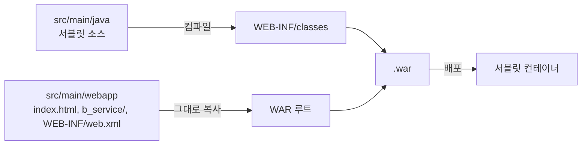
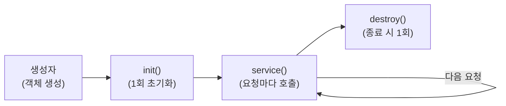

## 들어가며 (Situation)

JDBC 수업을 마치고 웹으로 넘어가 **서블릿(Servlet)** 수업이 시작됐습니다. IntelliJ에서 Gradle 프로젝트(`chap01-servlet`)를 만들고, 첫 실습으로 서블릿이 생성되고 호출되고 소멸되는 과정을 콘솔 출력으로 확인했습니다.

> 실제 서비스에서 겪은 문제가 아니라, 수업 실습을 정리한 글입니다. 동작 설명은 Jakarta Servlet 공식 문서로 보완했습니다. 실습은 Tomcat에서 진행했고 별다른 문제 없이 동작했습니다. Tomcat의 정확한 버전과 실행 결과 출력은 기록하지 않아 싣지 않았습니다.

## 문제 상황 (Task)

- 브라우저에서 `/life-cycle`을 요청하면 누가, 언제 `LifeCycleServlet` 객체를 만들까요?
- 요청이 여러 번 들어오면 객체도 매번 새로 만들어질까요?
- 수업 코드에는 이런 서블릿을 만들기 위한 설정이 어디에 있을까요?

## 해결 과정 (Action)

### 1. 서블릿(Servlet)이란

서블릿은 **서버에서 실행되는 자바 클래스로, HTTP 요청을 받아 응답을 만들어 내는 웹 컴포넌트**입니다. (Jakarta Servlet 명세는 컨테이너가 관리하며 동적 콘텐츠를 생성하는 자바 기반 웹 컴포넌트라고 정의합니다.) HTML 파일을 그대로 내려 주는 정적 응답과 달리, 요청에 따라 서버 코드가 실행되어 결과가 달라지는 **동적 응답**을 만드는 것이 목적입니다.


JDBC 실습의 `main` 메서드 프로그램과 가장 큰 차이는 **실행의 주도권**입니다. 지금까지는 우리가 `main`을 실행했지만, 서블릿은 우리가 `new`로 만들지도, 직접 호출하지도 않습니다. 객체를 만들고 메서드를 부르는 것은 컨테이너이고, 우리는 "요청이 오면 이렇게 처리하라"는 클래스만 작성합니다. 이 구조를 **제어의 역전**이라고 부르며, 뒤에 배울 Spring도 같은 발상입니다.

### 2. 서블릿 컨테이너(WAS)란

서블릿을 실행해 주는 프로그램이 **서블릿 컨테이너**이고, Apache Tomcat이 대표적인 구현체입니다. 이번 수업에서도 Tomcat으로 실습했습니다. 아래에서는 특정 제품이 아닌 역할을 설명하려고 "컨테이너"라는 이름으로 부르겠습니다.

컨테이너가 대신 해 주는 일을 표로 정리하면 다음과 같습니다.

| 컨테이너의 역할 | 개발자가 직접 한다면 |
|-----------------|----------------------|
| 네트워크 연결 수신, HTTP 메시지 파싱 | 소켓을 열고 요청 텍스트를 직접 해석 |
| URL 패턴과 서블릿 매핑 | 주소별 분기 코드를 직접 작성 |
| 서블릿 객체 생성·초기화·소멸 관리 | 객체 수명 관리 코드를 직접 작성 |
| 요청마다 스레드를 할당해 동시 처리 | 스레드 풀 직접 구현 |
| `HttpServletRequest` / `HttpServletResponse` 객체 생성 | 요청·응답 데이터 구조를 직접 설계 |

그래서 서블릿 클래스에는 소켓 코드가 한 줄도 없습니다. 이 글의 주제인 라이프사이클도 사실은 "컨테이너가 서블릿을 어떻게 관리하는가"에 대한 이야기입니다.

### 3. WAR란

**WAR(Web Application Archive)** 는 웹 애플리케이션 하나를 컨테이너에 배포하기 위해 묶은 파일입니다. JAR와 같은 ZIP 기반 형식이지만, 안에 웹 애플리케이션 전용 디렉토리 구조를 가집니다.

| 항목 | JAR | WAR |
|------|-----|-----|
| 용도 | 라이브러리 또는 일반 자바 프로그램 | 웹 애플리케이션 |
| 구조 | 클래스와 리소스 | 웹 루트 + `WEB-INF` 구조 |
| 실행 | `java -jar` 등으로 직접 실행 | 서블릿 컨테이너에 배포해서 실행 |

WAR 안의 구조는 Servlet 명세가 정합니다.

| WAR 안의 위치 | 내용 | 외부(브라우저) 접근 |
|---------------|------|----------------------|
| 루트 (`/`) | `index.html`, 정적 파일 | 가능 |
| `WEB-INF/` | 외부에 공개하지 않는 영역 | **불가** |
| `WEB-INF/classes/` | 컴파일된 자바 클래스(서블릿) | 불가 |
| `WEB-INF/lib/` | 의존하는 JAR | 불가 |
| `WEB-INF/web.xml` | 배포 설정(디스크립터) | 불가 |

수업 프로젝트의 소스 폴더와 이 구조가 이렇게 대응됩니다.



수업 폴더의 `build/libs/exploded/chap01-servlet-1.0-SNAPSHOT.war/` 디렉토리 안에 `index.html`, `b_service/service.html`, `WEB-INF/web.xml`이 들어 있는 것을 확인했습니다. 이 디렉토리가 압축을 풀어 놓은(exploded) 형태의 WAR이고, 소스의 `src/main/webapp` 내용이 그대로 루트에 복사된 모습입니다. `exploded` 형태는 파일을 압축하지 않아 개발 중에 빠르게 배포하려는 용도로 알고 있습니다.

`WEB-INF`가 외부에 공개되지 않는다는 점은 보안상 중요합니다. 직접 보여 주면 안 되는 설정 파일이나 클래스를 이 안에 두는 이유입니다. 반대로 `src/main/webapp` 아래에 둔 `index.html`은 `/index.html`로 바로 접근됩니다. 수업의 `/b_service/service.html`, `/c_parameter/parameter.html` 링크가 그 예입니다.

### 4. 프로젝트 설정: war와 servlet-api

```groovy
plugins {
    id 'java'
    id 'war'
}

dependencies {
    compileOnly('jakarta.servlet:jakarta.servlet-api:6.1.0')
}
```

| 설정 | 의미 |
|------|------|
| `id 'war'` | `.war`(웹 애플리케이션 아카이브)로 패키징하는 Gradle 플러그인 |
| `compileOnly` | 컴파일 때만 쓰고 war에는 포함하지 않음. 실행 시에는 서블릿 컨테이너가 같은 API를 제공함 |
| `jakarta.servlet` | Jakarta EE 9 이후 패키지명. 이전의 `javax.servlet`과 다름 |

`compileOnly`인 이유는 JDBC 때 쓴 `implementation`과 대비됩니다. 서블릿 API는 톰캣 같은 컨테이너가 이미 갖고 있어서, war에 또 넣으면 충돌할 수 있습니다.

`src/main/webapp/WEB-INF/web.xml`은 `version="6.1"`의 빈 `<web-app>`이고, 서블릿 등록은 XML이 아니라 어노테이션으로 합니다.

이 프로젝트의 `build.gradle`에는 `sourceCompatibility = '8'`이 적혀 있습니다. 실습에서는 컴파일부터 실행까지 문제가 없었습니다. 다만 Servlet API 6.1은 Jakarta EE 11 계열이라 실행에 더 높은 자바 버전(17 이상)이 필요한 것으로 알고 있습니다. 그래서 이 설정이 어떻게 문제없이 동작했는지는 따로 확인하지 못했습니다. 새 프로젝트를 만들 때는 사용하는 Tomcat이 지원하는 Servlet·자바 버전을 공식 문서에서 맞춰 보는 것이 안전합니다.

### 5. `@WebServlet`과 HttpServlet

```java
@WebServlet(value = "/life-cycle")
public class LifeCycleServlet extends HttpServlet {
    // ...
}
```

수업 주석은 "`@WebServlet`은 해당 클래스가 Servlet임을 명시하고, `value`는 처리할 URL 패턴이다. `/life-cycle` 요청이 들어오면 동작하는 클래스"라고 정리했습니다. 서블릿은 `HttpServlet`을 상속해 만들고, `main` 메서드가 없는 대신 컨테이너가 객체를 만들고 메서드를 호출합니다.

### 6. 라이프사이클 확인 코드

```java
public LifeCycleServlet() { System.out.println("기본생성자 호출됨"); }

@Override
public void init(ServletConfig config) { System.out.println("init() 호출됨" + intitCount++); }

@Override
protected void service(HttpServletRequest req, HttpServletResponse resp) {
    System.out.println("service() 호출됨" + serviceCount++);
}

@Override
public void destroy() { System.out.println("destroy() 호출됨" + destroyCount++); }
```



| 단계 | 호출 시점 | 횟수 |
|------|-----------|------|
| 생성자 | 컨테이너가 서블릿 객체를 만들 때 | 1회 |
| `init()` | 생성 직후 초기화 | 1회 |
| `service()` | 클라이언트 요청이 들어올 때마다 | 요청 수만큼 |
| `destroy()` | 컨테이너가 서블릿을 내릴 때(서버 종료, 재배포) | 1회 |

핵심은 **서블릿 객체가 요청마다 만들어지지 않는다**는 점입니다. 컨테이너가 서블릿당 인스턴스를 보통 하나 만들어 두고, 요청마다 스레드로 `service()`를 호출합니다. 그래서 수업 코드처럼 `serviceCount++`를 필드로 두면 요청이 쌓일수록 값이 이어서 올라가는 것을 확인할 수 있습니다. (제가 실행 출력을 기록하지는 않았습니다.) 객체가 처음 만들어지는 시점은 기본적으로 첫 요청 때이고, 서버 시작 때 미리 만들게 하는 `loadOnStartup` 설정도 있는 것으로 알고 있습니다.

### 7. 코드에서 눈에 띈 점

- **스레드 안전성.** 인스턴스가 하나이므로 필드(`serviceCount`)를 여러 요청이 동시에 수정할 수 있습니다. 실습의 카운터는 확인용이라 괜찮지만, 요청별 데이터를 필드에 저장하는 서블릿은 오류가 나기 쉬운 구조입니다. 요청별 값은 지역 변수에 두어야 합니다.
- **`init(ServletConfig)`를 `super` 호출 없이 재정의했습니다.** `GenericServlet`의 `init(ServletConfig)`는 전달받은 설정을 저장하는데, 이를 덮어쓰고 `super.init(config)`를 부르지 않으면 `getServletConfig()` 같은 메서드가 기대대로 동작하지 않을 수 있습니다. API 문서는 초기화 코드를 인자 없는 `init()`에 작성하라고 안내합니다.
- **`service()`가 응답을 쓰지 않습니다.** 콘솔에만 출력하므로 브라우저에서는 빈 페이지를 받게 됩니다. 응답 작성은 이번 수업 범위에 없었습니다.
- **링크가 절대 경로(`/life-cycle`)입니다.** `index.html`의 링크는 앱이 루트(`/`)에 배포됐을 때를 가정한 것이라, 컨텍스트 경로가 붙은 배포 환경에서는 달라질 수 있습니다.

## 결과 (Result)

정량 지표는 없고, 아래를 정리했습니다.

- 서블릿은 컨테이너가 생성·호출·소멸을 관리하는 서버 측 자바 클래스이고, 우리는 요청 처리 로직만 작성합니다.
- WAR는 웹 애플리케이션을 배포하는 묶음이며, `WEB-INF` 아래는 외부에서 접근할 수 없습니다.
- 서블릿의 수명은 생성자 → `init()` → `service()`(반복) → `destroy()` 순서입니다.
- 객체는 하나, 요청은 여러 개이며 요청마다 `service()`가 호출됩니다.
- 서블릿 API는 컨테이너가 제공하므로 `compileOnly`로 둡니다.
- 서블릿의 필드는 모든 요청이 공유하므로 요청별 상태를 담지 않습니다.

## 더 학습하면 좋은 개념

- **웹 서버와 WAS의 역할 구분(Nginx/Apache HTTPD vs Tomcat)** — 정적 파일 처리와 동적 처리를 나눠 맡는 실무 구성이며, 컨테이너 앞단이 왜 따로 있는지 이해하는 데 필요합니다.
- **제어의 역전(IoC)** — 컨테이너가 객체를 만들고 호출하는 구조의 일반 원리로, Spring의 핵심 개념과 직접 이어집니다.
- **스레드 안전성(Thread Safety)** — 서블릿이 싱글 인스턴스·멀티 스레드로 동작하는 이유와 그 제약을 알면 Spring 컨트롤러가 싱글톤인 이유도 이해됩니다.
- **`javax.servlet` → `jakarta.servlet` 전환** — Jakarta EE 9에서 패키지가 바뀌어 라이브러리·서버 버전을 맞춰야 하는 이유입니다.
- **`loadOnStartup`과 지연 초기화** — 서블릿 생성 시점을 제어해 첫 요청 지연을 줄이는 방법입니다.
- **`web.xml` vs 어노테이션 설정** — 서블릿 등록 방식의 두 가지 선택지와 우선순위입니다.

## 참고 자료

- [Jakarta Servlet 6.1 Specification](https://jakarta.ee/specifications/servlet/6.1/)
- [Jakarta Servlet 6.1 API - HttpServlet](https://jakarta.ee/specifications/servlet/6.1/apidocs/jakarta.servlet/jakarta/servlet/http/httpservlet)
- [Jakarta Servlet 6.1 API - GenericServlet](https://jakarta.ee/specifications/servlet/6.1/apidocs/jakarta.servlet/jakarta/servlet/genericservlet)
- [Jakarta Servlet 6.1 API - WebServlet](https://jakarta.ee/specifications/servlet/6.1/apidocs/jakarta.servlet/jakarta/servlet/annotation/webservlet)
- [Gradle - War Plugin](https://docs.gradle.org/current/userguide/war_plugin.html)
- [Apache Tomcat - Application Developer's Guide (Deployment)](https://tomcat.apache.org/tomcat-10.1-doc/appdev/deployment.html)
- [Apache Tomcat - Application Developer's Guide (Directory Structure)](https://tomcat.apache.org/tomcat-10.1-doc/appdev/source.html)
