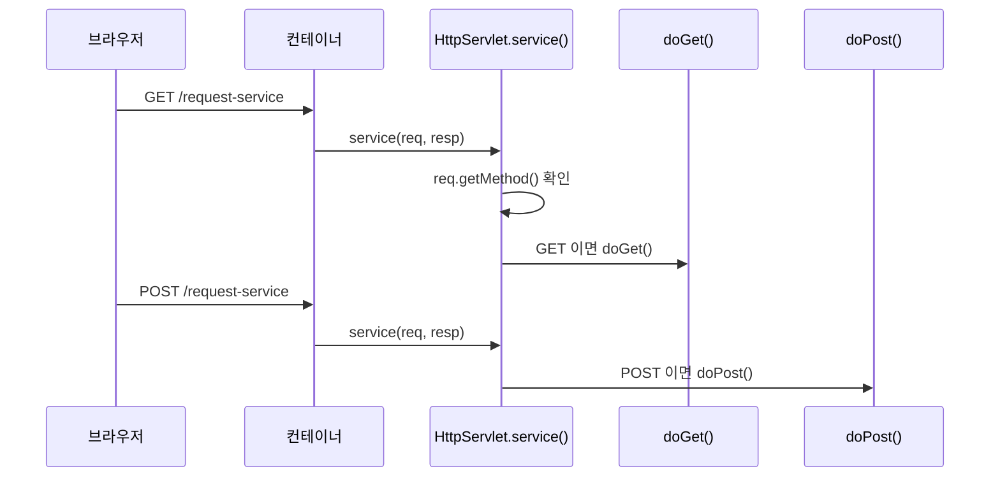

## 들어가며 (Situation)

앞선 글에서 `service()`가 요청마다 호출된다는 것을 확인했습니다. 이번 실습(`b_service`)은 같은 `/request-service` 주소로 **GET 방식과 POST 방식**의 요청을 보내 보고, 서블릿이 이를 어떻게 구분해 처리하는지 살펴봅니다.

> 실제 서비스에서 겪은 문제가 아니라, 수업 실습을 정리한 글입니다. 동작 설명은 Jakarta Servlet과 HTTP 공식 문서로 보완했습니다. 콘솔 출력 결과는 기록하지 않았습니다.

## 문제 상황 (Task)

- 브라우저의 어떤 동작이 GET이고, 어떤 동작이 POST일까요?
- 한 주소로 들어온 요청을 서블릿에서 방식별로 나눠 처리하려면 어떻게 해야 할까요?
- `service()`를 직접 재정의한 코드는 왜 주석 처리되어 있을까요?

## 해결 과정 (Action)

### 1. 요청 방식을 만드는 세 가지 HTML

```html
<!-- a 태그: GET -->
<a href="/request-service">서비스 메소드 요청하기</a>

<!-- form method="get" -->
<form action="/request-service" method="get">
  <input type="submit" value="GET 방식 요청!!">
</form>

<!-- form method="post" -->
<form action="/request-service" method="post">
  <input type="submit" value="POST 방식 요청!!">
</form>
```

| 동작 | HTTP 메서드 |
|------|-------------|
| `<a href>` 클릭 (주소 이동) | GET |
| `<form method="get">` 제출 | GET |
| `<form method="post">` 제출 | POST |

수업 주석은 "`a` 태그의 `href`는 화면의 URL을 변경하는 속성이고, URL이 변경되는 방식은 GET 요청에 해당한다"고 정리했습니다. `form`의 `method`를 생략하면 GET이 기본입니다.

### 2. 첫 번째 시도: service()에서 직접 구분

수업 코드에는 주석 처리된 첫 번째 방식이 남아 있습니다.

```java
@Override
protected void service(HttpServletRequest req, HttpServletResponse resp) {
    String httpMethod = req.getMethod();
    System.out.println("httpMethod = " + httpMethod);
}
```

`req.getMethod()`는 요청 방식을 문자열(`"GET"`, `"POST"`)로 돌려줍니다. 이 값으로 `if`로 나눠 처리할 수도 있지만, 모든 서블릿이 이런 분기 코드를 반복해야 합니다.

### 3. 선택한 방식: doGet / doPost

```java
@WebServlet(value = "/request-service")
public class ServiceMethodServlet extends HttpServlet {

    @Override
    protected void doGet(HttpServletRequest req, HttpServletResponse resp) {
        System.out.println("Get 요청을 처리할 메소드 호출됨");
    }

    @Override
    protected void doPost(HttpServletRequest req, HttpServletResponse resp) {
        System.out.println("Post 요청을 처리할 메소드 호출됨");
    }
}
```



`HttpServlet`이 상속받은 `service()` 안에서 이미 요청 방식을 읽고 `doGet`, `doPost` 등으로 나눠 호출해 줍니다. 그래서 개발자는 필요한 `doXxx` 메서드만 재정의하면 됩니다.

| 방식 | 직접 `service()` 재정의 | `doGet`/`doPost` 재정의 |
|------|--------------------------|--------------------------|
| 분기 코드 | 직접 작성 | 부모(`HttpServlet`)가 처리 |
| 방식별 코드 분리 | 한 메서드에 섞임 | 메서드로 분리 |
| 주의점 | 재정의하면 `doGet`/`doPost`는 호출되지 않음 | 정의하지 않은 방식은 오류 응답 |

여기서 `service()`를 직접 재정의한 코드를 주석 처리한 이유가 드러납니다. `service()`를 덮어쓰면 부모의 분기 로직이 사라져서 `doGet`/`doPost`가 호출되지 않기 때문입니다. 둘을 함께 두면 `doGet`, `doPost`가 동작하지 않는다는 점은 직접 실행해 확인하지는 않았고, API 문서의 설명을 바탕으로 정리했습니다.

### 4. 정의하지 않은 방식으로 요청하면

`ServiceMethodServlet`은 `doGet`, `doPost`만 있습니다. 다른 방식(`PUT`, `DELETE` 등)이나, 만약 `doPost`만 정의하고 GET으로 접근한다면 `HttpServlet`의 기본 구현이 오류 응답(405 Method Not Allowed 등)을 돌려주는 것으로 알고 있습니다. 이번 실습에서는 실행해 보지 않았습니다.

### 5. 응답이 비어 있다는 점

`doGet`/`doPost`는 콘솔에 출력만 하고 `resp`에는 아무것도 쓰지 않습니다. 브라우저는 빈 응답을 받으므로, 화면에는 아무것도 나오지 않을 수 있습니다. 화면에 결과를 보내는 방법은 이번 범위에 없었습니다.

## 결과 (Result)

정량 지표는 없고, 아래를 정리했습니다.

- 주소 이동(`a`, `form method="get"`)은 GET, `form method="post"`는 POST입니다.
- `HttpServlet.service()`가 요청 방식을 읽어 `doGet`/`doPost`로 나눠 줍니다.
- `service()`를 직접 재정의하면 이 분기가 사라지므로, 보통은 `doXxx`만 재정의합니다.

## 더 학습하면 좋은 개념

- **HTTP 메서드의 의미(안전성·멱등성)** — GET은 조회, POST는 상태 변경이라는 설계 기준입니다. REST API 설계의 기초가 됩니다.
- **HTTP 상태 코드(405, 404, 500 등)** — 정의하지 않은 메서드로 요청했을 때의 응답을 읽는 데 필요합니다.
- **`HttpServletResponse`로 응답 작성** — 이번 실습이 비워 둔 부분이며 다음 단계입니다.
- **브라우저 개발자 도구의 Network 탭** — 요청 메서드와 헤더·본문을 직접 확인하는 가장 빠른 방법입니다.
- **Spring MVC의 `@GetMapping` / `@PostMapping`** — `doGet`/`doPost` 분기를 어노테이션으로 대체한 형태입니다.

## 참고 자료

- [Jakarta Servlet 6.1 API - HttpServlet](https://jakarta.ee/specifications/servlet/6.1/apidocs/jakarta.servlet/jakarta/servlet/http/httpservlet)
- [Jakarta Servlet 6.1 API - HttpServletRequest (getMethod)](https://jakarta.ee/specifications/servlet/6.1/apidocs/jakarta.servlet/jakarta/servlet/http/httpservletrequest)
- [MDN - HTTP request methods](https://developer.mozilla.org/en-US/docs/Web/HTTP/Methods)
- [MDN - 405 Method Not Allowed](https://developer.mozilla.org/en-US/docs/Web/HTTP/Status/405)
- [MDN - The form element (method)](https://developer.mozilla.org/en-US/docs/Web/HTML/Element/form)
