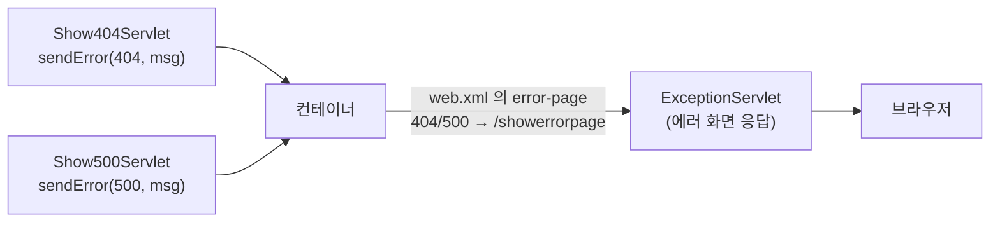

## 들어가며 (Situation)

이전 글에서 서블릿이 HTML로 응답하는 방법을 익혔습니다. 이번 실습(`e_exception`)은 **에러가 났을 때** 사용자에게 어떤 화면을 보여 줄지를 다룹니다. `404 Error`, `500 Error` 링크를 누르면 에러 상태가 만들어지고, 공통 에러 페이지가 응답합니다.

> 실제 서비스에서 겪은 문제가 아니라, 수업 실습을 정리한 글입니다. 실습은 Tomcat에서 진행했고 별다른 문제 없이 동작했습니다. 동작 설명은 Jakarta Servlet 공식 문서로 보완했습니다.

## 문제 상황 (Task)

- 서블릿에서 "페이지가 없다" 또는 "서버 오류가 났다"는 응답은 어떻게 만들까요?
- 에러마다 서블릿이 각자 HTML을 만들지 않고, **한 곳에서 에러 화면을 처리**할 수 있을까요?
- 에러 정보(상태 코드, 메시지)는 에러 화면 서블릿에 어떻게 전달될까요?

## 해결 과정 (Action)

### 1. 에러 상태를 만드는 `sendError`

```java
@WebServlet("/show404")
public class Show404Servlet extends HttpServlet {
    @Override
    protected void doGet(HttpServletRequest req, HttpServletResponse resp) throws IOException {
        System.out.println("404 Servlet 호출됨");
        resp.sendError(404, "페이지가 없습니다");
    }
}
```

`/show500`도 같은 구조에서 `resp.sendError(500, "500번대 Error는 순전히 개발자의 잘못")`을 호출합니다. 실제 오류를 만드는 대신 `sendError`로 **에러 응답을 직접 지정**해 시연하는 방식입니다. (코드의 주석 `// throw new Exception(); 에러 터진다는 가정`이 그 의미입니다.)

| 상태 코드 | 의미 |
|-----------|------|
| 4xx | 클라이언트의 요청 문제 (404: 요청한 자원이 없음) |
| 5xx | 서버 쪽에서 요청을 처리하지 못함 (500: 서버 내부 오류) |

수업 주석은 "500번대 에러는 순전히 개발자의 잘못"이라고 했습니다. 5xx는 서버 쪽 문제라는 의미이고, 대부분 서버 코드나 설정의 결함이지만, 외부 DB 장애처럼 개발자 코드 밖의 원인일 수도 있습니다. 상태 코드가 어느 쪽 책임인지를 알려 주는 구분으로 기억하면 충분합니다.

### 2. web.xml에 에러 페이지 등록

```xml
<web-app ... version="6.1">
    <error-page>
        <error-code>404</error-code>
        <location>/showerrorpage</location>
    </error-page>
    <error-page>
        <error-code>500</error-code>
        <location>/showerrorpage</location>
    </error-page>
</web-app>
```



`error-page`는 "이 상태 코드가 발생하면 `location`의 자원이 대신 응답하라"는 설정입니다. 이 프로젝트의 `web.xml`은 이전 글까지는 비어 있었고, 이번에 처음 내용이 채워졌습니다. 에러 코드마다 서블릿을 따로 만드는 대신 **404와 500이 같은 `/showerrorpage` 서블릿 하나**를 공유합니다.

| 방식 | 설명 | 선택 이유 |
|------|------|-----------|
| 서블릿마다 에러 HTML 직접 작성 | `sendError` 대신 각자 HTML 응답 | 에러 화면이 서블릿 수만큼 중복됨 |
| `web.xml`의 `error-page` | 에러 화면을 한 곳에서 처리 | 응답 형식을 통일하고 중복을 제거 |

수업 주석이 이 구조를 forward 개념에 비유한 부분도 기억해 둘 만합니다. "1개의 서블릿이 책임이 많아질 때 다른 서블릿을 만들어, 마치 요청을 받은 서블릿이 응답까지 하는 것처럼 보여 주는 것"입니다. 사용자는 `/show404`를 요청했는데 응답은 `/showerrorpage`가 만든다는 점에서 같습니다. forward는 다음 글에서 직접 다룹니다.

### 3. 에러 정보 읽기: request 속성

```java
@WebServlet("/showerrorpage")
public class ExceptionServlet extends HttpServlet {
    @Override
    protected void doGet(HttpServletRequest req, HttpServletResponse resp) throws IOException {
        String forwardUrl = req.getAttribute("jakarta.servlet.forward.request_uri").toString();

        int statusCode = (int) req.getAttribute("jakarta.servlet.error.status_code");
        String msg = req.getAttribute("jakarta.servlet.error.message").toString();

        // "404 - 페이지가 없습니다" 형태의 <h1> 응답
        resp.setContentType("text/html;charset=UTF-8");
        // ... PrintWriter 로 HTML 출력
    }
}
```

컨테이너가 에러 페이지를 호출하면서 `request` 객체에 에러 정보를 담아 줍니다. 서블릿은 `getAttribute`로 꺼냅니다.

| 속성 이름 | 담긴 값 |
|-----------|---------|
| `jakarta.servlet.error.status_code` | 에러 상태 코드 (정수) |
| `jakarta.servlet.error.message` | `sendError`에 전달한 메시지 |
| `jakarta.servlet.forward.request_uri` | 수업 코드에서 원래 요청 URI를 꺼내는 데 쓴 속성 |

`getAttribute`는 `Object`를 반환하므로 상태 코드는 `(int)` 캐스팅으로, 메시지는 `toString()`으로 변환했습니다. 이 속성 이름들은 Servlet 명세가 정한 표준 이름입니다.

### 4. 수업 코드에서 눈에 띈 점

아래는 직접 실행해 확인한 것이 아니라, API 동작 설명을 바탕으로 한 추정입니다.

- **속성이 없으면 NullPointerException.** `getAttribute(...)`는 속성이 없으면 `null`을 반환하므로 `.toString()`에서 오류가 납니다. 브라우저에서 `/showerrorpage`를 직접 열면 에러 속성이 없어서 이 문제가 생길 수 있습니다. 메시지 없이 `sendError(404)`만 호출한 경우도 `error.message` 속성이 비어 있을 수 있습니다.
- **`setContentType` 반복.** 주석처럼 "응답 시에 항상 해 주어야 하는 반복 코드"입니다. 이전 글의 지적과 같습니다.
- **응답에 값을 그대로 출력.** 지금은 서버가 정한 메시지만 출력하지만, 사용자 입력이 섞이면 HTML 이스케이프가 필요합니다.

## 결과 (Result)

정량 지표는 없고, 아래를 정리했습니다.

- `resp.sendError(상태코드, 메시지)`로 에러 응답을 직접 만들 수 있습니다.
- `web.xml`의 `<error-page>`로 상태 코드별 에러 화면을 지정하고, 여러 코드를 한 서블릿이 함께 처리할 수 있습니다.
- 에러 정보는 컨테이너가 `request` 속성(`jakarta.servlet.error.*`)에 담아 주며, `Object`라서 형 변환과 `null` 처리가 필요합니다.

## 더 학습하면 좋은 개념

- **HTTP 상태 코드 전체 체계(1xx~5xx)** — 4xx와 5xx의 책임 구분을 넘어 301/302/401/403 같은 코드를 이해하는 기본입니다.
- **예외 타입 기반 `<exception-type>` 설정** — 상태 코드뿐 아니라 던져진 예외 클래스로도 에러 페이지를 지정할 수 있습니다.
- **`RequestDispatcher`와 `DispatcherType.ERROR`** — 에러 페이지가 어떻게 호출되는지 컨테이너 동작 원리를 이해하는 데 필요합니다.
- **보안: 에러 메시지에 내부 정보 노출 금지** — 스택 트레이스나 경로를 사용자에게 보여 주면 공격 단서가 됩니다.
- **Spring의 `@ControllerAdvice` / `@ExceptionHandler`** — 에러 처리를 공통화하는 같은 발상의 프레임워크 방식입니다.

## 참고 자료

- [Jakarta Servlet 6.1 Specification - Error Handling](https://jakarta.ee/specifications/servlet/6.1/)
- [Jakarta Servlet 6.1 API - HttpServletResponse (sendError)](https://jakarta.ee/specifications/servlet/6.1/apidocs/jakarta.servlet/jakarta/servlet/http/httpservletresponse)
- [Jakarta Servlet 6.1 API - RequestDispatcher (error attributes)](https://jakarta.ee/specifications/servlet/6.1/apidocs/jakarta.servlet/jakarta/servlet/requestdispatcher)
- [MDN - HTTP response status codes](https://developer.mozilla.org/en-US/docs/Web/HTTP/Status)
- [MDN - 404 Not Found](https://developer.mozilla.org/en-US/docs/Web/HTTP/Status/404)
- [MDN - 500 Internal Server Error](https://developer.mozilla.org/en-US/docs/Web/HTTP/Status/500)
