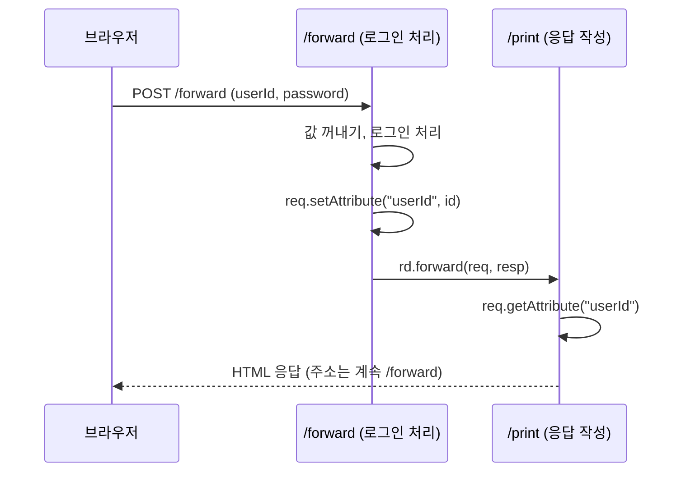
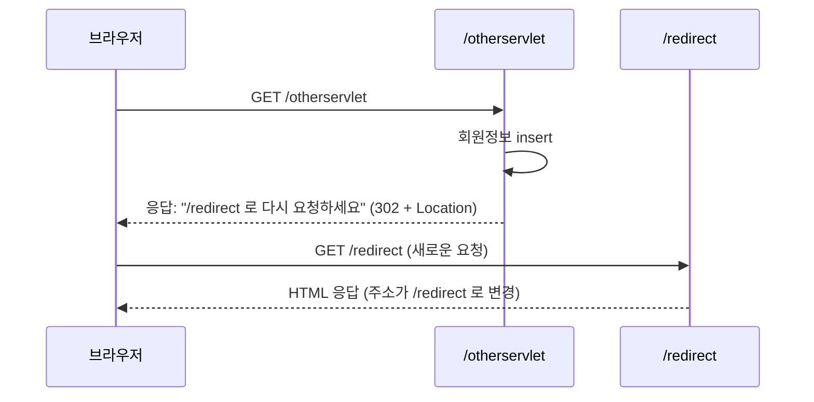
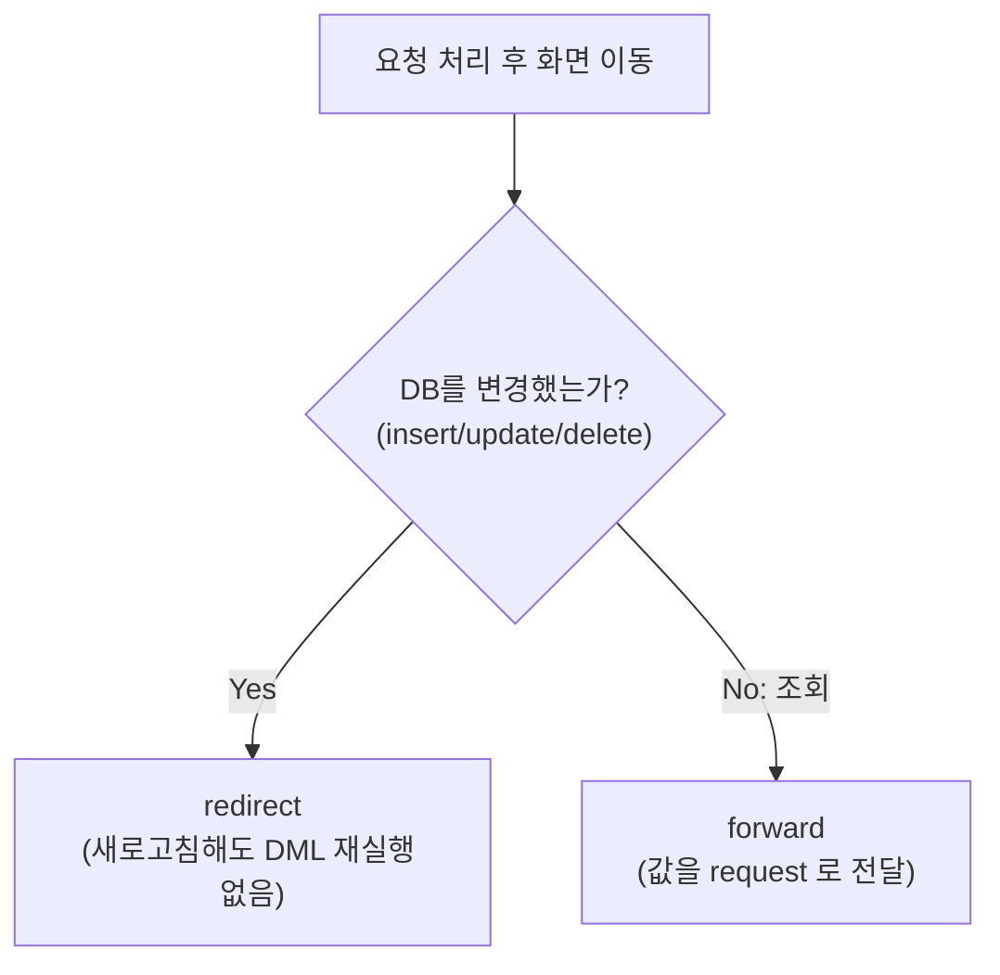

## 들어가며 (Situation)

한 서블릿이 요청 처리와 응답 HTML 작성을 모두 맡으면 책임이 커집니다. 이번 실습(`f_forward`, `g_redirect`)은 이를 나누는 두 가지 방법을 비교합니다. 하나는 요청을 다른 서블릿에 넘기는 **forward**, 다른 하나는 브라우저에게 다른 주소로 다시 요청하게 하는 **redirect**입니다.

> 실제 서비스에서 겪은 문제가 아니라, 수업 실습을 정리한 글입니다. 실습은 Tomcat에서 진행했고 별다른 문제 없이 동작했습니다. 동작 설명은 Jakarta Servlet과 HTTP 공식 문서로 보완했습니다. 수업 코드의 로그인은 실제 검증 없이 성공을 가정한 시연입니다.

## 문제 상황 (Task)

- 로그인 요청을 처리하는 서블릿(`/forward`)과, "OO님 환영합니다" 화면을 만드는 서블릿(`/print`)으로 **책임을 나누고** 싶습니다.
- 두 서블릿 사이에 아이디 값은 어떻게 전달할까요?
- 회원가입처럼 DB를 변경하는 요청 뒤에 새로고침하면 어떤 문제가 생길까요?

## 해결 과정 (Action)

### 1. forward: 요청을 서버 안에서 넘기기

```java
@WebServlet("/forward")
public class RequestInfoServlet extends HttpServlet {
    @Override
    protected void doPost(HttpServletRequest req, HttpServletResponse resp) throws ServletException, IOException {
        String id  = req.getParameter("userId");
        String pwd = req.getParameter("password");

        // memberService.login(id, pwd);   (실제 로그인 처리는 주석으로만 존재)

        // 전달해줄 값 집어넣기
        req.setAttribute("userId", id);

        RequestDispatcher rd = req.getRequestDispatcher("/print");
        rd.forward(req, resp);
    }
}
```

```java
@WebServlet("/print")
public class ResponseLoginServlet extends HttpServlet {
    @Override
    protected void doPost(HttpServletRequest req, HttpServletResponse resp) throws IOException {
        String id = req.getAttribute("userId").toString();   // 앞 서블릿이 넣어 준 값
        // "<id>님 환영합니다." HTML 을 작성해 응답
    }
}
```



수업이 정리한 forward의 핵심은 세 가지입니다.

| 특징 | 설명 |
|------|------|
| `req`, `resp` 공유 | 두 서블릿이 같은 요청·응답 객체를 쓰므로 `setAttribute`/`getAttribute`로 값을 넘길 수 있음 |
| 클라이언트에 노출되지 않음 | 서버 내부에서 넘기므로 URL이 바뀌지 않음 (`/forward`로 남음) |
| 새로고침 시 요청 반복 | 브라우저는 마지막으로 보낸 요청(POST `/forward`)을 다시 보냄 |

주의할 규칙도 있습니다. forward를 요청한 서블릿이 `doPost`로 처리하면 forward를 받는 서블릿도 `doPost`를 재정의해야 합니다. 수업 주석("forward를 요청한 서블릿에서 처리하는 메서드가 get이면 받은 서블릿도 get을 오버라이딩")이 이 규칙입니다. 같은 요청 객체를 그대로 넘기므로 요청 방식이 유지되기 때문입니다.

`getParameter`와 `setAttribute`는 다릅니다. `getParameter`는 클라이언트가 보낸 값(문자열)이고, `setAttribute`는 서버 안에서 객체를 주고받는 공간(요청 범위)입니다. `getAttribute`의 반환 타입이 `Object`라서 수업 코드는 `toString()`으로 바꿔 썼습니다.

### 2. 새로고침이 위험한 이유

수업은 forward의 세 번째 특징을 강조했습니다. 새로고침하면 같은 요청이 반복되어 `insert`/`update`/`delete`가 다시 실행될 수 있습니다. 그래서 **조회(select)에는 forward를, DML에는 forward를 쓰면 큰일난다**고 정리했습니다.

주소창은 `/forward` 그대로이고, 브라우저의 새로고침은 "마지막 요청을 다시 보내기"입니다. POST 요청이면 브라우저가 재전송 확인을 묻는 경우가 많고, 확인하면 같은 POST가 한 번 더 서버에 도달합니다. 그 안에서 회원가입 `insert`를 했다면 두 번 실행됩니다. 이 재전송 동작은 직접 재현해 보지 않았고 브라우저의 일반적인 동작입니다.

### 3. redirect: 브라우저에게 다시 요청시키기

```java
@WebServlet("/otherservlet")
public class OtherServlet extends HttpServlet {
    @Override
    protected void doGet(HttpServletRequest req, HttpServletResponse resp) throws IOException {
        // memberService.signUp();
        System.out.println("회원정보 DB에 Insert 완료");

        resp.sendRedirect("/redirect");
    }
}
```

```java
@WebServlet("/redirect")
public class RedirectServlet extends HttpServlet {
    @Override
    protected void doGet(HttpServletRequest req, HttpServletResponse resp) throws IOException {
        // "리다이랙트 성공!!!" HTML 응답
    }
}
```



`sendRedirect`는 HTML을 보내지 않고, 브라우저에게 **"이 주소로 다시 요청하라"** 고 응답합니다. 일반적으로 상태 코드 302와 `Location` 헤더로 전달됩니다. 수업 주석은 "URL 변경은 곧 `a` 태그를 누르는 것과 같은 효과라서 GET 방식"이라고 설명했습니다.

그 결과 새로고침하면 `/redirect`에 대한 GET만 반복되고, 이전 요청(`insert`를 수행한 `/otherservlet`)은 다시 실행되지 않습니다. DML 뒤에는 redirect를 쓰는 이유입니다.

### 4. 비교와 선택 기준

| 항목 | forward | redirect |
|------|---------|----------|
| 요청 횟수 | 1번 (서버 내부 이동) | 2번 (브라우저가 새로 요청) |
| 주소창 URL | 변하지 않음 | 새 주소로 변경 |
| `req`/`resp` | 공유함 | 새 요청이라 공유하지 않음 |
| 값 전달 | `setAttribute` | 불가 (쿠키/세션 필요) |
| 새로고침 | 이전 요청 반복 (DML 위험) | 새 주소 요청만 반복 (안전) |
| 적합한 용도 | 조회 결과 화면 | 등록·수정·삭제 후 이동 |

수업 주석은 redirect의 단점도 지적했습니다. "이전 요청을 아예 모른다는 것이 장점이자 단점"입니다. 요청 정보를 전달할 수 없으므로, 이를 극복하려고 **쿠키와 세션**이 나온다고 정리했습니다. 이 두 개념은 아직 배우지 않았습니다.



### 5. 수업 코드에서 눈에 띈 점

- **비밀번호가 콘솔에 출력됩니다.** `System.out.println("pwd = " + pwd)`는 학습용 확인 코드지만, 실제 서비스에서는 비밀번호를 로그에 남기지 않아야 합니다. 이전 JDBC 글의 접속 정보 출력과 같은 종류의 문제입니다.
- **아이디를 HTML에 그대로 출력합니다.** 입력에 `<script>` 같은 태그가 있으면 그대로 실행되는 XSS 위험이 있어, 실제로는 이스케이프가 필요합니다.
- **`/print`는 `getAttribute("userId")`에 의존합니다.** 주소창에 `/print`를 직접 입력하면 속성이 없어 `NullPointerException`이 날 수 있고, `doPost`만 있어서 GET 요청에는 오류 응답이 갑니다. 직접 실행해 확인한 것은 아닙니다.
- **redirect 경로가 `/redirect`로 시작합니다.** 서버 루트 기준으로 해석되는 값이라, 앱이 컨텍스트 경로를 붙여 배포되면 경로를 조정해야 할 수 있습니다.
- **forward는 "로그인 성공"이 하드코딩된 시연입니다.** 실제 로그인 검증은 `memberService.login(...)` 주석으로만 남아 있습니다.

## 결과 (Result)

정량 지표는 없고, 아래를 정리했습니다.

- forward는 서버 안에서 `req`/`resp`를 공유하며 위임하고 URL이 바뀌지 않아, 값 전달은 쉽지만 새로고침 시 같은 요청이 반복됩니다.
- redirect는 브라우저가 새 GET 요청을 보내 URL이 바뀌고 요청 정보는 사라지므로, DML 뒤의 이동에 안전합니다.
- 선택 기준은 "DB를 변경했는가"이며, 조회는 forward, 등록·수정·삭제는 redirect입니다.
- redirect 후에도 정보를 이어 가려면 쿠키/세션이 필요합니다.

## 더 학습하면 좋은 개념

- **PRG 패턴(Post/Redirect/Get)** — POST로 처리한 뒤 redirect해서 GET으로 결과를 보여 주는 표준 패턴입니다. 이번 실습의 DML 뒤 redirect 규칙이 이름 붙은 형태입니다.
- **쿠키와 세션** — redirect가 잃어버리는 정보를 이어 주는 수단이며, 로그인 상태 유지의 기반입니다.
- **요청 범위(Request Scope)와 `setAttribute`** — 속성의 생존 범위를 이해하면 forward에서 값이 전달되는 이유가 분명해집니다.
- **HTTP 3xx 상태 코드(301, 302, 303, 307)** — redirect가 상태 코드로 어떻게 표현되고 메서드가 어떻게 바뀌는지 이해하는 기초입니다.
- **Spring MVC의 `forward:` / `redirect:` 접두어와 `RedirectAttributes`** — 같은 개념이 프레임워크에서 어떻게 쓰이는지 연결됩니다.

## 참고 자료

- [Jakarta Servlet 6.1 API - RequestDispatcher](https://jakarta.ee/specifications/servlet/6.1/apidocs/jakarta.servlet/jakarta/servlet/requestdispatcher)
- [Jakarta Servlet 6.1 API - HttpServletResponse (sendRedirect)](https://jakarta.ee/specifications/servlet/6.1/apidocs/jakarta.servlet/jakarta/servlet/http/httpservletresponse)
- [Jakarta Servlet 6.1 API - ServletRequest (setAttribute, getAttribute)](https://jakarta.ee/specifications/servlet/6.1/apidocs/jakarta.servlet/jakarta/servlet/servletrequest)
- [MDN - Redirections in HTTP](https://developer.mozilla.org/en-US/docs/Web/HTTP/Guides/Redirections)
- [MDN - 302 Found](https://developer.mozilla.org/en-US/docs/Web/HTTP/Status/302)
- [OWASP - Cross Site Scripting (XSS)](https://owasp.org/www-community/attacks/xss/)
