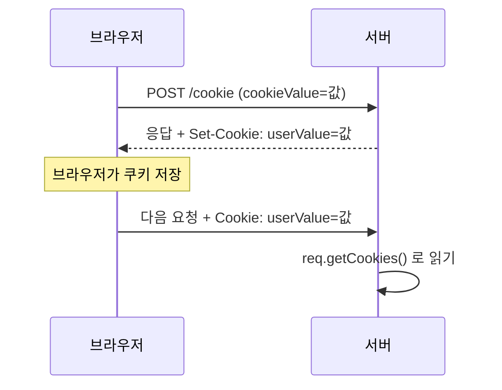

## 들어가며 (Situation)

지난 글에서 redirect는 "이전 요청을 아예 모른다"는 점이 장점이자 단점이라고 정리했고, 수업 주석은 그 단점을 극복하는 개념으로 **쿠키와 세션**을 예고했습니다. 이번 실습(`h_cookie_session`)에서 그 두 가지를 다뤘습니다. 이 글은 쿠키를 다룹니다. 응답 화면으로 처음 **JSP**가 등장한 실습이기도 합니다.

> 실제 서비스에서 겪은 문제가 아니라, 수업 실습을 정리한 글입니다. 실습은 Tomcat에서 진행했습니다. 동작 설명은 Jakarta Servlet 공식 문서와 MDN으로 보완했고, 직접 실행해 확인하지 않은 부분은 따로 표시했습니다.

## 문제 상황 (Task)

- HTTP는 요청마다 독립적이라 서버는 "방금 그 사람"을 기억하지 못합니다. 사용자가 입력한 값을 다음 요청에서도 쓰려면 어떻게 해야 할까요?
- 서블릿에서 `StringBuilder`로 HTML을 만드는 대신, 응답 화면을 따로 둘 수는 없을까요?

## 해결 과정 (Action)

### 1. 쿠키란

**쿠키**는 서버가 응답에 담아 보내면 **브라우저가 저장해 두었다가, 이후 같은 서버로 요청할 때마다 자동으로 함께 보내는** 작은 데이터입니다.



### 2. 쿠키 만들고 보내기

```html
<form action="/cookie" method="post">
    <label>쿠키 값 : <input type="text" name="cookieValue"></label>
    <button type="submit">쿠키에 값 넣기</button>
</form>
```

```java
@WebServlet("/cookie")
public class CookieServlet extends HttpServlet {

    @Override
    protected void doPost(HttpServletRequest req, HttpServletResponse resp) throws ServletException, IOException {
        String cookieValue = req.getParameter("cookieValue");

        Cookie cookie = new Cookie("userValue", cookieValue);
        cookie.setMaxAge(60 * 60);   // 만료 시간 설정 (초 단위, 1시간)

        resp.addCookie(cookie);      // 브라우저에게 보내 줄 쿠키 추가

        doGet(req, resp);
    }
}
```

| 코드 | 의미 |
|------|------|
| `new Cookie("userValue", 값)` | 이름-값 쌍으로 쿠키 생성 |
| `setMaxAge(초)` | 브라우저가 보관할 시간. 음수면 브라우저를 닫을 때 삭제, `0`이면 즉시 삭제 |
| `resp.addCookie(cookie)` | 응답 헤더(`Set-Cookie`)에 담아 브라우저로 전송 |

쿠키는 **응답(`resp`)에 넣고**, 읽을 때는 **요청(`req`)에서 꺼낸다**는 방향을 기억해야 합니다.

### 3. 쿠키 읽기

```java
@Override
protected void doGet(HttpServletRequest req, HttpServletResponse resp) throws ServletException, IOException {
    String savedValue = "없음";

    Cookie[] cookies = req.getCookies();
    if (cookies != null) {
        for (Cookie cookie : cookies) {
            if ("userValue".equals(cookie.getName())) {
                savedValue = cookie.getValue();
                break;
            }
        }
    }

    req.setAttribute("savedValue", savedValue);
    req.getRequestDispatcher("/h_cookie_session/cookie_result.jsp").forward(req, resp);
}
```

- `getCookies()`는 이름으로 하나를 찾는 메서드가 없고 **배열 전체**를 돌려줍니다. 그래서 반복문으로 이름을 비교합니다.
- 쿠키가 하나도 없으면 빈 배열이 아니라 **`null`** 을 반환합니다. 수업 코드처럼 `null` 검사가 필요합니다.
- `"userValue".equals(...)`처럼 상수를 앞에 두면 이름이 `null`이어도 예외가 나지 않습니다.

### 4. 시행착오 포인트: 방금 넣은 쿠키가 바로 보일까?

수업 코드는 `doPost`에서 쿠키를 `addCookie`한 뒤 곧바로 `doGet`을 호출해 쿠키를 읽습니다. 그런데 `addCookie`는 **응답**에 쿠키를 넣을 뿐이고, `doGet`의 `req.getCookies()`는 브라우저가 **이번 요청에 실어 보낸** 쿠키를 읽습니다. 방금 만든 쿠키는 아직 브라우저에 도착하지 않았으므로 이번 요청에는 없습니다.

| 시점 | `req.getCookies()`에 있는 값 |
|------|------------------------------|
| 처음 값을 입력해 제출한 요청 | 없음 (쿠키가 아직 브라우저에 없음) |
| 그다음 요청부터 | 이전에 저장된 값 |

API 동작상으로는 첫 제출 화면에 "없음"이 나오고, 다시 제출하거나 새로고침해야 값이 보이는 것이 정상입니다. 다만 이 과정을 직접 확인하며 기록해 두지는 않아서, 수업 중 실제 화면이 어땠는지는 확인이 필요합니다. 입력한 값을 즉시 보여 주려면 요청 속성에 입력값을 따로 넣거나, PRG 패턴처럼 redirect로 새 요청을 만들면 됩니다.

### 5. 응답 화면은 JSP로

이번 실습부터는 서블릿이 HTML을 직접 만들지 않고, **JSP로 forward**합니다.

```jsp
<%@ page contentType="text/html;charset=UTF-8" language="java" %>
<html>
  <body>
    <h1> 쿠키에 저장 된 값 꺼내기 </h1>
    <h3> 쿠키에 저장 된 값 : ${savedValue} </h3>
  </body>
</html>
```

| 방식 | 지금까지 (서블릿 직접 응답) | 이번 실습 (JSP로 forward) |
|------|------------------------------|---------------------------|
| HTML 작성 | `StringBuilder`로 문자열 조립 | HTML 파일처럼 작성 |
| 값 출력 | 문자열 연결 | `${savedValue}` (EL) |
| 역할 | 서블릿이 처리 + 화면 | 서블릿은 처리, JSP는 화면 |

`${savedValue}`는 **EL(Expression Language)** 로, 서블릿이 `req.setAttribute("savedValue", ...)`로 넣은 값을 꺼내 출력합니다. forward 글에서 배운 "요청 속성으로 값을 넘긴다"는 원리가 그대로 쓰입니다. 서블릿 글들에서 반복해서 지적한 "HTML을 문자열로 만드는 불편함"을 해결하는 첫 단계입니다.

### 6. 쿠키를 쓸 때 주의할 점

공식 문서 기준으로 정리했습니다.

| 주의점 | 이유 |
|--------|------|
| 민감한 정보 저장 금지 | 쿠키는 브라우저에 저장되어 사용자가 보고 수정할 수 있음 |
| 크기 제한 | 쿠키 하나는 대략 4KB 정도로 작음 |
| 값에 쓸 수 있는 문자 제한 | 공백, 세미콜론 같은 문자는 쿠키 값 규칙에 맞지 않음. 한글·공백을 입력하면 서버에서 오류가 날 수 있음 (직접 확인하지 않음) |
| `HttpOnly`, `Secure` | 자바스크립트 접근 차단, HTTPS에서만 전송하는 보안 속성 |

## 결과 (Result)

정량 지표는 없고, 아래를 정리했습니다.

- 쿠키는 서버가 응답으로 보내고 브라우저가 저장해 다음 요청마다 돌려보내는 데이터입니다.
- 넣을 때는 `resp.addCookie`, 읽을 때는 `req.getCookies()`이며, 방금 넣은 쿠키는 같은 요청에서 읽히지 않습니다.
- `getCookies()`는 쿠키가 없으면 `null`이라 반드시 검사합니다.
- 화면은 JSP로 분리하고 `${}`(EL)로 요청 속성을 출력하기 시작했습니다.

## 더 학습하면 좋은 개념

- **HTTP의 무상태성(Stateless)** — 쿠키와 세션이 왜 필요한지의 출발점입니다.
- **쿠키 속성(`HttpOnly`, `Secure`, `SameSite`, `Path`, `Domain`)** — 실제 서비스에서 쿠키를 안전하게 쓰기 위한 설정입니다.
- **JSP와 EL의 동작 원리** — JSP가 서블릿으로 변환되어 실행된다는 점을 이해하면 forward와 속성 전달이 자연스럽게 연결됩니다.
- **PRG 패턴** — POST 처리 후 redirect하면 방금 저장한 쿠키가 다음 요청에 바로 반영됩니다.
- **세션** — 값을 브라우저가 아니라 서버에 저장하는 방식으로, 다음 글의 주제입니다.

## 참고 자료

- [Jakarta Servlet 6.1 API - Cookie](https://jakarta.ee/specifications/servlet/6.1/apidocs/jakarta.servlet/jakarta/servlet/http/cookie)
- [Jakarta Servlet 6.1 API - HttpServletRequest (getCookies)](https://jakarta.ee/specifications/servlet/6.1/apidocs/jakarta.servlet/jakarta/servlet/http/httpservletrequest)
- [Jakarta Servlet 6.1 API - HttpServletResponse (addCookie)](https://jakarta.ee/specifications/servlet/6.1/apidocs/jakarta.servlet/jakarta/servlet/http/httpservletresponse)
- [MDN - Using HTTP cookies](https://developer.mozilla.org/en-US/docs/Web/HTTP/Guides/Cookies)
- [Jakarta Expression Language](https://jakarta.ee/specifications/expression-language/)
