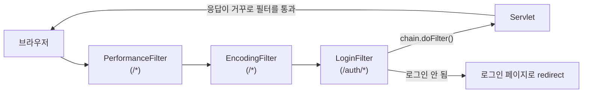

## 들어가며 (Situation)

서블릿 수업을 정리하며 계속 걸렸던 것이 **반복 코드**였습니다. 응답마다 `resp.setContentType("text/html;charset=UTF-8")`을 써야 했고(수업 주석의 표현으로는 "계속 반복되는 코드"), 지난 글처럼 로그인이 필요한 페이지마다 세션을 확인해야 합니다. 이번 실습(`i_filter`)은 이런 공통 처리를 서블릿 앞단의 **필터(Filter)** 로 옮깁니다.

> 실제 서비스에서 겪은 문제가 아니라, 수업 실습을 정리한 글입니다. 실습은 Tomcat에서 진행했습니다. 동작 설명은 Jakarta Servlet 공식 문서로 보완했고, 직접 실행해 확인하지 않은 부분은 따로 표시했습니다.

## 문제 상황 (Task)

- 모든 서블릿에 같은 인코딩 설정을 넣지 않고 한 번에 적용할 수 있을까요?
- 로그인이 필요한 페이지에 로그인하지 않은 사용자가 오면, 500 에러 대신 로그인 페이지로 보낼 수 있을까요?
- 모든 요청의 처리 시간을 서블릿 코드를 고치지 않고 측정할 수 있을까요?

## 해결 과정 (Action)

### 1. 필터란

수업 주석의 정의는 "Filter는 HTTP 요청이 Servlet에 도달하기 **전에** 동작하는 생명주기를 갖는다"입니다. 필터는 요청을 가로채 먼저 처리하고, 통과시킬지 말지를 정합니다.



위 그림의 필터 순서는 설명을 위한 예시입니다. 실제 순서는 아래 "등록 방법"에서 다룹니다.

필터는 `Filter` 인터페이스를 구현하며, 서블릿과 비슷한 생명주기를 가집니다.

| 메서드 | 호출 시점 |
|--------|-----------|
| `init(FilterConfig)` | 필터 생성 후 1회 (초기 설정 읽기) |
| `doFilter(request, response, chain)` | 매칭되는 요청마다 |
| `destroy()` | 필터 제거 시 1회 |

`doFilter` 안의 `chain.doFilter(request, response)`가 핵심입니다. 이 호출이 **다음 필터나 서블릿으로 요청을 넘기는** 역할을 하고, 호출하지 않으면 요청은 서블릿에 도달하지 않습니다.

### 2. PerformanceFilter: 서블릿 전후를 감싸기

```java
@WebFilter("/*")
public class PerformanceFilter implements Filter {

    @Override
    public void doFilter(ServletRequest request, ServletResponse response, FilterChain chain) throws IOException, ServletException {
        long startTime = System.currentTimeMillis();

        HttpServletRequest req = (HttpServletRequest) request;
        System.out.println("[요청 된 URL] : " + req.getRequestURI());

        chain.doFilter(request, response);   // 다음 필터 or 서블릿 호출

        long endTime = System.currentTimeMillis();
        System.out.println("[" + req.getRequestURI() + "의 최종 수행 시간] : " + (endTime - startTime) + "ms");
    }
}
```

`chain.doFilter` **앞**의 코드는 서블릿 실행 전에, **뒤**의 코드는 서블릿이 끝나고 돌아온 뒤에 실행됩니다. 그래서 한 메서드로 "요청 전후"를 감쌀 수 있고, 그 차이가 해당 요청의 처리 시간이 됩니다. `/*`는 모든 요청에 적용한다는 뜻입니다.

### 3. LoginFilter: 로그인하지 않았으면 돌려보내기

```java
@WebFilter("/auth/*")
public class LoginFilter implements Filter {

    @Override
    public void doFilter(ServletRequest request, ServletResponse response, FilterChain chain) throws IOException, ServletException {
        // 자식이 가진 getSession() 을 쓰기 위해 형변환
        HttpServletRequest req = (HttpServletRequest) request;
        HttpServletResponse resp = (HttpServletResponse) response;

        HttpSession session = req.getSession(false);

        if (session == null || session.getAttribute("loggedInUser") == null) {
            resp.sendRedirect("/h_cookie_session/cookie_session.html");
        } else {
            chain.doFilter(req, resp);   // 정상이므로 서블릿으로
        }
    }
}
```

| 상황 | 필터의 처리 |
|------|-------------|
| 세션이 없거나 `loggedInUser`가 없음 | 로그인 페이지로 redirect, 서블릿 실행 안 함 |
| 로그인된 상태 | `chain.doFilter`로 서블릿에 전달 |

수업 주석은 이 필터의 목적을 "세션에 `loggedInUser` 값이 없으면 null이나 500 에러를 발생시키는 것이 아니라, 로그인할 수 있는 페이지로 redirect 시키는 것"이라고 설명했습니다.

`doFilter`의 매개변수는 HTTP 전용이 아닌 `ServletRequest`/`ServletResponse` 타입입니다. 세션과 redirect는 HTTP 기능이라 `HttpServletRequest`/`HttpServletResponse`로 **형변환**해서 씁니다. 수업 주석의 "자식이 가지고 있는 `getSession()`을 쓰기 위해 형변환"이 그 의미입니다. 상속과 다형성 수업의 다운캐스팅이 실제로 쓰이는 곳입니다.

필터 뒤의 서블릿과 JSP는 이렇습니다.

```java
@WebServlet("/auth")
public class AuthServlet extends HttpServlet {
    @Override
    protected void doGet(HttpServletRequest req, HttpServletResponse resp) throws ServletException, IOException {
        HttpSession session = req.getSession(false);
        String existUser = (String) session.getAttribute("loggedInUser");
        // ...
        req.getRequestDispatcher("/i_filter/auth.jsp").forward(req, resp);
    }
}
```

```jsp
<%
    // jsp 파일은 HTML 처럼 보이지만 실제로는 Java로 이루어진 Servlet이다.
    String user = (String) session.getAttribute("loggedInUser");
%>
<h3> <%= user %> </h3>
```

`AuthServlet`은 `getSession(false)`의 결과를 `null` 검사 없이 씁니다. 필터가 "세션이 있고 로그인된 경우"만 통과시킨다는 전제가 있어서 가능한 코드입니다. 수업 코드에서 필터 패턴은 `/auth/*`이고 서블릿 주소는 `/auth`입니다. Servlet 명세의 경로 매칭 규칙상 `/auth/*`는 `/auth` 요청에도 적용되는 것으로 알고 있습니다. 필터가 적용되지 않는다면 로그인하지 않은 상태에서 `NullPointerException`이 날 수 있는 구조라, 이 매칭 규칙을 공식 문서에서 한번 확인해 두는 것이 좋겠습니다.

JSP에서는 지난 글의 EL(`${}`)과 달리 `<% %>`(스크립틀릿)과 `<%= %>`(출력식)로 자바 코드를 직접 썼습니다. `session`은 JSP가 기본으로 제공하는 내장 객체입니다. "JSP는 실제로는 서블릿"이라는 주석처럼, JSP는 서블릿으로 변환되어 실행되기 때문에 자바 코드를 넣을 수 있습니다. 다만 화면에 자바 코드가 섞이면 다시 읽기 어려워지므로, 실무에서는 EL과 JSTL 같은 태그를 주로 씁니다.

### 4. EncodingFilter: web.xml로 등록하고 설정값 받기

이번 필터는 어노테이션 없이 `web.xml`에 등록했습니다.

```java
public class EncodingFilter implements Filter {

    private String encodingType;

    @Override
    public void init(FilterConfig filterConfig) throws ServletException {
        encodingType = filterConfig.getInitParameter("encoding-type");
    }

    @Override
    public void doFilter(ServletRequest request, ServletResponse response, FilterChain chain) throws IOException, ServletException {
        response.setContentType(encodingType);
        chain.doFilter(request, response);
    }
}
```

```xml
<filter>
    <filter-name>encoding</filter-name>
    <filter-class>com.wanted.servlet.i_filter.EncodingFilter</filter-class>
    <init-param>
        <param-name>encoding-type</param-name>
        <param-value>text/html; charset=UTF-8</param-value>
    </init-param>
</filter>
<filter-mapping>
    <filter-name>encoding</filter-name>
    <url-pattern>/*</url-pattern>
</filter-mapping>
```

`init-param`의 값을 `init()`에서 `getInitParameter`로 읽어, 인코딩 값을 코드가 아닌 **설정 파일에서** 바꿀 수 있게 했습니다. JDBC 수업에서 접속 정보를 properties로 뺀 것과 같은 발상입니다.

이 필터를 적용하면서 기존 서블릿들(`ResponseServlet`, `ExceptionServlet`, `ResponseLoginServlet`, `CookieServlet`)의 `resp.setContentType(...)` 줄이 **모두 주석 처리**됐습니다. 서블릿 글마다 지적했던 반복 코드가 필터 하나로 정리된 것입니다.

| 항목 | 필터 적용 전 | 필터 적용 후 |
|------|--------------|--------------|
| 인코딩 설정 위치 | 응답하는 서블릿마다 | `EncodingFilter` 한 곳 |
| 설정값 변경 | 모든 서블릿 수정 | `web.xml`의 `param-value`만 수정 |
| 빠뜨릴 위험 | 새 서블릿마다 있음 | 없음 |

### 5. 필터 등록 방법 두 가지와 순서

수업 주석대로 등록 방법은 두 가지입니다.

| 방식 | 예 | 특징 |
|------|----|------|
| `@WebFilter` 어노테이션 | `LoginFilter`, `PerformanceFilter` | 간단함. 클래스에 바로 경로 지정 |
| `web.xml` | `EncodingFilter` | `init-param`으로 설정값 전달. `filter-mapping` 작성 순서로 실행 순서 지정 |

순서 문제가 하나 있습니다. Servlet 명세에서 `web.xml`에 등록한 필터는 `filter-mapping` 순서대로 실행되지만, **어노테이션으로만 등록한 필터끼리의 순서는 정해져 있지 않습니다.** 그래서 순서가 중요한 필터(예: 인코딩은 다른 처리보다 먼저)는 `web.xml`에 순서를 명시하는 편이 안전합니다.

### 6. 알아 둘 점

- **요청 인코딩은 처리하지 않습니다.** 수업의 `EncodingFilter`는 **응답** 형식만 지정합니다. POST로 받은 한글 파라미터가 깨지는 문제를 막으려면 보통 `request.setCharacterEncoding("UTF-8")`도 함께 넣습니다.
- **모든 응답을 `text/html`로 지정합니다.** `/*`에 적용되므로 CSS나 이미지 같은 정적 파일 요청에도 `setContentType`이 호출됩니다. 정적 파일은 기본 서블릿이 형식을 다시 지정할 것으로 보이지만, 직접 확인하지 않았습니다. 인코딩만 지정하려면 `setCharacterEncoding("UTF-8")`을 쓰는 방법도 있습니다.
- **redirect 경로가 절대 경로입니다.** 이전 글들과 같이 루트(`/`) 배포를 가정한 경로입니다.

## 결과 (Result)

정량 지표는 없고, 아래를 정리했습니다.

- 필터는 서블릿 앞에서 요청을 가로채며, `chain.doFilter`를 호출해야 다음 단계로 넘어갑니다.
- `chain.doFilter` 전후에 코드를 두면 서블릿 실행 전후를 감쌀 수 있습니다(수행 시간 측정).
- 로그인 검사를 필터로 옮기면 서블릿은 "로그인된 상태"를 전제로 단순해집니다.
- 인코딩 같은 공통 설정을 필터로 옮겨 서블릿의 반복 코드를 없앴습니다.
- 어노테이션 필터끼리는 순서가 보장되지 않아, 순서가 중요하면 `web.xml`로 등록합니다.

## 더 학습하면 좋은 개념

- **책임 연쇄 패턴(Chain of Responsibility)** — `FilterChain`이 여러 처리기를 차례로 통과시키는 구조의 설계 패턴입니다.
- **`DispatcherType`과 필터 적용 범위** — 필터는 기본적으로 클라이언트의 직접 요청에만 적용되고, forward·error 디스패치에는 설정해야 적용됩니다.
- **JSTL과 EL** — JSP에서 스크립틀릿 없이 반복·조건을 표현하는 표준 방법입니다.
- **Spring의 `HandlerInterceptor`와 Spring Security** — 필터 개념이 프레임워크에서 인증·인가로 어떻게 확장되는지 이어집니다.
- **AOP(관점 지향 프로그래밍)** — 수행 시간 측정처럼 여러 곳에 걸친 공통 관심사를 분리하는 일반 원리입니다.

## 참고 자료

- [Jakarta Servlet 6.1 API - Filter](https://jakarta.ee/specifications/servlet/6.1/apidocs/jakarta.servlet/jakarta/servlet/filter)
- [Jakarta Servlet 6.1 API - FilterChain](https://jakarta.ee/specifications/servlet/6.1/apidocs/jakarta.servlet/jakarta/servlet/filterchain)
- [Jakarta Servlet 6.1 API - WebFilter](https://jakarta.ee/specifications/servlet/6.1/apidocs/jakarta.servlet/jakarta/servlet/annotation/webfilter)
- [Jakarta Servlet 6.1 API - FilterConfig (getInitParameter)](https://jakarta.ee/specifications/servlet/6.1/apidocs/jakarta.servlet/jakarta/servlet/filterconfig)
- [Jakarta Servlet 6.1 Specification - Filtering, Mapping Requests to Servlets](https://jakarta.ee/specifications/servlet/6.1/)
- [Jakarta Server Pages Specification](https://jakarta.ee/specifications/pages/)
