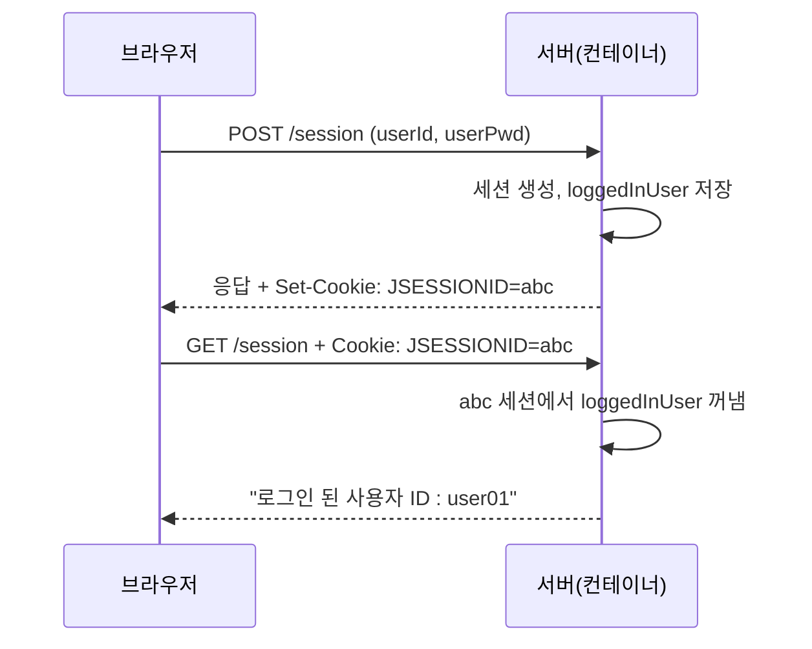
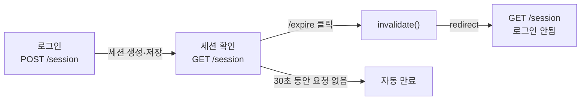

## 들어가며 (Situation)

지난 글에서 쿠키로 브라우저에 값을 저장했습니다. 하지만 쿠키는 사용자가 보고 고칠 수 있어서 로그인 정보를 담기에 적합하지 않습니다. 같은 실습(`h_cookie_session`)의 후반부는 값을 **서버에 저장하는 세션**으로 간단한 로그인 상태를 유지해 봅니다.

> 실제 서비스에서 겪은 문제가 아니라, 수업 실습을 정리한 글입니다. 실습은 Tomcat에서 진행했습니다. 수업 코드의 로그인은 실제 검증 없이 입력값을 세션에 저장하는 시연입니다. 직접 실행해 확인하지 않은 부분은 따로 표시했습니다.

## 문제 상황 (Task)

- 로그인한 사용자의 아이디를 여러 요청에 걸쳐 유지하려면 어디에 저장해야 할까요?
- 세션은 언제 만들어지고, 언제 사라질까요?
- 로그아웃은 어떻게 구현할까요?

## 해결 과정 (Action)

### 1. 쿠키 vs 세션

| 항목 | 쿠키 | 세션 |
|------|------|------|
| 저장 위치 | 브라우저 | **서버** |
| 사용자가 값 확인·수정 | 가능 | 불가 (서버에 있음) |
| 저장할 수 있는 값 | 문자열, 작은 크기 | 자바 객체 |
| 주된 용도 | 아이디 저장, 화면 설정 | 로그인 상태, 장바구니 |

그렇다면 서버는 수많은 세션 중 "이 요청이 누구의 세션인지"를 어떻게 알까요? 답은 쿠키입니다. 컨테이너는 세션을 만들면 **세션 ID**를 쿠키(Servlet 명세상 이름은 `JSESSIONID`)로 브라우저에 보내고, 브라우저가 다음 요청에 이 쿠키를 돌려보내면 그 ID로 세션을 찾습니다.



즉 세션은 쿠키를 대체하는 것이 아니라, **쿠키에는 열쇠(ID)만 두고 내용물은 서버에 두는 방식**입니다.

### 2. 세션 가져오기: getSession(true) / getSession(false)

```java
// true : 세션이 없으면 새로 만든다
HttpSession session = req.getSession(true);

// false : 기존 세션만 가져오고, 없으면 null 을 반환한다
HttpSession session = req.getSession(false);
```

| 호출 | 세션이 있을 때 | 세션이 없을 때 | 쓰는 곳 |
|------|----------------|----------------|---------|
| `getSession()` / `getSession(true)` | 기존 세션 | 새로 생성 | 로그인 처리 |
| `getSession(false)` | 기존 세션 | `null` | 로그인 여부 확인 |

로그인 여부만 확인하는 곳에서 `getSession(true)`를 쓰면, 로그인하지 않은 사람에게도 빈 세션이 계속 만들어집니다. 수업 코드는 저장할 때 `true`, 확인할 때 `false`로 나눠 썼습니다.

### 3. 로그인: 세션에 저장하고 유효 시간 지정

```java
@Override
protected void doPost(HttpServletRequest req, HttpServletResponse resp) throws ServletException, IOException {
    String userId = req.getParameter("userId");
    String userPwd = req.getParameter("userPwd");

    if (userId != null && !userPwd.isEmpty()) {
        HttpSession session = req.getSession(true);
        String existUser = (String) session.getAttribute("loggedInUser");

        session.setAttribute("loggedInUser", userId);
        session.setAttribute("userPwd", userPwd);
        session.setMaxInactiveInterval(30);   // 30초

        doGet(req, resp);
    }
}
```

(수업 코드는 `existUser`가 같은 사용자인지에 따라 `if/else`로 나눴지만, 두 분기의 내용이 같아서 위처럼 줄여 옮겼습니다.)

| 메서드 | 역할 |
|--------|------|
| `session.setAttribute(키, 값)` | 세션에 객체 저장 |
| `session.getAttribute(키)` | 꺼내기 (`Object` 반환, 없으면 `null`) |
| `session.setMaxInactiveInterval(초)` | 세션 유지 시간 지정 |

수업 주석은 `setMaxInactiveInterval(30)`을 "세션의 유효 기간 30초"라고 설명했습니다. 정확히는 **마지막 요청 이후 아무 요청이 없는 상태가 30초 지속되면** 만료됩니다. 이름의 `Inactive`가 그 의미입니다. 그래서 30초 안에 계속 요청하면 세션은 유지됩니다.

수업 주석에서 눈여겨본 문장도 있습니다. "`null`이 될 수 있는 값을 형변환할 때는 `toString()` 메서드보다 `(String)` 캐스트 연산자가 안정적이다." `null.toString()`은 `NullPointerException`을 내지만, `(String) null`은 그냥 `null`이기 때문입니다.

### 4. 세션 확인: 꺼내서 JSP로 forward

```java
@Override
protected void doGet(HttpServletRequest req, HttpServletResponse resp) throws ServletException, IOException {
    HttpSession session = req.getSession(false);

    String loggedInUser = null;
    String pwd = null;

    if (session != null) {
        loggedInUser = session.getAttribute("loggedInUser").toString();
        pwd = session.getAttribute("userPwd").toString();
    }

    req.setAttribute("loggedInUser", loggedInUser != null ? loggedInUser : "로그인 안됨");
    req.setAttribute("userPwd", pwd != null ? pwd : "비밀번호 없음");

    req.getRequestDispatcher("/h_cookie_session/session_result.jsp").forward(req, resp);
}
```

```jsp
<p> 로그인 된 사용자 ID : ${loggedInUser} </p>
<p> PWD : ${userPwd} </p>
<a href="/expire"> 세션 만료 시키기 </a>
```

### 5. 로그아웃: invalidate 후 redirect

```java
@WebServlet("/expire")
public class ExpireServlet extends HttpServlet {
    @Override
    protected void doGet(HttpServletRequest req, HttpServletResponse resp) throws IOException {
        HttpSession session = req.getSession(false);
        if (session != null) {
            session.invalidate();   // 세션 무효화
        }
        resp.sendRedirect("/session");
    }
}
```



`invalidate()`가 세션을 없애고, redirect로 `/session`을 새로 요청하면 세션이 없으므로 "로그인 안됨"이 표시됩니다. 로그아웃 뒤 redirect를 쓰는 것은 앞서 배운 "상태를 바꾼 뒤에는 redirect" 원칙과 같습니다.

### 6. 수업 코드에서 눈에 띈 점

코드를 읽으며 발견한 부분입니다. 직접 실행해 재현한 것은 아니고, 코드와 API 동작을 근거로 정리했습니다.

| 지점 | 내용 |
|------|------|
| **`doGet`의 `toString()`** | 세션은 있지만 `loggedInUser` 속성이 없는 경우(예: 다른 페이지에서 세션만 만들어진 경우) `NullPointerException`이 납니다. 위에서 정리한 "캐스트 연산자가 안정적"이라는 원칙을 여기에도 적용하면 해결됩니다. |
| **`doPost`의 조건** | `!userPwd.isEmpty()`는 `userPwd`가 `null`이면 예외가 납니다. 또 조건이 거짓일 때 아무 응답도 하지 않아 빈 화면이 됩니다. |
| **비밀번호를 세션에 저장하고 화면에 출력** | 학습용 확인 코드입니다. 실제로는 비밀번호를 세션에 두지 않고, 화면에 출력하지도 않습니다. 세션에는 로그인 확인에 필요한 최소 정보(사용자 식별값)만 둡니다. |

## 결과 (Result)

정량 지표는 없고, 아래를 정리했습니다.

- 세션은 값을 서버에 저장하고, 브라우저에는 세션 ID 쿠키(`JSESSIONID`)만 둡니다.
- 저장할 때는 `getSession(true)`, 확인할 때는 `getSession(false)`로 불필요한 세션 생성을 막습니다.
- `setMaxInactiveInterval`은 "마지막 요청 이후 비활동 시간" 기준입니다.
- 로그아웃은 `invalidate()` 후 redirect입니다.
- 세션 속성은 `Object`라서 캐스트와 `null` 처리가 필요합니다.

## 더 학습하면 좋은 개념

- **세션 고정(Session Fixation)과 세션 ID 재발급** — 로그인 성공 시 세션 ID를 바꿔야 하는 보안상 이유입니다.
- **비밀번호 해시(BCrypt 등)** — 비밀번호를 세션은 물론 DB에도 평문으로 두지 않는 방법입니다.
- **세션 저장소와 서버 확장** — 서버가 여러 대일 때 세션을 공유하는 방법(세션 클러스터링, Redis 등)입니다.
- **토큰 기반 인증(JWT)** — 서버에 상태를 두지 않는 다른 로그인 방식과 비교해 볼 수 있습니다.
- **필터로 로그인 검사 공통화** — 페이지마다 세션을 확인하는 코드를 한곳으로 모으는 방법이며, 다음 글의 주제입니다.

## 참고 자료

- [Jakarta Servlet 6.1 API - HttpSession](https://jakarta.ee/specifications/servlet/6.1/apidocs/jakarta.servlet/jakarta/servlet/http/httpsession)
- [Jakarta Servlet 6.1 API - HttpServletRequest (getSession)](https://jakarta.ee/specifications/servlet/6.1/apidocs/jakarta.servlet/jakarta/servlet/http/httpservletrequest)
- [Jakarta Servlet 6.1 Specification - Sessions](https://jakarta.ee/specifications/servlet/6.1/)
- [OWASP - Session Management Cheat Sheet](https://cheatsheetseries.owasp.org/cheatsheets/Session_Management_Cheat_Sheet.html)
- [MDN - Using HTTP cookies](https://developer.mozilla.org/en-US/docs/Web/HTTP/Guides/Cookies)
