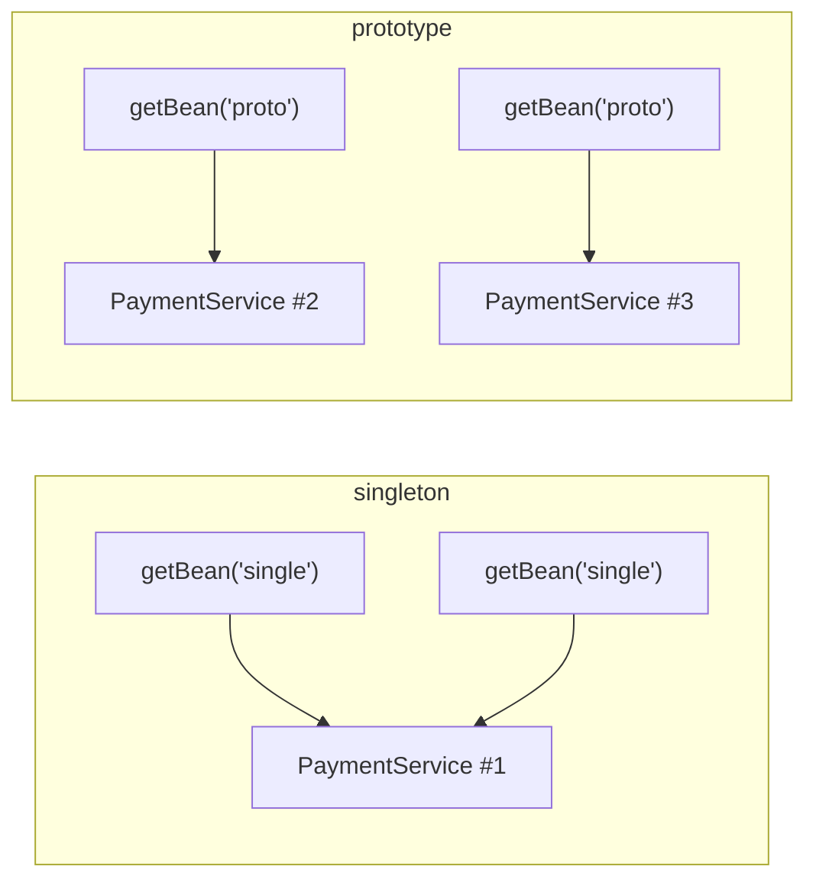
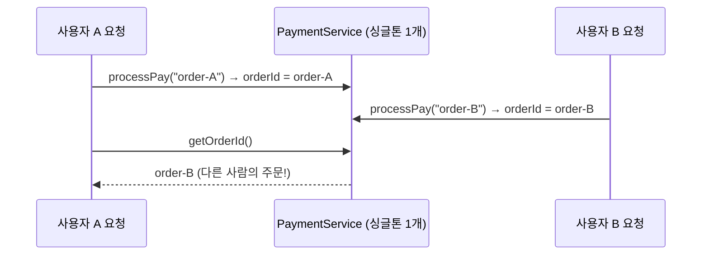

## 들어가며 (Situation)

지난 글에서 객체를 IoC 컨테이너에 Bean으로 등록하고 `getBean()`으로 꺼내 썼습니다. 그렇다면 `getBean()`을 두 번 호출하면 객체가 두 개 만들어질까요? 이번 실습(`chap01` section03)은 **Bean 스코프**를 다룹니다.

> 실제 서비스에서 겪은 문제가 아니라, 수업 실습을 정리한 글입니다. Spring Framework 7.0.8을 사용했고, 동작 설명은 Spring 공식 문서로 보완했습니다. 콘솔 출력은 기록하지 않아, 코드에서 예상되는 결과로 설명했습니다.

## 문제 상황 (Task)

- 컨테이너는 요청할 때마다 새 객체를 줄까요, 같은 객체를 줄까요?
- 같은 객체를 준다면, 그 객체에 값을 저장했을 때 어떤 일이 생길까요?

## 해결 과정 (Action)

### 1. 실험용 코드: 서비스에 주문 ID 필드 추가

```java
public class PaymentService {

    private final PaymentInterface paymentInterface;
    private String orderId;   // 마지막으로 처리한 주문 ID 를 저장

    public boolean processPay(String orderId, int amount) {
        this.orderId = orderId;
        // ... 결제 처리
    }

    public String getOrderId() {
        return this.orderId;
    }
}
```

같은 클래스를 스코프만 다르게 두 개의 Bean으로 등록합니다.

```java
@Configuration
public class AppConfig {

    @Bean("single")          // 이름 직접 지정 (기본값은 메서드명)
    @Scope("singleton")      // 기본값
    public PaymentService paymentService() {
        return new PaymentService(kakaoPayGateway());
    }

    @Bean("proto")
    @Scope("prototype")      // 요청할 때마다 새 인스턴스
    public PaymentService paymentService2() {
        return new PaymentService(kakaoPayGateway());
    }
}
```

`@Bean("이름")`으로 메서드 이름 대신 Bean 이름을 직접 지정할 수 있습니다.

### 2. singleton: 몇 번을 꺼내도 같은 객체

```java
PaymentService single = context.getBean("single", PaymentService.class);
single.processPay("order-001", 3);
System.out.println("single 의 주문 ID = " + single.getOrderId());

PaymentService single2 = context.getBean("single", PaymentService.class);
System.out.println("single2 의 주문 ID = " + single2.getOrderId());
```

`single2`로는 `processPay`를 호출한 적이 없는데도, 코드상 `single2.getOrderId()`는 `order-001`이 나옵니다. 수업 주석의 설명처럼 "`getBean()`으로 객체를 2번 꺼냈는데 `orderId`가 동일하다. 1개의 인스턴스를 공유한다. 싱글톤이다."

### 3. prototype: 꺼낼 때마다 새 객체

```java
PaymentService proto = context.getBean("proto", PaymentService.class);
proto.processPay("order-002", 3);
System.out.println("proto 의 주문 ID = " + proto.getOrderId());    // order-002

PaymentService proto2 = context.getBean("proto", PaymentService.class);
System.out.println("proto2 의 주문 ID = " + proto2.getOrderId());  // null
```

`proto2`는 새로 만들어진 객체라 `processPay`를 호출한 적이 없고, 그래서 `orderId`는 초기값인 `null`입니다.



| 항목 | singleton | prototype |
|------|-----------|-----------|
| 인스턴스 수 | 컨테이너당 1개 | `getBean` 호출마다 새로 생성 |
| 기본값 여부 | **기본값** | 직접 지정 필요 |
| 예상 결과 | `single2`도 `order-001` | `proto2`는 `null` |
| 장점 | 메모리 효율, 같은 동작 예상 가능 | 객체마다 독립적인 상태 |

수업 주석이 꼽은 싱글톤의 장점은 두 가지입니다. 객체를 하나만 만들어 **메모리 효율적**이고, 같은 인스턴스라 **동일한 동작을 예상**할 수 있다는 것입니다.

공식 문서에서 더해 둘 내용도 있습니다. prototype Bean은 컨테이너가 생성과 의존성 주입까지만 하고 이후 생명주기를 관리하지 않아서, 소멸 콜백이 호출되지 않습니다. 또 Spring의 싱글톤은 "자바 프로그램 전체에 하나"가 아니라 **"컨테이너 하나당 하나"** 라는 점에서, 클래스 수준에서 강제하는 싱글톤 디자인 패턴과 다르다고 설명합니다.

### 4. 가장 주의할 점: 싱글톤 Bean에 상태를 두지 않기

수업 주석이 "가장 주의!!!!"라고 강조한 부분입니다.

> Bean 이 상태(필드) 값을 가지게 되면 모든 요청이 해당 필드 값을 공유하게 된다. 따라서 필드에는 행위 위주의 클래스(ex. service, dao)만 작성하고, 데이터 저장이 필요한 경우에는 각 요청별로 DTO 를 통해서 데이터를 저장한다.

이번 실습의 `orderId` 필드가 바로 그 예입니다. 실제 웹 서비스라면 여러 사용자의 요청이 같은 `PaymentService` 객체를 동시에 씁니다. 사용자 A의 요청이 `orderId`를 저장한 직후 사용자 B의 요청이 덮어쓰면, A는 B의 주문 ID를 보게 됩니다. (예시 시나리오)



서블릿 라이프사이클 글에서 "서블릿은 인스턴스 하나를 여러 스레드가 함께 쓰므로 요청별 데이터를 필드에 두면 안 된다"고 정리했던 것과 같은 문제입니다. 컨테이너가 서블릿 컨테이너에서 Spring 컨테이너로 바뀌었을 뿐, 원칙은 같습니다.

| 둬도 되는 필드 | 두면 안 되는 필드 |
|----------------|-------------------|
| 다른 Bean 참조 (`final PaymentInterface`) | 요청마다 달라지는 값 (`orderId`, 로그인 사용자 등) |
| 변하지 않는 설정값 | 계산 중간 결과, 카운터 |

요청마다 다른 값은 메서드의 매개변수·지역 변수나 DTO로 주고받으면 됩니다.

### 5. 참고: 두 Bean이 공유하는 것

`single`과 `proto` 모두 `new PaymentService(kakaoPayGateway())`로 만듭니다. 지난 글에서 정리했듯 `@Configuration` 안의 `@Bean` 메서드 호출은 컨테이너의 Bean을 돌려주므로, `proto`를 몇 개 만들든 그 안의 `KakaoPayGateway`는 **같은 싱글톤 하나**를 공유하는 것으로 이해했습니다. prototype은 그 Bean 자체만 새로 만들고, 주입받는 의존 객체까지 새로 만들지는 않습니다.

## 결과 (Result)

코드에서 예상되는 결과를 정리했습니다.

| 호출 | 예상 `getOrderId()` |
|------|---------------------|
| `single` (`order-001` 처리) | `order-001` |
| `single2` (처리하지 않음) | `order-001` (같은 객체) |
| `proto` (`order-002` 처리) | `order-002` |
| `proto2` (처리하지 않음) | `null` (새 객체) |

- Bean의 기본 스코프는 singleton이며, 컨테이너 안에서 하나의 인스턴스를 공유합니다.
- prototype은 요청할 때마다 새로 만들고, 컨테이너가 소멸까지 관리하지는 않습니다.
- 싱글톤 Bean에는 요청별 상태를 두지 않고, 행위와 불변 의존성만 둡니다.

## 더 학습하면 좋은 개념

- **무상태(Stateless) 설계와 스레드 안전성** — 싱글톤 Bean이 왜 상태를 갖지 않아야 하는지의 근본 원리입니다.
- **웹 스코프(`request`, `session`)** — 웹 환경에서 요청·세션 단위로 Bean을 만드는 스코프로, 서블릿의 요청·세션 개념과 연결됩니다.
- **싱글톤 Bean에 prototype Bean 주입하기** — 주입 시점에 한 번만 만들어지는 문제와 `ObjectProvider` 같은 해결 방법입니다.
- **Bean 생명주기 콜백(`@PostConstruct`, `@PreDestroy`)** — 생성·소멸 시점에 실행할 코드를 지정하는 방법입니다.
- **싱글톤 디자인 패턴과의 차이** — 자바 수업의 `static` 싱글톤과 컨테이너 싱글톤을 비교해 볼 만합니다.

## 참고 자료

- [Spring Framework Reference - Bean Scopes](https://docs.spring.io/spring-framework/reference/core/beans/factory-scopes.html)
- [Spring Framework Reference - Basic Concepts: @Bean and @Configuration](https://docs.spring.io/spring-framework/reference/core/beans/java/basic-concepts.html)
- [Spring Framework Reference - Using the @Bean Annotation (Bean naming, @Scope)](https://docs.spring.io/spring-framework/reference/core/beans/java/bean-annotation.html)
- [Spring Framework API - @Scope](https://docs.spring.io/spring-framework/docs/current/javadoc-api/org/springframework/context/annotation/Scope.html)
