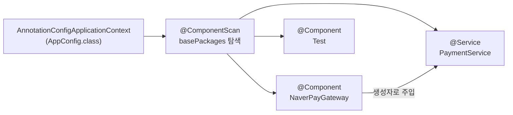

## 들어가며 (Situation)

지금까지는 `AppConfig`에 `@Bean` 메서드를 하나씩 써서 객체를 컨테이너에 등록했습니다. `chap02-dependency-injection`의 첫 주석은 이 방식에 문제를 제기합니다. "만약 Bean이 100개면?" 이번 글은 Bean을 자동으로 등록하는 **컴포넌트 스캔**과, 등록된 Bean끼리 연결하는 **의존성 주입(DI)의 세 가지 방식**을 정리합니다.

> 실제 서비스에서 겪은 문제가 아니라, 수업 실습을 정리한 글입니다. Spring Framework 7.0.8을 사용했고, 동작 설명은 Spring 공식 문서로 보완했습니다. 수업 중 여러 방식을 바꿔 가며 실행했기 때문에, 글의 코드는 방식별로 하나씩 정리한 형태입니다.

## 문제 상황 (Task)

- 클래스가 늘어날 때마다 `AppConfig`에 `@Bean` 메서드를 추가하지 않고 등록할 수 없을까요?
- 자동으로 등록된 Bean에 필요한 다른 Bean은 어떻게 넣어 줄까요?
- 주입 방식이 여러 가지라면 무엇을 써야 할까요?

## 해결 과정 (Action)

### 1. @Component와 @ComponentScan

등록하고 싶은 클래스에 어노테이션을 붙입니다.

```java
@Component
public class NaverPayGateway implements PaymentInterface { ... }

@Service
public class PaymentService {

    private final PaymentInterface paymentInterface;

    public PaymentService(PaymentInterface paymentInterface) {
        this.paymentInterface = paymentInterface;
    }
    // ...
}
```

설정 클래스에는 `@Bean` 메서드 대신 스캔 범위만 적습니다.

```java
@Configuration
@ComponentScan(basePackages = "com.wanted.di.section01")
public class AppConfig {
    // @Bean 메서드가 하나도 없다
}
```



| 어노테이션 | 의미 |
|------------|------|
| `@Component` | 이 클래스를 Bean으로 등록 대상에 포함 |
| `@Service` | `@Component`의 특수한 형태. Service 계층임을 나타냄 |
| `@ComponentScan` | 지정한 패키지에서 위 어노테이션이 붙은 클래스를 찾아 Bean으로 등록 |

수업 주석 기준의 규칙은 다음과 같습니다.

- `basePackages`를 지정하지 않으면 `@ComponentScan`이 붙은 클래스의 **패키지와 그 하위**를 스캔합니다. (수업 주석은 "동일한 레벨까지"라고 했는데, 공식 문서는 하위 패키지까지 포함한다고 설명합니다. 이 예제처럼 `config` 패키지에 둔 `AppConfig`가 `service`, `gateway`를 찾으려면 상위 패키지를 `basePackages`로 지정해야 하는 이유입니다.)
- 스캔으로 등록된 Bean의 이름은 **클래스 이름의 첫 글자를 소문자로** 바꾼 것입니다. `PaymentService` → `paymentService`
- `@Service("이름")`처럼 이름을 직접 지정할 수도 있습니다.

```java
PaymentService pay = context.getBean("paymentService", PaymentService.class);
pay.processPay("order-003", 3);
```

`PaymentService`의 생성자에 `PaymentInterface`가 필요한데, 컨테이너에 `PaymentInterface` 타입 Bean은 `NaverPayGateway` 하나뿐이라 자동으로 그것이 들어갑니다. `@Bean` 방식에서 `new PaymentService(kakaoPayGateway())`라고 직접 썼던 연결을 컨테이너가 대신 한 것입니다.

### 2. 스캔에서 제외하기: excludeFilters

수업에서는 제외 방법 세 가지를 주석으로 바꿔 가며 실습했습니다.

```java
@ComponentScan(basePackages = "com.wanted.di.section01",
    excludeFilters = @ComponentScan.Filter(
        // 1. 클래스 타입으로 제외
        type = FilterType.ASSIGNABLE_TYPE, classes = {PaymentService.class}
        // 2. 어노테이션으로 제외
        // type = FilterType.ANNOTATION, classes = {Service.class}
        // 3. 정규표현식으로 제외
        // type = FilterType.REGEX, pattern = {"com.wanted.di.section01.service.*"}
    ))
```

| 필터 타입 | 제외 기준 |
|-----------|-----------|
| `ASSIGNABLE_TYPE` | 특정 클래스(와 그 하위 타입) |
| `ANNOTATION` | 특정 어노테이션이 붙은 클래스 |
| `REGEX` | 클래스 전체 이름이 정규표현식과 일치 |

제외된 클래스는 Bean으로 등록되지 않으므로, 이를 `getBean`으로 꺼내면 Bean이 없다는 예외가 납니다.

### 3. 의존성 주입(DI)의 세 가지 방식

수업 주석은 DI를 "개발자가 직접 객체 간의 결합을 관리하는 것이 아니라, IoC 컨테이너가 자동으로 객체 간의 의존성을 주입하는 것 (`new` X)"이라고 정의했습니다. 같은 `PaymentInterface`를 주입받는 서비스를 세 가지 방식으로 만들어 비교했습니다.

**① 필드 주입**

```java
@Service
public class PaymentServiceField {

    @Autowired
    private PaymentInterface paymentInterface;
}
```

**② setter 주입**

```java
@Service
public class PaymentServiceSetter {

    private PaymentInterface paymentInterface;

    @Autowired
    public void setPaymentInterface(PaymentInterface paymentInterface) {
        this.paymentInterface = paymentInterface;
    }
}
```

**③ 생성자 주입**

```java
@Service
public class PaymentServiceConstructor {

    private final PaymentInterface paymentInterface;

    @Autowired   // 생성자가 하나뿐이면 생략 가능
    public PaymentServiceConstructor(PaymentInterface paymentInterface) {
        this.paymentInterface = paymentInterface;
    }
}
```

`@Autowired`는 "IoC 컨테이너에 있는 Bean을 찾아서 이 위치에 주입하라"는 뜻입니다.

| 항목 | 필드 주입 | setter 주입 | 생성자 주입 |
|------|-----------|-------------|-------------|
| `final` 사용 | 불가 | 불가 | **가능** |
| 의존성 누락 시 | 실행 중 `null` | setter가 안 불리면 `null` | 객체 생성 자체가 불가 |
| 코드 길이 | 가장 짧음 | 중간 | 중간 |
| 컨테이너 없이 테스트 | 어려움 (값 넣을 방법이 없음) | 가능 | 가능 (`new`로 직접 전달) |
| 장점 | 간단함 | **선택적 의존성**에 적합 | 불변성, 필수 의존성 강제 |
| 수업에서 꼽은 단점 | `final` 불가, 다른 객체를 대입해도 컴파일 에러가 나지 않음 | `final` 불가, 호출 전엔 `null` | (권장 방식) |

수업 주석의 결론은 생성자 주입이 **Spring 공식 권장 방식**이라는 것입니다. 근거는 두 가지였습니다.

1. `final`로 의존성이 바뀌는 것을 막을 수 있습니다(불변성).
2. `final` 필드는 반드시 초기화해야 하므로, 객체가 만들어지는 시점에 필요한 의존성이 모두 갖춰집니다(필수 의존성 강제).

공식 문서도 필수 의존성은 생성자 주입, 선택적 의존성은 setter 주입을 쓰라고 안내합니다. 또 생성자가 하나뿐이면 `@Autowired`를 생략해도 주입된다는 점도 공식 문서에 나옵니다. section01의 `PaymentService`가 `@Autowired` 없이 주입된 이유입니다.

## 결과 (Result)

정량 지표는 없고, 아래를 정리했습니다.

- `@Component`(와 `@Service` 등)를 붙이고 `@ComponentScan`으로 범위를 지정하면 `@Bean` 메서드 없이 Bean이 등록됩니다.
- 스캔 Bean의 이름은 클래스 이름의 첫 글자를 소문자로 한 것이고, 직접 지정할 수도 있습니다.
- `excludeFilters`로 타입, 어노테이션, 정규표현식 기준으로 스캔에서 제외할 수 있습니다.
- DI는 필드, setter, 생성자 세 가지가 있고, 필수 의존성은 `final` + 생성자 주입이 권장됩니다.

## 더 학습하면 좋은 개념

- **`@Repository`, `@Controller`** — `@Service`와 같은 스테레오타입 어노테이션으로, 계층 구조(Controller·Service·DAO)와 그대로 대응됩니다.
- **같은 타입 Bean이 여러 개일 때(`@Primary`, `@Qualifier`)** — `KakaoPayGateway`에도 `@Component`를 붙이면 `PaymentInterface` 후보가 둘이 되어 주입할 대상을 정해야 합니다.
- **순환 참조** — A가 B를, B가 A를 생성자로 요구할 때 생기는 문제이며, 생성자 주입이 이를 조기에 드러내 줍니다.
- **Lombok `@RequiredArgsConstructor`** — `final` 필드용 생성자를 자동으로 만들어 생성자 주입 코드를 줄여 줍니다.
- **Spring Boot의 자동 설정과 `@SpringBootApplication`** — 컴포넌트 스캔이 Boot에서는 어떻게 기본 적용되는지 이어집니다.

## 참고 자료

- [Spring Framework Reference - Classpath Scanning and Managed Components](https://docs.spring.io/spring-framework/reference/core/beans/classpath-scanning.html)
- [Spring Framework Reference - Dependency Injection](https://docs.spring.io/spring-framework/reference/core/beans/dependencies/factory-collaborators.html)
- [Spring Framework Reference - Using @Autowired](https://docs.spring.io/spring-framework/reference/core/beans/annotation-config/autowired.html)
- [Spring Framework API - @ComponentScan](https://docs.spring.io/spring-framework/docs/current/javadoc-api/org/springframework/context/annotation/ComponentScan.html)
- [Spring Framework API - FilterType](https://docs.spring.io/spring-framework/docs/current/javadoc-api/org/springframework/context/annotation/FilterType.html)
