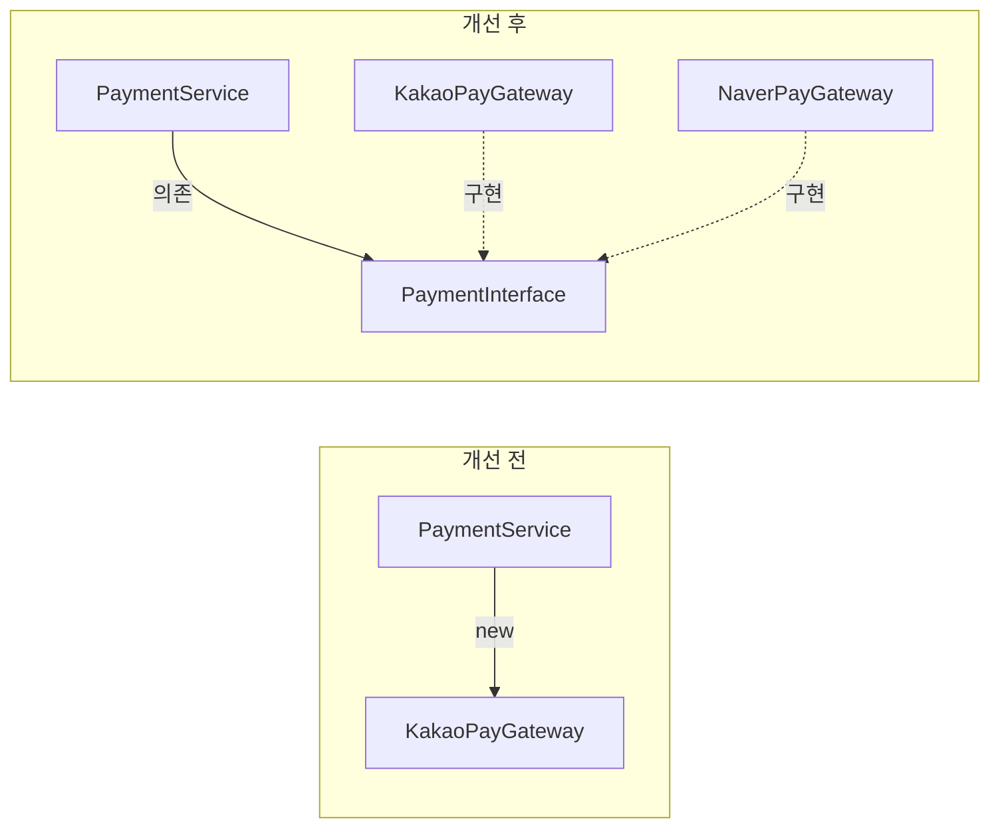
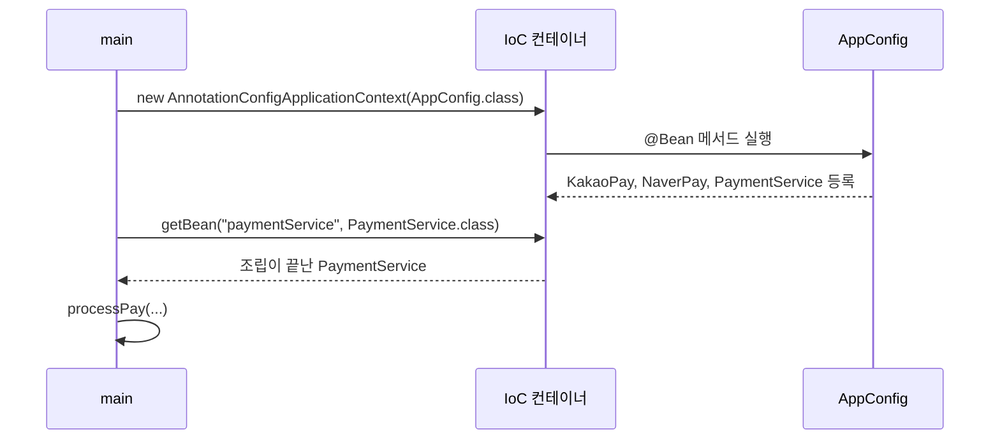

## 들어가며 (Situation)

서블릿 수업을 마치고 **Spring Core** 수업이 시작됐습니다. JDBC 계층 구조 실습에서 `Application`이 객체를 직접 조립하며 "추후 배울 Spring에서는 Application이 실행되면 모든 객체가 조립된다"고 예고했었는데, 그 내용을 처음 다뤘습니다. 실습(`chap01-IoC-container`)은 KakaoPay와 NaverPay 두 결제 수단을 가진 간단한 결제 시스템입니다.

> 실제 서비스에서 겪은 문제가 아니라, 수업 실습을 정리한 글입니다. Spring Framework `spring-context` 7.0.8을 사용했고, 동작 설명은 Spring 공식 문서로 보완했습니다. 콘솔 출력은 기록하지 않아, 코드에서 예상되는 결과로 설명했습니다.

## 문제 상황 (Task)

- 결제 수단을 NaverPay에서 KakaoPay로 바꾸라는 요구사항이 들어왔습니다. 몇 군데를 고쳐야 할까요?
- 객체를 개발자가 직접 `new`로 만드는 방식은 무엇이 문제일까요?

## 해결 과정 (Action)

### 1. 출발점: 서비스가 결제 구현체를 직접 생성

```java
public class PaymentService {

//    private NaverPayGateway naverPayGateway;
    private KakaoPayGateway kakaoPayGateway;

    public PaymentService() {
//        this.naverPayGateway = new NaverPayGateway();
        this.kakaoPayGateway = new KakaoPayGateway();
    }

    public boolean processPay(String orderId, int amount) {
//        boolean result = naverPayGateway.pay(orderId, amount);
        boolean result = kakaoPayGateway.pay(orderId, amount);
        // ...
    }
}
```

주석 처리된 줄이 변경 전(NaverPay), 그 아래가 변경 후(KakaoPay)입니다. 결제 수단 하나를 바꾸는데 **필드, 생성자, 메서드 호출 세 곳**을 고쳤습니다. 게다가 두 결제 클래스는 생김새도 다릅니다.

```java
public class KakaoPayGateway {
    public boolean pay(String orderId, int amount) { ... }
}

public class NaverPayGateway {
    public boolean pay(String orderId, double amount) { ... }   // 매개변수 타입이 다름
}
```

수업 주석은 이 코드의 문제를 두 가지로 정리했습니다.

1. 요구사항이 바뀌면 결제 구현체를 직접 바꿔야 합니다.
2. 메서드 이름이나 매개변수가 다르면 호출하는 쪽을 전부 수정해야 합니다.

이를 **SOLID의 개방-폐쇄 원칙(OCP)** 위반이라고 합니다. "소프트웨어는 확장에는 열려 있어야 하고, 변경에는 닫혀 있어야 한다." 하나를 바꿨을 때 여러 코드를 고쳐야 한다면 변경에 닫혀 있지 않은 것입니다.

### 2. 첫 번째 개선: 인터페이스로 약속 통일

```java
public interface PaymentInterface {
    boolean processPay(String orderId, int amount);
}

public class KakaoPayGateway implements PaymentInterface {
    @Override
    public boolean processPay(String orderId, int amount) { ... }
}

public class NaverPayGateway implements PaymentInterface {
    @Override
    public boolean processPay(String orderId, int amount) { ... }
}
```

```java
public class PaymentService {

    private final PaymentInterface paymentInterface;

    public PaymentService(PaymentInterface paymentInterface) {
        this.paymentInterface = paymentInterface;
    }

    public boolean processPay(String orderId, int amount) {
        boolean result = paymentInterface.processPay(orderId, amount);
        // ...
    }
}
```

두 가지가 바뀌었습니다.

| 변경 | 효과 |
|------|------|
| 인터페이스로 메서드 이름·매개변수 통일 | 구현체마다 다른 메서드 문제 해결 (자바 수업의 다형성) |
| `PaymentService`가 `new` 하지 않고 **생성자로 받음** | 서비스는 어떤 결제 수단인지 모름. 바꿀 때 서비스 코드는 그대로 |



그렇다면 이제 "어떤 구현체를 넣어 줄지"는 누가 정할까요? JDBC 실습에서는 `Application`의 `main`이 직접 조립했습니다. Spring에서는 이 일을 **IoC 컨테이너**가 맡습니다.

### 3. IoC 컨테이너에 객체 맡기기

먼저 의존성을 추가합니다.

```groovy
dependencies {
    /* spring-context : Spring 프레임 워크의 핵심 의존성. IoC Container 생성 */
    implementation 'org.springframework:spring-context:7.0.8'
}
```

컨테이너에 등록할 객체를 설정 클래스에 모읍니다.

```java
@Configuration
public class AppConfig {

    @Bean
    public KakaoPayGateway kakaoPayGateway() {
        return new KakaoPayGateway();
    }

    @Bean
    public NaverPayGateway naverPayGateway() {
        return new NaverPayGateway();
    }

    @Bean
    public PaymentService paymentService() {
        return new PaymentService(kakaoPayGateway());
    }
}
```

| 요소 | 의미 |
|------|------|
| `@Configuration` | 컨테이너에 등록할 객체를 모아 둔 설정 클래스 |
| `@Bean` | 메서드가 반환하는 객체를 컨테이너에 등록 |
| **Bean** | Spring 컨테이너가 관리하는 객체 |
| Bean 이름 | 기본값은 **메서드 이름** (`paymentService`) |

컨테이너를 만들고 Bean을 꺼내 씁니다.

```java
ApplicationContext context = new AnnotationConfigApplicationContext(AppConfig.class);

PaymentService paymentService = context.getBean("paymentService", PaymentService.class);
boolean result = paymentService.processPay("order-001", 3);
```



이제 결제 수단을 NaverPay로 바꾸려면 `AppConfig`의 `new PaymentService(kakaoPayGateway())`를 `naverPayGateway()`로 **한 줄만** 바꾸면 됩니다. `PaymentService`와 `main`은 수정할 필요가 없습니다.

| 변경 범위 | 직접 `new` (section01) | 인터페이스 + 컨테이너 (section02) |
|-----------|-------------------------|-------------------------------------|
| `PaymentService` 필드·생성자·호출부 | 수정 3곳 | 수정 없음 |
| 메서드 이름·매개변수 차이 | 호출부 수정 | 인터페이스로 통일되어 없음 |
| 결제 수단 선택 | 서비스 내부 | `AppConfig` 한 줄 |

### 4. "제어의 역전(IoC)"이 의미하는 것

객체를 만들고 연결하는 주도권이 개발자 코드(`main`, `PaymentService` 생성자)에서 **컨테이너로 넘어갔다**는 뜻입니다. 서블릿 글에서 "서블릿은 우리가 `new` 하지 않고 컨테이너(Tomcat)가 만든다"고 정리했던 것과 같은 원리이고, 이번에는 그 대상이 우리가 만든 일반 객체로 넓어졌습니다.

수업 주석은 "IoC Container == Application Context == Bean Factory"라고 적었습니다. 공식 문서 기준으로는 조금 구분됩니다. `BeanFactory`가 Bean을 관리하는 기본 인터페이스이고, `ApplicationContext`는 이를 확장해 기능을 더한 인터페이스입니다. 공식 문서도 대부분의 경우 `ApplicationContext`를 쓰라고 권장하므로, 실무에서 "IoC 컨테이너"라고 하면 보통 `ApplicationContext`를 가리킨다고 이해하면 됩니다.

### 5. 한 걸음 더: `kakaoPayGateway()`를 두 번 호출하면?

`AppConfig`의 `paymentService()` 안에서 `kakaoPayGateway()`를 직접 호출합니다. 자바 코드만 보면 호출할 때마다 `new KakaoPayGateway()`가 실행될 것 같습니다. 하지만 공식 문서에 따르면 `@Configuration` 클래스는 Spring이 프록시로 감싸서, `@Bean` 메서드 사이의 호출은 **컨테이너에 이미 등록된 Bean을 돌려줍니다.** 그래서 컨테이너 안의 `KakaoPayGateway`는 하나로 유지됩니다. 이 동작은 다음 글의 Bean 스코프와 이어집니다.

## 결과 (Result)

정량 지표는 없고, 아래를 정리했습니다.

- 구현체를 직접 `new` 하면 바꿀 때 여러 곳을 고쳐야 하고, 이는 개방-폐쇄 원칙 위반입니다.
- 인터페이스로 약속을 통일하고, 서비스는 구현체를 생성자로 받게 바꿨습니다.
- 어떤 구현체를 넣을지는 IoC 컨테이너(`@Configuration` + `@Bean`)가 정하고, 바꿀 때는 설정 한 줄만 고칩니다.
- `ApplicationContext`는 `BeanFactory`를 확장한 컨테이너이며, 보통 이쪽을 씁니다.

## 더 학습하면 좋은 개념

- **SOLID 원칙, 특히 의존 역전 원칙(DIP)** — `PaymentService`가 구현체가 아닌 인터페이스에 의존하게 바꾼 것이 DIP입니다. OCP와 함께 Spring 설계의 바탕입니다.
- **`@Configuration`의 프록시(CGLIB)** — `@Bean` 메서드를 여러 번 호출해도 Bean이 하나로 유지되는 이유입니다.
- **`BeanFactory` vs `ApplicationContext`** — 지연 로딩, 이벤트, 국제화 등 두 컨테이너의 기능 차이입니다.
- **같은 타입의 Bean이 여러 개일 때(`@Primary`, `@Qualifier`)** — KakaoPay와 NaverPay를 둘 다 자동 주입 대상으로 등록하면 생기는 문제와 해결 방법입니다.
- **팩토리 패턴** — 컨테이너가 하는 일을 직접 구현해 보면 IoC가 해결하는 문제가 더 분명해집니다.

## 참고 자료

- [Spring Framework Reference - The IoC Container](https://docs.spring.io/spring-framework/reference/core/beans.html)
- [Spring Framework Reference - Introduction to the Spring IoC Container and Beans](https://docs.spring.io/spring-framework/reference/core/beans/introduction.html)
- [Spring Framework Reference - Basic Concepts: @Bean and @Configuration](https://docs.spring.io/spring-framework/reference/core/beans/java/basic-concepts.html)
- [Spring Framework Reference - Using the @Configuration annotation](https://docs.spring.io/spring-framework/reference/core/beans/java/configuration-annotation.html)
- [Spring Framework API - ApplicationContext](https://docs.spring.io/spring-framework/docs/current/javadoc-api/org/springframework/context/ApplicationContext.html)
