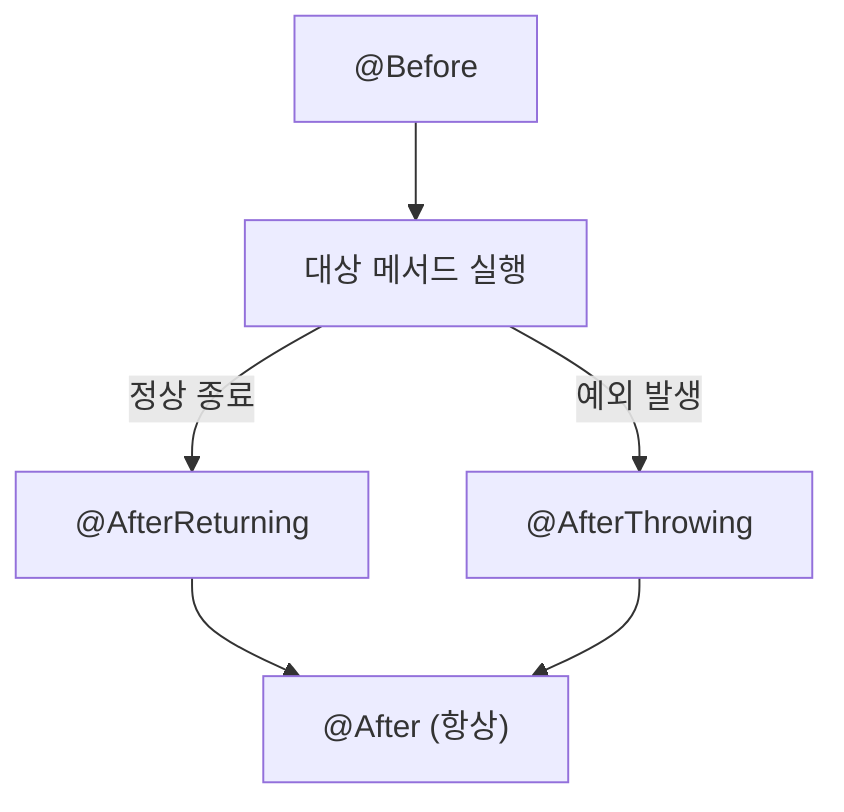
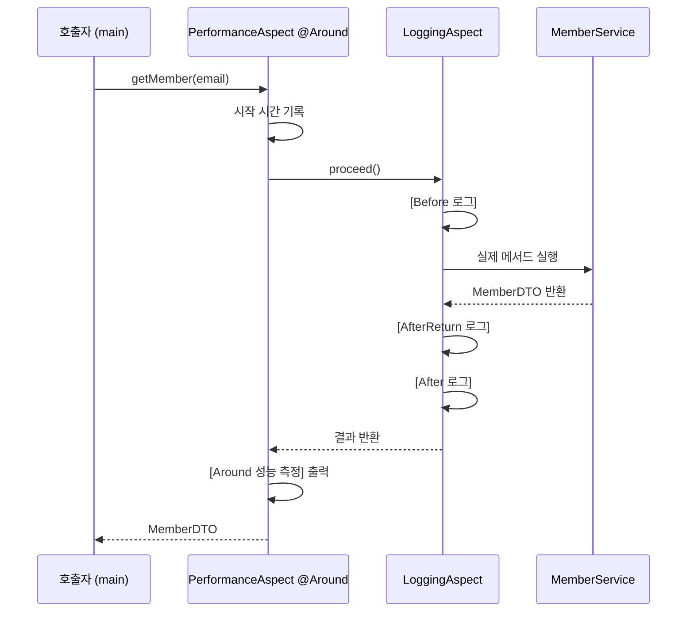
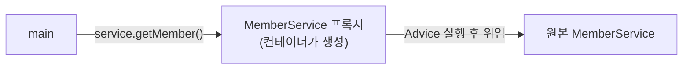

## 들어가며 (Situation)

지난 글에서 회원 관리 서비스의 로그·성능 측정 코드를 Aspect로 옮겼습니다. 이번 글은 그 Aspect 안을 자세히 봅니다. `LoggingAspect`는 실행 시점이 다른 Advice 네 개를, `PerformanceAspect`는 `@Around` 하나를 가집니다. 메서드 하나가 호출되면 이 다섯 개가 **어떤 순서로** 실행될까요?

> 실제 서비스에서 겪은 문제가 아니라, 수업 실습을 정리한 글입니다. Spring Framework 7.0.8을 사용했습니다. 콘솔 출력은 기록하지 않아, 실행 순서는 Spring 공식 문서에 설명된 규칙을 기준으로 정리했습니다.

## 문제 상황 (Task)

- 메서드 실행 "전", "후", "정상 종료 후", "예외 발생 후", "전후 모두"를 어떻게 구분해 지정할까요?
- 메서드 이름과 매개변수, 반환값, 예외 객체는 Advice에서 어떻게 꺼낼까요?
- 서비스 코드에는 아무 흔적도 없는데, Spring은 어떻게 Advice를 끼워 넣을까요?

## 해결 과정 (Action)

### 1. Advice 다섯 가지

| Advice | 실행 시점 | 실습에서의 용도 |
|--------|-----------|-----------------|
| `@Before` | 대상 메서드 실행 전 | 시작 로그, 매개변수 출력 |
| `@After` | 대상 메서드 종료 후 (**정상·예외 상관없이**) | 종료 로그. 수업 주석: 타이머 종료, 자원 정리 |
| `@AfterReturning` | **정상 종료**하고 값을 반환한 후 | 반환값 확인 |
| `@AfterThrowing` | **예외가 발생**했을 때 | 예외 로그 |
| `@Around` | 실행 **전후 모두**, 실행 자체를 제어 | 실행 시간 측정 |

`@After`는 자바의 `finally`, `@AfterReturning`은 `try` 블록의 끝, `@AfterThrowing`은 `catch`에 대응한다고 생각하면 쉽습니다. section01에서 직접 쓴 `try-catch-finally` 틀이 그대로 Advice 종류로 나뉜 것입니다.



### 2. JoinPoint로 실행 정보 꺼내기

```java
@Before("execution(* com.wanted.aop.section02.MemberService.*(..))")
public void logBefore(JoinPoint joinPoint) {
    String methodName = joinPoint.getSignature().getName();
    Object[] args = joinPoint.getArgs();

    StringBuilder argStr = new StringBuilder();
    for (Object arg : args) {
        argStr.append(arg).append(" , ");
    }
    System.out.println("[Before 로그] " + methodName + " 메서드 실행 시작 됨, 매개변수 : " + argStr);
}
```

**`JoinPoint`** 는 Advice가 적용된 지점의 정보를 담은 객체로, Advice 메서드의 매개변수로 받습니다.

| 메서드 | 반환 |
|--------|------|
| `getSignature().getName()` | 실행 중인 메서드 이름 (`registerMember` 등) |
| `getArgs()` | 전달된 매개변수 배열 |

### 3. 반환값과 예외 받기: returning, throwing

```java
@AfterReturning(
        pointcut = "execution(* com.wanted.aop.section02.MemberService.*(..))",
        returning = "result"
)
public void logAfterReturning(JoinPoint joinPoint, Object result) {
    System.out.println("[AfterReturn 로그] " + joinPoint.getSignature().getName()
            + " 메소드 정상 종료, 종료 시 반환값 : " + result);
}

@AfterThrowing(
        pointcut = "execution(* com.wanted.aop.section02.MemberService.*(..))",
        throwing = "exception"
)
public void logAfterThrowing(JoinPoint joinPoint, Exception exception) {
    System.out.println("[AfterThrowing 로그] " + joinPoint.getSignature().getName()
            + " 메소드 실행 중 예외 발생 : " + exception.getMessage());
}
```

- `returning = "result"`는 "대상 메서드의 반환값을 `result`라는 매개변수로 받겠다"는 뜻입니다. 이름이 매개변수 이름과 같아야 합니다.
- `registerMember`처럼 `void` 메서드는 반환값이 없으므로 `result`는 `null`로 출력됩니다. 반환값을 의미 있게 보는 것은 `getMember`(조회된 `MemberDTO`)입니다.
- `throwing = "exception"`도 같은 방식으로 예외 객체를 받습니다. 테스트 5(탈퇴한 회원 조회)에서 `IllegalArgumentException`이 이 Advice에 잡힙니다.

수업 주석은 `@AfterThrowing`으로 "예외 흐름 복구 로직도 할 수는 있지만, 더 좋은 예외 처리로 하는 것이 좋다"고 덧붙였습니다. 이 Advice는 예외를 **관찰**할 뿐 삼키지 않아서, 예외는 그대로 호출한 쪽으로 전달됩니다.

### 4. @Around: 실행 자체를 손에 쥐는 Advice

```java
@Component
@Aspect
@Order(1)
public class PerformanceAspect {

    @Around("execution(* com.wanted.aop.section02.MemberService.*(..))")
    public Object performance(ProceedingJoinPoint joinPoint) {
        long startTime = System.currentTimeMillis();
        try {
            Object result = joinPoint.proceed();   // 여기서 대상 메서드가 실행된다
            return result;
        } catch (Throwable e) {
            throw new RuntimeException(e);
        } finally {
            long endTime = System.currentTimeMillis();
            System.out.println("[Around 성능 측정] " + joinPoint.getSignature().getName()
                    + " 메서드 실행 시간 : " + (endTime - startTime) + "(ms)");
        }
    }
}
```

수업 주석은 `@Around`를 "Advice 중 가장 강력한 어노테이션, 메서드의 앞뒤에 모두 동작"이라고 소개했습니다. 핵심은 **`ProceedingJoinPoint.proceed()`** 입니다.

- `proceed()`를 호출해야 대상 메서드가 실행됩니다. 호출하지 않으면 대상 메서드는 아예 실행되지 않습니다.
- `proceed()`의 반환값을 `return` 해야 호출한 쪽이 결과를 받습니다. `getMember`의 `MemberDTO`가 여기서 전달됩니다.
- 그래서 `@Around` 메서드의 반환 타입은 `Object`입니다.

서블릿 필터의 `chain.doFilter()` 앞뒤로 시간을 쟀던 `PerformanceFilter`와 구조가 똑같습니다. `proceed()`가 `chain.doFilter()`의 자리에 있습니다.

| 비교 | `PerformanceFilter` (서블릿) | `PerformanceAspect` (AOP) |
|------|------------------------------|---------------------------|
| 다음 단계 호출 | `chain.doFilter(req, resp)` | `joinPoint.proceed()` |
| 적용 단위 | HTTP 요청 | Bean 메서드 호출 |
| 대상 지정 | URL 패턴 (`/*`) | 포인트컷 표현식 |

**예외 처리에서 알아 둘 점이 있습니다.** 수업 코드는 `proceed()`에서 난 예외를 `RuntimeException`으로 감싸서 다시 던집니다. 그래서 `main`의 `catch`가 받는 것은 원래의 `IllegalArgumentException`이 아니라 그것을 감싼 `RuntimeException`이고, `e.getMessage()`의 내용도 원래 메시지 앞에 예외 클래스 이름이 붙은 형태로 바뀝니다. 원래 예외를 그대로 전달하려면 메서드에 `throws Throwable`을 선언하고 다시 던지는 방식이 일반적입니다. (예시 코드)

```java
@Around("execution(* com.wanted.aop.section02.MemberService.*(..))")
public Object performance(ProceedingJoinPoint joinPoint) throws Throwable {
    long startTime = System.currentTimeMillis();
    try {
        return joinPoint.proceed();
    } finally {
        // 실행 시간 출력
    }
}
```

### 5. 실행 순서

`MemberService`의 메서드 하나에 Advice 다섯 개가 걸려 있습니다. 순서를 정하는 규칙은 두 가지입니다.

**① Aspect 사이의 순서: `@Order`**

`PerformanceAspect`에는 `@Order(1)`이 있고 `LoggingAspect`에는 없습니다. 숫자가 작을수록 우선순위가 높고, 우선순위가 높은 Aspect가 **바깥쪽**을 감쌉니다. `@Order`가 없으면 가장 낮은 우선순위입니다. 따라서 `PerformanceAspect`의 `@Around`가 가장 바깥에서 전체를 감싸고, 그 안에서 `LoggingAspect`가 동작합니다.

**② 같은 Aspect 안의 순서**

공식 문서에 따르면 같은 Aspect 안에서는 `@Around`, `@Before`, `@After`, `@AfterReturning`, `@AfterThrowing` 순으로 우선순위가 정해지며, `@After`는 같은 Aspect의 `@AfterReturning`·`@AfterThrowing`보다 **나중에** 호출됩니다.

이 두 규칙을 적용하면 정상 실행 시 출력 순서는 다음과 같을 것으로 예상합니다.



| 순서 | 정상 종료 시 | 예외 발생 시 (테스트 5) |
|------|-------------|------------------------|
| 1 | `[Before 로그]` | `[Before 로그]` |
| 2 | (메서드 실행) | (메서드 실행 중 예외) |
| 3 | `[AfterReturn 로그]` | `[AfterThrowing 로그]` |
| 4 | `[After 로그]` | `[After 로그]` |
| 5 | `[Around 성능 측정]` | `[Around 성능 측정]` |

이 표는 공식 문서의 규칙을 적용한 예상이며, 실제 출력은 기록해 두지 않았습니다. 실행 결과가 다르면 Spring 버전별 규칙을 공식 문서에서 다시 확인해야 합니다.

### 6. 서비스 코드는 그대로인데 어떻게 끼어들까: 프록시

`MemberService`에는 Aspect와 관련된 코드가 한 줄도 없습니다. 그런데도 Advice가 실행되는 것은, `getBean(MemberService.class)`가 돌려주는 객체가 **원본 `MemberService`가 아니라 그것을 감싼 프록시 객체**이기 때문입니다.



- `@EnableAspectJAutoProxy`가 켜져 있으면, 컨테이너는 포인트컷에 해당하는 Bean을 등록할 때 프록시로 감싸서 등록합니다.
- `MemberService`는 인터페이스를 구현하지 않은 클래스라서, 공식 문서 기준으로 클래스를 상속하는 방식(CGLIB)의 프록시가 만들어집니다.
- 지난 글에서 `MemberService`를 `new`가 아니라 **컨테이너에서 꺼내야 한다**고 했던 이유가 이것입니다. 직접 `new MemberService()`로 만든 객체는 프록시가 아니어서 Advice가 하나도 실행되지 않습니다.

공식 문서는 이 방식의 한계도 설명합니다. 프록시를 거치는 **외부 호출**에만 Advice가 적용되므로, `MemberService` 안에서 자기 자신의 다른 메서드를 호출(`this.getMember(...)`)하면 프록시를 거치지 않아 Advice가 적용되지 않습니다.

## 결과 (Result)

정량 지표는 없고, 아래를 정리했습니다.

- Advice는 실행 시점에 따라 `@Before`, `@After`, `@AfterReturning`, `@AfterThrowing`, `@Around` 다섯 가지이며, `try-catch-finally` 구조와 대응됩니다.
- `JoinPoint`로 메서드 이름과 매개변수를, `returning`·`throwing`으로 반환값과 예외를 받습니다.
- `@Around`는 `proceed()`로 대상 메서드 실행을 직접 제어하고, 결과를 반드시 반환해야 합니다. 예외를 감싸면 호출자가 받는 예외가 바뀝니다.
- `@Order`가 작은 Aspect가 바깥을 감싸고, 같은 Aspect 안에서는 공식 문서의 우선순위 규칙을 따릅니다.
- Spring AOP는 프록시로 동작하므로, Bean을 컨테이너에서 꺼내 쓸 때만 적용되고 내부 호출에는 적용되지 않습니다.

## 더 학습하면 좋은 개념

- **JDK 동적 프록시 vs CGLIB** — 인터페이스 유무에 따라 프록시를 만드는 방식이 달라지는 이유와 각각의 제약입니다.
- **프록시 패턴, 데코레이터 패턴** — Spring AOP가 기반으로 하는 디자인 패턴입니다.
- **자기 호출(Self-invocation) 문제** — `@Transactional`이 같은 클래스 내부 호출에서 동작하지 않는 이유와 같은 원리입니다.
- **`@Transactional`의 동작 원리** — 트랜잭션 처리가 바로 이 `@Around` 방식의 Advice로 구현되어 있습니다.
- **AspectJ의 컴파일 타임 위빙** — 프록시 없이 바이트코드에 직접 끼워 넣는 방식으로, Spring AOP의 한계를 넘는 대안입니다.

## 참고 자료

- [Spring Framework Reference - Declaring Advice](https://docs.spring.io/spring-framework/reference/core/aop/ataspectj/advice.html)
- [Spring Framework Reference - Advice Ordering](https://docs.spring.io/spring-framework/reference/core/aop/ataspectj/advice.html#aop-ataspectj-advice-ordering)
- [Spring Framework Reference - Proxying Mechanisms](https://docs.spring.io/spring-framework/reference/core/aop/proxying.html)
- [Spring Framework Reference - Understanding AOP Proxies](https://docs.spring.io/spring-framework/reference/core/aop/proxying.html#aop-understanding-aop-proxies)
- [AspectJ API - ProceedingJoinPoint](https://javadoc.io/doc/org.aspectj/aspectjrt/latest/org/aspectj/lang/ProceedingJoinPoint.html)
