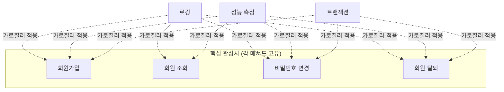

## 들어가며 (Situation)

Spring Core 수업의 세 번째 주제는 **AOP(Aspect Oriented Programming, 관점 지향 프로그래밍)** 였습니다. 실습(`chap03-aop`)은 회원 관리 프로그램입니다. 기능은 회원가입, 회원 조회, 비밀번호 변경, 탈퇴 네 가지이고, 여기에 **로깅과 성능 측정**이라는 비기능 요구사항이 붙습니다.

> 실제 서비스에서 겪은 문제가 아니라, 수업 실습을 정리한 글입니다. Spring Framework 7.0.8, AspectJ 1.9.25.1을 사용했고, 동작 설명은 Spring 공식 문서로 보완했습니다. 회원 저장소는 DB 대신 `HashMap`을 쓴 인메모리 구조입니다.

## 문제 상황 (Task)

- 네 개의 메서드 모두에 "시작 로그, 성공·실패 로그, 실행 시간 측정, 트랜잭션 처리" 코드가 들어가야 합니다.
- 이 코드들은 비즈니스 로직이 아닌데도 모든 메서드에 같은 모양으로 반복됩니다. 한곳에 모을 수는 없을까요?

## 해결 과정 (Action)

### 1. AOP 적용 전: 핵심 로직이 부가 코드에 파묻힌 메서드

section01의 회원가입 메서드는 이런 구조입니다. (중간 생략)

```java
public void registerMember(MemberDTO member) {
    // 성능 측정 시작 - 횡단 관심사 #1
    long startTime = System.currentTimeMillis();

    try {
        // 로깅 - 횡단 관심사 #2
        System.out.println("[로그] 회원 가입 시작: " + member.getEmail());

        // 트랜잭션 시작 (의사코드) - 횡단 관심사 #3
        // beginTransaction();

        // ----- 핵심 비즈니스 로직 시작 -----
        // 이메일·비밀번호 검증, 중복 확인, 저장
        // ----- 핵심 비즈니스 로직 종료 -----

        // commitTransaction();
        System.out.println("[로그] 회원 가입 성공: " + member.getEmail());
    } catch (Exception e) {
        // rollbackTransaction();
        System.out.println("[로그] 회원 가입 실패: " + e.getMessage());
        throw e;
    } finally {
        long endTime = System.currentTimeMillis();
        System.out.println("[성능] 회원 가입 처리 시간: " + (endTime - startTime) + "ms");
    }
}
```

`getMember`, `updatePassword`, `deleteMember`도 로그 문구만 다를 뿐 같은 `try-catch-finally` 틀을 그대로 반복합니다.

수업 주석은 section01의 문제를 세 가지로 정리했습니다.

| 문제 | 내용 |
|------|------|
| 코드 중복 | 모든 메서드마다 로깅, 성능 측정, 트랜잭션 코드가 반복됨 |
| 낮은 응집도 | 각 메서드가 핵심 비즈니스 로직 외의 일까지 함 |
| 유지보수 어려움 | 로그 양식이나 성능 측정 기준이 바뀌면 모든 메서드를 수정해야 함 |

### 2. 핵심 관심사와 횡단 관심사

이런 코드를 **횡단 관심사(Cross-cutting Concern)** 라고 부릅니다. 여러 기능(메서드)을 **가로질러** 공통으로 필요한 관심사라는 뜻입니다.



AOP는 이 횡단 관심사를 **별도의 모듈(Aspect)로 분리**하고, "어디에 적용할지"만 선언해서 끼워 넣는 방식입니다. 서블릿 수업의 `PerformanceFilter`가 모든 요청의 처리 시간을 서블릿 코드 밖에서 측정했던 것과 같은 발상입니다. 차이는 적용 단위입니다. 필터는 HTTP 요청 단위이고, AOP는 Spring Bean의 **메서드 호출** 단위입니다.

### 3. AOP 적용 후: 서비스에는 핵심 로직만

section02의 `MemberService`는 같은 기능에서 부가 코드를 모두 지운 모습입니다.

```java
@Service
public class MemberService {

    private Map<String, MemberDTO> memberRepository = new HashMap<>();

    public void registerMember(MemberDTO member) {
        if (member.getEmail() == null || member.getEmail().isEmpty()) {
            throw new IllegalArgumentException("이메일은 필수입니다.");
        }
        if (member.getPassword() == null || member.getPassword().length() < 8) {
            throw new IllegalArgumentException("비밀번호는 8자 이상이어야 합니다.");
        }
        if (memberRepository.containsKey(member.getEmail())) {
            throw new IllegalArgumentException("이미 등록된 이메일입니다: " + member.getEmail());
        }
        memberRepository.put(member.getEmail(), member);
    }
    // getMember, updatePassword, deleteMember 도 핵심 로직만 남음
}
```

로그와 성능 측정 코드는 **Aspect 클래스**로 옮겨졌습니다.

```java
@Component
@Aspect
public class LoggingAspect {

    @Before("execution(* com.wanted.aop.section02.MemberService.*(..))")
    public void logBefore(JoinPoint joinPoint) {
        String methodName = joinPoint.getSignature().getName();
        System.out.println("[Before 로그]" + methodName + " 메서드 실행 시작 됨");
    }
    // @After, @AfterReturning, @AfterThrowing ...
}
```

| 비교 | section01 (적용 전) | section02 (적용 후) |
|------|---------------------|---------------------|
| `MemberService` 내용 | 핵심 로직 + 로그 + 성능 측정 + 트랜잭션 | 핵심 로직만 |
| 로그 양식 변경 시 | 메서드 4개 수정 | `LoggingAspect` 한 곳 수정 |
| 새 메서드 추가 시 | 부가 코드도 직접 복사 | 포인트컷에 해당하면 자동 적용 |

### 4. AOP 용어 정리

수업 주석의 설명을 공식 문서 용어와 맞춰 정리했습니다.

| 용어 | 의미 | 실습에서 |
|------|------|----------|
| **Aspect** | 횡단 관심사를 모은 모듈. "어디에(Pointcut)"와 "무엇을(Advice)"을 묶음 | `LoggingAspect`, `PerformanceAspect` |
| **Advice** | 실제로 실행할 부가 기능과 실행 시점 | `@Before`, `@After`, `@AfterReturning`, `@AfterThrowing`, `@Around` |
| **Pointcut** | Advice를 적용할 대상을 고르는 표현식 | `execution(* com.wanted.aop.section02.MemberService.*(..))` |
| **Join Point** | Advice가 끼어들 수 있는 지점. Spring AOP에서는 **메서드 실행** | `registerMember` 실행 등 |
| **Target** | Advice가 적용되는 원래 객체 | `MemberService` |

### 5. Pointcut 표현식 읽기

```
execution(* com.wanted.aop.section02.MemberService.*(..))
          ①  ②                                    ③ ④
```

| 위치 | 부분 | 의미 |
|------|------|------|
| ① | `*` | 반환 타입 아무거나 (접근 제어자는 생략 가능) |
| ② | `com.wanted.aop.section02.MemberService` | 패키지와 클래스 |
| ③ | `*` | 메서드 이름 아무거나 = 클래스의 모든 메서드 |
| ④ | `(..)` | 매개변수 0개 이상 아무거나 |

수업에서 정리한 매개변수 패턴도 함께 기억해 둡니다.

| 패턴 | 매칭 대상 |
|------|-----------|
| `()` | 매개변수가 없는 메서드 |
| `(..)` | 매개변수 개수·타입 상관없음 |
| `(String)` | `String` 하나만 받는 메서드 |
| `(String, ..)` | 첫 매개변수가 `String`이고 나머지는 상관없음 |

### 6. AOP를 켜는 설정

```groovy
implementation 'org.springframework:spring-context:7.0.8'
implementation 'org.springframework:spring-aop:7.0.8'
implementation 'org.aspectj:aspectjweaver:1.9.25.1'
```

```java
@Configuration
@ComponentScan("com.wanted.aop.section02")
@EnableAspectJAutoProxy
public class AppConfig {
}
```

- `@Aspect`, `@Before` 같은 어노테이션은 AspectJ 라이브러리의 것이라 `aspectjweaver` 의존성이 필요합니다.
- `@Aspect`만으로는 Bean으로 등록되지 않습니다. 그래서 `@Component`를 함께 붙여 컴포넌트 스캔 대상이 되게 합니다. (공식 문서에서도 두 어노테이션을 함께 쓰도록 안내합니다.)
- `@EnableAspectJAutoProxy`가 있어야 Spring이 `@Aspect` Bean을 찾아 실제로 적용합니다.

`Application`에서는 `MemberService`를 직접 `new` 하지 않고 컨테이너에서 꺼냅니다.

```java
ApplicationContext context = new AnnotationConfigApplicationContext(AppConfig.class);
MemberService service = context.getBean(MemberService.class);
```

컨테이너에서 꺼내야 하는 이유는 Spring AOP의 동작 방식(프록시) 때문이며, 다음 글에서 다룹니다.

### 7. 덤: Lombok으로 DTO 줄이기

이번 실습에서 Lombok이 처음 등장했습니다.

```groovy
compileOnly 'org.projectlombok:lombok:1.18.46'
annotationProcessor 'org.projectlombok:lombok:1.18.46'
```

```java
// DTO 는 행위 위주의 객체가 아닌 데이터 위주의 객체이다.
@NoArgsConstructor
@AllArgsConstructor
@Getter
@Setter
@ToString
public class MemberDTO {
    private String email;
    private String password;
    private String name;
    private String phone;
    private String role;
}
```

JDBC 수업의 `MenuDTO`에서 직접 썼던 기본 생성자, 전체 필드 생성자, Getter/Setter, `toString`을 어노테이션 다섯 개가 컴파일 시점에 만들어 줍니다. `compileOnly`와 `annotationProcessor`로 등록하는 것은 Lombok이 실행 중이 아니라 **컴파일할 때** 코드를 생성하기 때문입니다.

## 결과 (Result)

정량 지표는 없고, 아래를 정리했습니다.

- 로깅·성능 측정·트랜잭션처럼 여러 메서드에 반복되는 코드를 횡단 관심사라고 합니다.
- AOP는 이를 Aspect로 분리하고, Pointcut으로 적용 대상을, Advice로 실행 시점과 내용을 정합니다.
- AOP를 적용하자 `MemberService`에는 핵심 비즈니스 로직만 남았습니다.
- 설정에는 `aspectjweaver` 의존성, `@Aspect` + `@Component`, `@EnableAspectJAutoProxy`가 필요합니다.

## 더 학습하면 좋은 개념

- **`@Pointcut`으로 표현식 재사용** — 같은 `execution(...)` 문자열을 Advice마다 반복하지 않고 이름을 붙여 재사용하는 방법입니다.
- **`within`, `@annotation` 등 다른 포인트컷 지정자** — 패키지 단위나 특정 어노테이션이 붙은 메서드만 고르는 방법입니다.
- **`@Transactional`** — 이번 실습에서 의사코드로 남긴 트랜잭션 처리를 Spring이 AOP로 제공하는 실제 기능입니다.
- **필터 vs 인터셉터 vs AOP** — 공통 처리를 어느 계층에서 할지 고르는 기준입니다.
- **Lombok 사용 시 주의점(`@Data`, `@Setter` 남용)** — 편리하지만 불필요한 setter가 객체의 불변성을 깨뜨릴 수 있습니다.

## 참고 자료

- [Spring Framework Reference - Aspect Oriented Programming with Spring](https://docs.spring.io/spring-framework/reference/core/aop.html)
- [Spring Framework Reference - AOP Concepts](https://docs.spring.io/spring-framework/reference/core/aop/introduction-defn.html)
- [Spring Framework Reference - Enabling @AspectJ Support](https://docs.spring.io/spring-framework/reference/core/aop/ataspectj/aspectj-support.html)
- [Spring Framework Reference - Declaring an Aspect](https://docs.spring.io/spring-framework/reference/core/aop/ataspectj/at-aspectj.html)
- [Spring Framework Reference - Declaring a Pointcut](https://docs.spring.io/spring-framework/reference/core/aop/ataspectj/pointcuts.html)
- [Project Lombok - Features](https://projectlombok.org/features/)
