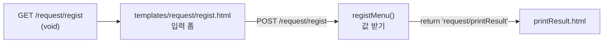
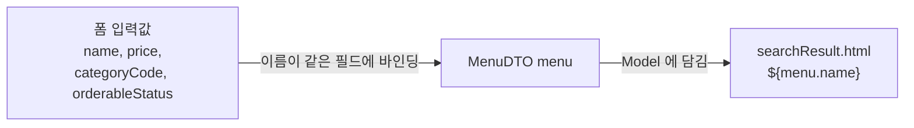
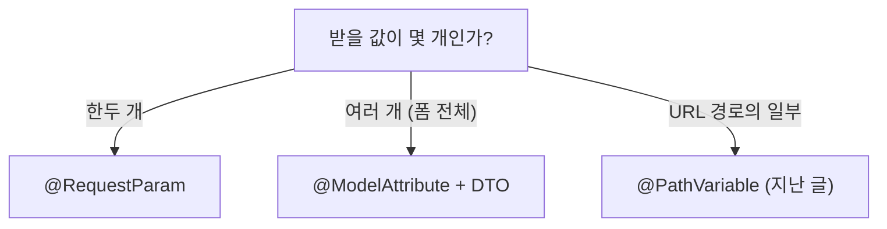

## 들어가며 (Situation)

지난 글에서 요청을 핸들러 메서드로 매핑했습니다. 이번 실습(`chap02-handler-mathod`)은 그 핸들러 메서드가 **사용자가 보낸 값을 받는 방법**을 다룹니다. 서블릿 수업에서는 `req.getParameter("name")`으로 하나씩 꺼내고, 숫자는 `Integer.parseInt`로 직접 바꿨습니다. 메뉴 등록·수정·검색 폼으로 그 과정이 어떻게 줄어드는지 비교했습니다.

> 실제 서비스에서 겪은 문제가 아니라, 수업 실습을 정리한 글입니다. Spring Boot 4.1.2, Thymeleaf, Lombok을 사용했습니다. 동작 설명은 Spring 공식 문서로 보완했습니다.

## 문제 상황 (Task)

- 폼 입력값이 많아질수록 `getParameter`와 형 변환 코드가 반복됩니다.
- 입력값 여러 개를 DTO 하나로 바로 받을 수는 없을까요?
- 화면만 보여 주는 GET 요청에도 매번 뷰 이름을 써야 할까요?

## 해결 과정 (Action)

### 1. 화면만 보여 주는 핸들러: void 반환

```java
@Controller
@RequestMapping("/request/*")
public class RequestController {

    @GetMapping("regist")
    public void regist() {
    }

    @GetMapping("modify")
    public void modify() {
    }

    @GetMapping("search")
    public void search() {
    }
}
```

수업 주석은 뷰를 반환하는 방식을 두 가지로 정리했습니다.

| 반환 타입 | 사용할 뷰 |
|-----------|-----------|
| `String` | 반환한 문자열이 뷰 이름 (`"request/printResult"`) |
| `void` | **요청 경로가 곧 뷰 이름** (`/request/regist` → `templates/request/regist.html`) |

입력 폼을 보여 주기만 하는 GET 요청처럼 따로 할 일이 없으면 `void`로 두어도 요청 경로와 같은 이름의 템플릿이 렌더링됩니다. 공식 문서도 반환값이 없으면 요청 경로로 뷰 이름을 정한다고 설명합니다.



### 2. 방법 ① WebRequest: 서블릿 방식 그대로

```java
@PostMapping("regist")
public String registMenu(Model model, WebRequest request) {
    String menuName = request.getParameter("name");
    int menuPrice = Integer.parseInt(request.getParameter("price"));
    int categoryCode = Integer.parseInt(request.getParameter("categoryCode"));

    String message = menuName + "을(를) 신규 메뉴 목록 " + categoryCode
            + "번 카테고리에 " + menuPrice + "원으로 등록했습니다";
    model.addAttribute("message", message);

    return "request/printResult";
}
```

`WebRequest`는 요청 정보에 접근하는 Spring의 객체로, 서블릿의 `HttpServletRequest`처럼 `getParameter()`를 쓸 수 있습니다. 핸들러 메서드의 매개변수에 선언만 하면 `DispatcherServlet`이 넣어 줍니다. 다만 코드 모양은 서블릿 수업 때와 같습니다. 값마다 `getParameter`를 쓰고, 숫자는 `parseInt`로 직접 바꿉니다.

### 3. 방법 ② @RequestParam: 값 하나씩, 타입 변환까지

```html
<form action="modify" method="post">
    수정할 메뉴의 이름 : <input type="text" name="modifyName"><br>
    수정할 메뉴의 가격 : <input type="number" name="modifyPrice"><br>
    <button type="submit">수정</button>
</form>
```

```java
@PostMapping("modify")
public String modifyMenu(Model model,
                         @RequestParam String modifyName,
                         @RequestParam int modifyPrice) {
    System.out.println("modifyName = " + modifyName);
    System.out.println("modifyPrice = " + modifyPrice);
    // ...
}
```

`@RequestParam`은 요청 파라미터를 메서드 매개변수로 바로 받습니다. 매개변수 타입이 `int`이면 문자열을 **자동으로 변환**해 주므로 `parseInt`가 사라집니다.

수업 주석이 "가장 주의해야 할 것"으로 꼽은 부분이 있습니다. 폼의 `name` 속성과 매개변수 이름이 일치하지 않으면 **400 Bad Request**가 납니다. `@RequestParam`은 기본적으로 필수 값(`required = true`)이라, 이름으로 찾지 못하면 요청 자체를 잘못된 것으로 판단하기 때문입니다. 공식 문서 기준으로 정리하면 이렇습니다.

| 상황 | 결과 |
|------|------|
| 폼 `name`과 매개변수 이름이 다름 (필수 파라미터 없음) | 400 Bad Request |
| 숫자 칸을 비우거나 숫자가 아닌 값 (`int` 변환 실패) | 400 Bad Request |
| 이름을 다르게 쓰고 싶음 | `@RequestParam("modifyName") String name`처럼 이름 지정 |
| 값이 없어도 되게 하고 싶음 | `@RequestParam(required = false)` 또는 `defaultValue` 지정 |

서블릿 수업에서 나이 칸을 비우면 `parseInt`에서 `NumberFormatException`이 나던 문제를, Spring은 400 응답으로 처리해 주는 셈입니다.

### 4. 방법 ③ @ModelAttribute: 입력값을 DTO 하나로

```java
@NoArgsConstructor
@AllArgsConstructor
@Getter
@Setter
@ToString
public class MenuDTO {
    private String name;
    private int price;
    private int categoryCode;
    private String orderableStatus;
}
```

```html
<form action="search" method="post">
    검색할 메뉴 이름 : <input type="text" name="name"><br>
    검색할 메뉴 가격 : <input type="number" name="price"><br>
    검색할 메뉴 카테고리 : <select name="categoryCode"> ... </select><br>
    검색할 판매 상태 : <input type="text" name="orderableStatus"><br>
    <input type="submit" value="검색하기">
</form>
```

```java
@PostMapping("search")
public String searchMenu(Model model, @ModelAttribute MenuDTO menu) {
    System.out.println("menu = " + menu);
    model.addAttribute("menu", menu);
    return "request/searchResult";
}
```

`@ModelAttribute`는 **폼의 `name`과 DTO의 필드 이름을 맞춰** 값을 객체 하나로 묶어 줍니다. Spring이 `MenuDTO`를 기본 생성자로 만들고, `name`, `price`, `categoryCode`, `orderableStatus` 값을 setter로 채우는 방식입니다. 그래서 Lombok의 `@NoArgsConstructor`와 `@Setter`가 이 바인딩과 맞물립니다. `price`, `categoryCode`도 `int`로 자동 변환됩니다.



수업 주석이 덧붙인 내용도 있습니다. `@ModelAttribute`로 받은 객체는 **Model에 직접 넣지 않아도** 다음 화면에서 쓸 수 있고, 이름을 지정하지 않으면 클래스 이름의 첫 글자를 소문자로 바꾼 `menuDTO`라는 이름으로 담깁니다. 실습 코드는 `model.addAttribute("menu", menu)`로 `menu`라는 이름을 직접 지정해 화면에서 썼습니다.

```html
<h3 th:text="${menu.getName()}"></h3>
<h3 th:text="${menu.getPrice()}"></h3>
```

Thymeleaf에서는 getter를 직접 호출하는 대신 `${menu.name}`처럼 프로퍼티 이름으로 써도 같은 getter가 호출됩니다.

### 5. 세 방식 비교

| 항목 | `WebRequest` | `@RequestParam` | `@ModelAttribute` |
|------|--------------|-----------------|-------------------|
| 받는 단위 | 요청 전체에서 하나씩 꺼냄 | 값 하나 = 매개변수 하나 | 여러 값 = 객체 하나 |
| 형 변환 | 직접 (`parseInt`) | 자동 | 자동 |
| 이름 맞추기 | 문자열로 지정 | 매개변수 이름 = 폼 `name` | 필드 이름 = 폼 `name` |
| 값이 없을 때 | `null` 반환 | 기본 필수, 없으면 400 | 파라미터가 아예 없으면 필드가 기본값으로 남음 (숫자 변환 실패는 바인딩 오류) |
| 어울리는 경우 | 서블릿 방식 코드를 옮길 때 | 값이 한두 개일 때 (검색어, 페이지 번호) | 폼 입력이 많을 때 (등록, 수정) |



## 결과 (Result)

정량 지표는 없고, 아래를 정리했습니다.

- 핸들러 메서드가 `void`를 반환하면 요청 경로가 곧 뷰 이름이 됩니다.
- `WebRequest`는 서블릿의 `getParameter` 방식 그대로이고, 형 변환은 직접 해야 합니다.
- `@RequestParam`은 값을 매개변수로 바로 받고 타입도 변환해 주지만, 이름이 맞지 않으면 400 Bad Request가 납니다.
- `@ModelAttribute`는 폼 입력을 DTO 하나로 묶어 주며, 필드 이름과 폼 `name`을 맞추는 것이 핵심입니다.

## 더 학습하면 좋은 개념

- **`@RequestBody`와 JSON** — 폼이 아닌 JSON 요청 본문을 객체로 받는 방법으로, REST API의 기본입니다.
- **Bean Validation (`@Valid`, `@NotBlank`, `@Min`)** — `@ModelAttribute`로 받은 DTO의 값을 선언적으로 검증하는 방법입니다.
- **`BindingResult`와 바인딩 오류 처리** — 타입 변환 실패를 400으로 끝내지 않고 폼에 오류 메시지를 다시 보여 주는 방법입니다.
- **컴파일 옵션 `-parameters`** — `@RequestParam`에 이름을 생략해도 매개변수 이름으로 찾을 수 있는 이유와 관련된 설정입니다.
- **DTO와 엔티티의 분리** — 요청을 받는 DTO와 DB에 저장하는 객체를 나누는 설계 원칙입니다.

## 참고 자료

- [Spring Framework Reference - Handler Methods: Method Arguments](https://docs.spring.io/spring-framework/reference/web/webmvc/mvc-controller/ann-methods/arguments.html)
- [Spring Framework Reference - @RequestParam](https://docs.spring.io/spring-framework/reference/web/webmvc/mvc-controller/ann-methods/requestparam.html)
- [Spring Framework Reference - @ModelAttribute](https://docs.spring.io/spring-framework/reference/web/webmvc/mvc-controller/ann-methods/modelattrib-method-args.html)
- [Spring Framework Reference - Return Values](https://docs.spring.io/spring-framework/reference/web/webmvc/mvc-controller/ann-methods/return-types.html)
- [Spring Framework API - WebRequest](https://docs.spring.io/spring-framework/docs/current/javadoc-api/org/springframework/web/context/request/WebRequest.html)
- [Thymeleaf - Tutorial: Using Thymeleaf (Variables)](https://www.thymeleaf.org/doc/tutorials/3.1/usingthymeleaf.html)
