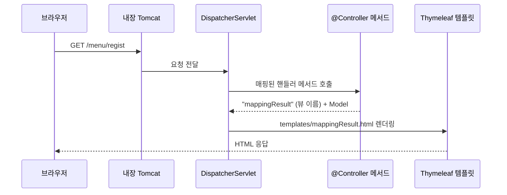

## 들어가며 (Situation)

Spring Core(IoC, DI, AOP)에 이어 **Spring Web MVC** 수업이 시작됐습니다. 서블릿 수업에서는 URL마다 `@WebServlet` 클래스를 만들고 `doGet`/`doPost`를 재정의했습니다. 이번 실습(`chap01-request-mapping`)은 같은 일을 **Spring Boot** 프로젝트에서 `@Controller`와 요청 매핑 어노테이션으로 처리합니다.

> 실제 서비스에서 겪은 문제가 아니라, 수업 실습을 정리한 글입니다. Spring Boot 4.1.2, Java 21, Thymeleaf를 사용했습니다. 동작 설명은 Spring 공식 문서로 보완했습니다.

## 문제 상황 (Task)

- 서블릿 방식에서는 요청 경로마다 서블릿 클래스가 하나씩 필요했고, `web.xml`이나 Tomcat 설정도 직접 다뤘습니다. 이 반복을 줄일 수 있을까요?
- 하나의 클래스에서 여러 요청 경로와 HTTP 메서드를 나눠 처리하려면 어떻게 해야 할까요?
- 응답 화면은 JSP 대신 무엇으로, 어떻게 연결될까요?

## 해결 과정 (Action)

### 1. Spring Boot 프로젝트

```groovy
plugins {
    id 'java'
    id 'org.springframework.boot' version '4.1.2'
    id 'io.spring.dependency-management' version '1.1.7'
}

java {
    toolchain {
        languageVersion = JavaLanguageVersion.of(21)
    }
}

dependencies {
    implementation 'org.springframework.boot:spring-boot-starter-webmvc'
    implementation 'org.springframework.boot:spring-boot-starter-thymeleaf'
}
```

```java
@SpringBootApplication
public class Chap01RequestMappingApplication {
    public static void main(String[] args) {
        SpringApplication.run(Chap01RequestMappingApplication.class, args);
    }
}
```

```yaml
server:
  port: 7777
```

지금까지와 달라진 점을 정리하면 다음과 같습니다.

| 항목 | 서블릿 수업 | Spring Boot |
|------|-------------|-------------|
| 서버 | 외부 Tomcat에 war 배포 | **내장 Tomcat**, `main` 실행만으로 서버 기동 |
| 의존성 | 라이브러리를 하나씩 지정 | **starter** 하나에 필요한 묶음 포함 |
| 설정 | `web.xml`, 직접 설정 | 자동 설정, `application.yaml`로 조정 (예: 포트 7777) |
| 컨테이너 생성 | `new AnnotationConfigApplicationContext(...)` | `SpringApplication.run(...)` |

`@SpringBootApplication`은 Spring Core 수업의 `@ComponentScan`과 `@Configuration` 역할을 포함하고 있어서, 이 클래스가 있는 패키지와 하위 패키지의 `@Controller`, `@Component`가 자동으로 Bean이 됩니다.

### 2. 요청은 누가 받을까: DispatcherServlet

수업 주석은 이렇게 설명했습니다. "Spring Boot App은 Tomcat이 내장되어 있다. 지금까지 사용자의 요청이 있으면 요청을 처리할 Servlet을 만들었다면, (이제는) Servlet이 HTTP 요청을 받는 즉시 `@Controller` 어노테이션이 달린 클래스에 요청을 위임한다."

여기서 말하는 서블릿이 Spring MVC의 **`DispatcherServlet`** 입니다. 모든 요청을 이 서블릿 하나가 먼저 받고, 알맞은 컨트롤러 메서드로 넘겨 주는 **프런트 컨트롤러** 역할을 합니다.



서블릿 수업과 비교하면, `@WebServlet` 클래스 여러 개가 하던 일을 `DispatcherServlet` 하나와 컨트롤러 메서드들이 나눠 맡는 구조입니다.

### 3. 메서드에 요청 매핑하기

```java
@Controller
public class MethodController {

    @RequestMapping("/menu/regist")
    public String registMenu(Model model) {
        model.addAttribute("message", "GET 방식의 메뉴 등록 핸들러 메서드 동작함");
        return "mappingResult";
    }

    @RequestMapping(value = "/menu/regist", method = RequestMethod.POST)
    public String postRegistMenu(Model model) {
        model.addAttribute("message", "POST 방식의 메뉴 등록 핸들러 메서드 동작함");
        return "mappingResult";
    }

    @GetMapping("/menu/modify")
    public String getModifyMenu(Model model) { ... }

    @PostMapping("/menu/modify")
    public String postModifyMenu(Model model) { ... }
}
```

요청을 처리하는 이 메서드들을 **핸들러 메서드**라고 부릅니다.

| 어노테이션 | 매칭 대상 |
|------------|-----------|
| `@RequestMapping("/경로")` | 해당 경로의 **모든** HTTP 메서드 |
| `@RequestMapping(value = "/경로", method = RequestMethod.POST)` | 해당 경로의 POST만 |
| `@GetMapping("/경로")` | GET만 (`@RequestMapping(method = GET)`의 축약) |
| `@PostMapping("/경로")` | POST만 |

수업 주석은 `@RequestMapping`을 "서블릿의 `service()`"에 비유했습니다. 메서드를 지정하지 않으면 GET, POST 모두 받는다는 점이 `service()`와 같습니다. 그래서 `/menu/regist`는 메서드를 지정하지 않은 `registMenu`와 POST를 지정한 `postRegistMenu`가 함께 있습니다. 이 경우 POST 요청은 더 구체적인 조건을 가진 `postRegistMenu`로 갑니다. 실무에서는 보통 `@GetMapping`/`@PostMapping`처럼 메서드를 명시합니다.

| 서블릿 | Spring MVC |
|--------|------------|
| `@WebServlet("/menu/modify")` 클래스 하나 | 컨트롤러 안의 메서드 하나 |
| `doGet()` / `doPost()` 재정의 | `@GetMapping` / `@PostMapping` |
| 경로 하나당 클래스 하나 | 클래스 하나에 여러 경로 |

### 4. 화면 연결: Model과 뷰 이름

```java
model.addAttribute("message", "GET 방식의 메뉴 등록 핸들러 메서드 동작함");
return "mappingResult";
```

```html
<!-- templates/mappingResult.html -->
<!-- th 는 타임리프라는 템플릿엔진의 문법이다. -->
<h3 th:text="${message}"></h3>
```

- **`Model`** 은 컨트롤러에서 만든 값을 화면에 전달하는 객체입니다. `key-value`로 담습니다. 서블릿에서 `req.setAttribute()`로 값을 넣고 JSP로 forward하던 것과 같은 역할입니다.
- 핸들러 메서드가 **문자열을 반환하면 그것이 뷰 이름**이 됩니다. 수업 주석대로 Thymeleaf 자동 설정이 `resources/templates/`를 앞에, `.html`을 뒤에 붙여 `templates/mappingResult.html`을 찾습니다.
- `th:text="${message}"`는 Thymeleaf 문법으로, Model의 `message` 값을 태그 내용으로 넣습니다. JSP의 EL(`${}`)과 비슷하지만 HTML 속성으로 쓰기 때문에, 서버 없이 파일을 열어도 일반 HTML로 보인다는 특징이 있습니다.

정적 파일은 `resources/static/`에 둡니다. 실습의 `static/index.html`이 버튼과 폼으로 각 요청을 보내는 시작 페이지입니다.

| 위치 | 용도 | 접근 |
|------|------|------|
| `resources/static/` | 그대로 내려가는 정적 파일 (`index.html`) | `/index.html` 직접 요청 |
| `resources/templates/` | 컨트롤러가 값을 채워 렌더링하는 템플릿 | 컨트롤러가 반환한 뷰 이름으로만 |

서블릿 글의 `WEB-INF`처럼, `templates`의 파일은 URL로 직접 열 수 없고 컨트롤러를 거쳐야 합니다.

### 5. 클래스에 요청 매핑하기와 @PathVariable

```java
@Controller
@RequestMapping("/order/*")
public class ClassController {

    @GetMapping("/regist")
    public String registOrder(Model model) {
        model.addAttribute("message", "GET 방식의 주문 등록 핸들러 메서드 동작");
        return "mappingResult";
    }

    @GetMapping("/detail/{orderNo}")
    public String pathVariable(Model model, @PathVariable("orderNo") int no) {
        model.addAttribute("message", no + "번 주문 상세조회");
        return "mappingResult";
    }
}
```

클래스에 붙인 `@RequestMapping`은 그 안의 모든 핸들러 메서드 경로 앞에 공통으로 붙습니다. `/order/regist`, `/order/detail/3`처럼 주문 관련 요청을 한 컨트롤러에 모을 수 있습니다. 수업 코드처럼 클래스에 `/order/*`를 쓰면 Spring의 경로 결합 규칙에 따라 메서드 경로와 합쳐져 `/order/regist`가 됩니다. (공식 문서의 `PathPattern.combine` 예시에 이 규칙이 나옵니다.) 흔히는 `@RequestMapping("/order")`처럼 씁니다.

**`@PathVariable`** 은 URL 경로의 일부를 값으로 받습니다. 수업 주석의 설명대로 `/order/detail/3`의 `3`이 "요청 URL을 타고 서버로 넘어오는 값"입니다.

| 방식 | 예시 URL | 받는 방법 |
|------|----------|-----------|
| 쿼리스트링 (서블릿 수업) | `/order/detail?orderNo=3` | `getParameter("orderNo")` |
| 경로 변수 | `/order/detail/3` | `@PathVariable("orderNo") int no` |

서블릿에서는 문자열로 받아 `Integer.parseInt`로 바꿨지만, `@PathVariable`은 선언한 타입(`int`)으로 **자동 변환**해 줍니다. 숫자로 바꿀 수 없는 값(`/order/detail/abc`)이 오면 변환에 실패해 오류 응답이 나는 것으로 알고 있습니다.

## 결과 (Result)

정량 지표는 없고, 아래를 정리했습니다.

- Spring Boot는 내장 Tomcat과 starter, 자동 설정으로 서버 실행과 설정을 단순하게 만듭니다.
- 모든 요청은 `DispatcherServlet`이 먼저 받아 `@Controller`의 핸들러 메서드로 넘깁니다.
- `@RequestMapping`(모든 메서드), `@GetMapping`/`@PostMapping`(특정 메서드)으로 경로를 매핑하고, 클래스 레벨 매핑으로 공통 경로를 묶습니다.
- `Model`로 값을 담고 뷰 이름을 반환하면 `templates/뷰이름.html`이 렌더링됩니다.
- `@PathVariable`로 URL 경로의 값을 원하는 타입으로 받습니다.

## 더 학습하면 좋은 개념

- **프런트 컨트롤러 패턴과 DispatcherServlet의 처리 흐름** — HandlerMapping, HandlerAdapter, ViewResolver가 각각 무슨 일을 하는지 알면 MVC 전체가 보입니다.
- **Spring Boot 자동 설정(Auto-configuration)** — starter를 추가했을 뿐인데 Tomcat과 Thymeleaf가 설정되는 원리입니다.
- **REST API 설계와 경로 변수** — `/orders/3`처럼 자원을 URL로 표현하는 방식으로, `@PathVariable`이 많이 쓰이는 이유입니다.
- **Thymeleaf 기본 문법(`th:each`, `th:if`, `th:href`)** — 목록 출력과 조건 처리로 화면을 만드는 다음 단계입니다.
- **PRG 패턴과 `redirect:` 접두사** — 서블릿에서 배운 redirect를 Spring MVC에서는 뷰 이름 앞에 `redirect:`를 붙여 표현합니다.

## 참고 자료

- [Spring Framework Reference - DispatcherServlet](https://docs.spring.io/spring-framework/reference/web/webmvc/mvc-servlet.html)
- [Spring Framework Reference - Mapping Requests](https://docs.spring.io/spring-framework/reference/web/webmvc/mvc-controller/ann-requestmapping.html)
- [Spring Framework Reference - @PathVariable (URI patterns)](https://docs.spring.io/spring-framework/reference/web/webmvc/mvc-controller/ann-requestmapping.html#mvc-ann-requestmapping-uri-templates)
- [Spring Framework API - PathPattern (combine)](https://docs.spring.io/spring-framework/docs/current/javadoc-api/org/springframework/web/util/pattern/PathPattern.html)
- [Spring Boot Reference - Servlet Web Applications (Static Content, Template Engines)](https://docs.spring.io/spring-boot/reference/web/servlet.html)
- [Thymeleaf - Tutorial: Using Thymeleaf](https://www.thymeleaf.org/doc/tutorials/3.1/usingthymeleaf.html)
