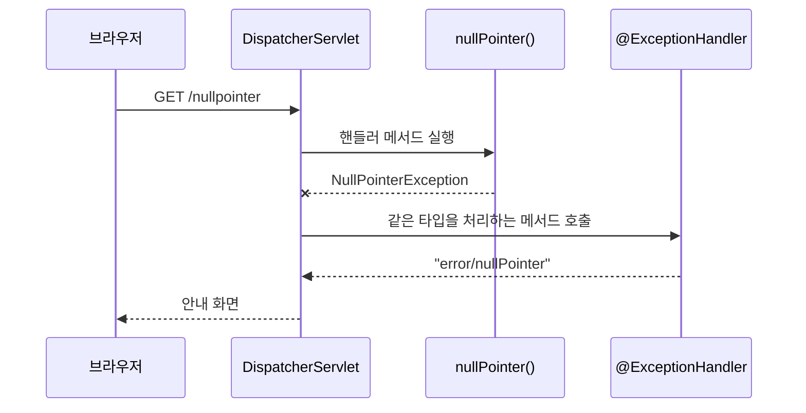
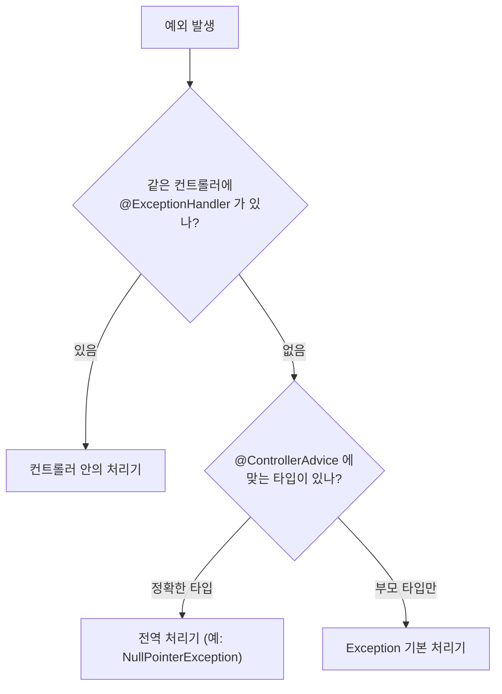

## 들어가며 (Situation)

서블릿 수업에서는 `web.xml`의 `<error-page>`로 404, 500 같은 **상태 코드별** 에러 화면을 지정했습니다. 이번 실습(`chap04-exception-handler`)은 Spring MVC에서 **예외 종류별로** 처리 메서드를 지정하는 방법을 다룹니다. 컨트롤러 하나 안에서 처리하는 방법과, 모든 컨트롤러에 공통으로 적용하는 방법을 비교했습니다.

> 실제 서비스에서 겪은 문제가 아니라, 수업 실습을 정리한 글입니다. Spring Boot 4.1.2, Thymeleaf를 사용했고, 동작 설명은 Spring 공식 문서로 보완했습니다. 예외는 `null`에 메서드를 호출하거나 범위를 벗어난 배열 인덱스에 접근하는 식으로 일부러 발생시켰습니다.

## 문제 상황 (Task)

- 컨트롤러에서 예외가 나면 사용자는 서버의 기본 에러 화면을 보게 됩니다. 우리가 만든 안내 화면을 보여 줄 수 있을까요?
- 같은 종류의 예외가 여러 컨트롤러에서 날 때, 처리 코드를 컨트롤러마다 반복해야 할까요?
- 직접 만든 예외(예: 회원을 찾을 수 없음)도 같은 방식으로 처리할 수 있을까요?

## 해결 과정 (Action)

### 1. 컨트롤러 안의 @ExceptionHandler

```java
@Controller
public class ExceptionTestController {

    @GetMapping("nullpointer")
    public String nullPointer() {
        String str = null;
        System.out.println(str.toLowerCase(Locale.ROOT));   // NullPointerException 발생
        return "/";
    }

    @ExceptionHandler(NullPointerException.class)
    public String nullHandler(Model model, NullPointerException e) {
        model.addAttribute("key", e.getMessage());
        return "error/nullPointer";
    }
}
```

```html
<!-- templates/error/nullPointer.html -->
<h3>많이 놀라셨죠?</h3>
<h4>죄송합니다.</h4>
<h4 th:text="${key}"></h4>
```

수업 주석의 설명은 "`@ExceptionHandler(처리하고자 하는 예외 클래스)`를 정의해 두면, 해당 예외 발생 시 예외 핸들러가 Controller의 흐름을 가로채서 동작한다"입니다.

- 핸들러 메서드에서 예외가 던져지면, Spring은 같은 컨트롤러에서 그 예외 타입을 처리하는 `@ExceptionHandler` 메서드를 찾아 대신 실행합니다.
- 예외 객체(`NullPointerException e`)를 매개변수로 받아 메시지를 꺼낼 수 있습니다.
- 일반 핸들러 메서드처럼 `Model`에 값을 담고 뷰 이름을 반환합니다. 이때 `Model`은 예외 처리용으로 새로 주어진 것이라, 원래 핸들러 메서드가 담던 값은 들어 있지 않습니다. (공식 문서 기준)



### 2. 직접 만든 예외도 같은 방식으로

```java
public class MemberNotFoundException extends Throwable {
    public MemberNotFoundException(String message) {
        super(message);
    }
}
```

```java
@GetMapping("userexception")
public String userException() throws MemberNotFoundException {
    boolean check = true;
    if (check) {
        throw new MemberNotFoundException("아프지 말자 우리");
    }
    return "/";
}

@ExceptionHandler(MemberNotFoundException.class)
public String userException(Model model, MemberNotFoundException e) {
    model.addAttribute("key", e.getMessage());
    return "error/nullPointer";
}
```

자바 수업의 사용자 정의 예외를 그대로 활용했습니다. "회원을 찾을 수 없음" 같은 **업무 상황을 예외 이름으로 표현**하고, 그 예외만 처리하는 메서드를 둘 수 있습니다.

알아 둘 점이 하나 있습니다. 실습의 예외는 `Throwable`을 직접 상속합니다. 자바 공식 문서는 애플리케이션 예외를 보통 `Exception`(또는 `RuntimeException`) 하위로 만들도록 안내합니다. 이 차이는 아래 3절의 `Exception.class` 기본 처리기와 관련이 있습니다. `Throwable`을 직접 상속한 예외는 `Exception`의 하위 타입이 아니라서 `@ExceptionHandler(Exception.class)`에 잡히지 않습니다.

### 3. 전역 처리: @ControllerAdvice

```java
@Controller
public class GlobalTestController {

    @GetMapping("global-nullpointer")
    public String globalNull() {
        String str = null;
        System.out.println(str.toLowerCase(Locale.ROOT));
        return "/";
    }

    @GetMapping("global-default")
    public String anyException() {
        int[] iarr = new int[0];
        System.out.println(iarr[1]);   // ArrayIndexOutOfBoundsException
        return "/";
    }
}
```

수업 주석은 이 컨트롤러에서 이렇게 짚었습니다. "`ExceptionTestController`에 작성해 둔 null-pointer 예외 처리 핸들러가 동작하지 않는다. 다른 클래스 내부에 있는 메서드는 알 수 없다." 컨트롤러 안의 `@ExceptionHandler`는 **그 컨트롤러에서 난 예외에만** 적용됩니다.

여러 컨트롤러에 공통으로 적용하려면 별도 클래스에 `@ControllerAdvice`를 붙입니다.

```java
@ControllerAdvice
public class GlobalExceptionHandler {

    @ExceptionHandler(NullPointerException.class)
    public String nullHandler(Model model, NullPointerException e) {
        System.out.println("전역 예외처리 핸들러 동작!!!");
        model.addAttribute("key", e.getMessage());
        return "error/nullPointer";
    }

    @ExceptionHandler(Exception.class)
    public String defaultException(Model model, Exception e) {
        model.addAttribute("class", e.getClass());
        model.addAttribute("message", e.getMessage());
        return "error/default";
    }
}
```

```html
<!-- templates/error/default.html -->
<h1>Default 예외 페이지!</h1>
<h3 th:text="|${class} 에러 발생! 원인 : ${message}|"></h3>
```

수업 주석은 이름의 연결도 짚었습니다. "Advice는 AOP 챕터에서 반복적으로 동작해야 하는 코드를 뭉쳐 둔 메서드를 지칭하는 단어였다. `@ControllerAdvice`는 공통으로 발생할 수 있는 예외 처리 핸들러를 묶어 둔 클래스를 지칭한다." 여러 컨트롤러를 가로지르는 예외 처리를 한곳에 모은다는 점에서 횡단 관심사를 분리하는 AOP의 발상과 같습니다.

`@ExceptionHandler(Exception.class)`는 **기본 처리기** 역할을 합니다. `ArrayIndexOutOfBoundsException`처럼 따로 처리기가 없는 예외는 부모 타입인 `Exception` 처리기가 받습니다. 템플릿의 `|...|`는 Thymeleaf의 리터럴 치환 문법으로, 문자열 안에 `${}` 값을 바로 끼워 넣습니다.

### 4. 어떤 처리기가 선택될까: 우선순위

수업 주석은 "예외 처리 핸들러는 우선순위가 존재한다. 같은 클래스 내부에 있는 핸들러 > 전역 핸들러"라고 정리했습니다.

| 요청 | 발생 예외 | 실행되는 처리기 |
|------|-----------|-----------------|
| `/nullpointer` | `NullPointerException` | `ExceptionTestController`의 처리기 (같은 클래스 우선) |
| `/global-nullpointer` | `NullPointerException` | `GlobalExceptionHandler.nullHandler` |
| `/global-default` | `ArrayIndexOutOfBoundsException` | `GlobalExceptionHandler.defaultException` (`Exception` 처리기) |
| `/userexception` | `MemberNotFoundException` | `ExceptionTestController`의 처리기 |



공식 문서도 같은 규칙을 설명합니다. 컨트롤러 안의 `@ExceptionHandler`가 `@ControllerAdvice`보다 먼저 적용되고, 여러 처리기가 맞으면 **더 가까운(구체적인) 예외 타입**의 처리기가 선택됩니다.

### 5. 서블릿 error-page와의 비교

| 항목 | 서블릿 `web.xml` `<error-page>` | `@ExceptionHandler` / `@ControllerAdvice` |
|------|---------------------------------|-------------------------------------------|
| 기준 | HTTP 상태 코드 (404, 500) | 예외 타입 (`NullPointerException` 등) |
| 정보 꺼내기 | `request` 속성 (`jakarta.servlet.error.*`) | 예외 객체를 매개변수로 직접 받음 |
| 범위 | 애플리케이션 전체 | 컨트롤러 단위 또는 전역 |
| 처리 위치 | 별도 서블릿 | 일반 핸들러 메서드처럼 `Model` + 뷰 이름 |

## 결과 (Result)

정량 지표는 없고, 아래를 정리했습니다.

- `@ExceptionHandler(예외.class)`는 그 컨트롤러에서 난 해당 예외를 가로채 안내 화면으로 응답합니다.
- 다른 컨트롤러의 `@ExceptionHandler`는 적용되지 않으므로, 공통 처리는 `@ControllerAdvice` 클래스에 모읍니다.
- 우선순위는 같은 컨트롤러의 처리기가 먼저이고, 여러 처리기 중에서는 더 구체적인 예외 타입이 선택됩니다.
- `@ExceptionHandler(Exception.class)`를 기본 처리기로 두면 따로 처리하지 않은 예외를 받을 수 있습니다. 단, `Throwable`을 직접 상속한 예외는 여기에 잡히지 않으므로 사용자 정의 예외는 `Exception` 계열로 만드는 것이 좋습니다.

## 더 학습하면 좋은 개념

- **`@RestControllerAdvice`와 `ResponseEntity`** — 화면이 아닌 JSON 에러 응답을 내려 주는 REST API 방식의 전역 예외 처리입니다.
- **`@ResponseStatus`** — 예외에 HTTP 상태 코드를 붙여 404, 400 등으로 응답하는 방법입니다. 지금 실습은 안내 화면을 보여 주지만 상태 코드는 따로 지정하지 않았습니다.
- **Spring Boot 기본 에러 페이지 (`templates/error/404.html`)** — 상태 코드 이름의 템플릿만 두면 자동으로 쓰이는 기능으로, 서블릿의 `error-page`와 비슷합니다.
- **Checked vs Unchecked 예외 설계** — 업무 예외를 `RuntimeException`으로 만드는 이유와 장단점입니다.
- **에러 메시지 노출 주의** — `e.getMessage()`나 예외 클래스 이름을 그대로 사용자에게 보여 주면 내부 구조가 드러날 수 있습니다.

## 참고 자료

- [Spring Framework Reference - Exceptions (@ExceptionHandler)](https://docs.spring.io/spring-framework/reference/web/webmvc/mvc-controller/ann-exceptionhandler.html)
- [Spring Framework Reference - Controller Advice](https://docs.spring.io/spring-framework/reference/web/webmvc/mvc-controller/ann-advice.html)
- [Spring Boot Reference - Error Handling](https://docs.spring.io/spring-boot/reference/web/servlet.html#web.servlet.spring-mvc.error-handling)
- [Oracle Java Tutorials - Creating Exception Classes](https://docs.oracle.com/javase/tutorial/essential/exceptions/creating.html)
- [Thymeleaf - Literal substitutions](https://www.thymeleaf.org/doc/tutorials/3.1/usingthymeleaf.html#literal-substitutions)
