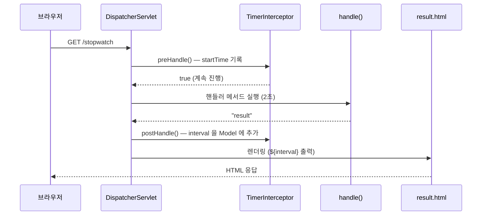
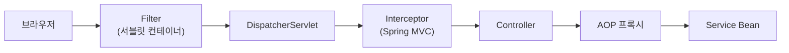

## 들어가며 (Situation)

공통 처리를 분리하는 방법을 이미 두 가지 배웠습니다. 서블릿 수업의 **필터**는 서블릿 앞에서 요청을 가로챘고, Spring Core 수업의 **AOP**는 Bean 메서드 호출을 감쌌습니다. 이번 실습(`chap05-interceptor`)은 세 번째 방법인 Spring MVC의 **인터셉터**로 핸들러 메서드의 실행 시간을 측정합니다.

> 실제 서비스에서 겪은 문제가 아니라, 수업 실습을 정리한 글입니다. Spring Boot 4.1.2를 사용했고, 동작 설명은 Spring 공식 문서로 보완했습니다. 핸들러 메서드는 `Thread.sleep(2000)`으로 2초간 멈추게 해 처리 시간을 흉내 냈고, 실제 측정값은 기록하지 않았습니다.

## 문제 상황 (Task)

- 컨트롤러의 핸들러 메서드가 얼마나 오래 걸리는지 재고 싶습니다. 메서드마다 시간 측정 코드를 넣지 않고 할 수 있을까요?
- 측정한 시간을 화면에 보여 주려면, 컨트롤러가 만든 Model에 값을 더해야 합니다.
- 서블릿 필터로도 시간을 쟀는데, 인터셉터는 무엇이 다를까요?

## 해결 과정 (Action)

### 1. 측정 대상: 2초 걸리는 핸들러

```java
@Controller
public class InterceptorController {

    @GetMapping("stopwatch")
    public String handle() throws InterruptedException {
        System.out.println("stopwatch 요청을 처리하는 핸들러 메서드 동작..");
        Thread.sleep(2000);   // 2초간 정지
        return "result";
    }
}
```

```html
<!-- templates/result.html -->
<h3 th:text="| 핸들러메서드 호출 수행 시간 : ${interval} |"></h3>
```

핸들러 메서드에는 시간 측정 코드가 없습니다. 그런데 화면은 `interval` 값을 출력합니다. 이 값을 넣는 것이 인터셉터입니다.

### 2. HandlerInterceptor 구현

```java
@Component
public class TimerInterceptor implements HandlerInterceptor {

    // 컨트롤러 도달 전
    @Override
    public boolean preHandle(HttpServletRequest request, HttpServletResponse response, Object handler) {
        long startTime = System.currentTimeMillis();
        request.setAttribute("startTime", startTime);
        // true : 다음 인터셉터가 있다면 호출 / 없다면 컨트롤러의 핸들러 메서드 호출
        return true;
    }

    // 컨트롤러 핸들러 메서드 실행 후
    @Override
    public void postHandle(HttpServletRequest request, HttpServletResponse response,
                           Object handler, @Nullable ModelAndView modelAndView) {
        long endTime = System.currentTimeMillis();
        long startTime = (long) request.getAttribute("startTime");
        modelAndView.addObject("interval", endTime - startTime);
    }
}
```

수업 주석은 인터셉터를 "Controller의 핸들러 메서드 전과 후에 동작한다"고 설명했습니다. 공식 문서 기준으로 세 시점이 있습니다.

| 메서드 | 호출 시점 | 실습에서 |
|--------|-----------|----------|
| `preHandle` | 핸들러 메서드 실행 **전** | 시작 시간 기록. `false`를 반환하면 이후 처리가 중단됨 |
| `postHandle` | 핸들러 메서드 실행 **후**, 뷰 렌더링 **전** | 걸린 시간을 `ModelAndView`에 추가 |
| `afterCompletion` | 뷰 렌더링까지 끝난 **후** | 사용하지 않음 (자원 정리 등에 사용) |



`postHandle`이 **뷰 렌더링 전에** 호출된다는 점이 핵심입니다. 그래서 컨트롤러가 반환한 `ModelAndView`에 값을 더하면 화면에서 그 값을 쓸 수 있습니다. 필터는 서블릿 단위라서 이런 `ModelAndView`에 접근할 수 없습니다.

### 3. 시작 시간을 왜 필드가 아니라 request에 저장할까

`preHandle`에서 잰 시작 시간을 `postHandle`에서 써야 하는데, 수업 코드는 이를 인터셉터의 필드가 아니라 `request.setAttribute`에 저장합니다.

`TimerInterceptor`는 `@Component`로 등록된 **싱글톤 Bean**입니다. Bean 스코프 글에서 정리했듯 싱글톤은 모든 요청이 하나의 인스턴스를 공유합니다. `startTime`을 필드에 두면 요청 A가 저장한 값을 요청 B가 덮어써서 시간이 엉망이 됩니다. 요청 객체에 저장하면 **요청마다 따로** 보관되므로 안전합니다.

| 저장 위치 | 공유 범위 | 이 용도에 |
|-----------|-----------|-----------|
| 인터셉터 필드 | 모든 요청 (싱글톤) | 부적합 |
| `request.setAttribute` | 요청 하나 | **적합** |

### 4. WebMvcConfigurer로 인터셉터 등록

```java
/* WebMvcConfigurer
 *  Spring MVC 패턴의 기본설정은 유지하며
 *  추가적인 커스터마이징이 필요할 때 구현하는 인터페이스
 *  ex) 인터셉터 추가, CORS 설정, 정적 리소스 핸들링 등 */
@Configuration
public class WebConfig implements WebMvcConfigurer {

    private final TimerInterceptor timerInterceptor;

    // 생성자를 통한 Bean 간의 의존성 주입
    @Autowired
    public WebConfig(TimerInterceptor timerInterceptor) {
        this.timerInterceptor = timerInterceptor;
    }

    @Override
    public void addInterceptors(InterceptorRegistry registry) {
        registry.addInterceptor(timerInterceptor)
                .addPathPatterns("/*")              // 인터셉터가 동작할 URL
                .excludePathPatterns("/css/**")     // 정적 리소스 제외
                .excludePathPatterns("/images/**")
                .excludePathPatterns("/js/**")
                .excludePathPatterns("/video/**");
    }
}
```

인터셉터는 만들기만 해서는 동작하지 않고, `WebMvcConfigurer`의 `addInterceptors`에서 등록해야 합니다. 여기서 Spring Core 수업의 **생성자 주입**이 그대로 쓰였습니다. `TimerInterceptor` Bean을 생성자로 받아 `final` 필드에 둡니다.

| 메서드 | 의미 |
|--------|------|
| `addPathPatterns("/*")` | 한 단계 경로(`/stopwatch` 등)에 적용 |
| `excludePathPatterns("/css/**")` | `/css` 아래 모든 하위 경로 제외 |
| `/*` vs `/**` | `/*`는 한 단계만, `/**`는 모든 하위 경로까지 |

공식 문서 기준으로 `/*`는 `/stopwatch`처럼 한 단계 경로에만 맞고 `/css/style.css`처럼 두 단계 이상은 맞지 않습니다. 그래서 이 설정에서 `/css/**` 같은 제외 패턴은 실제로 겹칠 일이 없습니다. 다만 나중에 적용 범위를 `/**`로 넓혔을 때 정적 파일까지 인터셉터가 동작하지 않도록 미리 막아 둔 것으로 이해했습니다. 정적 파일 요청에 인터셉터가 동작하면, 응답할 화면이 없어 `postHandle`의 `modelAndView`가 `null`일 수 있습니다.

### 5. 알아 둘 점: postHandle의 modelAndView는 null일 수 있다

메서드 시그니처의 `@Nullable ModelAndView modelAndView`가 이를 알려 줍니다. 이번 실습의 `/stopwatch`는 뷰 이름을 반환하므로 문제없지만, 뷰 없이 응답하는 핸들러(예: JSON으로 응답하는 REST API)에서는 `modelAndView`가 `null`입니다. 그 상태에서 `addObject`를 호출하면 `NullPointerException`이 나므로, 범위를 넓힐 때는 `null` 검사를 넣는 것이 안전합니다. (예시 코드)

```java
if (modelAndView != null) {
    modelAndView.addObject("interval", endTime - startTime);
}
```

### 6. 필터 vs 인터셉터 vs AOP

지금까지 배운 세 가지 공통 처리 방법을 비교하면 이렇습니다.



| 항목 | 필터 (서블릿 수업) | 인터셉터 (이번 실습) | AOP (Spring Core 수업) |
|------|--------------------|----------------------|------------------------|
| 관리 주체 | 서블릿 컨테이너 (Tomcat) | Spring MVC | Spring 컨테이너 |
| 동작 위치 | `DispatcherServlet` 앞 | `DispatcherServlet`과 컨트롤러 사이 | Bean 메서드 호출 |
| 대상 지정 | URL 패턴 | URL 패턴 (`addPathPatterns`) | 포인트컷 표현식 |
| 다음 단계 진행 | `chain.doFilter()` | `preHandle`에서 `true` 반환 | `proceed()` |
| 접근 가능 정보 | 요청·응답 | 요청·응답 + 핸들러 + `ModelAndView` | 메서드·매개변수·반환값 |
| 어울리는 일 | 인코딩, 보안 등 웹 전체 처리 | 로그인 확인, 컨트롤러 실행 시간, 화면 공통 데이터 | 트랜잭션, 서비스 로깅 |

서블릿의 `LoginFilter`에서 하던 "로그인하지 않았으면 돌려보내기"도 인터셉터의 `preHandle`에서 `false`를 반환하고 redirect하는 방식으로 옮길 수 있습니다.

## 결과 (Result)

정량 지표는 없고, 아래를 정리했습니다. (`Thread.sleep(2000)` 때문에 화면의 수행 시간은 2000ms 이상으로 나올 것으로 예상하지만, 실제 측정값은 기록하지 않았습니다.)

- 인터셉터는 `preHandle`(실행 전), `postHandle`(실행 후·렌더링 전), `afterCompletion`(렌더링 후)에서 동작합니다.
- `postHandle`에서 `ModelAndView`에 값을 더하면 화면에서 쓸 수 있고, 이는 필터로는 할 수 없는 일입니다.
- 인터셉터는 싱글톤 Bean이므로 요청별 값은 필드가 아니라 `request` 속성에 저장합니다.
- 인터셉터는 `WebMvcConfigurer.addInterceptors`에서 경로 패턴과 함께 등록합니다.

## 더 학습하면 좋은 개념

- **`afterCompletion`과 예외 처리** — 렌더링 후, 예외가 났을 때도 호출되는 단계로, 자원 정리와 예외 로깅에 쓰입니다.
- **인터셉터로 로그인 체크** — `preHandle`에서 세션을 확인하고 `false` + redirect로 막는 방식으로, 팀 프로젝트의 로그인 처리에 바로 쓸 수 있습니다.
- **여러 인터셉터의 순서 (`.order()`)** — 등록 순서와 `order` 값에 따라 실행 순서가 정해집니다.
- **`WebMvcConfigurer`의 다른 설정** — CORS(`addCorsMappings`), 정적 리소스(`addResourceHandlers`), 뷰 컨트롤러(`addViewControllers`) 등입니다.
- **`PathPattern` 문법** — `/*`, `/**`, `{변수}` 같은 경로 패턴 규칙을 정확히 알면 적용 범위 실수를 줄일 수 있습니다.

## 참고 자료

- [Spring Framework Reference - Interception](https://docs.spring.io/spring-framework/reference/web/webmvc/mvc-servlet/handlermapping-interceptor.html)
- [Spring Framework Reference - MVC Config: Interceptors](https://docs.spring.io/spring-framework/reference/web/webmvc/mvc-config/interceptors.html)
- [Spring Framework API - HandlerInterceptor](https://docs.spring.io/spring-framework/docs/current/javadoc-api/org/springframework/web/servlet/HandlerInterceptor.html)
- [Spring Framework API - WebMvcConfigurer](https://docs.spring.io/spring-framework/docs/current/javadoc-api/org/springframework/web/servlet/config/annotation/WebMvcConfigurer.html)
- [Spring Framework API - PathPattern](https://docs.spring.io/spring-framework/docs/current/javadoc-api/org/springframework/web/util/pattern/PathPattern.html)
