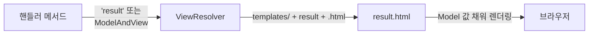
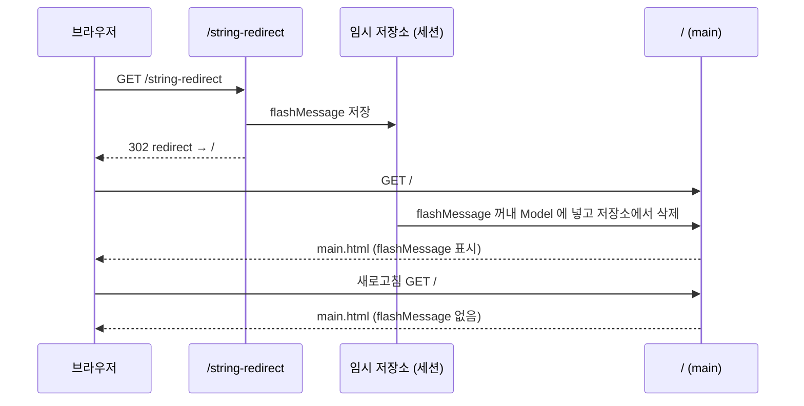

## 들어가며 (Situation)

Spring Web MVC 세 번째 실습(`chap03-view-resolver`)은 컨트롤러가 **어떤 화면으로 응답할지** 정하는 방법을 다룹니다. 수업 주석은 이렇게 시작합니다. "Spring에서 `@Controller`는 View를 반환해야 하는 책임을 가지고 있다." 서블릿 수업의 forward와 redirect가 Spring MVC에서는 어떻게 표현되는지, 그리고 redirect 후에도 값을 전달하는 방법을 정리했습니다.

> 실제 서비스에서 겪은 문제가 아니라, 수업 실습을 정리한 글입니다. Spring Boot 4.1.2, Thymeleaf를 사용했고, 동작 설명은 Spring 공식 문서로 보완했습니다. 회원가입 처리는 `System.out` 한 줄로 가정만 했습니다.

## 문제 상황 (Task)

- 핸들러 메서드가 뷰를 지정하는 방법에는 무엇이 있을까요?
- 회원가입처럼 데이터를 바꾸는 요청 뒤에는 redirect해야 한다고 배웠습니다(PRG). Spring에서는 redirect를 어떻게 할까요?
- redirect하면 `Model`에 담은 값이 사라집니다. "가입이 완료되었습니다" 같은 메시지는 어떻게 전달할까요?

## 해결 과정 (Action)

### 1. 여러 경로를 한 핸들러에

```java
@Controller
public class MainController {

    // {} 내부에는 여러 경로를 , 기준으로 작성할 수 있다.
    @RequestMapping(value = {"/", "/main"})
    public String mainPage() {
        return "main";
    }
}
```

`value`에 배열로 경로를 여러 개 적으면 `/`와 `/main` 모두 같은 메인 페이지를 보여 줍니다. 뒤에서 redirect의 도착지로 이 `/`를 씁니다.

### 2. 뷰를 반환하는 세 가지 방법

수업 주석이 정리한 방법은 세 가지입니다.

| 반환 타입 | 뷰 경로 | 값 전달 |
|-----------|---------|---------|
| `void` | 요청 URL이 곧 뷰 경로 | `Model` 매개변수 |
| `String` | 반환한 문자열이 뷰 경로 | `Model` 매개변수 |
| `ModelAndView` | `setViewName("문자열")`의 문자열 | `addObject()` |

`void`는 지난 글에서 다뤘으니 나머지 두 가지를 보겠습니다.

**String 반환**

```java
@GetMapping("/string")
public String stringView(Model model) {
    model.addAttribute("forwardMessage", "문자열로 View 반환");
    // service.registMember();  (회원가입 로직 가정)
    return "result";
}
```

수업 주석의 설명대로, **ViewResolver**가 반환된 문자열에 접두사 `resources/templates/`와 접미사 `.html`을 붙여 `templates/result.html`을 찾습니다.

**ModelAndView 반환**

```java
@GetMapping("modelAndView")
public ModelAndView modelAndView(ModelAndView mv) {
    mv.addObject("forwardMessage", "MV 활용 뷰와 데이터!");
    mv.setViewName("result");
    return mv;
}
```

`ModelAndView`는 이름 그대로 **데이터(Model)와 화면 이름(View)을 한 객체에** 담습니다. `Model`의 `addAttribute`가 여기서는 `addObject`이고, 뷰 이름은 `return` 문자열 대신 `setViewName`으로 지정합니다. 핸들러 메서드 매개변수로 선언하면 Spring이 만들어 넣어 줍니다.

| 비교 | `String` + `Model` | `ModelAndView` |
|------|--------------------|----------------|
| 데이터 담기 | `model.addAttribute(k, v)` | `mv.addObject(k, v)` |
| 뷰 지정 | `return "result"` | `mv.setViewName("result")` |
| 특징 | 간결해서 가장 많이 쓰임 | 데이터와 뷰를 한 객체로 다룸 |



### 3. redirect: 뷰 이름 앞에 `redirect:`

```java
@GetMapping("/string-redirect")
public String redirect(RedirectAttributes rttr) {
    // service.registMember();  (회원가입 로직 가정)
    rttr.addFlashAttribute("flashMessage", "리다이랙트 된 페이지에서도 유지되는 값!");
    return "redirect:/";
}
```

수업 주석은 "Spring에서 view 리턴 시 기본 방식은 forward 방식이다. 만약 redirect가 필요하다면 문자열에 접두사로 `redirect:{보낼 URL}`을 붙여야 한다"고 정리했습니다. `"result"`는 뷰 이름으로 해석되지만, `"redirect:/"`는 브라우저에게 `/`로 다시 요청하라고 응답합니다.

| 반환값 | 동작 | 서블릿 수업의 대응 |
|--------|------|-------------------|
| `"result"` | 같은 요청 안에서 템플릿을 렌더링 | `RequestDispatcher.forward` |
| `"redirect:/"` | 브라우저가 `/`로 새 요청 | `resp.sendRedirect("/")` |

(Thymeleaf 뷰는 JSP처럼 `RequestDispatcher`로 실제 forward하지 않고 같은 요청 안에서 HTML을 바로 만들어 응답합니다. "같은 요청 안에서 화면을 만든다"는 점에서 수업에서는 forward라고 부릅니다.)

회원가입처럼 데이터를 바꾸는 처리 뒤에 `"result"`로 응답하면, 새로고침할 때 회원가입 요청이 다시 실행됩니다. 서블릿 forward/redirect 글에서 정리한 **"DML 뒤에는 redirect"** 원칙이 Spring에서는 `redirect:` 접두사 하나로 해결됩니다.

### 4. redirect하면 Model 값은 왜 사라질까

수업 주석의 설명을 그대로 옮기면 이렇습니다.

> redirect 시에는 2번의 요청이 발생한다. 그렇기 때문에 최초에 model에 담아둔 값은 재요청 시 소멸되며, 요청에서는 사용할 수 없게 된다. 따라서 redirect 시 전달해 줄 값이 있다면 Servlet 개념인 session과 cookie를 사용해야 한다. Spring에서는 RedirectAttributes라는 객체를 통해서 redirect 시 값을 저장할 수 있는 방법을 제공해 준다.

`Model`의 값은 **요청 하나**에만 담기는 값입니다(서블릿의 `req.setAttribute`와 같은 범위). redirect는 요청을 둘로 나누므로 첫 요청의 `Model`은 두 번째 요청에 남지 않습니다.

### 5. RedirectAttributes와 Flash Attribute

```java
rttr.addFlashAttribute("flashMessage", "리다이랙트 된 페이지에서도 유지되는 값!");
return "redirect:/";
```

```html
<!-- main.html -->
<h3 th:text="${flashMessage}"></h3>
```



공식 문서에 따르면 **Flash Attribute**는 redirect 직전에 임시로 저장되었다가(보통 세션), redirect된 다음 요청에서 꺼내져 `Model`에 들어가고 **곧바로 삭제**됩니다. 그래서 redirect 후 첫 화면에서만 보이고, 새로고침하면 사라집니다. "가입 완료" 같은 일회성 알림에 딱 맞는 동작입니다.

| 값 전달 방법 | 저장 위치 | 유지 범위 | 용도 |
|--------------|-----------|-----------|------|
| `Model` | 요청 | 요청 하나 | forward(렌더링) 화면 |
| `addFlashAttribute` | 임시 저장 (세션) | redirect 후 첫 요청 한 번 | 완료·실패 알림 메시지 |
| 세션 직접 사용 | 세션 | 세션이 끝날 때까지 | 로그인 정보 |

서블릿 수업에서 redirect의 단점을 쿠키·세션으로 해결한다고 배웠는데, Flash Attribute는 그 세션 사용을 "한 번만 쓰고 지우는" 형태로 감싸 준 기능이라고 이해했습니다.

## 결과 (Result)

정량 지표는 없고, 아래를 정리했습니다.

- 뷰는 `void`(요청 경로), `String`(반환 문자열), `ModelAndView`(`setViewName`) 세 방법으로 지정합니다.
- ViewResolver가 뷰 이름에 `templates/`와 `.html`을 붙여 템플릿을 찾습니다.
- 기본은 같은 요청 안에서 렌더링하는 방식이고, `redirect:` 접두사를 붙이면 redirect합니다.
- redirect하면 `Model` 값은 사라지므로, 일회성 메시지는 `RedirectAttributes.addFlashAttribute`로 전달합니다.

## 더 학습하면 좋은 개념

- **ViewResolver와 View 인터페이스** — 뷰 이름이 실제 화면으로 바뀌는 과정을 이해하면 Thymeleaf와 JSP의 차이도 보입니다.
- **`addAttribute` vs `addFlashAttribute` (RedirectAttributes)** — 전자는 redirect URL의 쿼리스트링으로, 후자는 임시 저장소로 전달됩니다.
- **`forward:` 접두사** — 다른 핸들러로 요청을 넘기는 방법입니다.
- **PRG 패턴** — 이번 실습의 redirect + flash 조합이 바로 이 패턴의 Spring 구현입니다.
- **Thymeleaf 레이아웃(fragment)** — 여러 화면의 공통 영역(헤더, 메시지 영역)을 재사용하는 방법입니다.

## 참고 자료

- [Spring Framework Reference - View Resolution](https://docs.spring.io/spring-framework/reference/web/webmvc/mvc-servlet/viewresolver.html)
- [Spring Framework Reference - Redirecting to a URL (redirect: prefix)](https://docs.spring.io/spring-framework/reference/web/webmvc/mvc-servlet/viewresolver.html#mvc-redirecting-redirect-prefix)
- [Spring Framework Reference - Flash Attributes](https://docs.spring.io/spring-framework/reference/web/webmvc/mvc-controller/ann-methods/flash-attributes.html)
- [Spring Framework Reference - Return Values (ModelAndView)](https://docs.spring.io/spring-framework/reference/web/webmvc/mvc-controller/ann-methods/return-types.html)
- [Spring Framework API - RedirectAttributes](https://docs.spring.io/spring-framework/docs/current/javadoc-api/org/springframework/web/servlet/mvc/support/RedirectAttributes.html)
