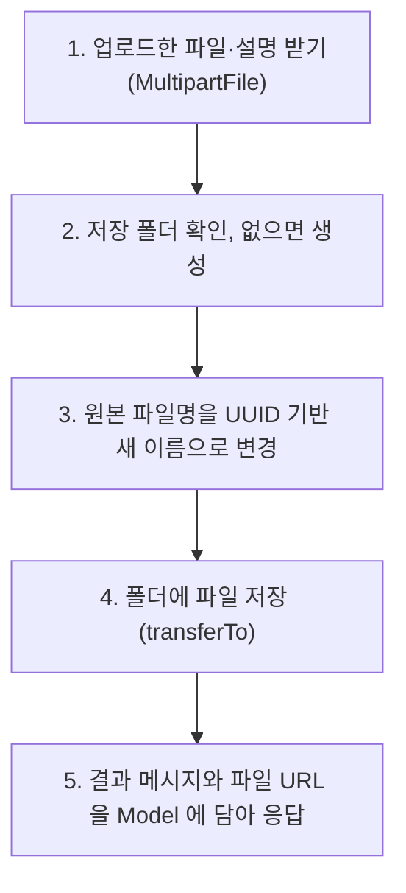

## 들어가며 (Situation)

지금까지의 폼은 텍스트와 숫자만 보냈습니다. 이번 실습(`chap06-file-upload`)은 **파일**을 업로드해 서버 폴더에 저장하고, 저장한 이미지를 다시 화면에 보여 줍니다. 단일 파일과 여러 파일 업로드를 모두 다뤘습니다.

> 실제 서비스에서 겪은 문제가 아니라, 수업 실습을 정리한 글입니다. Spring Boot 4.1.2를 사용했고, 동작 설명은 Spring 공식 문서로 보완했습니다. 실습 화면의 안내 문구처럼, 서버 폴더에 파일을 직접 저장하는 이 방식은 나중에는 권장하지 않지만 현재 기술 스택에서 쓸 수 있는 방법입니다.

## 문제 상황 (Task)

- 폼에서 파일을 보내려면 무엇을 바꿔야 할까요?
- 여러 사용자가 같은 이름(`스크린샷.png`)의 파일을 올리면 서로 덮어쓰지 않을까요?
- 서버 폴더에 저장한 이미지를 `` 태그로 보여 주려면 URL과 폴더를 어떻게 연결할까요?
- 파일 5개 중 4개만 저장되고 1개가 실패하면 어떻게 할까요?

## 해결 과정 (Action)

### 1. 폼: enctype="multipart/form-data"

```html
<form action="single-file" method="post" enctype="multipart/form-data">
    파일 : <input type="file" name="singleFile"> <br>
    파일 설명 : <input type="text" name="description"><br>
    <input type="submit">
</form>

<form action="multi-file" method="post" enctype="multipart/form-data">
    파일 : <input type="file" name="multiFile" multiple> <br>
    파일 설명 : <input type="text" name="description"><br>
    <input type="submit">
</form>
```

| 속성 | 의미 |
|------|------|
| `enctype="multipart/form-data"` | 요청 본문을 여러 부분(part)으로 나눠 텍스트와 파일을 함께 보냄 |
| `type="file"` | 파일 선택 입력 |
| `multiple` | 파일 여러 개 선택 허용 |

폼의 기본 인코딩은 `키=값&키=값` 형태의 문자열이라 파일 내용을 담을 수 없습니다. 수업 주석대로 인코딩을 맞춰 보내야 Spring도 알맞은 타입(`MultipartFile`)으로 받을 수 있습니다. 파일은 크기가 크기 때문에 `method`도 반드시 `post`입니다.

### 2. 업로드 크기와 저장 경로 설정

```yaml
spring:
  servlet:
    multipart:
      max-file-size: 200MB        # 파일 1개의 최대 크기
      max-request-size: 1000MB    # 요청 1번에 담긴 파일들의 합계 최대 크기

# 프로젝트에서 파일을 어디에 저장할지에 대한 경로 지정
file:
  upload-dir: ./uploads
```

`spring.servlet.multipart`는 Spring Boot가 제공하는 설정입니다. Spring Boot 문서에 따르면 기본값은 파일 1MB, 요청 10MB라서 이미지 몇 장만 올려도 넘을 수 있습니다. `file.upload-dir`은 우리가 직접 정한 설정 키이고, 코드에서 `@Value`로 읽습니다.

```java
@Value("${file.upload-dir}")
private String uploadDir;
```

JDBC 수업에서 접속 정보를 properties 파일로 빼냈던 것처럼, 경로를 코드에 박지 않고 설정 파일로 분리했습니다.

### 3. 업로드 처리 흐름

수업 주석이 정리한 순서입니다.



### 4. 단일 파일: MultipartFile

```java
@PostMapping("single-file")
public ModelAndView single(@RequestParam MultipartFile singleFile,
                           @RequestParam String description,
                           ModelAndView mv) {
    try {
        String savedName = save(singleFile);
        mv.addObject("message", "파일 업로드 성공!!");
        mv.addObject("files", "/uploads/" + savedName);
    } catch (IOException e) {
        mv.addObject("message", "파일 업로드 실패.." + e.getMessage());
    }
    mv.setViewName("result");
    return mv;
}
```

업로드된 파일은 **`MultipartFile`** 타입으로 받습니다. 지난 글의 `@RequestParam`과 같은 방식으로, 폼의 `name`(`singleFile`)과 매개변수 이름을 맞춥니다. 텍스트 입력(`description`)도 같은 요청에서 함께 받습니다.

### 5. 저장 메서드: UUID로 이름 바꾸기

```java
private String save(MultipartFile file) throws IOException {
    // 파일의 원본 이름 추출 : test.png
    String originName = file.getOriginalFilename();

    // 확장자 분리 + 소문자로 통일 : .PNG -> .png
    String ext = originName.substring(originName.lastIndexOf(".")).toLowerCase();

    // 중복되는 파일명 방지를 위한 UUID : 스크린샷.png -> 3829382d-....png
    String savedName = UUID.randomUUID().toString() + ext;

    // 파일을 저장할 폴더 생성
    File dir = new File(uploadDir).getAbsoluteFile();
    dir.mkdirs();

    // 생성한 폴더에 새 이름으로 저장
    file.transferTo(new File(dir, savedName));

    return savedName;
}
```

| 단계 | 메서드 | 이유 |
|------|--------|------|
| 원본 이름 | `getOriginalFilename()` | 사용자가 올린 파일 이름 (`test.png`) |
| 확장자 | `substring(lastIndexOf("."))` + `toLowerCase()` | 이미지 형식은 유지하고 `.PNG`/`.png`를 통일 |
| 새 이름 | `UUID.randomUUID()` | 사실상 겹치지 않는 무작위 이름으로 **덮어쓰기 방지** |
| 폴더 | `mkdirs()` | 폴더가 없으면 상위 폴더까지 생성 |
| 저장 | `transferTo(File)` | 업로드된 내용을 실제 파일로 기록 |

원본 이름을 그대로 쓰면 두 사람이 `스크린샷.png`를 올렸을 때 나중 파일이 먼저 파일을 덮어씁니다. UUID로 바꾸면 이 문제가 사라지고, 한글·공백 같은 문자가 URL에 섞이는 문제도 피할 수 있습니다. 원본 이름이 필요하면 `FileDTO`처럼 따로 보관합니다.

```java
public class FileDTO {
    private String originFileName;   // 사용자가 올린 이름
    private String savedName;        // 서버에 저장한 UUID 이름
    private String filePath;         // 저장 폴더
    private String description;      // 파일 설명
}
```

### 6. 여러 파일과 "롤백"

```java
@PostMapping("multi-file")
public ModelAndView multiFileUpload(@RequestParam("multiFile") List<MultipartFile> multipartFile,
                                    String description, ModelAndView mv) {
    List<FileDTO> files = new ArrayList<>();
    List<String> savedFiles = new ArrayList<>();

    try {
        for (MultipartFile file : multipartFile) {
            String savedName = save(file);
            files.add(new FileDTO(file.getOriginalFilename(), savedName, uploadDir, description));
            savedFiles.add("/uploads/" + savedName);
        }
        mv.addObject("message", "멀티 파일 업로드 성공!");
        mv.addObject("files", savedFiles);
    } catch (Exception e) {
        // 실패 시에 이전에 저장된 파일을 삭제
        for (FileDTO file : files) {
            new File(new File(uploadDir).getAbsoluteFile(), file.getSavedName()).delete();
        }
        mv.addObject("message", "멀티 파일 업로드 실패!");
    }

    mv.setViewName("result");
    return mv;
}
```

`multiple`로 보낸 파일들은 `List<MultipartFile>`로 받습니다. 수업 주석이 던진 질문이 이 코드의 핵심입니다. "5개 파일을 넣었는데 4개는 정상적으로 저장되고 1개만 안 되면?" 그 답으로 **트랜잭션의 rollback처럼** 동작하게 만들었습니다. 저장에 성공한 파일을 `files` 목록에 기록해 두었다가, 중간에 예외가 나면 그 목록을 돌며 이미 저장한 파일을 지웁니다.


DB 트랜잭션은 데이터베이스가 `rollback`을 해 주지만, 디스크에 쓴 파일은 되돌려 주는 기능이 없습니다. 그래서 **무엇을 저장했는지 직접 기록하고 직접 지우는** 방식이 필요합니다. MySQL 트랜잭션 글에서 다룬 "전부 성공 아니면 전부 취소" 원칙을 파일에 직접 구현한 것입니다.

### 7. 저장한 파일을 URL로 보여 주기: addResourceHandlers

```html
<!-- result.html -->
<h3 th:text="${message}"></h3>
<!-- th:each 는 java 의 for 문이라고 생각하면 좋다. -->
<div th:each="file : ${files}">
    
</div>
```

``가 그려지면 브라우저는 `/uploads/abc.png`로 **다시 요청**합니다. 수업 주석의 표현으로는 "이미지 내놔!" 요청입니다. 그런데 이 파일은 `resources/static`이 아니라 프로젝트의 `./uploads` 폴더에 있어서, 그냥은 찾을 수 없습니다. 요청 URL과 폴더를 연결해야 합니다.

```java
@Configuration
public class WebConfig implements WebMvcConfigurer {

    @Value("${file.upload-dir}")
    private String uploadDir;

    @Override
    public void addResourceHandlers(ResourceHandlerRegistry registry) {
        registry.addResourceHandler("/uploads/**")
                .addResourceLocations("file:" + uploadDir + "/");
    }
}
```

| 설정 | 값 | 의미 |
|------|----|------|
| `addResourceHandler` | `/uploads/**` | 이 URL로 시작하는 요청을 |
| `addResourceLocations` | `file:./uploads/` | 파일 시스템의 이 폴더에서 찾아 응답 |

지난 글에서 인터셉터 등록에 쓴 `WebMvcConfigurer`를 이번에는 **정적 리소스 경로 추가**에 썼습니다. `file:` 접두사는 클래스패스가 아니라 디스크 경로라는 뜻입니다.

### 8. 알아 둘 점

수업 코드는 정상적인 이미지 업로드를 기준으로 작성되어 있습니다. 실제 서비스라면 아래를 함께 고려해야 합니다. (코드와 API 동작을 근거로 정리했고, 직접 재현하지는 않았습니다.)

| 상황 | 영향 | 대응 방향 |
|------|------|-----------|
| 파일을 선택하지 않고 제출 | 빈 `MultipartFile`이 들어와 이름에 `.`이 없으면 `substring`에서 예외 | `file.isEmpty()` 먼저 확인 |
| 확장자가 없는 파일 | 위와 같은 예외 | 확장자 유무 검사 |
| 이미지가 아닌 파일(`.html` 등) 업로드 | `/uploads/`로 그대로 제공되어 악성 파일이 될 수 있음 | 허용할 확장자 목록(화이트리스트)으로 제한 |
| 설정한 크기 초과 | 업로드 거부 예외 | 전역 예외 처리기로 안내 화면 |

## 결과 (Result)

정량 지표는 없고, 아래를 정리했습니다.

- 파일 업로드에는 `enctype="multipart/form-data"`와 POST가 필요하고, 서버에서는 `MultipartFile`(여러 개면 `List<MultipartFile>`)로 받습니다.
- 크기 제한은 `spring.servlet.multipart`로, 저장 경로는 직접 만든 설정 키와 `@Value`로 관리합니다.
- 저장 시 UUID로 이름을 바꿔 덮어쓰기를 막고, 원본 이름은 DTO에 따로 보관합니다.
- 여러 파일 중 하나라도 실패하면 이미 저장한 파일을 직접 지워 "전부 아니면 전무"를 지킵니다.
- 저장 폴더는 `addResourceHandlers`로 URL과 연결해야 ``로 보여 줄 수 있습니다.

## 더 학습하면 좋은 개념

- **객체 스토리지(AWS S3 등)** — 실습 화면이 "나중에는 권장하지 않는 방식"이라고 한 이유입니다. 서버가 여러 대이거나 재배포해도 파일이 유지되도록 파일을 서버 밖에 둡니다.
- **파일 업로드 보안(확장자·MIME 타입 검증)** — 업로드된 파일이 실행되거나 악성 콘텐츠로 제공되는 것을 막는 방법입니다.
- **`MaxUploadSizeExceededException` 처리** — 크기 초과를 `@ControllerAdvice`로 잡아 안내하는 방법으로, 지난 예외 처리 글과 이어집니다.
- **파일 메타데이터의 DB 저장** — `FileDTO`의 원본 이름·저장 이름을 테이블에 저장하고, DB 트랜잭션과 파일 저장을 함께 맞추는 설계입니다.
- **`@ConfigurationProperties`** — `@Value`로 하나씩 읽는 대신 설정 묶음을 객체로 받는 방법입니다.

## 참고 자료

- [Spring Framework Reference - Multipart Resolver](https://docs.spring.io/spring-framework/reference/web/webmvc/mvc-servlet/multipart.html)
- [Spring Framework Reference - Multipart (Handler Method Arguments)](https://docs.spring.io/spring-framework/reference/web/webmvc/mvc-controller/ann-methods/multipart-forms.html)
- [Spring Framework API - MultipartFile](https://docs.spring.io/spring-framework/docs/current/javadoc-api/org/springframework/web/multipart/MultipartFile.html)
- [Spring Framework Reference - Static Resources (MVC Config)](https://docs.spring.io/spring-framework/reference/web/webmvc/mvc-config/static-resources.html)
- [Spring Boot Reference - Common Application Properties (spring.servlet.multipart)](https://docs.spring.io/spring-boot/appendix/application-properties/index.html)
- [OWASP - File Upload Cheat Sheet](https://cheatsheetseries.owasp.org/cheatsheets/File_Upload_Cheat_Sheet.html)
