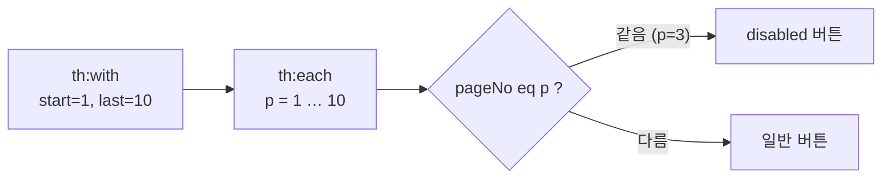
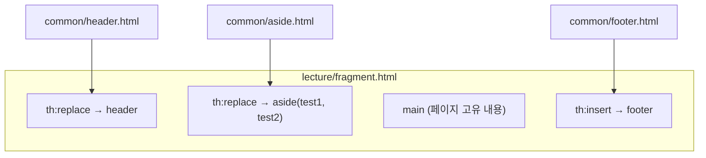

## 들어가며 (Situation)

지난 글에서 Thymeleaf 표현식으로 값을 꺼내 출력하는 방법을 정리했습니다. 이번 글은 같은 실습(`chap07-thymeleaf`)의 나머지인 **조건문, 반복문, 지역 변수, SpringEL로 컬렉션 다루기, 그리고 공통 영역을 재사용하는 fragment**를 다룹니다. 화면을 실제로 "조립"하는 데 필요한 문법들입니다.

> 실제 서비스에서 겪은 문제가 아니라, 수업 실습을 정리한 글입니다. Spring Boot 4.1.2, Thymeleaf 3.1 계열을 사용했고, 동작 설명은 Thymeleaf 공식 문서로 보완했습니다.

## 문제 상황 (Task)

- 값에 따라 화면 일부를 보여 주거나 숨기려면 어떻게 할까요?
- 컨트롤러가 넘긴 `List`나 `Map`을 표로 그리려면 어떻게 할까요?
- 페이지 번호 버튼처럼 "현재 페이지만 다르게" 그리려면 어떻게 할까요?
- 헤더·푸터처럼 모든 페이지에 들어가는 영역을 페이지마다 복사해야 할까요?

## 해결 과정 (Action)

### 1. 조건문: th:if, th:unless, th:switch

```java
mv.addObject("num", 1);
mv.addObject("str", "바나나");
```

```html
<p th:if="${ num > 0 }">넘어온 값은 0보다 크다.</p>
<p th:if="${ num < 0 }">넘어온 값은 0보다 작다.</p>
<p th:unless="${ num < 0 }">넘어온 값은 0보다 작지 않다.</p>

<th:block th:if="${ str == '바나나' }">
    <p>바나나 좋아요!</p>
</th:block>

<!-- and, or 로 다중 조건 -->
<p th:if="${ num > 0 and num <= 10 }">1부터 10까지의 양수</p>
<!-- Utility Object 로 null·빈 문자열 처리 -->
<p th:if="${ !#strings.isEmpty(str) and str == '바나나' }">바나나 좋아요!</p>
```

| 문법 | 태그가 출력되는 경우 |
|------|----------------------|
| `th:if` | 조건이 `true` |
| `th:unless` | 조건이 `false` (`if`의 반대) |
| `and` / `or` | 여러 조건 조합 |

조건이 맞지 않으면 그 태그는 **결과 HTML에서 아예 빠집니다.** CSS로 숨기는 것과 달리 페이지 소스에도 남지 않습니다. 감싸는 태그를 따로 만들고 싶지 않으면 `<th:block>`에 조건을 걸면 됩니다.

`#strings`는 Thymeleaf가 제공하는 **Utility Object** 중 하나입니다. 수업 주석은 `#strings`, `#numbers`, `#lists`, `#maps`, `#dates` 등 자주 쓰는 것들을 정리해 두었습니다. `#strings.isEmpty(str)`은 `null`과 빈 문자열을 함께 검사해 줍니다.

```html
<th:block th:switch="${ str }">
    <span th:case="사과">사과가 선택되었습니다</span>
    <span th:case="바나나">바나나가 선택되었습니다</span>
    <span th:case="*">사과도 바나나도 아닙니다</span>   <!-- switch 문의 default -->
</th:block>
```

자바의 `switch`처럼 값에 맞는 `th:case` 하나만 출력하고, `th:case="*"`는 어떤 경우에도 맞지 않을 때의 기본값입니다.

### 2. 반복문: th:each와 반복 상태

```java
List<MemberDTO> memberList = new ArrayList<>();
memberList.add(new MemberDTO("홍길동", 20, '남', "서울시 서초구"));
memberList.add(new MemberDTO("유관순", 22, '여', "서울시 노원구"));
// ...
mv.addObject("memberList", memberList);
```

```html
<tr th:each="member : ${ memberList }">
    <td th:text="${ member.name }"></td>
    <td th:text="${ member.age }"></td>
    <td th:text="${ member.gender }"></td>
    <td th:text="${ member.address }"></td>
</tr>
```

`th:each="member : ${memberList}"`는 자바의 향상된 for문(`for (MemberDTO member : memberList)`)과 같은 모양입니다. **`th:each`를 붙인 태그 자체가 반복**되므로, `<tr>`에 붙이면 회원 수만큼 행이 만들어집니다.

반복 중 몇 번째인지 같은 상태 정보도 꺼낼 수 있습니다.

```html
<tr th:each="member, stat : ${ memberList }">
    <td th:text="${ stat.index }"></td>
    <td th:text="${ stat.count }"></td>
    <!-- ... -->
</tr>
```

| 상태 변수 | 의미 |
|-----------|------|
| `index` | 0부터 시작하는 인덱스 |
| `count` | 1부터 시작하는 순번 |
| `size` | 전체 개수 |
| `current` | 현재 요소 |
| `even` / `odd` | 짝수·홀수 번째 여부 |
| `first` / `last` | 첫 번째·마지막 여부 |

상태 변수 이름을 생략하면 **`반복변수명 + Stat`** 이라는 이름으로 자동 제공됩니다. 위 예에서는 `memberStat.index`처럼 씁니다. 목록 번호(`count`)나 줄무늬 표(`odd`)를 만들 때 자주 쓰입니다.

컬렉션 없이 숫자 범위로 반복할 수도 있습니다.

```html
<th:block th:each="num : ${ #numbers.sequence(5, 10) }">
    <a th:href="@{|/numbering/${ numStat.count }|}" th:text="번호 + ${ num }"></a>
</th:block>
```

`#numbers.sequence(5, 10)`은 5부터 10까지의 숫자를 만들어 줍니다. 링크 경로 중간에 값을 넣을 때는 지난 글의 리터럴 치환(`|...|`)을 링크 표현식 안에서 함께 씁니다.

### 3. 지역 변수 th:with와 페이지 버튼

```java
// 시작 페이지 1, 끝 페이지 10, 현재 페이지 3
SelectCriteria selectCriteria = new SelectCriteria(1, 10, 3);
// 키 이름 없이 객체만 담으면 클래스 이름의 첫 글자를 소문자로 바꾼 "selectCriteria" 가 키가 된다.
mv.addObject(selectCriteria);
```

```html
<th:block th:with="start = ${ selectCriteria.startPage }, last = ${ selectCriteria.endPage }">
    <th:block th:each="p : ${ #numbers.sequence(start, last) }">
        <!-- 현재 페이지 버튼만 비활성화 -->
        <th:block th:if="${ selectCriteria.pageNo eq p }">
            <button th:text="${ p }" disabled></button>
        </th:block>
        <th:block th:if="${ selectCriteria.pageNo ne p }">
            <button th:text="${ p }"></button>
        </th:block>
    </th:block>
</th:block>
```



- `th:with`는 태그 범위 안에서만 쓰는 **지역 변수**를 만듭니다. 긴 표현식을 짧은 이름으로 줄일 때 씁니다.
- 비교 연산자는 문자로도 쓸 수 있습니다: `eq`(==), `ne`(!=), `gt`(>), `lt`(<), `ge`(>=), `le`(<=). HTML 속성 안에서 `<`, `>`를 쓰는 것보다 읽기 쉽습니다.

목록 화면의 페이지 번호(1~10 중 현재 페이지 3만 다르게)를 만드는 전형적인 방식입니다.

### 4. SpringEL로 객체·List·Map 꺼내기

`${}` 안에서는 Spring이 제공하는 표현식 언어 **SpringEL**을 씁니다. 같은 값을 여러 방식으로 꺼낼 수 있습니다.

| 대상 | 작성 예 |
|------|---------|
| 객체 | `${ member.name }`, `${ member['age'] }`, `${ member.getGender() }` |
| List | `${ memberList[1].name }`, `${ memberList.get(1).address }` |
| Map | `${ memberMap['m03'].name }`, `${ memberMap['m03']['age'] }` |

수업 주석에 따르면 `.필드명`, `['필드명']`, `.getter()` 세 가지 모두 **내부적으로 getter를 호출**합니다. 필드가 `private`이므로 getter가 없으면 세 방식 모두 에러가 납니다. Lombok의 `@Getter`나 직접 작성한 getter가 Thymeleaf에서도 필요한 이유입니다.

Map은 `th:each`로 반복하면 각 요소가 `Map.Entry`가 되어 `key`, `value`로 꺼냅니다.

```java
/* HashMap 은 순서를 보장하지 않으므로, 넣은 순서대로 출력하기 위해 LinkedHashMap 사용 */
Map<String, MemberDTO> memberMap = new LinkedHashMap<>();
memberMap.put("m01", new MemberDTO("홍길동", 20, '남', "서울시 서초구"));
```

```html
<li th:each="entry : ${ memberMap }" th:text="|${ entry.key } : ${ entry.value.name }|"></li>
```

JDBC 수업에서 조회 순서를 유지하려고 `LinkedHashMap`을 골랐던 이유가 화면 출력 순서에도 그대로 적용됩니다.

### 5. fragment: 공통 영역 재사용

수업 주석은 fragment의 필요성을 이렇게 설명합니다. 웹 페이지에는 헤더, 내비게이션, 푸터, 사이드처럼 공통으로 반복되는 영역이 많은데, 이를 매번 페이지에 넣으면 내비게이션 하나를 바꿀 때 페이지 수만큼 같은 작업을 반복해야 합니다.

**① 조각 정의: th:fragment**

```html
<!-- templates/common/header.html -->
<header th:fragment="headerFragment" class="header">
    <h1> header Fragment</h1>
</header>

<!-- templates/common/footer.html -->
<footer th:fragment="footerFragment" class="footer">
    <h1> footer Fragment</h1>
</footer>
```

`th:fragment`로 이름을 붙인 영역만 다른 페이지로 불려 갑니다. 파일의 나머지(`head`, `body`)는 쓰이지 않습니다.

**② 조각 불러오기: th:replace, th:insert**

```html
<!-- templates/lecture/fragment.html -->
<header th:replace="~{common/header :: headerFragment}">
    <h1>나는 header</h1>
</header>

<footer th:insert="~{common/footer :: footerFragment}">
    <h2>나는 footer</h2>
</footer>
```

작성 방법은 `~{템플릿 경로 :: 조각 이름}`입니다. 템플릿 경로는 `templates` 기준이고 `.html`은 생략하며, 뷰 이름과 마찬가지로 앞에 `/`를 붙이지 않습니다.

| 문법 | 동작 | 결과 HTML |
|------|------|-----------|
| `th:replace` | 작성한 태그를 **통째로** 조각으로 교체 | `<header class="header">...</header>` |
| `th:insert` | 작성한 태그는 **유지**하고 그 안에 조각을 삽입 | `<footer><footer class="footer">...</footer></footer>` |

두 경우 모두 원래 태그 안의 내용(`나는 header`, `나는 footer`)은 사라집니다. 이 내용은 서버 없이 파일을 열었을 때만 보이는 자리 표시 역할을 합니다. 같은 태그가 중첩되지 않게 하려면 보통 `th:replace`를 많이 씁니다.

**③ 매개변수가 있는 조각**

```html
<!-- templates/common/aside.html -->
<aside th:fragment="asideFragment(parameter, parameter1)" class="aside">
    <ul>
        <li th:text="${parameter}"></li>
        <li th:text="${parameter1}"></li>
    </ul>
</aside>
```

```html
<!-- fragment.html : 컨트롤러가 넘긴 test1, test2 를 전달 -->
<aside th:replace="~{common/aside :: asideFragment(${test1}, ${test2})}"></aside>
```

조각을 메서드처럼 정의하고, 부르는 쪽에서 값을 넘겨 내용을 바꿀 수 있습니다. 예를 들어 같은 사이드 메뉴에서 현재 페이지만 강조하는 식으로 활용할 수 있습니다.



서블릿 수업의 출력 코드를 한곳에 모으자는 아이디어나, JSP의 `include`와 같은 목적입니다. 공통 영역을 한 파일에서 고치면 그 조각을 쓰는 모든 페이지에 반영됩니다.

## 결과 (Result)

정량 지표는 없고, 아래를 정리했습니다.

- `th:if`/`th:unless`/`th:switch`로 조건에 따라 태그를 출력하거나 결과 HTML에서 빼고, `<th:block>`으로 감싸는 태그 없이 범위를 지정합니다.
- `th:each`는 붙인 태그 자체를 반복하며, `stat`(또는 `변수명Stat`)으로 순번·첫째·마지막 등 반복 상태를 꺼냅니다.
- `th:with`로 지역 변수를 만들고 `eq`/`ne` 같은 문자 연산자로 비교해 페이지 번호 버튼을 만들 수 있습니다.
- `${}`의 SpringEL은 객체·List·Map을 여러 방식으로 꺼내지만 모두 getter에 의존합니다.
- `th:fragment`로 공통 영역을 정의하고 `th:replace`(태그 교체) 또는 `th:insert`(태그 안에 삽입)로 불러오며, 매개변수도 전달할 수 있습니다.

## 더 학습하면 좋은 개념

- **Thymeleaf Layout Dialect** — fragment를 넘어 "기본 레이아웃 하나에 페이지 내용만 끼우는" 방식으로, 페이지가 많아질 때 유용합니다.
- **페이지네이션 설계** — `SelectCriteria`처럼 시작·끝·현재 페이지를 계산하는 로직과 SQL의 `LIMIT`/`OFFSET`을 연결하는 방법입니다. MySQL 글의 `LIMIT`과 이어집니다.
- **Utility Objects 전체 목록(`#dates`, `#lists`, `#temporals`)** — 날짜 서식, 리스트 크기 확인 등 화면 가공을 템플릿에서 처리하는 방법입니다.
- **`th:classappend`** — 반복 상태(`odd`, 현재 페이지 여부)에 따라 CSS 클래스를 붙여 화면을 꾸미는 방법입니다.
- **Spring Security와 Thymeleaf 연동(`sec:authorize`)** — 로그인 여부에 따라 영역을 다르게 보여 주는 방법으로, 로그인 기능이 있는 프로젝트에서 필요합니다.

## 참고 자료

- [Thymeleaf - Tutorial: Conditional Evaluation](https://www.thymeleaf.org/doc/tutorials/3.1/usingthymeleaf.html#conditional-evaluation)
- [Thymeleaf - Tutorial: Iteration (Keeping iteration status)](https://www.thymeleaf.org/doc/tutorials/3.1/usingthymeleaf.html#iteration)
- [Thymeleaf - Tutorial: Local Variables (th:with)](https://www.thymeleaf.org/doc/tutorials/3.1/usingthymeleaf.html#local-variables)
- [Thymeleaf - Tutorial: Template Layout (fragments)](https://www.thymeleaf.org/doc/tutorials/3.1/usingthymeleaf.html#template-layout)
- [Thymeleaf - Tutorial: Expression Utility Objects](https://www.thymeleaf.org/doc/tutorials/3.1/usingthymeleaf.html#appendix-b-expression-utility-objects)
- [Spring Framework Reference - Spring Expression Language (SpEL)](https://docs.spring.io/spring-framework/reference/core/expressions.html)
