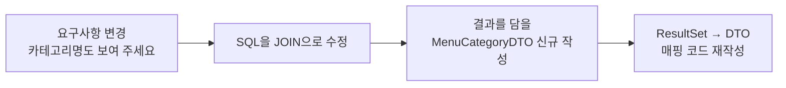
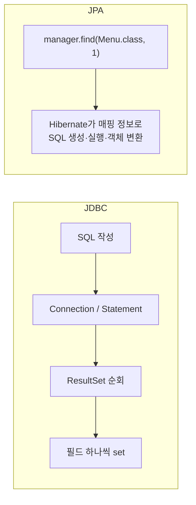
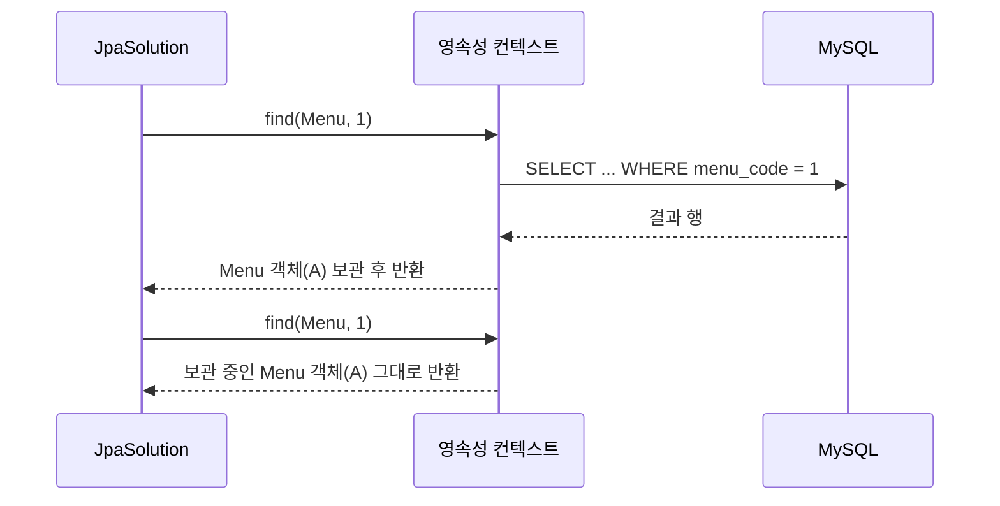

## 들어가며 (Situation)

[JDBC 시리즈]({{ site.baseurl }})에서는 `Connection`, `PreparedStatement`, `ResultSet`을 직접 다루며 DAO 계층까지 만들었습니다. 이번 수업(`09_JPA/chap01-jpa-intro`)은 **JPA**로 넘어가는 첫 시간입니다. 같은 메뉴 테이블(`tbl_menu`, `tbl_category`)을 대상으로 먼저 JDBC로 짠 코드에서 문제를 짚고(section01), 같은 기능을 JPA로 다시 만들었습니다(section02).

> 실제 서비스에서 겪은 문제가 아니라, 수업 실습을 정리한 글입니다. Spring Boot 4.1.2, Java 21, MySQL을 사용했고, 동작 설명은 Jakarta Persistence·Spring 공식 문서로 보완했습니다.

## 문제 상황 (Task)

JDBC로도 기능은 다 만들 수 있었습니다. 수업에서는 JDBC를 직접 쓰면 아래 네 가지가 불편하다고 짚었습니다.

| 번호 | 문제 | 한 줄 요약 |
|------|------|-----------|
| 1 | 반복 코드와 수작업 매핑 | 조회할 때마다 커넥션·Statement·ResultSet 코드와 `rset.getXxx()` → `setXxx()` 매핑을 다시 쓴다 |
| 2 | SQL에 의존적인 개발 | 요구사항이 바뀌면 SQL → DTO → 매핑 코드가 줄줄이 바뀐다 |
| 3 | 패러다임 불일치 | 테이블은 FK **값**으로, 객체는 **참조**로 연관을 표현한다 |
| 4 | 동일성 보장 문제 | 같은 행을 두 번 조회하면 서로 다른 객체가 된다 |

이 글에서는 각 문제가 코드에서 어떻게 드러나는지, JPA가 어떻게 해결하는지를 정리합니다.

## 해결 과정 (Action)

### 1. 프로젝트 설정

**의존성(`build.gradle`)**

```groovy
dependencies {
    implementation 'org.springframework.boot:spring-boot-starter-data-jpa'
    compileOnly 'org.projectlombok:lombok'
    runtimeOnly 'com.mysql:mysql-connector-j'
    annotationProcessor 'org.projectlombok:lombok'
    // 테스트 의존성 생략
}
```

`spring-boot-starter-data-jpa` 하나에 JPA 표준 API(`jakarta.persistence`), 구현체인 **Hibernate**, 커넥션 풀(HikariCP)이 함께 들어옵니다. JPA는 인터페이스와 규칙을 정한 **표준**이고, 실제로 SQL을 만들고 실행하는 것은 구현체인 Hibernate입니다.

**설정(`application.yaml`)** — DB 접속 정보(url, username, password)는 생략했습니다.

```yaml
spring:
  datasource:
    driver-class-name: com.mysql.cj.jdbc.Driver
    # url, username, password 생략
  jpa:
    show-sql: true          # JPA가 만든 SQL을 콘솔에 출력
    hibernate:
      ddl-auto: none        # 테이블을 자동으로 만들거나 바꾸지 않음
    properties:
      hibernate:
        format_sql: true    # 출력되는 SQL을 줄바꿈해서 보기 좋게
```

MySQL 드라이버 의존성을 추가하면 Spring Boot가 DataSource를 자동으로 만들려고 하므로, 접속 정보를 적지 않으면 애플리케이션이 시작되지 않습니다.

`ddl-auto`는 Hibernate가 애플리케이션 시작 시 테이블을 어떻게 다룰지 정합니다. Spring Boot 문서에 따르면 지원 값은 다섯 가지입니다.

| 값 | 동작 | 쓰는 상황 |
|----|------|-----------|
| `create` | 시작할 때 테이블을 지우고 새로 만든다 | 매번 깨끗한 상태로 실습 |
| `create-drop` | `create` + 종료할 때 테이블 삭제 | 테스트 |
| `update` | 엔티티와 테이블의 차이를 반영 | 개발 초기 |
| `validate` | 엔티티와 테이블이 맞는지 검사만 한다 | 운영 점검 |
| `none` | 아무것도 하지 않는다 | 이미 만들어 둔 테이블 사용 (이번 실습) |

> Spring Boot chooses a default value for you based on whether you are using an embedded database. ... If an embedded database is identified and no schema manager (Flyway or Liquibase) has been detected, `ddl-auto` defaults to `create-drop`. In all other cases, it defaults to `none`.
> — [Spring Boot - Database Initialization](https://docs.spring.io/spring-boot/how-to/data-initialization.html#howto.data-initialization.using-hibernate)

이번 실습은 MySQL에 이미 데이터가 들어 있는 테이블을 쓰므로 `none`이 맞습니다. `create`로 두면 실습 데이터가 날아갑니다.

**실행 구조** — 섹션마다 `@SpringBootApplication` 실행 클래스를 따로 두었습니다. 컴포넌트 스캔은 실행 클래스의 패키지 하위만 보므로, section01을 실행하면 section02의 클래스가 섞이지 않습니다. `main`에서 컨테이너를 띄운 뒤 `context.getBean()`으로 꺼낸 객체를 콘솔 메뉴로 호출하는 방식입니다.

```java
@SpringBootApplication
public class Section01Application {
    public static void main(String[] args) {
        ConfigurableApplicationContext context =
                SpringApplication.run(Section01Application.class, args);
        JdbcProblem jdbcProblem = context.getBean(JdbcProblem.class);
        // Scanner로 번호를 입력받아 jdbcProblem의 메서드 호출 (생략)
    }
}
```

### 2. section01 - JDBC를 직접 쓸 때의 문제

JDBC 수업 때는 `DriverManager`로 커넥션을 직접 만들었습니다. 이번에는 Spring Boot가 만들어 준 `DataSource`(커넥션 풀)를 생성자로 주입받아 커넥션을 꺼냅니다. 커넥션 관리는 편해졌지만, 그 뒤의 일은 여전히 개발자 몫입니다.

#### 문제 1. 반복 코드와 수작업 매핑

```java
@Component
public class JdbcProblem {

    private final DataSource dataSource;

    public JdbcProblem(DataSource dataSource) {
        this.dataSource = dataSource;
    }

    public void findAllMenu() {
        String query = "SELECT menu_code, menu_name, menu_price, category_code, orderable_status FROM tbl_menu";
        List<Menu> menuList = new ArrayList<>();

        try (Connection con = dataSource.getConnection();
             Statement stmt = con.createStatement();
             ResultSet rset = stmt.executeQuery(query)) {

            while (rset.next()) {
                // 행 1개를 객체 1개로 직접 옮겨 담는다
                Menu menu = new Menu();
                menu.setMenuCode(rset.getInt("menu_code"));
                menu.setMenuName(rset.getString("menu_name"));
                menu.setMenuPrice(rset.getInt("menu_price"));
                menu.setCategoryCode(rset.getInt("category_code"));
                menu.setOrderableStatus(rset.getString("orderable_status"));
                menuList.add(menu);
            }
        } catch (SQLException e) {
            throw new RuntimeException(e);
        }
        menuList.forEach(System.out::println);
    }
}
```

SQL 문자열, `try-with-resources` 블록, 컬럼 하나하나를 필드로 옮기는 코드가 조회 메서드마다 반복됩니다. 실습 클래스에는 조회 메서드가 4개 있는데, 네 메서드 모두 이 구조를 거의 그대로 반복합니다.

#### 문제 2. SQL에 의존적인 개발

요구사항이 "메뉴 목록에 카테고리 **이름**도 보여 주세요"로 바뀌었다고 해 봅시다.

```java
String query = "SELECT m.menu_code, m.menu_name, m.menu_price, c.category_name, m.orderable_status " +
               "FROM tbl_menu m " +
               "JOIN tbl_category c ON m.category_code = c.category_code " +
               "ORDER BY m.menu_code";
```

JOIN 결과를 담을 클래스가 없으므로 `MenuCategoryDTO`를 새로 만들어야 하고, 매핑 코드도 다시 써야 합니다.



화면 요구가 하나 바뀔 때마다 이 연쇄가 반복되고 DTO 클래스가 계속 늘어납니다. 코드를 짤 때 "어떤 객체가 필요한가"보다 "어떤 SQL을 쓸까"를 먼저 생각하게 됩니다. 수업에서는 이를 **SQL(테이블) 중심 개발**이라고 불렀습니다.

#### 문제 3. 패러다임 불일치

테이블과 객체는 연관을 표현하는 방식이 다릅니다.

| 관점 | 메뉴 ↔ 카테고리 연관 표현 | 카테고리 정보를 얻는 법 |
|------|--------------------------|------------------------|
| 테이블 | `tbl_menu.category_code` (FK **값**) | JOIN 하거나 그 값으로 한 번 더 조회 |
| 객체 | `Menu`가 `Category` 객체를 필드로 가짐 (**참조**) | `menu.getCategory()` |

테이블 구조에 맞춰 만든 `Menu`는 `int categoryCode`만 갖고 있습니다. 그래서 카테고리가 필요하면 객체 탐색이 아니라 SQL을 한 번 더 실행해 직접 조립해야 합니다.

```java
public void findMenuAndCategory(int menuCode) {
    Menu menu = findMenuByMenuCode(menuCode);   // SELECT ... FROM tbl_menu WHERE menu_code = ?
    // menu.getCategory() 같은 탐색이 불가능
    Category category = findCategoryByCategoryCode(menu.getCategoryCode()); // SELECT ... FROM tbl_category ...
}
```

카테고리 조회 코드에는 작은 디테일도 하나 있었습니다. `ref_category_code`는 NULL을 허용하는 컬럼이라 `getInt()`로 꺼내면 NULL이 `0`이 됩니다. 그래서 `rset.getObject("ref_category_code", Integer.class)`로 꺼내 `Integer` 필드에 담았습니다.

#### 문제 4. 동일성 보장 문제

```java
Menu menu1 = findMenuByMenuCode(menuCode);
Menu menu2 = findMenuByMenuCode(menuCode);

System.out.println("menu1 == menu2 : " + (menu1 == menu2));   // false

menu1.setMenuName("이름 변경 테스트");
System.out.println(menu1.getMenuName());   // 이름 변경 테스트
System.out.println(menu2.getMenuName());   // 원래 이름
```

DB의 **같은 행**을 꺼냈는데도 조회할 때마다 `new Menu()`를 하므로 서로 다른 객체가 됩니다. 한쪽을 수정해도 다른 쪽은 그 사실을 모릅니다. 같은 데이터를 가리키는 객체가 애플리케이션 안에 여러 개 생기고, 어느 것이 최신인지 알 수 없게 됩니다.

### 3. section02 - JPA로 다시 만들기

> JPA(Jakarta Persistence)는 자바 진영의 **ORM(Object-Relational Mapping) 표준**입니다. 객체와 테이블의 대응 관계를 어노테이션으로 알려 주면, SQL 생성과 실행, 결과 매핑을 구현체(Hibernate)가 대신합니다.

#### 엔티티 매핑

```java
@Entity
@Table(name = "tbl_menu")
@NoArgsConstructor
@AllArgsConstructor
@Getter
@ToString
public class Menu {

    @Id
    @Column(name = "menu_code")
    private int menuCode;

    @Column(name = "menu_name")
    private String menuName;

    @Column(name = "menu_price")
    private int menuPrice;

    @ManyToOne
    @JoinColumn(name = "category_code")
    private Category category;          // FK 값이 아니라 Category 객체를 참조

    @Column(name = "orderable_status")
    private String orderableStatus;

    public void changeMenuName(String menuName) {
        this.menuName = menuName;
    }
}
```

```java
@Entity
@Table(name = "tbl_category")
@NoArgsConstructor
@AllArgsConstructor
@Getter
@ToString
public class Category {

    @Id
    @Column(name = "category_code")
    private int categoryCode;

    @Column(name = "category_name")
    private String categoryName;

    @Column(name = "ref_category_code")
    private Integer refCategoryCode;
}
```

| 어노테이션 | 역할 |
|-----------|------|
| `@Entity` | JPA가 관리하는 객체(엔티티)임을 표시 |
| `@Table(name)` | 매핑할 테이블 이름 |
| `@Id` | 기본 키(PK)에 해당하는 필드 |
| `@Column(name)` | 매핑할 컬럼 이름 |
| `@ManyToOne` | 다대일 연관관계 (메뉴 N : 카테고리 1) |
| `@JoinColumn(name)` | 연관관계에 사용할 FK 컬럼 |

JPA 명세상 엔티티에는 인자 없는 생성자가 필요합니다. JPA가 조회 결과로 객체를 만들 때 기본 생성자로 만든 뒤 값을 채우기 때문입니다. `@NoArgsConstructor`가 그 역할을 합니다.

section02의 `Menu`에는 `@Setter`를 붙이지 않고 `changeMenuName()`이라는 메서드를 따로 두었습니다. 아무 필드나 바꿀 수 있는 setter 대신, 의도가 드러나는 메서드로만 상태를 바꾸게 하는 방식입니다.

#### EntityManager 주입

```java
@Component
public class JpaSolution {

    @PersistenceContext
    private EntityManager manager;
}
```

**영속성 컨텍스트(Persistence Context)**는 엔티티 객체를 보관하고 관리하는 공간입니다. 애플리케이션은 **EntityManager**를 통해 엔티티를 넣거나 꺼냅니다. 영속성 컨텍스트는 다음 글에서 자세히 다룹니다.

#### 해결 1. SQL·JDBC 코드·매핑이 사라진다

```java
public void findMenu(int menuCode) {
    Menu foundMenu = manager.find(Menu.class, menuCode);
    System.out.println(foundMenu);
}
```

`find(엔티티 타입, PK 값)` 한 줄이면 됩니다. SQL 작성, 커넥션·Statement·ResultSet 처리, 컬럼을 필드로 옮기는 코드는 Hibernate가 엔티티의 매핑 정보를 보고 대신 처리합니다. `show-sql: true` 덕분에 Hibernate가 만든 SELECT 문이 콘솔에 출력되어 실제로 어떤 SQL이 나갔는지 확인할 수 있습니다.



#### 해결 2. 패러다임 불일치 - 객체 그래프 탐색

```java
public void findMenuAndCategory(int menuCode) {
    Menu foundMenu = manager.find(Menu.class, menuCode);
    System.out.println(foundMenu);
    // Menu(menuCode=2, menuName=..., category=Category(categoryCode=..., categoryName=...), ...)
}
```

`Menu`가 `Category`를 필드로 갖고 있으므로 메뉴를 조회하면 카테고리 정보까지 객체 안에 담겨 나옵니다. JDBC 때처럼 FK 값으로 한 번 더 조회해 조립하는 코드가 필요 없습니다.

이게 가능한 이유는 `@ManyToOne`의 기본 조회 전략이 **즉시 로딩(EAGER)**이기 때문입니다. 메뉴를 조회할 때 연관된 카테고리도 함께 가져옵니다. 즉시 로딩과 지연 로딩(LAZY)의 차이는 이후 연관관계 수업에서 다룰 주제라 이 글에서는 여기까지만 정리합니다.

> 문제 2(요구사항 변경 시 SQL·DTO 연쇄 수정)도 같은 맥락에서 줄어듭니다. "카테고리 이름도 보여 주세요"라는 요구에 새 JOIN SQL과 DTO를 만드는 대신 `menu.getCategory().getCategoryName()`으로 꺼내면 됩니다.

#### 해결 3. 동일성 보장

```java
@Transactional(readOnly = true)
public void compareSameMenu(int menuCode) {
    System.out.println("=============1번째 조회=============");
    Menu menu1 = manager.find(Menu.class, menuCode);
    System.out.println("=============2번째 조회=============");
    Menu menu2 = manager.find(Menu.class, menuCode);

    System.out.println("menu1 == menu2 : " + (menu1 == menu2));   // true

    menu1.changeMenuName("테스트");
    System.out.println(menu1.getMenuName());   // 테스트
    System.out.println(menu2.getMenuName());   // 테스트
}
```

같은 트랜잭션 안에서 **같은 PK로 조회한 엔티티는 항상 같은 객체**입니다. 첫 번째 `find`에서 SELECT를 실행하고 결과 엔티티를 영속성 컨텍스트에 보관합니다. 두 번째 `find`는 DB에 가지 않고 보관해 둔 그 객체를 돌려줍니다. 콘솔에서도 SELECT 문이 "1번째 조회" 아래에만 한 번 찍히는 것으로 확인할 수 있습니다. `menu1`과 `menu2`가 같은 객체이므로 한쪽의 이름을 바꾸면 다른 쪽에서도 바뀐 이름이 보입니다.



**왜 `@Transactional`이 필요할까?**

`@Transactional`은 메서드가 시작될 때 트랜잭션을 열고, 예외 없이 끝나면 커밋, 런타임 예외가 나면 롤백합니다. 이 예제에서 `@Transactional`은 단순한 장식이 아닙니다. Spring 공식 문서는 `@PersistenceContext`로 주입받은 EntityManager를 이렇게 설명합니다.

> It delegates all calls to the current transactional `EntityManager`, if any. Otherwise, it falls back to a newly created `EntityManager` per operation, in effect making its usage thread-safe.
> — [Spring Framework Reference - JPA](https://docs.spring.io/spring-framework/reference/data-access/orm/jpa.html#orm-jpa-dao)

주입받은 `manager`는 진짜 EntityManager가 아니라 **공유 프록시**입니다. 트랜잭션이 있으면 그 트랜잭션에 묶인 EntityManager에 호출을 넘기고, 트랜잭션이 없으면 호출할 때마다 새 EntityManager를 씁니다. 따라서 `@Transactional`을 빼면 두 번의 `find`가 서로 다른 영속성 컨텍스트에서 실행되어 `menu1 == menu2`가 `false`가 될 수 있습니다. 동일성 보장의 범위는 **같은 영속성 컨텍스트(= 여기서는 같은 트랜잭션)**까지입니다.

`readOnly = true`는 조회 전용 트랜잭션이라는 뜻입니다. 이 예제의 `changeMenuName("테스트")`는 메모리 속 객체만 바꾸고, DB에 UPDATE를 보내지 않는 것을 전제로 합니다. 엔티티 값을 바꾸면 DB에 반영되는 원리(변경 감지)는 다음 글에서 정리합니다.

### 4. JDBC와 JPA 비교

| 문제 | JDBC | JPA |
|------|------|-----|
| 반복 코드·매핑 | 조회마다 직접 작성 | `find()` 한 줄, 매핑은 어노테이션으로 한 번 |
| SQL 의존 | 요구 변경마다 SQL·DTO·매핑 수정 | 객체 탐색으로 해결되는 경우가 많음 |
| 패러다임 불일치 | FK 값으로 다시 조회해서 조립 | `@ManyToOne`으로 객체 참조 |
| 동일성 | 조회마다 새 객체 (`==` false) | 같은 영속성 컨텍스트에서 같은 객체 (`==` true) |

## 결과 (Result)

정량 지표는 없고, 아래를 정리했습니다.

- JDBC를 직접 쓰면 반복 코드, SQL 중심 개발, 패러다임 불일치, 동일성 문제가 생깁니다.
- JPA는 ORM 표준이고 Hibernate가 구현체입니다. `spring-boot-starter-data-jpa` 하나로 둘 다 들어옵니다.
- `@Entity`, `@Table`, `@Id`, `@Column`, `@ManyToOne`/`@JoinColumn`으로 객체와 테이블을 연결하면 SQL과 매핑 코드를 Hibernate가 대신 처리합니다.
- 같은 영속성 컨텍스트 안에서 같은 PK로 조회한 엔티티는 같은 객체입니다. `@PersistenceContext`로 주입한 EntityManager는 트랜잭션 단위로 영속성 컨텍스트를 쓰므로, 동일성을 확인하려면 `@Transactional`이 필요합니다.
- `ddl-auto`는 이미 데이터가 있는 DB에서는 `none`이나 `validate`로 둡니다.

## 더 학습하면 좋은 개념

- **영속성 컨텍스트와 1차 캐시** — 동일성 보장이 어떻게 구현되는지 설명하는 핵심 개념입니다. 다음 글에서 이어집니다.
- **지연 로딩(LAZY)과 프록시** — `@ManyToOne`의 기본값인 즉시 로딩이 왜 실무에서 권장되지 않는지, 연관 객체를 필요할 때만 조회하는 방법입니다.
- **N+1 문제** — 연관관계를 객체로 탐색할 때 의도하지 않은 SELECT가 여러 번 나가는 대표적인 성능 문제입니다.
- **JPQL** — PK 조회(`find`) 말고 조건 검색이나 목록 조회를 할 때 쓰는 객체 기준 쿼리 언어입니다.
- **Spring Data JPA** — EntityManager를 직접 다루지 않고 인터페이스 선언만으로 CRUD를 만드는 방법입니다. 이번 글의 내용 위에서 동작합니다.

## 참고 자료

- [Jakarta Persistence 3.2 Specification](https://jakarta.ee/specifications/persistence/3.2/)
- [Jakarta Persistence API - EntityManager](https://jakarta.ee/specifications/persistence/3.2/apidocs/jakarta.persistence/jakarta/persistence/EntityManager.html)
- [Spring Framework Reference - JPA](https://docs.spring.io/spring-framework/reference/data-access/orm/jpa.html)
- [Spring Framework Reference - Using @Transactional](https://docs.spring.io/spring-framework/reference/data-access/transaction/declarative/annotations.html)
- [Spring Boot - Database Initialization (Using Hibernate)](https://docs.spring.io/spring-boot/how-to/data-initialization.html#howto.data-initialization.using-hibernate)
- [Hibernate ORM 7.0 User Guide](https://docs.hibernate.org/orm/7.0/userguide/html_single/)
