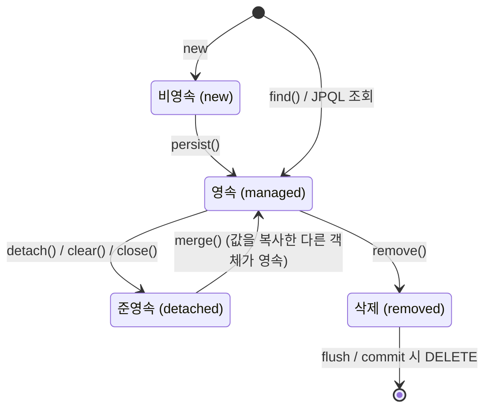
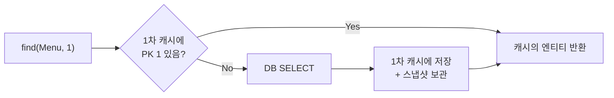
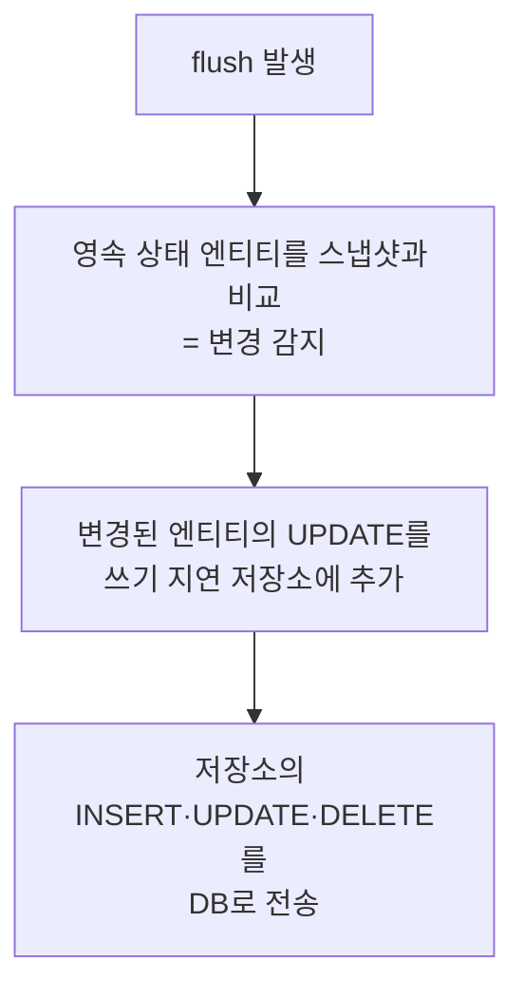
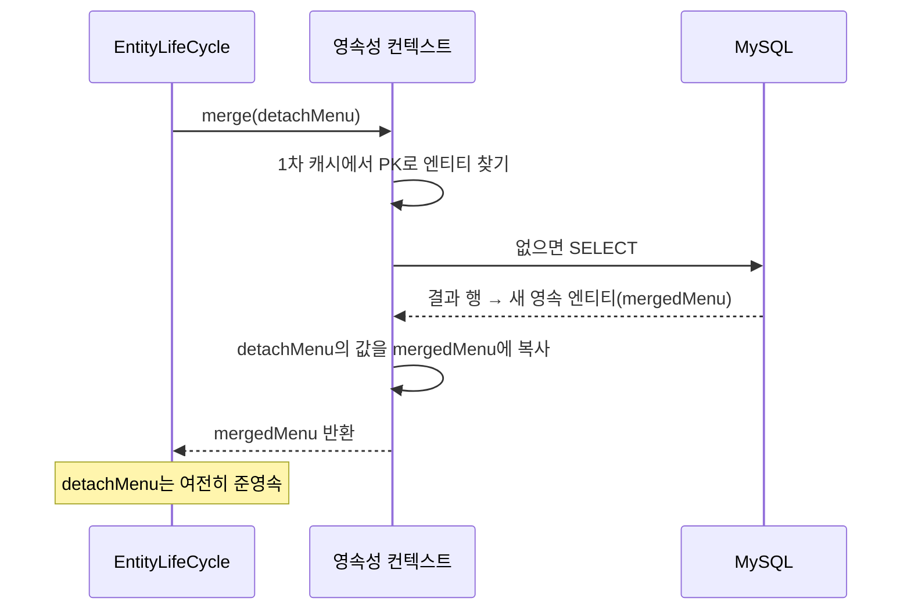

## 들어가며 (Situation)

[지난 글]({{ site.baseurl }})에서 관리 중인 엔티티의 값을 바꾸면 변경 감지가 UPDATE를 만들어 준다는 것을 봤습니다. 이번 실습(`chap02-persistence-context` section02)에서는 "관리 중"이라는 말이 정확히 무엇인지를 다뤘습니다. 엔티티는 영속성 컨텍스트와의 관계에 따라 네 가지 상태를 가집니다.

> 실제 서비스에서 겪은 문제가 아니라, 수업 실습을 정리한 글입니다. Spring Boot 4.1.2(Hibernate), MySQL을 사용했고, 동작 설명은 Jakarta Persistence 공식 API 문서로 보완했습니다. 데이터를 바꾸는 예제(준영속·삭제·병합)는 실습 데이터를 지키기 위해 마지막에 모두 `rollback()` 합니다.

## 문제 상황 (Task)

- 같은 값을 가진 두 객체가 있는데, 왜 하나만 JPA가 관리할까요?
- 엔티티 두 개의 가격을 모두 바꿨는데 UPDATE가 하나만 나간다면 이유가 무엇일까요?
- flush와 commit은 무엇이 다를까요?
- 관리에서 빠진 엔티티를 다시 반영하려면 어떻게 할까요?

## 해결 과정 (Action)

### 1. 네 가지 상태 한눈에 보기



| 상태 | 영어 | 의미 | 만드는 방법 |
|------|------|------|-------------|
| 비영속 | new / transient | 영속성 컨텍스트와 전혀 관계없는 객체 | `new Menu()` |
| 영속 | managed | 영속성 컨텍스트가 관리하는 상태 | `persist()`, `find()` |
| 준영속 | detached | 관리받다가 분리된 상태 | `detach()`, `clear()`, `close()` |
| 삭제 | removed | 삭제하기로 표시된 상태 | `remove()` |

엔티티가 지금 영속 상태인지는 `manager.contains(엔티티)`로 확인할 수 있습니다. 공식 API 문서는 이 메서드를 이렇게 설명합니다.

> Determine if the given object is a managed entity instance belonging to the current persistence context.
> — [Jakarta Persistence API - EntityManager.contains](https://jakarta.ee/specifications/persistence/3.2/apidocs/jakarta.persistence/jakarta/persistence/EntityManager.html)

실습은 섹션01과 같은 방식(EntityManagerFactory를 주입받아 메서드마다 EntityManager를 만들고 닫기)으로 작성했습니다.

### 2. 비영속: 값이 같아도 관리 대상이 아니다

```java
public void transientState(int menuCode) {

    EntityManager manager = factory.createEntityManager();

    Menu foundMenu = manager.find(Menu.class, menuCode);   // 영속

    Menu newMenu = new Menu();                              // 비영속
    newMenu.setMenuCode(foundMenu.getMenuCode());
    newMenu.setMenuName(foundMenu.getMenuName());
    newMenu.setMenuPrice(foundMenu.getMenuPrice());
    newMenu.setCategoryCode(foundMenu.getCategoryCode());
    newMenu.setOrderableStatus(foundMenu.getOrderableStatus());

    System.out.println("foundMenu == newMenu : " + (foundMenu == newMenu));      // false
    System.out.println("foundMenu 는 영속 상태인가? " + manager.contains(foundMenu)); // true
    System.out.println("newMenu 는 영속 상태인가? " + manager.contains(newMenu));     // false

    manager.close();
}
```

`newMenu`는 `foundMenu`와 타입도 값도 PK도 똑같습니다. 그래도 `new`로 만든 객체일 뿐이므로 영속성 컨텍스트는 이 객체를 모릅니다. JPA가 관리하는지는 **값이 아니라 객체(인스턴스) 단위**로 정해집니다.

### 3. 영속: 1차 캐시와 동일성 보장

```java
public void managedState(int menuCode) {

    EntityManager manager = factory.createEntityManager();

    System.out.println("===== 첫 번째 조회 =====");
    Menu foundMenu = manager.find(Menu.class, menuCode);   // SELECT 실행
    System.out.println("===== 두 번째 조회 =====");
    Menu newMenu = manager.find(Menu.class, menuCode);     // SELECT 없음

    System.out.println("foundMenu == newMenu : " + (foundMenu == newMenu));   // true

    manager.close();
}
```

`find()`로 조회한 엔티티는 영속성 컨텍스트 안의 **1차 캐시**(PK를 키로 엔티티를 보관하는 저장소)에 들어갑니다. 같은 EntityManager에서 같은 PK를 다시 조회하면 DB에 가지 않고 1차 캐시의 엔티티를 그대로 돌려줍니다. 콘솔에서 SELECT 문은 "첫 번째 조회" 아래에만 한 번 출력됩니다.

[첫 번째 JPA 글]({{ site.baseurl }})에서 본 동일성 보장이 바로 이 1차 캐시 덕분입니다.



### 4. 준영속: 값을 바꿔도 UPDATE가 나가지 않는다

```java
public void detachedState(int menuCode1, int menuCode2) {

    EntityManager manager = factory.createEntityManager();
    EntityTransaction transaction = manager.getTransaction();
    transaction.begin();

    Menu foundMenu1 = manager.find(Menu.class, menuCode1);
    Menu foundMenu2 = manager.find(Menu.class, menuCode2);

    manager.detach(foundMenu2);                         // 2번만 준영속으로

    foundMenu1.setMenuPrice(foundMenu1.getMenuPrice() + 1000);
    foundMenu2.setMenuPrice(foundMenu2.getMenuPrice() + 1000);

    System.out.println(menuCode1 + "번 메뉴는 영속 상태인가? " + manager.contains(foundMenu1)); // true
    System.out.println(menuCode2 + "번 메뉴는 영속 상태인가? " + manager.contains(foundMenu2)); // false

    System.out.println("===== flush =====");
    manager.flush();                                    // UPDATE는 foundMenu1 것만

    transaction.rollback();
    manager.close();
}
```

두 메뉴의 가격을 모두 1000원 올렸지만, 콘솔에는 UPDATE가 **하나만** 출력됩니다. `detach()`로 분리된 `foundMenu2`는 더 이상 영속성 컨텍스트가 관리하지 않으므로 변경 감지 대상이 아닙니다. 객체 자체의 값은 바뀌었지만 DB에는 반영되지 않습니다.

이 실습에서 확인할 수 있는 것은 두 가지입니다.

1. **쓰기 지연** — `setMenuPrice()`는 `===== flush =====` 출력보다 먼저 실행되지만, UPDATE 문은 그 **아래**에 출력됩니다.
2. **변경 감지 범위** — 영속 상태인 엔티티만 스냅샷과 비교됩니다.

준영속으로 만드는 방법은 세 가지입니다.

| 메서드 | 범위 | 비고 |
|--------|------|------|
| `detach(entity)` | 특정 엔티티 하나 | 나머지는 그대로 영속 |
| `clear()` | 영속성 컨텍스트 전체 초기화 | 관리하던 모든 엔티티가 준영속, EntityManager는 계속 사용 가능 |
| `close()` | 영속성 컨텍스트 종료 | 관리하던 모든 엔티티가 준영속, EntityManager 사용 불가 |

### 5. flush는 commit이 아니다

위 예제는 `flush()`로 UPDATE를 DB에 보낸 뒤 `rollback()`을 합니다. 그래도 실제 데이터는 바뀌지 않습니다. flush와 commit이 다른 일이기 때문입니다.

| 구분 | flush | commit |
|------|-------|--------|
| 하는 일 | 영속성 컨텍스트의 변경 내용을 SQL로 DB에 **전송** | 트랜잭션을 **확정** |
| 롤백 가능? | 가능 (아직 트랜잭션 안) | 불가능 |
| 1차 캐시 | **그대로 유지** (비우지 않음) | — |

flush가 일어나면 아래 과정이 진행됩니다.



flush가 일어나는 시점은 세 가지입니다.

| 시점 | 방식 | 설명 |
|------|------|------|
| `transaction.commit()` | 자동 | 지난 글의 CRUD 예제가 이 경우 |
| `manager.flush()` | 직접 호출 | 이번 실습처럼 SQL 전송 시점을 확인할 때 |
| JPQL 쿼리 실행 직전 | 자동 | JPQL은 DB를 직접 조회하므로, 아직 안 보낸 변경이 있으면 결과가 틀리지 않게 먼저 반영 |

공식 API 문서도 flush를 "동기화"라고 설명합니다.

> Synchronize changes held in the persistence context to the underlying database.
> — [Jakarta Persistence API - EntityManager.flush](https://jakarta.ee/specifications/persistence/3.2/apidocs/jakarta.persistence/jakarta/persistence/EntityManager.html)

### 6. 삭제: 다시 조회해도 null

```java
public void removedState(int menuCode) {

    EntityManager manager = factory.createEntityManager();
    EntityTransaction transaction = manager.getTransaction();
    transaction.begin();

    Menu foundMenu = manager.find(Menu.class, menuCode);
    if (foundMenu == null) {
        System.out.println(menuCode + "번 메뉴가 존재하지 않습니다.");
        transaction.rollback();
        manager.close();
        return;
    }

    manager.remove(foundMenu);

    Menu refoundMenu = manager.find(Menu.class, menuCode);
    System.out.println("삭제한 엔티티 객체 = " + foundMenu);         // 객체는 그대로 존재
    System.out.println("다시 조회한 결과 = " + refoundMenu);          // null
    System.out.println("삭제한 엔티티는 영속 상태인가? " + manager.contains(foundMenu)); // false

    System.out.println("===== flush =====");
    manager.flush();                                                // DELETE 전송

    transaction.rollback();
    manager.close();
}
```

`remove()`를 호출하면 엔티티는 즉시 **삭제 상태**가 됩니다. 같은 PK로 다시 조회하면 `null`이 나오고, `contains()`도 `false`입니다. 하지만 DELETE 문은 이때 나가지 않고 쓰기 지연 저장소에 들어갑니다. 콘솔에서 DELETE는 `===== flush =====` 아래에 출력됩니다.

자바 객체 `foundMenu` 자체는 사라지지 않습니다. 출력해 보면 값이 그대로 있습니다. "삭제"는 DB의 행과 영속성 컨텍스트의 관리 대상에서 지운다는 뜻이지, 자바 객체를 없앤다는 뜻이 아닙니다.

이번 예제는 지난 글과 달리 `find()` 결과가 `null`인지 먼저 확인합니다. 존재하지 않는 PK로 `remove(null)`을 호출해 예외가 나는 상황을 미리 막은 것입니다.

### 7. 병합(merge): 준영속을 다시 반영하기

```java
public void merge(int menuCode, String menuName) {

    EntityManager manager = factory.createEntityManager();
    EntityTransaction transaction = manager.getTransaction();
    transaction.begin();

    Menu detachMenu = manager.find(Menu.class, menuCode);
    manager.detach(detachMenu);
    detachMenu.setMenuName(menuName);          // 준영속 상태에서 변경 → 변경 감지 대상 아님

    System.out.println("===== merge =====");
    Menu mergedMenu = manager.merge(detachMenu);

    System.out.println("detachMenu == mergedMenu : " + (detachMenu == mergedMenu));     // false
    System.out.println("detachMenu 는 영속 상태인가? " + manager.contains(detachMenu)); // false
    System.out.println("mergedMenu 는 영속 상태인가? " + manager.contains(mergedMenu)); // true
    System.out.println("mergedMenu.getMenuName() = " + mergedMenu.getMenuName());       // 바꾼 이름

    System.out.println("===== flush =====");
    manager.flush();                           // mergedMenu 기준으로 UPDATE 전송

    transaction.rollback();
    manager.close();
}
```

`merge()`의 동작은 세 단계입니다.



이 예제에서는 `detach()`로 1차 캐시에서 빠졌기 때문에, `===== merge =====` 아래에 SELECT가 한 번 출력됩니다. 그 뒤 flush하면 이름이 바뀐 `mergedMenu`가 스냅샷과 달라졌으므로 UPDATE가 나갑니다.

가장 주의할 점은 **파라미터로 넘긴 객체가 영속 상태가 되는 것이 아니라는 점**입니다. 영속 상태인 것은 **반환값**입니다. 공식 API 문서도 반환값을 이렇게 설명합니다.

> Return a managed instance with the same persistent state as the given entity instance.
> — [Jakarta Persistence API - EntityManager.merge](https://jakarta.ee/specifications/persistence/3.2/apidocs/jakarta.persistence/jakarta/persistence/EntityManager.html)

따라서 `merge()` 이후에 값을 더 바꿀 때는 반드시 `mergedMenu`를 써야 합니다. `detachMenu`를 계속 수정하면 아무것도 반영되지 않습니다.

수업 주석에는 PK로 조회한 결과가 없으면 `merge()`가 새 엔티티로 판단해 저장(INSERT)한다는 내용도 있었습니다. 이 동작은 이번 실습에서 직접 실행해 보지는 않았습니다.

### 8. 상태별 동작 정리

| 상태 | `contains()` | 값 변경 시 UPDATE | 같은 PK `find()` |
|------|:-----------:|:----------------:|-----------------|
| 비영속 | false | 나가지 않음 | 비영속 객체가 아닌, 관리 중인 다른 객체 반환 |
| 영속 | true | flush 때 나감 | 같은 객체 반환 |
| 준영속 | false | 나가지 않음 | 1차 캐시에 없으므로 SELECT 후 새 객체 |
| 삭제 | false | (DELETE 예정) | `null` |

## 결과 (Result)

정량 지표는 없고, 아래를 정리했습니다.

- 엔티티는 비영속·영속·준영속·삭제의 네 가지 상태를 가지며, `contains()`로 영속 여부를 확인할 수 있습니다.
- 변경 감지와 동일성 보장은 **영속 상태**에서만 동작합니다. 값이 같아도 `new`로 만든 객체나 `detach()`된 객체는 관리 대상이 아닙니다.
- flush는 변경 내용을 SQL로 DB에 보내는 것이고 commit이 아닙니다. 1차 캐시도 비우지 않습니다. commit 시, JPQL 실행 전, 직접 호출 시에 일어납니다.
- `remove()`는 엔티티를 즉시 삭제 상태로 만들지만 DELETE는 flush 때 나갑니다.
- `merge()`는 준영속 객체의 값을 복사한 **새 영속 엔티티를 반환**합니다. 넘긴 객체는 계속 준영속입니다.

## 더 학습하면 좋은 개념

- **변경 감지 vs merge** — 웹 요청으로 받은 데이터로 수정할 때 `merge()` 대신 "조회 후 값 변경(변경 감지)"을 권장하는 이유입니다. `merge()`는 모든 필드를 덮어쓰므로 값이 없는 필드가 `null`로 바뀔 수 있습니다.
- **OSIV(Open Session In View)** — Spring Boot에서 영속성 컨텍스트가 요청이 끝날 때까지 열려 있도록 하는 설정입니다. 준영속 상태가 언제 생기는지와 직결됩니다.
- **JPQL과 flush 모드(`FlushModeType.AUTO`/`COMMIT`)** — JPQL 실행 전에 자동 flush가 일어나는 이유와, 이를 바꾸는 설정입니다.
- **지연 로딩과 `LazyInitializationException`** — 준영속 상태에서 지연 로딩된 연관 객체에 접근하면 발생하는 대표적인 예외입니다.
- **엔티티의 `equals`/`hashCode`** — 영속성 컨텍스트 밖에서 엔티티를 비교하거나 `Set`에 담을 때, 동일성(`==`)과 동등성(`equals`)을 어떻게 다룰지에 대한 주제입니다.

## 참고 자료

- [Jakarta Persistence API - EntityManager](https://jakarta.ee/specifications/persistence/3.2/apidocs/jakarta.persistence/jakarta/persistence/EntityManager.html)
- [Jakarta Persistence 3.2 Specification](https://jakarta.ee/specifications/persistence/3.2/)
- [Jakarta Persistence API - FlushModeType](https://jakarta.ee/specifications/persistence/3.2/apidocs/jakarta.persistence/jakarta/persistence/FlushModeType.html)
- [Spring Framework Reference - JPA](https://docs.spring.io/spring-framework/reference/data-access/orm/jpa.html)
- [Hibernate ORM 7.0 User Guide](https://docs.hibernate.org/orm/7.0/userguide/html_single/)
