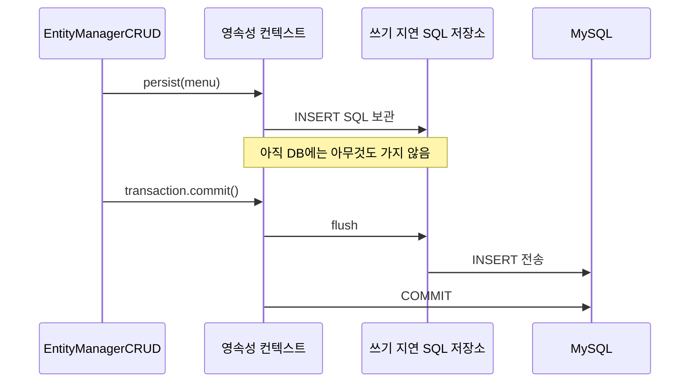
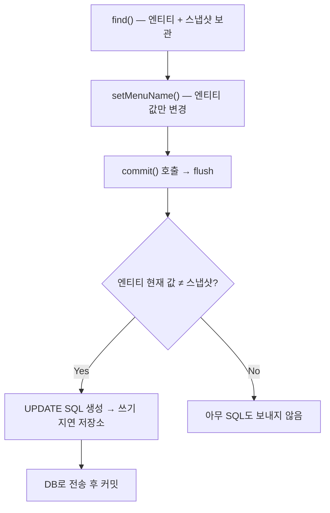

## 들어가며 (Situation)

[지난 글]({{ site.baseurl }})에서는 `manager.find()` 한 줄로 조회하는 것까지 봤습니다. 이번 실습(`chap02-persistence-context` section01)에서는 EntityManager로 **등록·조회·수정·삭제(CRUD)**를 모두 해 봤습니다.

> 실제 서비스에서 겪은 문제가 아니라, 수업 실습을 정리한 글입니다. Spring Boot 4.1.2(Hibernate), MySQL을 사용했고, 동작 설명은 Jakarta Persistence·Spring 공식 문서로 보완했습니다.

## 문제 상황 (Task)

JDBC에서는 CRUD마다 `INSERT`, `SELECT`, `UPDATE`, `DELETE` SQL을 직접 썼습니다. JPA의 EntityManager에는 아래 메서드가 있습니다.

| 작업 | JDBC | EntityManager |
|------|------|---------------|
| 조회 | `SELECT` + `executeQuery()` | `find(엔티티 타입, PK)` |
| 등록 | `INSERT` + `executeUpdate()` | `persist(엔티티)` |
| 수정 | `UPDATE` + `executeUpdate()` | **전용 메서드 없음** |
| 삭제 | `DELETE` + `executeUpdate()` | `remove(엔티티)` |

수업에서는 세 가지를 확인했습니다.

- 수정 메서드가 없는데 수정은 어떻게 하는가?
- `persist()`나 `remove()`를 호출한 순간 SQL이 바로 DB로 가는가?
- EntityManager는 어떻게 만들고, 언제 닫아야 하는가?

## 해결 과정 (Action)

### 1. EntityManagerFactory와 EntityManager

지난 글에서는 `@PersistenceContext`로 EntityManager를 주입받았습니다. 이번 실습은 주입 대신 **EntityManagerFactory**를 생성자로 받아 EntityManager를 **메서드마다 직접 만들고 닫았습니다**.

```java
@Component
public class EntityManagerCRUD {

    private final EntityManagerFactory factory;

    public EntityManagerCRUD(EntityManagerFactory factory) {
        this.factory = factory;
    }

    public void findMenuByMenuCode(int menuCode) {
        EntityManager manager = factory.createEntityManager();   // 요청 시작 시 생성

        Menu foundMenu = manager.find(Menu.class, menuCode);
        System.out.println("foundMenu = " + foundMenu);

        manager.close();                                         // 요청 끝나면 닫기
    }
}
```

| 구분 | EntityManagerFactory | EntityManager |
|------|---------------------|---------------|
| 개수 | 애플리케이션에 하나 (Spring Boot가 Bean으로 등록) | 작업(요청)마다 하나 |
| 생성 비용 | 큼 (매핑 정보 분석, 커넥션 풀 연결) | 작음 |
| 스레드 안전 | 안전 → 공유 가능 | **안전하지 않음** → 공유 금지 |

수업 주석의 핵심은 "EntityManager를 필드에 두고 여러 요청이 공유하면 안 된다"였습니다. Spring 공식 문서도 같은 내용을 말합니다.

> Although `EntityManagerFactory` instances are thread-safe, `EntityManager` instances are not.
> — [Spring Framework Reference - JPA](https://docs.spring.io/spring-framework/reference/data-access/orm/jpa.html#orm-jpa-dao)

여기에는 짚어 둘 점이 하나 있습니다. `@PersistenceContext`로 주입받는 EntityManager는 필드에 있어도 괜찮습니다. 지난 글에서 본 것처럼 그 객체는 진짜 EntityManager가 아니라, 현재 트랜잭션의 EntityManager에 호출을 넘기는 **공유 프록시**이기 때문입니다. 공유하면 안 되는 것은 `createEntityManager()`로 직접 만든 EntityManager입니다.

그런데 왜 이번 실습은 직접 만들었을까요? EntityManager를 직접 만들면 **영속성 컨텍스트가 언제 생기고 언제 사라지는지, 트랜잭션을 언제 시작하고 끝내는지를 코드로 눈에 보이게** 다룰 수 있습니다. 실무에서는 대부분 `@Transactional`과 주입 방식(또는 Spring Data JPA)을 쓰지만, 영속성 컨텍스트의 동작을 배우는 단계에서는 이 방식이 이해하기 좋습니다.

### 2. 등록: persist()와 쓰기 지연

```java
public void registMenu(Menu menu) {

    EntityManager manager = factory.createEntityManager();
    EntityTransaction transaction = manager.getTransaction();
    transaction.begin();                      // 여기부터 트랜잭션 적용

    try {
        manager.persist(menu);                // 영속성 컨텍스트에 저장 (아직 INSERT 전송 X)
        transaction.commit();                 // commit → flush → INSERT 전송 → DB 커밋
        System.out.println("등록 된 메뉴 : " + menu);
    } catch (Exception e) {
        transaction.rollback();
    } finally {
        manager.close();
    }
}
```

데이터를 바꾸는 작업(INSERT, UPDATE, DELETE)에는 **트랜잭션**이 필요합니다. 중간에 오류가 나면 롤백해야 하기 때문입니다. `@Transactional` 없이 EntityManager를 직접 만들었으므로 `EntityTransaction`으로 `begin()`, `commit()`, `rollback()`을 직접 호출했습니다. [MySQL 트랜잭션 글]({{ site.baseurl }})에서 `COMMIT`/`ROLLBACK`으로 하던 일을 자바 코드로 하는 셈입니다.

`persist()`를 호출해도 INSERT는 바로 DB로 가지 않습니다. EntityManager는 SQL을 **쓰기 지연 SQL 저장소**에 모아 두었다가 **flush** 시점에 한꺼번에 보냅니다. `commit()`을 호출하면 flush가 자동으로 먼저 실행됩니다.



SQL을 모아서 보내면 트랜잭션 안에서 변경을 한 번에 반영할 수 있고, 중간에 실패하면 DB에 아무것도 보내지 않은 상태로 롤백할 수 있습니다.

**알아 둘 점: PK 값**

콘솔에서 새 메뉴를 입력받는 코드는 메뉴 이름, 가격, 카테고리 코드, 주문 가능 여부만 채웁니다. `menuCode`(`@Id`)는 `int` 기본값인 `0`인 채로 `persist()`됩니다. 이 엔티티에는 PK 생성 전략(`@GeneratedValue`)이 없으므로, Hibernate는 `menu_code = 0`으로 INSERT를 보냅니다. 아래는 코드와 MySQL 문서를 근거로 정리한 것이고, 실습 DB의 테이블 정의를 직접 확인하지는 않았습니다.

- `menu_code`가 `AUTO_INCREMENT`라면, MySQL은 기본 설정에서 `0`이 들어오면 다음 번호를 자동으로 붙입니다(`NO_AUTO_VALUE_ON_ZERO` 모드가 꺼져 있을 때).
- 이 경우 DB에는 새 번호로 저장되지만, 자바의 `menu` 객체는 여전히 `menuCode=0`이므로 "등록 된 메뉴" 출력에도 0이 찍힙니다.
- DB가 만든 번호를 엔티티에 받아 오려면 `@GeneratedValue(strategy = GenerationType.IDENTITY)` 같은 PK 생성 전략을 지정해야 합니다.

### 3. 수정: 변경 감지(Dirty Checking)

```java
public void modifyMenuName(int menuCode, String menuName) {

    EntityManager manager = factory.createEntityManager();

    Menu foundMenu = manager.find(Menu.class, menuCode);   // 이 순간 스냅샷 보관
    System.out.println("수정 전 메뉴 : " + foundMenu);

    EntityTransaction transaction = manager.getTransaction();
    transaction.begin();

    try {
        foundMenu.setMenuName(menuName);                    // 값만 바꾼다. update() 호출 없음
        System.out.println("=======commit 하기 전=========");
        transaction.commit();                               // 여기서 UPDATE 전송
    } catch (Exception e) {
        transaction.rollback();
    }

    System.out.println("수정 후 메뉴 : " + manager.find(Menu.class, menuCode));
    manager.close();
}
```

EntityManager에는 `update()` 메서드가 없습니다. 영속성 컨텍스트는 엔티티를 처음 조회할 때 그 상태를 **스냅샷**으로 따로 보관합니다. flush 시점에 엔티티의 현재 값과 스냅샷을 비교해서, 달라진 필드가 있으면 UPDATE SQL을 만들어 쓰기 지연 저장소에 넣고 DB로 보냅니다. 이를 **변경 감지(Dirty Checking)**라고 합니다.



콘솔에서는 UPDATE 문이 `=======commit 하기 전=========` 출력 **아래**에 찍힙니다. `setMenuName()`을 호출한 시점이 아니라 commit(flush) 시점에 SQL이 만들어진다는 증거입니다.

마지막 `manager.find()`는 같은 EntityManager에서 같은 PK를 다시 조회합니다. 이미 영속성 컨텍스트에 있는 엔티티(수정된 그 객체)가 그대로 반환되므로 바뀐 이름이 보입니다.

> 수정이 "객체 값을 바꾸는 것"만으로 끝나는 이유는 그 엔티티가 영속성 컨텍스트의 **관리를 받고 있기 때문**입니다. 관리 대상에서 빠진 엔티티는 값을 바꿔도 UPDATE가 나가지 않습니다. 이 차이는 다음 글(엔티티 생명주기)에서 직접 확인합니다.

### 4. 삭제: remove()

```java
public void removeMenu(int menuCode) {

    EntityManager manager = factory.createEntityManager();

    Menu removeMenu = manager.find(Menu.class, menuCode);   // 먼저 조회해서 관리 상태로

    EntityTransaction transaction = manager.getTransaction();
    transaction.begin();

    try {
        manager.remove(removeMenu);                          // DELETE는 쓰기 지연 저장소로
        transaction.commit();                                // 여기서 DELETE 전송
    } catch (Exception e) {
        transaction.rollback();
    }

    Menu removedMenu = manager.find(Menu.class, menuCode);
    System.out.println("removedMenu = " + removedMenu);     // null
    manager.close();
}
```

`remove()`는 PK 값이 아니라 **엔티티 객체**를 받습니다. 그래서 먼저 `find()`로 조회해 영속성 컨텍스트가 관리하는 상태로 만든 다음 삭제합니다. `persist()`와 마찬가지로 DELETE도 commit 시점에 DB로 갑니다. 삭제 후 다시 조회하면 `null`이 나옵니다.

존재하지 않는 메뉴 코드를 입력하면 `find()`가 `null`을 돌려주고, `remove(null)`은 `IllegalArgumentException`을 던집니다. 이 예제에서는 `catch (Exception e)`가 잡아서 롤백합니다. 다만 사용자에게는 아무 안내가 나오지 않으므로, 실제로는 조회 결과가 `null`인지 먼저 확인하는 편이 좋습니다. 다음 글의 실습 코드는 그렇게 작성되어 있습니다.

### 5. 정리: CUD는 언제 DB에 반영되는가

| 메서드 | 호출 시점에 일어나는 일 | DB 반영 시점 |
|--------|------------------------|-------------|
| `persist(entity)` | 영속성 컨텍스트에 저장, INSERT 보관 | flush (commit 시 자동) |
| 값 변경 (setter 등) | 엔티티 값만 바뀜 | flush 때 스냅샷 비교 → UPDATE |
| `remove(entity)` | 삭제 대상으로 표시, DELETE 보관 | flush (commit 시 자동) |
| `find(type, pk)` | 영속성 컨텍스트에 있으면 그대로 반환, 없으면 SELECT | 즉시 (조회) |

## 결과 (Result)

정량 지표는 없고, 아래를 정리했습니다.

- EntityManagerFactory는 하나를 공유하고, EntityManager는 작업마다 만들고 닫습니다. 직접 만든 EntityManager는 스레드 안전하지 않으므로 공유하지 않습니다. `@PersistenceContext`로 주입받은 것은 공유 프록시라 필드로 둬도 됩니다.
- INSERT, UPDATE, DELETE는 트랜잭션 안에서 실행하고, 실패하면 롤백합니다.
- `persist()`와 `remove()`는 SQL을 바로 보내지 않고 쓰기 지연 저장소에 모았다가 flush(commit) 시점에 보냅니다.
- 수정 전용 메서드는 없습니다. 관리 중인 엔티티의 값을 바꾸면 변경 감지가 UPDATE를 만들어 줍니다.

## 더 학습하면 좋은 개념

- **엔티티 생명주기(비영속·영속·준영속·삭제)** — 변경 감지가 "관리 중인 엔티티"에만 동작하는 이유입니다. 다음 글에서 이어집니다.
- **PK 생성 전략(`@GeneratedValue`)** — `IDENTITY`, `SEQUENCE`, `TABLE` 전략의 차이와, `IDENTITY` 전략에서는 왜 `persist()` 시점에 INSERT가 바로 나가는지입니다.
- **`@Transactional`과 트랜잭션 전파** — `EntityTransaction`을 직접 다루던 코드를 선언적으로 바꾸는 방법입니다. 실무 코드는 대부분 이 방식입니다.
- **`@DynamicUpdate`** — 변경 감지로 만든 UPDATE는 기본적으로 모든 컬럼을 갱신합니다. 바뀐 컬럼만 갱신하도록 바꾸는 Hibernate 기능입니다.
- **JDBC 배치(`hibernate.jdbc.batch_size`)** — 쓰기 지연 저장소에 모인 SQL을 묶어서 보내 네트워크 왕복을 줄이는 설정입니다.

## 참고 자료

- [Jakarta Persistence API - EntityManager](https://jakarta.ee/specifications/persistence/3.2/apidocs/jakarta.persistence/jakarta/persistence/EntityManager.html)
- [Jakarta Persistence API - EntityTransaction](https://jakarta.ee/specifications/persistence/3.2/apidocs/jakarta.persistence/jakarta/persistence/EntityTransaction.html)
- [Jakarta Persistence 3.2 Specification](https://jakarta.ee/specifications/persistence/3.2/)
- [Spring Framework Reference - JPA](https://docs.spring.io/spring-framework/reference/data-access/orm/jpa.html)
- [Hibernate ORM 7.0 User Guide](https://docs.hibernate.org/orm/7.0/userguide/html_single/)
- [MySQL 8.4 Reference Manual - Using AUTO_INCREMENT](https://dev.mysql.com/doc/refman/8.4/en/example-auto-increment.html)
