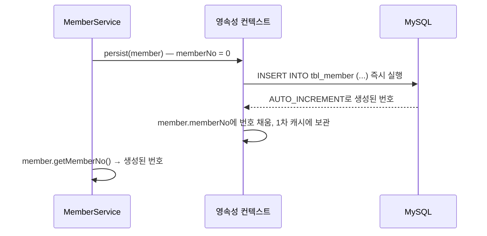
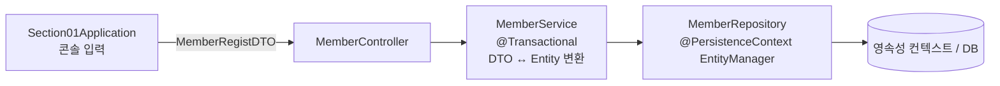
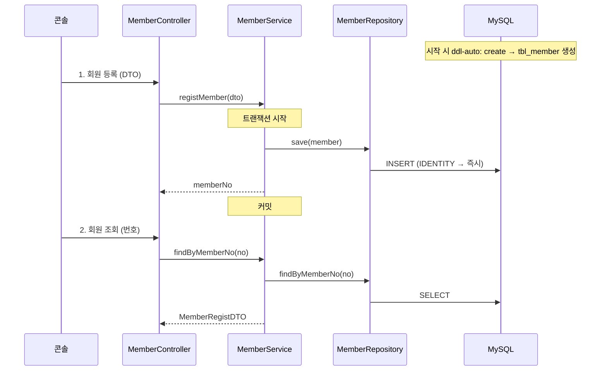

## 들어가며 (Situation)

[지난 글들]({{ site.baseurl }})에서는 이미 만들어 둔 `tbl_menu` 테이블에 엔티티를 맞췄습니다(`ddl-auto: none`). 이번 수업(`chap03-entity-mapping`)은 방향이 반대입니다. **엔티티 클래스를 먼저 작성하고, 그 매핑 정보로 JPA가 테이블을 만들게** 했습니다. 예제는 회원(`Member`) 등록·조회이고, Controller → Service → Repository 계층으로 나눠 작성했습니다.

> 실제 서비스에서 겪은 문제가 아니라, 수업 실습을 정리한 글입니다. Spring Boot 4.1.2(Hibernate), MySQL을 사용했고, 동작 설명은 Jakarta Persistence·Spring·Hibernate 공식 문서로 보완했습니다. 생성되는 DDL은 직접 캡처하지 않았으므로 속성별 효과로 정리했습니다.

## 문제 상황 (Task)

- 엔티티만 보고 테이블을 만들려면 컬럼의 길이, NOT NULL, UNIQUE 같은 정보를 어디에 적을까요?
- 회원 번호처럼 DB가 자동으로 매기는 PK는 어떻게 매핑할까요? (지난 글에서 PK를 안 채우고 `persist()`하면 `0`이 들어가던 문제)
- 회원 권한처럼 정해진 값만 허용하는 필드는 어떤 타입으로, 어떻게 저장할까요?
- 날짜·시간 필드는 어떻게 매핑할까요?

## 해결 과정 (Action)

### 1. ddl-auto: create

```yaml
spring:
  jpa:
    show-sql: true
    hibernate:
      ddl-auto: create    # 실행할 때마다 테이블을 지우고 엔티티 기준으로 다시 생성
    properties:
      hibernate:
        format_sql: true
```

지난 실습은 `none`이었지만 이번에는 `create`입니다. 애플리케이션을 시작하면 Hibernate가 `@Entity` 클래스를 읽어 `tbl_member`를 DROP 후 CREATE합니다. `show-sql` 덕분에 콘솔에서 생성된 DDL을 확인할 수 있습니다. 매번 테이블이 새로 만들어지므로 **이전에 등록한 데이터는 재실행하면 사라집니다.** 학습용 설정이고, 데이터가 있는 DB에는 쓰면 안 됩니다.

### 2. 엔티티 전체 코드

```java
@NoArgsConstructor
@AllArgsConstructor
@Getter
@ToString
@Entity
@Table(name = "tbl_member")
public class Member {

    @Id
    @Column(name = "member_no")
    @GeneratedValue(strategy = GenerationType.IDENTITY)
    private int memberNo;

    @Column(name = "member_id", nullable = false,
            unique = true, columnDefinition = "varchar(10)")
    private String memberId;

    @Column(name = "member_pwd", nullable = false)
    private String memberPwd;

    @Column(name = "member_name")
    private String memberName;

    @Column(name = "phone", unique = true)
    private String phone;

    @Column(name = "address", length = 900)
    private String address;

    @Column(name = "enroll_date")
    private LocalDateTime enrollDate;

    @Column(name = "member_role")
    @Enumerated(EnumType.STRING)
    private MemberRole memberRole;

    @Column(name = "status", columnDefinition = "char(1) default 'Y'")
    private String status;

    // memberNo 를 뺀 생성자 : PK 는 DB 가 만든다
    public Member(String memberId, String memberPwd, String memberName, String phone,
                  String address, LocalDateTime enrollDate, MemberRole memberRole, String status) {
        this.memberId = memberId;
        this.memberPwd = memberPwd;
        this.memberName = memberName;
        this.phone = phone;
        this.address = address;
        this.enrollDate = enrollDate;
        this.memberRole = memberRole;
        this.status = status;
    }
}
```

`@AllArgsConstructor`와 별도로 **`memberNo`만 뺀 생성자**를 직접 만든 점이 눈에 띕니다. 회원 번호는 DB가 정하는 값이므로 등록할 때 개발자가 넣지 않습니다.

### 3. @Column 속성: 테이블 제약조건을 엔티티에 적기

| 속성 | 의미 | 기본값 | 이번 실습 |
|------|------|--------|-----------|
| `name` | 매핑할 컬럼 이름 | 필드 이름 | 모든 필드 |
| `nullable` | `false`면 NOT NULL | `true` | `member_id`, `member_pwd` |
| `unique` | UNIQUE 제약조건 | `false` | `member_id`, `phone` |
| `length` | 문자열 컬럼 길이 | `255` | `address` → `varchar(900)` |
| `columnDefinition` | 컬럼 정의(타입, 기본값)를 SQL로 직접 작성 | — | `member_id` → `varchar(10)`, `status` → `char(1) default 'Y'` |

이 속성들은 **JPA가 DDL을 만들 때 쓰는 정보**입니다. `ddl-auto: none`으로 기존 테이블을 쓰는 경우에는 테이블을 바꾸지 않습니다. 예를 들어 `nullable = false`를 적어도, 기존 테이블에 NOT NULL 제약이 없으면 DB는 NULL을 막지 않습니다.

`columnDefinition`은 SQL 조각을 그대로 붙이므로 DB에 종속적입니다. `char(1) default 'Y'`는 MySQL에서는 동작하지만 다른 DB로 바꾸면 문법이 다를 수 있습니다.

**알아 둘 점: `default 'Y'`는 언제 적용될까**

DDL에 `default 'Y'`가 들어가도, JPA는 INSERT할 때 엔티티의 **모든 컬럼을 값과 함께** 보냅니다. `status` 필드가 `null`이면 `status`에 `NULL`을 명시해서 INSERT하므로 DB 기본값이 적용되지 않습니다. (DB 기본값은 INSERT 문에서 컬럼이 **빠졌을 때** 적용됩니다.) 이번 실습은 콘솔 입력 단계에서 `setStatus("Y")`로 값을 직접 채우므로 문제가 없습니다. 기본값이 필요하면 자바 필드 초기값(`private String status = "Y";`)으로 두는 쪽이 확실합니다. 이 부분은 코드와 SQL 동작을 근거로 정리했고, 직접 재현하지는 않았습니다.

### 4. @GeneratedValue: PK를 DB에 맡기기

[지난 글]({{ site.baseurl }})에서는 PK 생성 전략이 없어서, 새 메뉴를 `persist()`하면 `menuCode=0`으로 INSERT되고 자바 객체도 0으로 남았습니다. 이번에는 `@GeneratedValue`로 PK를 자동 생성합니다.

| 전략 | PK 생성 주체 | INSERT 시점 | 주로 쓰는 DB |
|------|-------------|-------------|-------------|
| `IDENTITY` | DB (`AUTO_INCREMENT`) | **`persist()` 즉시** (쓰기 지연 X) | MySQL, MariaDB |
| `SEQUENCE` | DB 시퀀스 객체 | flush 시점 (쓰기 지연 O) | Oracle, PostgreSQL |
| `TABLE` | 키 생성 전용 테이블 | flush 시점 | DB 무관 |
| `AUTO` (기본값) | 구현체가 DB에 맞게 선택 | 선택된 전략에 따름 | — |

`IDENTITY`가 쓰기 지연의 예외인 이유는 간단합니다. `AUTO_INCREMENT` 값은 **INSERT를 실행해야** 알 수 있습니다. 그런데 영속성 컨텍스트는 엔티티를 PK로 관리해야 하므로(1차 캐시의 키가 PK), PK를 모르는 채로 엔티티를 보관할 수 없습니다. 그래서 `persist()`를 호출하는 순간 INSERT를 바로 실행하고, DB가 만든 번호를 엔티티에 채워 넣습니다.



덕분에 서비스 코드에서 `save()` 바로 다음 줄에 `member.getMemberNo()`로 생성된 번호를 돌려줄 수 있습니다(아래 5번 코드).

`AUTO`는 "MySQL이니까 AUTO_INCREMENT"를 뜻하지 않습니다. 어떤 전략을 고를지는 구현체가 정하는데, 최근 Hibernate는 숫자 PK에 시퀀스 방식을 우선하고, MySQL처럼 시퀀스가 없는 DB에서는 테이블로 시퀀스를 흉내 냅니다. MySQL의 `AUTO_INCREMENT`를 쓰려면 이번 실습처럼 `IDENTITY`를 명시하는 편이 의도가 분명합니다.

### 5. 계층 구조: Controller → Service → Repository



[JDBC 계층 구조 글]({{ site.baseurl }})의 View → Controller → Service → DAO와 같은 구조입니다. 이름만 바뀌었습니다. Spring에서 JPA를 쓸 때는 DB 접근 계층을 **Repository**라고 부르고 `@Repository`를 붙입니다.

**Repository** — EntityManager로 엔티티를 영속성 컨텍스트에 넣고 꺼내는 일만 합니다.

```java
@Repository
public class MemberRepository {

    @PersistenceContext
    private EntityManager manager;

    public void save(Member member) {
        manager.persist(member);
    }

    public Member findByMemberNo(int memberNo) {
        return manager.find(Member.class, memberNo);
    }
}
```

**Service** — DTO를 엔티티로 바꾸고, 트랜잭션 경계를 정합니다.

```java
@Service
public class MemberService {

    private final MemberRepository memberRepository;

    public MemberService(MemberRepository memberRepository) {
        this.memberRepository = memberRepository;
    }

    @Transactional
    public int registMember(MemberRegistDTO dto) {
        // 1. DTO -> Entity
        Member member = new Member(
                dto.getMemberId(), dto.getMemberPwd(), dto.getMemberName(), dto.getPhone(),
                dto.getAddress(), dto.getEnrollDate(), dto.getMemberRole(), dto.getStatus()
        );
        // 2. Repository 에 전달 (IDENTITY 이므로 여기서 INSERT 실행)
        memberRepository.save(member);

        return member.getMemberNo();   // DB 가 만든 번호
    }

    @Transactional(readOnly = true)
    public MemberRegistDTO findByMemberNo(int memberNo) {
        Member foundMember = memberRepository.findByMemberNo(memberNo);
        // Entity -> DTO
        return new MemberRegistDTO(
                foundMember.getMemberId(), foundMember.getMemberPwd(),
                foundMember.getMemberName(), foundMember.getPhone()
        );
    }
}
```

지난 chap02에서는 `EntityTransaction`으로 `begin()`/`commit()`/`rollback()`을 직접 호출했습니다. 이번에는 서비스 메서드의 `@Transactional`이 그 일을 대신합니다. 메서드가 시작되면 트랜잭션을 열고, 정상 종료되면 커밋, 예외가 나면 롤백합니다. 어떤 예외일 때 롤백하는지, 다른 트랜잭션 메서드를 호출하면 어떻게 되는지는 [다음 글]({{ site.baseurl }})에서 정리합니다.

조회 메서드의 `readOnly = true`는 수업 주석대로 "불필요한 변경 감지를 하지 않는" 조회 전용 트랜잭션입니다. Spring은 이 값을 Hibernate에 전달해 flush를 하지 않도록 설정합니다.

**왜 Entity를 그대로 넘기지 않고 DTO로 바꿀까?** 엔티티는 영속성 컨텍스트가 관리하는 객체라, 계층 밖(화면 등)에서 값을 바꾸면 트랜잭션 안에서는 변경 감지로 DB까지 바뀔 수 있습니다. 또 화면에 필요한 필드와 테이블 컬럼이 항상 같지는 않습니다. 이 실습의 조회 DTO는 아이디·비밀번호·이름·전화번호 4개만 담습니다.

> 조회 DTO에 비밀번호가 포함되어 출력되는 것은 실습 확인용입니다. 실제 서비스라면 비밀번호는 해시(BCrypt 등)로 저장하고, 조회 결과에 포함하지 않습니다.

### 6. 날짜·시간 매핑: LocalDateTime

```java
@Column(name = "enroll_date")
private LocalDateTime enrollDate;
```

| 자바 타입 | 저장 내용 | MySQL 컬럼(일반적인 매핑) |
|-----------|-----------|--------------------------|
| `LocalDate` | 날짜 (`yyyy-MM-dd`) | `date` |
| `LocalDateTime` | 날짜 + 시간 | `datetime` |

예전에는 `java.util.Date`에 `@Temporal`을 붙여 날짜인지 시간인지 알려 줘야 했습니다. JPA 2.2부터 `java.time` 타입을 표준으로 지원하므로 어노테이션 없이 매핑됩니다. 등록 시각은 콘솔 입력 코드에서 `LocalDateTime.now()`로 채웠습니다.

### 7. @Enumerated: 정해진 값만 허용하기

```java
public enum MemberRole {
    ROLE_MEMBER, ROLE_ADMIN;
}
```

회원 권한은 시스템 정책상 두 가지로 고정입니다. `String`으로 두면 `"ADMIN"`, `"admin"`, `"관리자"`처럼 아무 값이나 들어갈 수 있지만, enum으로 두면 **컴파일 단계에서 두 값만 허용**합니다.

enum을 DB에 어떻게 저장할지는 `@Enumerated`로 정합니다.

| 방식 | 저장 값 | 장점 | 단점 |
|------|--------|------|------|
| `EnumType.ORDINAL` (기본값) | 선언 순서 숫자 (`0`, `1`) | 저장 공간이 작다 | 숫자만 봐서는 의미를 모르고, **순서를 바꾸거나 중간에 값을 추가하면 기존 데이터의 의미가 바뀐다** |
| `EnumType.STRING` | 이름 문자열 (`ROLE_MEMBER`) | 읽기 쉽고 순서 변경에 안전 | 숫자보다 크다 (큰 문제는 아님) |

ORDINAL의 위험을 예로 들면, 나중에 `ROLE_MEMBER` 앞에 `ROLE_GUEST`를 추가하는 순간 DB에 `0`으로 저장되어 있던 기존 일반회원이 모두 `ROLE_GUEST`로 읽힙니다. 데이터는 그대로인데 의미가 바뀌는 것이라 에러도 나지 않습니다. 그래서 실무에서는 **STRING**을 씁니다.

수업 주석에 따르면 Hibernate 6 이후 MySQL에서는 `STRING`으로 매핑한 enum 컬럼이 MySQL의 `enum('ROLE_ADMIN','ROLE_MEMBER')` 타입으로 생성됩니다. `varchar`로 만들고 싶다면 `columnDefinition = "varchar(20)"`처럼 직접 지정합니다.

### 8. 실행 흐름 정리



조회할 회원 번호가 없으면 `find()`가 `null`을 돌려주므로, 서비스의 DTO 변환에서 `NullPointerException`이 납니다. 실제 서비스라면 `null`을 확인해 "회원이 없습니다"로 안내하거나 별도 예외를 던져야 합니다.

## 결과 (Result)

정량 지표는 없고, 아래를 정리했습니다.

- `ddl-auto: create`로 두면 엔티티의 매핑 정보로 테이블이 만들어집니다. `@Column`의 `nullable`, `unique`, `length`, `columnDefinition`은 이때 쓰이는 DDL 정보입니다.
- `@GeneratedValue(strategy = GenerationType.IDENTITY)`는 PK 생성을 MySQL의 `AUTO_INCREMENT`에 맡깁니다. PK를 알기 위해 `persist()` 시점에 INSERT가 바로 실행됩니다.
- `LocalDate`, `LocalDateTime`은 JPA 2.2부터 어노테이션 없이 매핑됩니다.
- enum은 `@Enumerated(EnumType.STRING)`으로 저장합니다. 기본값인 ORDINAL은 값 추가나 순서 변경에 취약합니다.
- Controller → Service(`@Transactional`, DTO↔Entity 변환) → Repository(EntityManager) 구조로 나눴습니다.

## 더 학습하면 좋은 개념

- **`@Transactional`의 롤백 규칙과 전파** — 수업에서 더 찾아볼 키워드로 받은 주제입니다. [다음 글]({{ site.baseurl }})에서 정리했습니다.
- **SEQUENCE 전략과 `allocationSize`** — 시퀀스 값을 미리 여러 개 받아 와 DB 왕복을 줄이는 최적화입니다. IDENTITY에서는 왜 INSERT를 묶어 보내는 배치가 어려운지와 이어집니다.
- **스키마 관리 도구(Flyway, Liquibase)** — 운영 환경에서는 `ddl-auto` 대신 버전이 붙은 SQL 스크립트로 테이블 변경 이력을 관리합니다.
- **`@ColumnDefault`와 `@DynamicInsert`** — DB 기본값을 DDL에 넣거나, `null`인 컬럼을 INSERT 문에서 빼서 DB 기본값이 적용되게 하는 Hibernate 기능입니다.
- **`AttributeConverter`** — enum이나 값 객체를 원하는 형태(예: `'Y'`/`'N'` ↔ `boolean`)로 바꿔 저장하는 JPA 표준 방법입니다. `status` 같은 필드에 쓸 수 있습니다.

## 참고 자료

- [Jakarta Persistence API - Column](https://jakarta.ee/specifications/persistence/3.2/apidocs/jakarta.persistence/jakarta/persistence/Column.html)
- [Jakarta Persistence API - GenerationType](https://jakarta.ee/specifications/persistence/3.2/apidocs/jakarta.persistence/jakarta/persistence/GenerationType.html)
- [Jakarta Persistence API - Enumerated](https://jakarta.ee/specifications/persistence/3.2/apidocs/jakarta.persistence/jakarta/persistence/Enumerated.html)
- [Jakarta Persistence 3.2 Specification](https://jakarta.ee/specifications/persistence/3.2/)
- [Hibernate ORM 7.0 User Guide](https://docs.hibernate.org/orm/7.0/userguide/html_single/)
- [Spring Boot - Database Initialization (Using Hibernate)](https://docs.spring.io/spring-boot/how-to/data-initialization.html#howto.data-initialization.using-hibernate)
- [Spring Framework Reference - Using @Transactional](https://docs.spring.io/spring-framework/reference/data-access/transaction/declarative/annotations.html)
