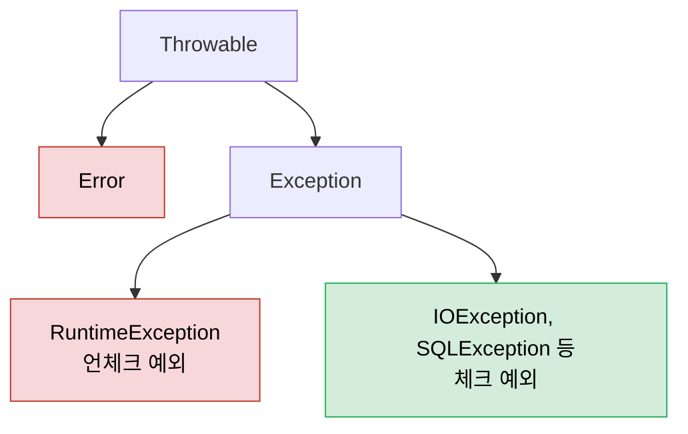
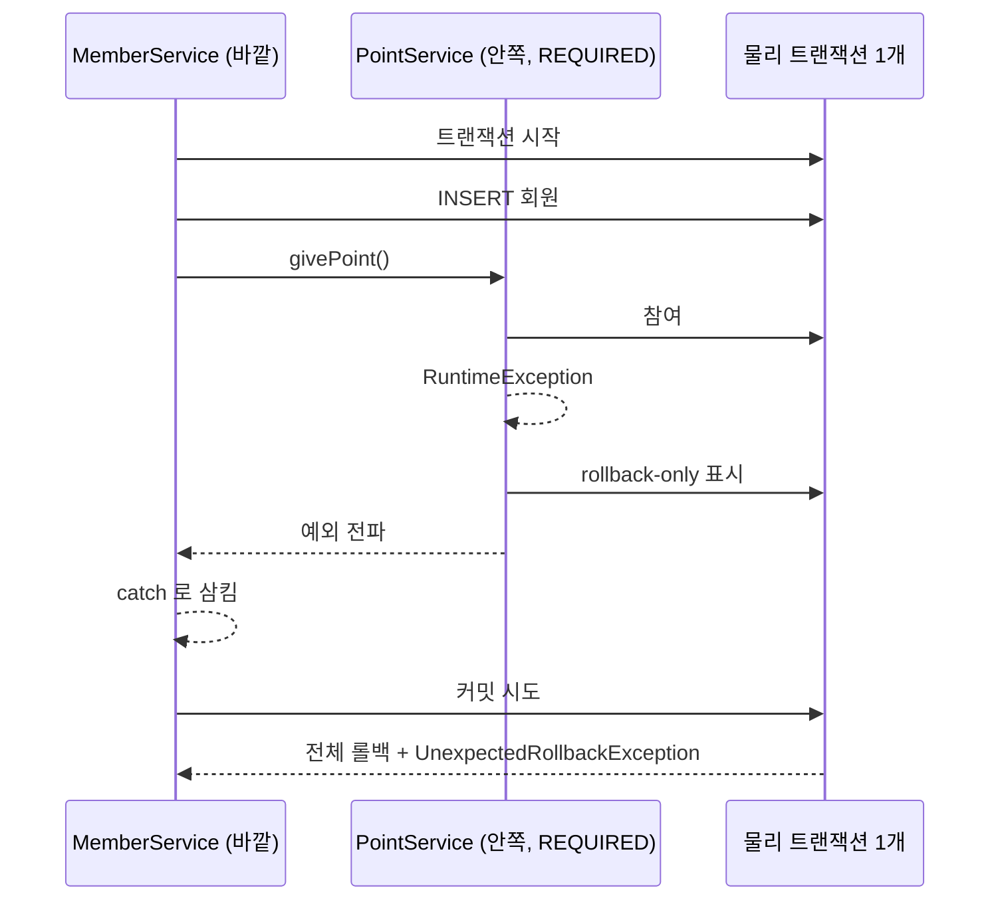

## 들어가며 (Situation)

[엔티티 매핑 실습]({{ site.baseurl }})에서 서비스 메서드에 `@Transactional`을 붙였습니다. 수업 코드에는 "메서드 실행 시 begin(), 정상 종료 시 commit(), 예외 발생 시 rollback()"이라는 주석과 함께, 더 찾아볼 키워드가 두 가지 적혀 있었습니다.

1. Checked 예외 / Unchecked 예외의 `@Transactional` 동작 방식
2. `@Transactional`의 전파(propagation)

이 글은 두 키워드를 Spring 공식 문서로 정리한 것입니다.

> 실제 서비스에서 겪은 문제가 아니라, 수업에서 받은 키워드를 공식 문서로 정리한 글입니다. 수업 실습 코드가 없는 주제라 **이 글의 코드는 모두 설명용 예시 코드**이고, 직접 실행해 결과를 확인하지는 않았습니다. 기준 문서는 Spring Framework 7.0 레퍼런스입니다(Spring Boot 4.x가 사용하는 버전).

## 문제 상황 (Task)

"예외가 나면 롤백"이라는 설명은 절반만 맞습니다.

- 메서드에서 `IOException` 같은 **체크 예외**가 나면 롤백될까요?
- `@Transactional` 메서드가 또 다른 `@Transactional` 메서드를 호출하면 트랜잭션이 두 개가 될까요, 하나가 될까요?
- 안쪽 메서드의 예외를 바깥에서 `try-catch`로 잡으면 바깥 작업은 커밋될까요?

## 해결 과정 (Action)

### 1. @Transactional 기본 설정

Spring 문서가 밝힌 기본값은 다음과 같습니다.

| 속성 | 기본값 | 의미 |
|------|--------|------|
| `propagation` | `REQUIRED` | 진행 중인 트랜잭션이 있으면 참여, 없으면 새로 시작 |
| `isolation` | `DEFAULT` | DB의 기본 격리 수준 사용 |
| `readOnly` | `false` | 읽기·쓰기 트랜잭션 |
| `timeout` | 트랜잭션 시스템 기본값 | — |
| 롤백 대상 | `RuntimeException`, `Error` | **체크 예외는 롤백하지 않음** |

> Any `RuntimeException` or `Error` triggers rollback, and any checked `Exception` does not.
> — [Spring Framework Reference - Using @Transactional](https://docs.spring.io/spring-framework/reference/data-access/transaction/declarative/annotations.html)

### 2. 체크 예외와 언체크 예외

[Java 예외 글]({{ site.baseurl }})에서 본 예외 계층을 트랜잭션 관점으로 다시 보면 다음과 같습니다.



빨간색(`Error`, `RuntimeException`과 그 하위)은 기본적으로 **롤백**, 초록색(체크 예외)은 기본적으로 **커밋**입니다.

| 구분 | 예시 | 컴파일러 처리 강제 | 기본 트랜잭션 동작 |
|------|------|------------------|------------------|
| 언체크 예외 | `NullPointerException`, `IllegalArgumentException`, `DataAccessException` | X | **롤백** |
| 체크 예외 | `IOException`, 직접 만든 `extends Exception` 예외 | O (`throws`/`try-catch`) | **커밋** |
| 에러 | `OutOfMemoryError` | X | **롤백** |

**예시 코드: 체크 예외가 나도 INSERT가 커밋되는 경우**

```java
// 예시 코드 — 수업 실습 코드가 아닙니다
@Transactional
public void registMember(MemberRegistDTO dto) throws IOException {
    memberRepository.save(toEntity(dto));   // INSERT 실행

    if (dto.getAddress() == null) {
        throw new IOException("주소 정보 파일을 읽지 못했습니다");   // 체크 예외
    }
}
// 결과 : 예외는 호출한 쪽으로 전파되지만, 트랜잭션은 커밋되어 회원은 저장된다
```

호출한 쪽에서는 예외를 받았으니 "실패했다"고 생각하기 쉽지만, DB에는 회원이 들어가 있습니다. 바로 이 점이 함정입니다.

**왜 이렇게 설계되었을까?** 문서는 이유를 따로 길게 설명하지 않지만, 기본 규칙은 EJB의 관례를 따른 것으로 알려져 있습니다. 체크 예외는 "호출한 쪽이 처리할 수 있는, 예상된 비즈니스 상황"이고, 언체크 예외는 "복구할 수 없는 오류"라는 구분입니다. 예상된 상황이라면 그때까지의 작업은 유효하다고 보는 것입니다.

### 3. 롤백 규칙 바꾸기

**`rollbackFor` / `noRollbackFor`**

```java
// 예시 코드
@Transactional(rollbackFor = Exception.class)         // 체크 예외도 롤백
public void registMember(MemberRegistDTO dto) throws IOException { ... }

@Transactional(noRollbackFor = NotificationFailedException.class)  // 이 런타임 예외는 커밋
public void registMemberAndNotify(MemberRegistDTO dto) { ... }
```

문서에 따르면 규칙은 예외 타입과 **그 하위 타입**에 모두 적용되고, 여러 규칙이 겹치면 가장 구체적으로 일치하는 규칙(strongest matching rule)이 이깁니다.

**애플리케이션 전체 기본값 바꾸기 (Spring 6.2+)**

메서드마다 `rollbackFor`를 적지 않고 전체 기본 동작을 "모든 예외에서 롤백"으로 바꾸는 방법도 있습니다. Spring 문서는 `@EnableTransactionManagement(rollbackOn = ALL_EXCEPTIONS)` 설정을 소개합니다. Spring Boot는 트랜잭션 설정을 자동 구성하므로 이 방식을 적용할 때는 Boot 문서와 함께 확인이 필요합니다.

**실무에서 자주 쓰는 방법: 런타임 예외로 감싸기**

```java
// 예시 코드
@Transactional
public void registMember(MemberRegistDTO dto) {
    memberRepository.save(toEntity(dto));
    try {
        readAddressFile(dto);                       // IOException 발생 가능
    } catch (IOException e) {
        throw new MemberRegistException("주소 처리 실패", e);   // RuntimeException 하위
    }
}
```

[@Around 글]({{ site.baseurl }})에서 `Throwable`을 런타임 예외로 감쌌던 것과 같은 방식입니다. 원인 예외(`e`)를 함께 넘겨야 스택 트레이스가 남습니다.

참고로 JPA를 쓸 때 DB 오류는 대부분 이미 언체크 예외입니다. `@Repository`가 붙은 클래스에서 나온 JPA·Hibernate 예외는 Spring이 `DataAccessException`(런타임 예외) 계열로 바꿔 주므로, 중복 아이디 INSERT 같은 오류는 별도 설정 없이 롤백됩니다.

**주의: 예외를 잡고 삼키면 롤백되지 않는다**

```java
// 예시 코드 — 하면 안 되는 패턴
@Transactional
public void registMember(MemberRegistDTO dto) {
    try {
        memberRepository.save(toEntity(dto));
        pointService.givePoint(dto);
    } catch (RuntimeException e) {
        System.out.println("실패 : " + e.getMessage());   // 예외를 삼킴 → 정상 종료 → 커밋
    }
}
```

`@Transactional`은 **메서드 밖으로 던져진 예외**를 보고 롤백을 결정합니다. 메서드 안에서 잡고 끝내면 정상 종료로 보고 커밋합니다. 예외를 잡아야 한다면 다시 던지거나, 문서에 나온 `TransactionAspectSupport.currentTransactionStatus().setRollbackOnly()`로 롤백을 표시해야 합니다(문서는 이 방식을 권장하지는 않습니다).

### 4. 트랜잭션 전파(Propagation)

전파는 "트랜잭션이 이미 진행 중일 때 `@Transactional` 메서드를 호출하면 어떻게 할지"에 대한 규칙입니다.

| 전파 옵션 | 진행 중인 트랜잭션이 있을 때 | 없을 때 |
|-----------|---------------------------|---------|
| `REQUIRED` (기본값) | **참여** (같은 트랜잭션) | 새로 시작 |
| `REQUIRES_NEW` | 바깥 트랜잭션을 두고 **새 트랜잭션** 시작 | 새로 시작 |
| `NESTED` | 같은 트랜잭션 안에 **세이브포인트**를 만들고 실행 | 새로 시작 |
| `SUPPORTS` | 참여 | 트랜잭션 없이 실행 |
| `MANDATORY` | 참여 | 예외 |
| `NOT_SUPPORTED` | 바깥 트랜잭션을 두고 트랜잭션 없이 실행 | 트랜잭션 없이 실행 |
| `NEVER` | 예외 | 트랜잭션 없이 실행 |

자주 이야기되는 것은 위의 세 가지입니다.

#### REQUIRED: 논리 트랜잭션은 여러 개, 물리 트랜잭션은 하나

```java
// 예시 코드
@Service
public class MemberService {
    @Transactional                        // 바깥
    public void registMember(MemberRegistDTO dto) {
        memberRepository.save(toEntity(dto));
        pointService.givePoint(dto);      // 안쪽 (다른 Bean)
    }
}

@Service
public class PointService {
    @Transactional                        // REQUIRED → 바깥 트랜잭션에 참여
    public void givePoint(MemberRegistDTO dto) { ... }
}
```

Spring 문서는 이를 **논리 트랜잭션**과 **물리 트랜잭션**으로 설명합니다. `@Transactional`이 붙은 메서드마다 논리 트랜잭션 범위가 생기지만, `REQUIRED`라면 모두 **하나의 물리 트랜잭션**(실제 DB 트랜잭션)에 연결됩니다. 그래서 둘 중 하나라도 실패하면 회원 저장과 포인트 지급이 함께 롤백됩니다. 대부분 원하는 동작이 이것이라 기본값입니다.

**함정: 안쪽 예외를 바깥에서 잡으면 `UnexpectedRollbackException`**

```java
// 예시 코드
@Transactional
public void registMember(MemberRegistDTO dto) {
    memberRepository.save(toEntity(dto));
    try {
        pointService.givePoint(dto);      // 안에서 RuntimeException → 트랜잭션에 rollback-only 표시
    } catch (RuntimeException e) {
        // 포인트는 실패해도 회원 가입은 되게 하고 싶어서 잡았지만...
    }
}   // 커밋 시도 → UnexpectedRollbackException
```



안쪽 메서드의 프록시는 예외가 자기 범위를 빠져나가는 순간 공유 중인 물리 트랜잭션에 **rollback-only** 표시를 남깁니다. 바깥에서 예외를 잡아도 표시는 지워지지 않으므로, 바깥이 커밋하려 하면 Spring은 롤백하고 예외를 던집니다.

> In the case of standard `PROPAGATION_REQUIRED` behavior, all these scopes are mapped to the same physical transaction. So a rollback-only marker set in the inner transaction scope does affect the outer transaction's chance to actually commit.
> — [Spring Framework Reference - Transaction Propagation](https://docs.spring.io/spring-framework/reference/data-access/transaction/declarative/tx-propagation.html)

문서는 이 예외가 필요한 이유를 "호출한 쪽이 커밋되지 않았는데 커밋됐다고 착각하지 않게 하기 위해서"라고 설명합니다.

#### REQUIRES_NEW: 독립된 물리 트랜잭션

포인트 지급이 실패해도 회원 가입은 살리고 싶다면, 안쪽을 별도 트랜잭션으로 분리합니다.

```java
// 예시 코드
@Transactional(propagation = Propagation.REQUIRES_NEW)
public void givePoint(MemberRegistDTO dto) { ... }
```

`REQUIRES_NEW`는 바깥과 **다른 물리 트랜잭션**을 씁니다. 안쪽이 롤백돼도 바깥에 rollback-only 표시가 남지 않습니다(바깥에서 예외를 잡았다는 전제). 반대로 안쪽이 커밋한 뒤 바깥이 롤백돼도 안쪽 결과는 남습니다. 실패해도 남겨야 하는 이력 로그 저장에 자주 쓰입니다.

| 상황 | REQUIRED | REQUIRES_NEW |
|------|----------|--------------|
| 안쪽 실패, 바깥에서 catch | 전체 롤백 + `UnexpectedRollbackException` | 안쪽만 롤백, 바깥 커밋 가능 |
| 안쪽 성공, 바깥 실패 | 전체 롤백 | 안쪽은 이미 커밋되어 남음 |
| DB 커넥션 | 1개 공유 | 바깥이 커넥션을 쥔 채로 **하나 더** 사용 |

문서는 마지막 줄에 대해 경고합니다. 바깥 트랜잭션의 커넥션을 쥔 채 새 커넥션을 얻으므로, 동시 요청이 많으면 **커넥션 풀이 고갈되어 교착 상태**에 빠질 수 있습니다. 문서는 커넥션 풀 크기가 동시 스레드 수보다 최소 1 이상 크지 않다면 `REQUIRES_NEW`를 쓰지 말라고 합니다.

#### NESTED: 세이브포인트

`NESTED`는 물리 트랜잭션은 하나로 두고, 안쪽 시작 지점에 **세이브포인트**를 만듭니다. 안쪽이 실패하면 세이브포인트까지만 되돌리고 바깥은 계속 진행할 수 있습니다. [MySQL 트랜잭션 글]({{ site.baseurl }})의 "더 학습하면 좋은 개념"에 적어 둔 `SAVEPOINT`(트랜잭션 일부만 되돌리기)가 바로 이것입니다. 문서는 이 옵션이 보통 JDBC 세이브포인트에 대응되어 **JDBC 리소스 트랜잭션에서만** 동작한다고 밝히고 있어, JPA 환경에서 쓸 때는 트랜잭션 매니저의 지원 여부를 먼저 확인해야 합니다.

### 5. 전파가 동작하지 않는 경우: 같은 클래스 안의 호출

```java
// 예시 코드
@Service
public class MemberService {

    public void registAll(List<MemberRegistDTO> list) {
        for (MemberRegistDTO dto : list) {
            this.registOne(dto);            // 같은 객체 내부 호출 → 프록시를 거치지 않음
        }
    }

    @Transactional(propagation = Propagation.REQUIRES_NEW)
    public void registOne(MemberRegistDTO dto) { ... }   // 트랜잭션이 적용되지 않는다
}
```

`@Transactional`은 [AOP 프록시]({{ site.baseurl }})로 동작합니다. 외부에서 프록시를 통해 들어온 호출만 가로채므로, 같은 객체 안에서 `this.registOne()`으로 부르면 프록시를 거치지 않아 `@Transactional`이 무시됩니다.

> In proxy mode (which is the default), only external method calls coming in through the proxy are intercepted. This means that self-invocation ... does not lead to an actual transaction at runtime even if the invoked method is marked with `@Transactional`.
> — [Spring Framework Reference - Using @Transactional](https://docs.spring.io/spring-framework/reference/data-access/transaction/declarative/annotations.html)

전파 옵션을 다르게 주고 싶은 메서드는 **다른 Bean으로 분리**하는 것이 일반적인 해결책입니다. 위 예시들에서 `PointService`를 따로 둔 것도 이 때문입니다.

## 결과 (Result)

정량 지표는 없고, 아래를 정리했습니다.

- `@Transactional`의 기본 롤백 대상은 `RuntimeException`과 `Error`입니다. **체크 예외는 예외가 전파되더라도 커밋됩니다.**
- 체크 예외도 롤백하려면 `rollbackFor`를 쓰거나 런타임 예외로 감싸 던집니다. 메서드 안에서 예외를 잡고 끝내면 커밋됩니다.
- 기본 전파 `REQUIRED`는 여러 논리 트랜잭션을 하나의 물리 트랜잭션으로 묶습니다. 안쪽에서 난 예외를 바깥에서 잡아도 rollback-only 표시 때문에 전체가 롤백되고 `UnexpectedRollbackException`이 납니다.
- `REQUIRES_NEW`는 독립된 물리 트랜잭션이지만 커넥션을 하나 더 쓰므로 커넥션 풀 고갈에 주의해야 합니다. `NESTED`는 세이브포인트 방식입니다.
- 같은 클래스 안의 메서드 호출에는 `@Transactional`이 적용되지 않습니다.

## 더 학습하면 좋은 개념

- **트랜잭션 격리 수준(Isolation)** — `isolation` 속성의 의미와, Dirty Read·Non-Repeatable Read·Phantom Read가 각 격리 수준에서 어떻게 막히는지입니다.
- **`@TransactionalEventListener`** — 트랜잭션이 커밋된 뒤에만 실행할 작업(알림 발송 등)을 분리하는 방법입니다. `REQUIRES_NEW` 대신 쓸 수 있는 경우가 많습니다.
- **선언적 vs 프로그래밍 방식 트랜잭션(`TransactionTemplate`)** — 메서드 전체가 아니라 코드 일부만 트랜잭션으로 묶고 싶을 때의 방법입니다.
- **커넥션 풀(HikariCP) 크기 설정** — `REQUIRES_NEW`의 교착 위험을 이해하려면 풀 크기와 동시 요청의 관계를 알아야 합니다.
- **Spring의 예외 변환(`PersistenceExceptionTranslationPostProcessor`)** — `@Repository`의 JPA 예외가 `DataAccessException`으로 바뀌는 원리입니다.

## 참고 자료

- [Spring Framework Reference - Using @Transactional](https://docs.spring.io/spring-framework/reference/data-access/transaction/declarative/annotations.html)
- [Spring Framework Reference - Rolling Back a Declarative Transaction](https://docs.spring.io/spring-framework/reference/data-access/transaction/declarative/rolling-back.html)
- [Spring Framework Reference - Transaction Propagation](https://docs.spring.io/spring-framework/reference/data-access/transaction/declarative/tx-propagation.html)
- [Spring Framework API - Propagation](https://docs.spring.io/spring-framework/docs/current/javadoc-api/org/springframework/transaction/annotation/Propagation.html)
- [Spring Framework API - TransactionAspectSupport](https://docs.spring.io/spring-framework/docs/current/javadoc-api/org/springframework/transaction/interceptor/TransactionAspectSupport.html)
