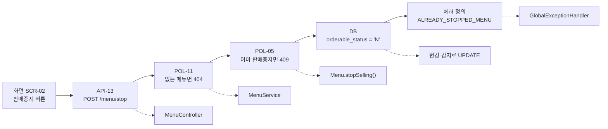
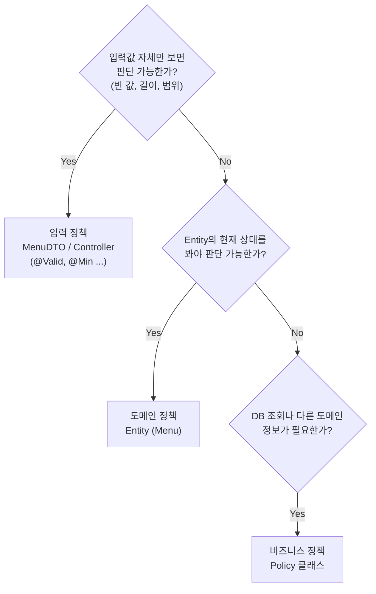
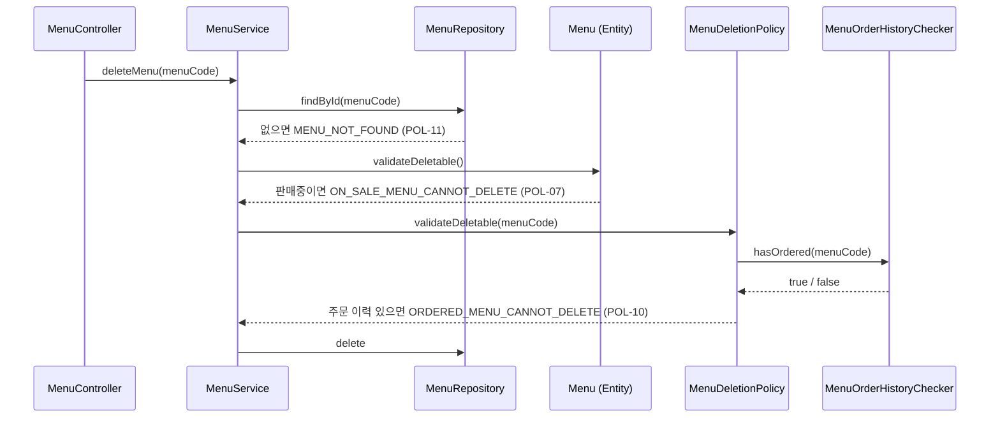
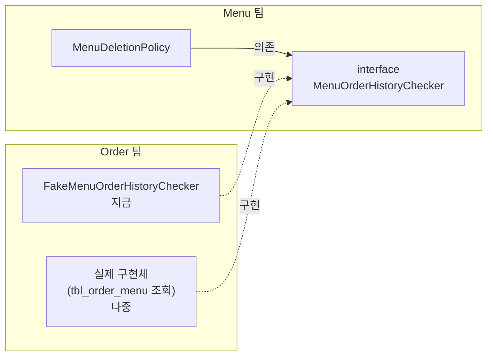

## 들어가며 (Situation)

JPA 수업의 마무리로 **레스토랑 메뉴 관리 웹 서비스** 미니 프로젝트(`module07-jpa-mini-project`)를 시작했습니다. 지금까지 배운 Spring MVC, Thymeleaf, JPA를 한 프로젝트에 묶는 실습입니다.

이전 실습과 가장 크게 다른 점은 **코드보다 문서가 먼저 주어졌다**는 것입니다. 프로젝트에는 화면·API·정책·에러·DB를 모두 정의한 PRD(제품 요구사항 문서)가 `README.md`로 들어 있고, 코드는 그 문서를 옮겨 적도록 `TODO`가 비어 있는 형태입니다.

> 실제 서비스에서 겪은 문제가 아니라, 수업 미니 프로젝트를 정리한 글입니다. 이 프로젝트는 Spring Boot 3.5, Java 21, Spring Data JPA, Thymeleaf, MySQL 8을 사용합니다(앞선 실습의 Spring Boot 4.x와 버전이 다릅니다). 수업 시점에 아직 코드로 채우지 않은 기능은 **PRD의 설계만** 소개하고, 구현 코드를 지어내지 않았습니다.

이 글은 PRD와 프로젝트 구조, 그리고 "규칙(정책)을 어느 클래스에 둘지"라는 설계를 다룹니다. 수업에서 구현한 조회 기능은 [Spring Data JPA 글]({{ site.baseurl }})과 [검증·예외 처리 글]({{ site.baseurl }})에서 이어집니다.

## 문제 상황 (Task)

기능 자체는 메뉴 조회·등록·수정·판매중지·삭제로 단순합니다. 어려운 것은 **규칙**입니다.

- 메뉴 이름은 필수이고 30자 이하
- 신규 메뉴는 항상 판매중으로 시작
- 이미 판매중지된 메뉴는 다시 판매중지할 수 없다
- 메뉴 이름은 중복될 수 없다
- 메뉴는 하위 카테고리에만 등록할 수 있다
- 주문 이력이 있는 메뉴는 삭제할 수 없다 (그런데 주문 데이터는 **다른 팀** 소유)

이 규칙들을 전부 Service의 `if` 문으로 쓰면 Service가 금방 비대해지고, 같은 규칙이 여러 메서드에 흩어집니다. 이 프로젝트는 그 문제를 **"규칙을 판단하는 데 무엇이 필요한가"로 위치를 정하는** 방식으로 풉니다.

## 해결 과정 (Action)

### 1. PRD의 각 장이 코드의 한 계층이 된다

PRD는 이런 원칙으로 시작합니다.

> 이 문서 하나만 보고 개발할 수 있어야 한다. ... 코드를 짜다가 막히면 코드가 아니라 이 문서를 먼저 본다. 문서에 답이 없다면 코드를 짜기 전에 문서부터 고친다.

PRD의 장과 코드의 대응은 다음과 같습니다.

| PRD | 정한 내용 | 코드로 옮겨지는 곳 |
|-----|----------|-------------------|
| 화면 설계 | URL, 템플릿, Model에 담을 이름 | `templates/**.html`, Controller의 View 이름 |
| API 명세 | Method, URL, 요청 값, 성공/실패 응답 | `MenuController`의 `@GetMapping`/`@PostMapping` |
| 정책 정의 | 규칙과 판단 위치 | `MenuDTO`(입력), `Menu`(도메인), `policy` 패키지(비즈니스) |
| 에러 정의 | 에러 코드, HTTP 상태, 메시지 | `ErrorCode`, `GlobalExceptionHandler` |
| DB 설계 | 테이블, 엔티티 매핑, 필요한 조회 | `Menu`, `Category`, Repository |
| 협업 계약 | 다른 팀에게 받을 정보 | `MenuOrderHistoryChecker` 인터페이스 |

기능 하나를 PRD에서 코드로 옮기는 예시도 PRD에 들어 있습니다. "판매중지(F-06)"라면:



위쪽 줄이 PRD에서 읽을 내용, 아래 점선이 그 내용이 들어갈 코드입니다. 문서가 정확하면 "어디에 무엇을 짤지"를 고민할 필요가 없다는 것이 이 방식의 핵심입니다.

### 2. 프로젝트 구조

```text
com.wanted.project
├── domain
│   ├── menu
│   │   ├── controller   MenuController
│   │   └── model
│   │       ├── dao      MenuRepository, CategoryRepository
│   │       ├── dto      MenuDTO, CategoryDTO
│   │       ├── entity   Menu, Category
│   │       ├── policy   MenuNamePolicy, MenuCategoryPolicy, MenuDeletionPolicy,
│   │       │            MenuOrderHistoryChecker (Order 팀과의 계약)
│   │       └── service  MenuService
│   └── order            FakeMenuOrderHistoryChecker (Order 팀 영역)
└── global
    ├── config           실행 클래스, ContextConfig, JpaConfig, IndexController
    └── exception        BusinessException, ErrorCode, GlobalExceptionHandler
```

`domain` 아래에는 업무 단위(메뉴, 주문)별로, `global` 아래에는 프로젝트 전체가 쓰는 설정과 예외를 둡니다.

**실행 클래스 위치와 스캔 설정**

실행 클래스(`@SpringBootApplication`)가 `global.config` 패키지에 있습니다. [컴포넌트 스캔 글]({{ site.baseurl }})에서 본 것처럼 기본 스캔 범위는 실행 클래스의 패키지 하위이므로, 이대로는 `domain.menu`의 Controller나 Service가 Bean으로 등록되지 않습니다. 그래서 설정 클래스 두 개로 범위를 넓힙니다.

```java
@Configuration
@ComponentScan(basePackages = "com.wanted.project")
public class ContextConfig { }
```

```java
@Configuration
@EnableJpaRepositories(basePackages = "com.wanted.project")
@EntityScan(basePackages = "com.wanted.project")
public class JpaConfig { }
```

| 설정 | 스캔 대상 |
|------|----------|
| `@ComponentScan` | `@Controller`, `@Service`, `@Component`, `@ControllerAdvice` 등 일반 Bean |
| `@EnableJpaRepositories` | `JpaRepository`를 상속한 Repository 인터페이스 |
| `@EntityScan` | `@Entity` 클래스 |

Spring Boot는 Repository와 Entity도 기본적으로 실행 클래스의 패키지를 기준으로 찾습니다. 그래서 일반 Bean 스캔만 넓히면 JPA 쪽은 여전히 못 찾으므로 JPA 전용 스캔 설정이 따로 필요합니다.

### 3. 정책 3분류: 판단에 무엇이 필요한가

PRD는 정책을 구현하기 전에 아래 질문으로 위치를 정하라고 합니다.



PRD의 정책을 이 기준으로 나누면 다음과 같습니다.

| ID | 종류 | 정책 | 판단 위치 | 위반 시 |
|----|------|------|----------|---------|
| POL-01 | 입력 | 메뉴 이름은 필수, 30자 이하 | `MenuDTO`, `MenuController` | 400 |
| POL-02 | 입력 | 가격은 0원 이상 | `MenuDTO`, `MenuController` | 400 |
| POL-03 | 입력 | 카테고리는 반드시 선택 | `MenuDTO` | 400 |
| POL-04 | 도메인 | 신규 메뉴는 항상 판매중(Y)으로 시작 | `Menu.create()` | — |
| POL-05 | 도메인 | 이미 판매중지된 메뉴는 판매중지 불가 | `Menu.stopSelling()` | 409 |
| POL-06 | 도메인 | 이미 판매중인 메뉴는 판매재개 불가 | `Menu.resumeSelling()` | 409 |
| POL-07 | 도메인 | 판매중인 메뉴는 삭제 불가 | `Menu.validateDeletable()` | 409 |
| POL-08 | 비즈니스 | 메뉴 이름 중복 불가 (수정 시 자기 자신 제외) | `MenuNamePolicy` | 409 |
| POL-09 | 비즈니스 | 하위 카테고리에만 등록 가능 | `MenuCategoryPolicy` | 404 / 400 |
| POL-10 | 비즈니스 | 주문 이력이 있는 메뉴는 삭제 불가 | `MenuDeletionPolicy` | 409 |
| POL-11 | 공통 | 없는 메뉴는 조회·수정·상태변경·삭제 불가 | `MenuService` | 404 |

왜 이렇게 나눌까요? 핵심은 **각 클래스가 판단에 필요한 정보를 이미 가지고 있느냐**입니다.

| 위치 | 아는 것 | 모르는 것 | 그래서 맡는 규칙 |
|------|---------|-----------|-----------------|
| DTO | 화면에서 넘어온 값 | DB에 저장된 현재 상태 | 형식 (빈 값, 길이, 범위) |
| Entity | 자기 자신의 현재 상태 | 다른 행, 다른 테이블 | 자기 상태에 따른 허용 여부 |
| Policy | Repository, 다른 팀 계약 | — | 조회가 필요한 규칙 |

예를 들어 "이미 판매중지된 메뉴인가?"는 DTO가 판단할 수 없습니다. DTO에는 화면에서 보낸 `menuCode`만 있고, 그 메뉴의 현재 상태는 DB에 있기 때문입니다. 반대로 "같은 이름의 메뉴가 있는가?"는 `Menu` 엔티티 하나로는 알 수 없습니다. 다른 메뉴들을 조회해야 합니다.

### 4. Service는 순서만 책임진다

정책이 DTO·Entity·Policy로 흩어지면 Service에는 무엇이 남을까요? 제공된 `MenuService`의 클래스 주석은 이렇게 정의합니다.

> 조회 → 규칙 확인(Policy) → 변경(Entity) → 저장 → DTO 변환의 **"순서"만 책임진다.**
> 규칙을 직접 판단하지 않는다. (if 문으로 규칙을 검사하고 있다면 Entity나 Policy로 옮길 대상)

PRD의 정책 보충에는 삭제 기능의 검사 순서도 정해져 있습니다. **판매중 여부(Menu 자신의 상태)를 먼저, 주문 이력(다른 팀에 질문)을 나중에** 확인합니다. 자기 상태로 바로 답할 수 있는 검사를 먼저 하면, 불필요하게 다른 팀에 묻는 일을 줄일 수 있습니다.



위 흐름은 PRD와 클래스 주석에 정의된 **설계**를 그린 것입니다. 삭제 기능은 수업 시점에 아직 구현하지 않았습니다.

### 5. 엔티티 설계: setter 대신 이름 있는 메서드

```java
@NoArgsConstructor
@AllArgsConstructor(access = AccessLevel.PRIVATE)
@Getter
@ToString
@Entity
@Table(name = "tbl_menu")
public class Menu {

    @Id
    @Column(name = "menu_code")
    @GeneratedValue(strategy = GenerationType.IDENTITY)
    private int menuCode;

    @Column(name = "menu_name")
    private String menuName;

    @Column(name = "menu_price")
    private int menuPrice;

    @Column(name = "category_code")
    private int categoryCode;

    @Column(name = "orderable_status")
    private String orderableStatus;

    // 아래 메서드들은 설계(시그니처)만 정해져 있다
    // public static Menu create(String menuName, int menuPrice, int categoryCode)
    // public void changeMenuName(String newMenuName)
    // public void stopSelling()
    // public void resumeSelling()
    // public void validateDeletable()
}
```

눈여겨볼 설계는 세 가지입니다.

**① 전체 필드 생성자는 `private`, setter는 없음**

`@AllArgsConstructor(access = AccessLevel.PRIVATE)`로 외부에서 아무 값이나 넣어 객체를 만들 수 없게 막았습니다. 생성은 `Menu.create()`, 변경은 `changeMenuName()`, `stopSelling()` 같은 **이름 있는 메서드로만** 하도록 설계되어 있습니다. 그래야 "신규 메뉴는 항상 판매중(Y)"(POL-04) 같은 규칙을 생성 메서드 한 곳에서 지킬 수 있습니다. `setOrderableStatus("N")`이 열려 있다면 누구나 규칙을 우회할 수 있습니다. [엔티티 매핑 글]({{ site.baseurl }})에서 PK를 뺀 생성자를 직접 만들었던 것을 한 단계 더 밀고 나간 형태입니다.

`@NoArgsConstructor`가 `public`으로 남아 있는 것은 JPA가 조회 결과로 객체를 만들 때 기본 생성자를 쓰기 때문입니다.

**② 상태 변경 후 `save()`가 필요 없다**

PRD의 판매중지 예시에는 "변경 감지로 UPDATE (save 불필요)"라고 적혀 있습니다. 트랜잭션 안에서 조회한 `Menu`는 영속 상태이므로, `stopSelling()`으로 필드 값만 바꾸면 커밋 시점에 [변경 감지]({{ site.baseurl }})가 UPDATE를 만듭니다.

**③ `Category`를 객체가 아닌 `int categoryCode`로 참조**

[JPA 첫 글]({{ site.baseurl }})에서는 `@ManyToOne Category`로 객체 참조를 하는 것이 JPA의 장점이라고 정리했습니다. 그런데 이 PRD는 일부러 `int categoryCode`로 둡니다.

> `Menu.categoryCode`는 `@ManyToOne Category`가 아닌 `int`로 둔다. (다른 도메인은 ID로 참조)

PRD가 밝힌 이유는 괄호 안의 한 줄입니다. 객체로 참조하면 두 엔티티가 강하게 묶여, 한쪽을 조회할 때 다른 쪽이 딸려 오고 변경의 영향도 함께 받습니다. ID로만 참조하면 필요할 때 따로 조회해야 하는 대신 경계가 분명해집니다. 화면도 카테고리 이름이 아니라 `categoryCode` 숫자를 그대로 보여 줍니다. 두 방식은 장단점이 있는 선택이고, 이 프로젝트는 경계를 우선했습니다.

`Category`는 조회 전용이라 setter가 없고, "하위 카테고리인가?"라는 질문에 스스로 답하는 `isSubCategory()` 메서드를 갖도록 설계되어 있습니다. Policy가 `getRefCategoryCode() == null` 같은 내부 구조를 직접 해석하지 않고 엔티티에게 **묻게** 하려는 것입니다.

### 6. 에러를 한 곳에: ErrorCode와 BusinessException

정책을 어기면 어떻게 알릴까요? 예외 클래스를 규칙마다 만들지 않고, **예외 하나 + 에러 코드 enum** 조합을 씁니다.

```java
@Getter
@RequiredArgsConstructor
public enum ErrorCode {

    /* 조회 대상 없음 */
    MENU_NOT_FOUND(HttpStatus.NOT_FOUND, "메뉴를 찾을 수 없습니다."),
    CATEGORY_NOT_FOUND(HttpStatus.NOT_FOUND, "카테고리를 찾을 수 없습니다."),

    /* 도메인 규칙 위반 (Entity 가 자신의 "현재 상태" 로 판단) */
    ALREADY_STOPPED_MENU(HttpStatus.CONFLICT, "이미 판매중지된 메뉴입니다."),
    ALREADY_ON_SALE_MENU(HttpStatus.CONFLICT, "이미 판매중인 메뉴입니다."),
    ON_SALE_MENU_CANNOT_DELETE(HttpStatus.CONFLICT, "판매중인 메뉴는 삭제할 수 없습니다. 먼저 판매중지해주세요."),

    /* 비즈니스 규칙 위반 (Policy 가 판단) */
    DUPLICATE_MENU_NAME(HttpStatus.CONFLICT, "이미 존재하는 메뉴 이름입니다."),
    NOT_SUB_CATEGORY(HttpStatus.BAD_REQUEST, "메뉴는 하위 카테고리에만 등록할 수 있습니다."),
    ORDERED_MENU_CANNOT_DELETE(HttpStatus.CONFLICT, "주문 이력이 있는 메뉴는 삭제할 수 없습니다.");

    private final HttpStatus status;
    private final String message;
}
```

```java
@Getter
public class BusinessException extends RuntimeException {

    private final ErrorCode errorCode;

    public BusinessException(ErrorCode errorCode) {
        super(errorCode.getMessage());
        this.errorCode = errorCode;
    }
}
```

| 설계 | 효과 |
|------|------|
| enum 상수 하나 = 규칙 위반 하나 | 예외 클래스가 규칙 수만큼 늘어나지 않음 |
| 상수에 HTTP 상태 + 메시지 | 메시지를 바꿀 때 한 곳만 수정 |
| `RuntimeException` 상속 | `throws` 선언 없이 Controller 밖까지 전파되고, [`@Transactional` 안에서 나면 롤백]({{ site.baseurl }}) |

`ErrorCode`는 규칙을 **판단하지 않습니다.** 판단은 Entity와 Policy가 하고, `ErrorCode`는 "무슨 규칙을 어겼는지"를 표현만 합니다. 화면으로 바꾸는 일은 `GlobalExceptionHandler`가 맡습니다([다음 글]({{ site.baseurl }})).

HTTP 상태의 의미도 구분되어 있습니다. 대상이 없으면 404(Not Found), 입력이 잘못되면 400(Bad Request), 요청은 맞지만 **현재 상태와 충돌**하면 409(Conflict)입니다. "이미 판매중지된 메뉴를 판매중지"는 요청 형식이 아니라 상태가 문제이므로 409입니다.

### 7. 다른 팀과의 계약: 인터페이스와 Fake

"주문 이력이 있는 메뉴는 삭제할 수 없다"(POL-10)는 주문 데이터가 필요합니다. 그런데 주문 테이블(`tbl_order_menu`)은 **Order 팀** 소유입니다. Menu 팀이 Order 팀의 Entity나 Repository를 직접 가져다 쓰면 어떻게 될까요?

- Order 팀이 테이블이나 엔티티를 바꾸면 Menu 팀 코드가 깨집니다.
- Order는 메뉴 가격 때문에 이미 Menu에 의존합니다. Menu까지 Order에 의존하면 **순환 의존**이 생깁니다.
- Order 팀 구현이 끝날 때까지 Menu 팀은 삭제 기능을 개발할 수 없습니다.

그래서 PRD는 **필요한 쪽(Menu 팀)이 인터페이스를 정의하고, 정보를 가진 쪽(Order 팀)이 구현**하도록 정했습니다.

```java
// Menu 팀이 정의 (domain/menu/model/policy)
public interface MenuOrderHistoryChecker {
    boolean hasOrdered(int menuCode);
}
```

```java
// Order 팀 영역 (domain/order) — 실제 구현 전까지 쓰는 가짜 구현체
@Component
public class FakeMenuOrderHistoryChecker implements MenuOrderHistoryChecker {

    private static final Set<Integer> ORDERED_MENU_CODES = Set.of(1, 2, 3);

    @Override
    public boolean hasOrdered(int menuCode) {
        return ORDERED_MENU_CODES.contains(menuCode);
    }
}
```



화살표 방향을 보면 Order 팀 클래스가 Menu 팀의 인터페이스를 향합니다. 원래라면 "Menu → Order"였을 의존이 뒤집혀 **"Order → Menu" 한 방향**만 남습니다. 이를 **의존성 역전**이라고 합니다.

`MenuDeletionPolicy`는 인터페이스 타입으로만 주입받으므로, 지금 들어온 것이 Fake인지 진짜인지 모릅니다. Order 팀의 실제 구현이 완성되면 **Fake 클래스만 삭제**하면 되고, Menu 팀 코드는 한 줄도 바뀌지 않습니다. [DI 글]({{ site.baseurl }})에서 본 "구현체가 아닌 타입에 의존한다"는 원칙이 팀 협업 단위에서 어떻게 쓰이는지 보여 주는 예입니다.

PRD의 협업 규칙은 다섯 가지입니다.

1. 다른 팀의 Repository / Entity를 import 하지 않는다. 합의한 인터페이스로만 묻는다.
2. 값은 Entity가 아닌 기본형 / DTO로 주고받는다.
3. 필요한 쪽이 인터페이스를 정의하고, 정보를 가진 쪽이 구현한다. (순환 의존 방지)
4. 상대 구현이 없으면 Fake로 먼저 개발한다.
5. 계약을 바꿔야 하면 상대 팀과 합의한 뒤 바꾼다.

### 8. 요구사항이 바뀌면: 문서를 먼저 고친다

PRD는 마지막에 "판매상태에 품절(S)을 추가한다"는 변경 예시를 듭니다. 순서는 **정책 정의 → 에러 정의 → DB 허용 값 → 코드**입니다. 품절 메뉴는 삭제할 수 있는지, 판매재개할 수 있는지를 먼저 문서에서 정해야 코드가 흔들리지 않습니다. 그리고 판매상태 관련 규칙이 `Menu` 엔티티에 모여 있다면, 코드는 `Menu` 한 곳만 고치면 됩니다. 정책 위치를 나눈 효과가 여기서 드러납니다.

## 결과 (Result)

정량 지표는 없고, 아래를 정리했습니다.

- PRD의 화면·API·정책·에러·DB·협업 계약이 각각 템플릿·Controller·DTO/Entity/Policy·ErrorCode·Entity/Repository·인터페이스에 대응합니다.
- 실행 클래스가 하위 패키지에 있으면 `@ComponentScan`, `@EnableJpaRepositories`, `@EntityScan`으로 스캔 범위를 넓혀야 합니다.
- 정책은 판단에 필요한 정보에 따라 입력(DTO) / 도메인(Entity) / 비즈니스(Policy)로 나누고, Service는 호출 순서만 책임집니다.
- 엔티티는 setter 대신 이름 있는 메서드로만 생성·변경하게 해 규칙을 한 곳에서 지킵니다.
- 규칙 위반은 `BusinessException(ErrorCode)` 하나로 표현하고, HTTP 상태는 404·400·409로 의미를 구분합니다.
- 다른 팀의 데이터는 필요한 쪽이 정의한 인터페이스로만 받고, 구현 전에는 Fake로 개발합니다(의존성 역전).

## 더 학습하면 좋은 개념

- **도메인 주도 설계(DDD)의 애그리거트와 ID 참조** — 다른 도메인을 객체가 아닌 ID로 참조하는 PRD 규칙의 배경이 되는 개념입니다.
- **풍부한 도메인 모델 vs 빈약한 도메인 모델** — 규칙을 엔티티에 두는 방식(이 프로젝트)과 Service에 두는 방식의 차이와 장단점입니다.
- **의존성 역전 원칙(DIP)과 헥사고날 아키텍처** — `MenuOrderHistoryChecker` 같은 "필요한 쪽이 정의하는 인터페이스"를 구조 전체로 확장한 설계입니다.
- **테스트 대역(Fake, Stub, Mock)** — Fake 구현체가 협업뿐 아니라 단위 테스트에서 어떻게 쓰이는지와 각 대역의 차이입니다.
- **HTTP 상태 코드의 의미(RFC 9110)** — 400, 404, 409를 어떤 기준으로 고르는지 표준 문서로 확인할 수 있습니다.

## 참고 자료

- [Spring Boot Reference - Structuring Your Code](https://docs.spring.io/spring-boot/reference/using/structuring-your-code.html)
- [Spring Boot API - @EntityScan](https://docs.spring.io/spring-boot/3.5/api/java/org/springframework/boot/autoconfigure/domain/EntityScan.html)
- [Spring Data JPA Reference - Enabling Spring Data Repositories](https://docs.spring.io/spring-data/jpa/reference/repositories/create-instances.html)
- [Spring Framework Reference - Classpath Scanning and Managed Components](https://docs.spring.io/spring-framework/reference/core/beans/classpath-scanning.html)
- [Jakarta Persistence 3.2 Specification](https://jakarta.ee/specifications/persistence/3.2/)
- [RFC 9110 - HTTP Semantics (Status Codes)](https://www.rfc-editor.org/rfc/rfc9110.html#name-status-codes)
