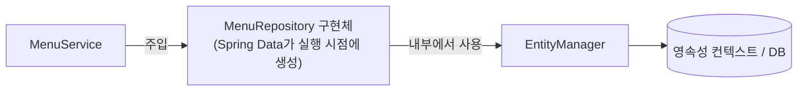
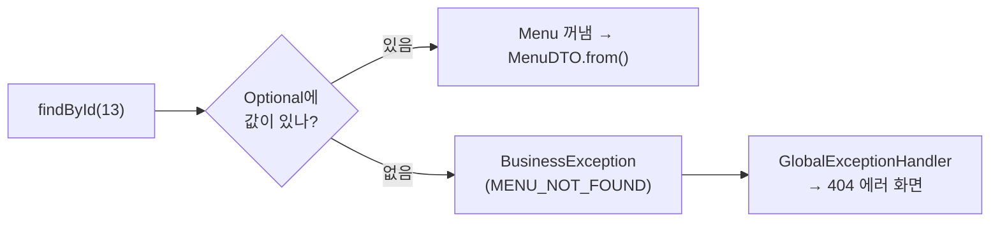
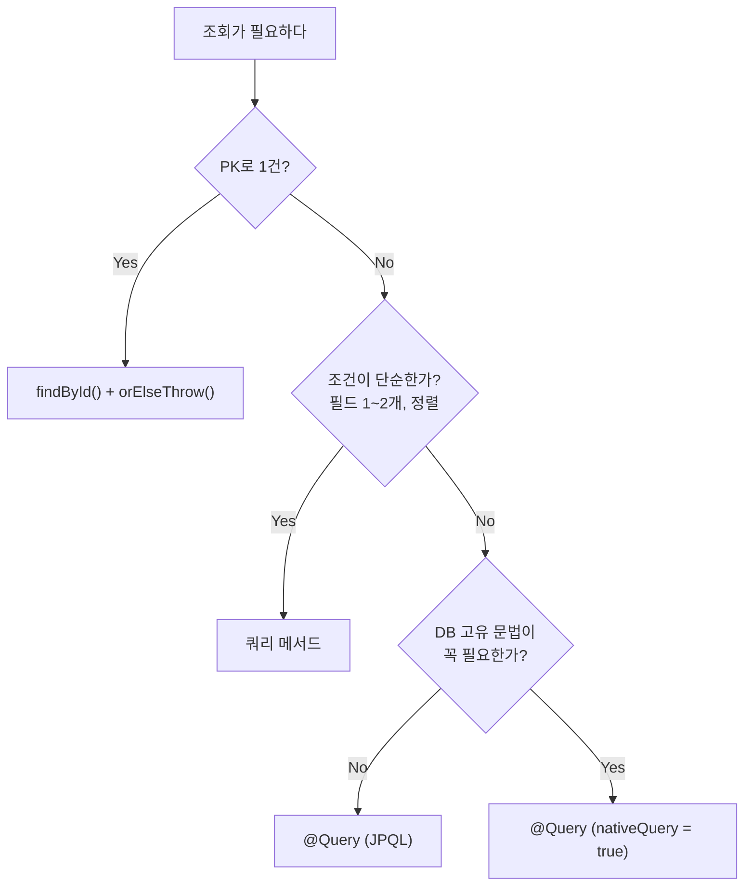

## 들어가며 (Situation)

[미니 프로젝트 설계 글]({{ site.baseurl }})에서 PRD와 계층 구조를 정리했습니다. 이 글은 수업에서 실제로 구현한 **조회 기능**의 DB 접근 부분을 다룹니다.

| 기능 | PRD ID | 이 글에서 다루는 기술 |
|------|--------|---------------------|
| 메뉴 1건 조회 | F-01 | `findById()`, `Optional`, `orElseThrow()` |
| 가격으로 메뉴 검색 | F-03 | 쿼리 메서드 |
| 하위 카테고리 목록 | API-07 | `@Query` Native Query |

chap01~03에서는 `EntityManager`를 직접 다뤘지만, 이번 프로젝트는 **Spring Data JPA**를 씁니다.

> 실제 서비스에서 겪은 문제가 아니라, 수업 미니 프로젝트를 정리한 글입니다. Spring Boot 3.5, Spring Data JPA, MySQL 8을 사용했고, 동작 설명은 Spring Data JPA 공식 문서로 보완했습니다.

## 문제 상황 (Task)

[chap03의 MemberRepository]({{ site.baseurl }})는 이랬습니다.

```java
@Repository
public class MemberRepository {

    @PersistenceContext
    private EntityManager manager;

    public void save(Member member) { manager.persist(member); }

    public Member findByMemberNo(int memberNo) { return manager.find(Member.class, memberNo); }
}
```

엔티티가 늘어날 때마다 `save`, `findById`, `findAll`, `delete`를 똑같은 모양으로 반복해서 작성해야 합니다. 조건 조회가 필요하면 JPQL 문자열도 직접 써야 합니다. 이번 프로젝트에는 다음 요구가 있었습니다.

- 메뉴 1건 조회: 없는 메뉴면 404 에러 화면 (POL-11)
- 입력한 가격 **초과** 메뉴를 가격 오름차순으로 (F-03)
- 상위 카테고리가 있는 **하위 카테고리만** 카테고리 번호 순으로 (API-07)

## 해결 과정 (Action)

### 1. JpaRepository: 인터페이스만 선언한다

```java
@Repository
public interface MenuRepository extends JpaRepository<Menu, Integer> {
}
```

`JpaRepository<관리할 엔티티, @Id 필드의 타입>`을 상속한 **인터페이스**만 선언했습니다. 구현 클래스는 작성하지 않습니다. 애플리케이션이 시작될 때 Spring Data JPA가 이 인터페이스의 구현체(프록시)를 만들어 Bean으로 등록합니다. 그 구현체가 내부에서 지금까지 직접 다뤘던 `EntityManager`를 사용합니다.



수업 주석에는 "JpaRepository는 영속성 컨텍스트와 엔티티 매니저를 구현한 구현체"라고 적혀 있었습니다. 정확히는 `JpaRepository`는 **인터페이스**이고, 구현은 Spring Data JPA가 대신 만들어 준다고 이해하면 됩니다.

인터페이스에 붙은 `@Repository`는 없어도 됩니다. Spring Data는 `@EnableJpaRepositories`로 지정한 범위에서 `Repository`를 상속한 인터페이스를 찾아 등록하기 때문입니다. 붙여 두면 계층이 눈에 잘 띄는 정도의 효과입니다.

상속만으로 쓸 수 있는 주요 메서드는 다음과 같습니다.

| 메서드 | 기능 | chap03의 EntityManager 방식 |
|--------|------|---------------------------|
| `save(entity)` | 저장 (새 엔티티면 persist, 아니면 merge) | `persist()` 직접 호출 |
| `findById(id)` | PK로 1건 조회, `Optional` 반환 | `find()`, `null` 반환 |
| `findAll()` / `findAll(Sort)` | 전체 조회 / 정렬 조회 | JPQL 직접 작성 |
| `existsById(id)` | 존재 여부 | — |
| `count()` | 개수 | — |
| `delete(entity)` / `deleteById(id)` | 삭제 | `remove()` |

**트랜잭션은?** 공식 문서에 따르면 `JpaRepository`에서 물려받은 메서드는 기본 구현체(`SimpleJpaRepository`)의 트랜잭션 설정을 그대로 씁니다. 조회 메서드는 `readOnly = true`, 나머지는 일반 `@Transactional`입니다. 반면 인터페이스에 **직접 선언한 쿼리 메서드**에는 기본 트랜잭션 설정이 붙지 않습니다.

> Declared query methods (including default methods) do not get any transaction configuration applied by default.
> — [Spring Data JPA - Transactionality](https://docs.spring.io/spring-data/jpa/reference/jpa/transactions.html)

여러 Repository 호출을 하나의 트랜잭션으로 묶거나 변경 감지를 써야 하는 등록·수정·삭제는 Service 메서드에 `@Transactional`을 붙이는 것이 이 프로젝트의 설계입니다.

### 2. findById와 Optional: 없는 메뉴를 어떻게 처리할까

```java
@Service
@RequiredArgsConstructor
public class MenuService {

    private final MenuRepository menuRepository;
    private final CategoryRepository categoryRepository;

    public MenuDTO findMenuByMenuCode(int menuCode) {

        Menu foundMenu = menuRepository.findById(menuCode)
                .orElseThrow(() -> new BusinessException(ErrorCode.MENU_NOT_FOUND));

        return MenuDTO.from(foundMenu);
    }
}
```

`findById()`의 반환 타입은 `Menu`가 아니라 `Optional<Menu>`입니다. `Optional`은 "값이 있을 수도, 없을 수도 있다"를 타입으로 드러내는 상자입니다. 메뉴가 없을 때 예외가 나거나 `null`이 들어오는 것이 아니라 **빈 `Optional`**이 돌아옵니다.

| 방식 | 없을 때 | 호출한 쪽이 할 일 |
|------|--------|------------------|
| `manager.find()` (chap02~03) | `null` 반환 | `null` 체크를 잊으면 나중에 `NullPointerException` |
| `repository.findById()` | 빈 `Optional` 반환 | `Optional`을 꺼내는 순간 "없으면?"을 반드시 정해야 함 |

[chap03 글]({{ site.baseurl }})에서 없는 회원 번호로 조회하면 DTO 변환 단계에서 NPE가 날 수 있다고 정리했는데, `Optional`은 그 실수를 타입 수준에서 줄여 줍니다.

`orElseThrow(() -> new BusinessException(ErrorCode.MENU_NOT_FOUND))`는 "값이 있으면 꺼내고, 없으면 이 예외를 던져라"입니다. 던진 `BusinessException`은 `GlobalExceptionHandler`가 받아 404 에러 화면으로 바꿉니다([다음 글]({{ site.baseurl }})). 그래서 Service와 Controller에는 `try-catch`도 `if (menu == null)`도 없습니다.



**Entity → DTO 변환은 DTO의 정적 메서드로**

```java
public class MenuDTO {

    private int menuCode;
    private String menuName;
    private int menuPrice;
    private int categoryCode;
    private String orderableStatus;

    public static MenuDTO from(Menu menu) {
        return new MenuDTO(
                menu.getMenuCode(),
                menu.getMenuName(),
                menu.getMenuPrice(),
                menu.getCategoryCode(),
                menu.getOrderableStatus()
        );
    }
}
```

변환 메서드를 `Menu`가 아니라 `MenuDTO`에 둔 이유는 의존 방향 때문입니다. 클래스 주석의 설명대로 **Entity는 DTO를 몰라야** 합니다. 화면용 DTO가 바뀔 때마다 핵심 도메인 객체인 엔티티까지 수정되면 안 되기 때문입니다. DTO가 엔티티를 아는 것은 괜찮습니다. Service가 Controller에 엔티티 대신 DTO만 돌려주므로 엔티티는 Service 밖으로 나가지 않습니다.

### 3. 쿼리 메서드: 메서드 이름이 곧 쿼리

F-03은 "입력한 가격 **초과** 메뉴를 가격 오름차순으로"입니다.

```java
public interface MenuRepository extends JpaRepository<Menu, Integer> {

    List<Menu> findByMenuPriceGreaterThanOrderByMenuPrice(int menuPrice);
}
```

메서드 본문도, 쿼리 문자열도 없습니다. Spring Data JPA가 **메서드 이름을 해석해** 쿼리를 만듭니다.

| 이름 조각 | 의미 |
|----------|------|
| `findBy` | 조회 시작, 이후가 조건 |
| `MenuPrice` | 엔티티의 `menuPrice` 필드 (컬럼명이 아니라 **필드명**) |
| `GreaterThan` | `>` (초과) |
| `OrderByMenuPrice` | `menuPrice` 기준 정렬 (방향 생략 시 오름차순) |

공식 문서의 키워드 표에 따르면 `GreaterThan`은 `where x.age > ?1`, `OrderBy`는 `order by` 절로 바뀝니다. 그래서 위 메서드는 대략 아래 JPQL과 같은 뜻입니다.

```sql
-- 이해를 돕기 위해 풀어 쓴 JPQL
select m from Menu m where m.menuPrice > ?1 order by m.menuPrice
```

| 원하는 조건 | 키워드 | 연산자 |
|-------------|--------|--------|
| 초과 | `GreaterThan` | `>` |
| 이상 | `GreaterThanEqual` | `>=` |
| 미만 | `LessThan` | `<` |
| 사이 | `Between` | `between` |
| 내림차순 | `OrderBy...Desc` | `desc` |

PRD는 "초과"로 정했으므로 `GreaterThan`이 맞습니다. "이상"이었다면 `GreaterThanEqual`을 써야 합니다. 이름 한 단어 차이로 결과가 달라지므로 PRD의 용어와 키워드를 정확히 맞춰야 합니다.

```java
public List<MenuDTO> findByMenuPrice(int menuPrice) {

    List<Menu> menuList = menuRepository.findByMenuPriceGreaterThanOrderByMenuPrice(menuPrice);

    return menuList.stream()
            .map(MenuDTO::from)
            .toList();
}
```

조회 결과를 DTO 목록으로 바꿀 때는 stream을 썼습니다.

| 방식 | 코드 |
|------|------|
| for 문 | `List<MenuDTO> dtos = new ArrayList<>();` → `for (Menu m : menuList) dtos.add(MenuDTO.from(m));` |
| stream + 람다 | `menuList.stream().map(menu -> MenuDTO.from(menu)).toList()` |
| stream + 메서드 참조 | `menuList.stream().map(MenuDTO::from).toList()` |

`MenuDTO::from`은 "각 요소를 `MenuDTO.from()`에 넣어라"를 줄여 쓴 **메서드 참조**입니다. `toList()`는 Java 16부터 쓸 수 있고, 수정할 수 없는 리스트를 반환합니다.

**쿼리 메서드의 한계**

수업 주석은 쿼리 메서드의 장단점을 이렇게 정리했습니다.

- 장점: 조건이 적으면 메서드 선언만으로 끝난다.
- 단점: 조건이 많아지거나 Join이 들어가면 이름이 길어져 읽기 어렵고, 원하는 쿼리를 정확히 만들기 힘들다.

PRD의 이후 기능(PART 3)에도 쿼리 메서드가 계획되어 있습니다. 이름 중복 확인(POL-08)에 쓸 `existsByMenuName()`과, 이름 수정 시 자기 자신을 빼고 확인할 `existsByMenuNameAndMenuCodeNot()`입니다. `exists`로 시작하면 `boolean`을 반환하고, `Not`은 `<>` 조건이 됩니다.

### 4. @Query: 직접 쿼리를 쓰는 경우

API-07은 "상위 카테고리가 있는(=`ref_category_code`가 NULL이 아닌) 하위 카테고리만, 카테고리 번호 순으로"입니다. 이번에는 쿼리를 직접 작성했습니다.

```java
@Repository
public interface CategoryRepository extends JpaRepository<Category, Integer> {

    @Query(value = "select * from tbl_category c where ref_category_code is not null order by category_code",
           nativeQuery = true)
    List<Category> findSubCategory();
}
```

`@Query`에는 두 종류가 있습니다.

| 구분 | JPQL (기본) | Native Query |
|------|------------|--------------|
| 설정 | `@Query("...")` | `@Query(value = "...", nativeQuery = true)` |
| 대상 | **엔티티와 필드** (`Category`, `refCategoryCode`) | **테이블과 컬럼** (`tbl_category`, `ref_category_code`) |
| DB 종속성 | 없음 (Hibernate가 DB에 맞게 변환) | 있음 (MySQL 문법 그대로) |
| 쓰는 경우 | 대부분의 조회 | DB 고유 기능, 복잡한 SQL |

같은 조회를 JPQL로 쓰면 이렇습니다.

```java
// 예시 코드 — 수업에서는 Native Query 로 작성
@Query("select c from Category c where c.refCategoryCode is not null order by c.categoryCode")
List<Category> findSubCategory();
```

이 정도 조건은 쿼리 메서드(`findByRefCategoryCodeIsNotNullOrderByCategoryCode`)로도 표현할 수 있습니다. PRD의 "필요한 조회" 표가 이 조회를 일부러 **native query**로 지정해, 세 가지 방식을 모두 써 볼 수 있게 구성되어 있습니다.

Native Query의 `select *` 결과는 반환 타입인 `Category` 엔티티로 매핑됩니다. 컬럼 이름이 엔티티의 `@Column(name = ...)`과 맞기 때문입니다.

```java
public List<CategoryDTO> findSubCategories() {
    List<Category> categoryList = categoryRepository.findSubCategory();

    return categoryList.stream()
            .map(CategoryDTO::from)
            .toList();
}
```

### 5. 정리: 조회 방법 고르기



## 결과 (Result)

정량 지표는 없고, 아래를 정리했습니다.

- `JpaRepository<엔티티, PK 타입>`을 상속한 인터페이스만 선언하면 Spring Data JPA가 구현체를 만들어 줍니다. 내부에서는 EntityManager를 씁니다.
- 물려받은 CRUD 메서드에는 기본 트랜잭션이 적용되지만, 직접 선언한 쿼리 메서드에는 적용되지 않습니다. 여러 작업을 묶는 트랜잭션은 Service의 `@Transactional`로 정합니다.
- `findById()`는 `Optional`을 반환하므로, `orElseThrow()`로 "없으면 어떻게 할지"를 그 자리에서 정합니다.
- 쿼리 메서드는 **필드명**과 키워드(`GreaterThan`, `OrderBy` 등)로 쿼리를 만듭니다. "초과"와 "이상"처럼 키워드 하나로 결과가 달라집니다.
- `@Query`는 기본이 JPQL(엔티티 기준)이고, `nativeQuery = true`면 실제 DB의 SQL을 씁니다.
- Entity → DTO 변환은 DTO의 정적 메서드 `from()`에 두어, 엔티티가 DTO를 모르게 합니다.

## 더 학습하면 좋은 개념

- **페이징(`Pageable`, `Page`)** — `findAll(Pageable)`로 목록을 나눠 조회하는 방법입니다. 메뉴가 많아지면 전체 목록 화면에 필요합니다.
- **`@Modifying`과 벌크 연산** — `@Query`로 UPDATE·DELETE를 직접 실행할 때 필요한 설정과, 영속성 컨텍스트를 거치지 않아 생기는 주의점입니다.
- **프로젝션(Projection)** — 엔티티 전체가 아니라 필요한 컬럼만 인터페이스나 DTO로 바로 조회하는 방법입니다.
- **Querydsl / Specification** — 검색 조건이 여러 개이고 동적으로 바뀔 때, 쿼리 메서드의 한계를 넘는 방법입니다.
- **`Optional` 사용 지침** — 반환 타입에만 쓰고 필드나 파라미터에는 쓰지 않는 이유 등 `Optional`을 쓰는 원칙입니다.

## 참고 자료

- [Spring Data JPA Reference - Core Concepts](https://docs.spring.io/spring-data/jpa/reference/repositories/core-concepts.html)
- [Spring Data JPA Reference - JPA Query Methods](https://docs.spring.io/spring-data/jpa/reference/jpa/query-methods.html)
- [Spring Data JPA Reference - Query Creation](https://docs.spring.io/spring-data/jpa/reference/jpa/query-methods.html#jpa.query-methods.query-creation)
- [Spring Data JPA Reference - Native Queries](https://docs.spring.io/spring-data/jpa/reference/jpa/query-methods.html#jpa.query-methods.at-query.native)
- [Spring Data JPA Reference - Transactionality](https://docs.spring.io/spring-data/jpa/reference/jpa/transactions.html)
- [Java SE 21 API - Optional](https://docs.oracle.com/en/java/javase/21/docs/api/java.base/java/util/Optional.html)
