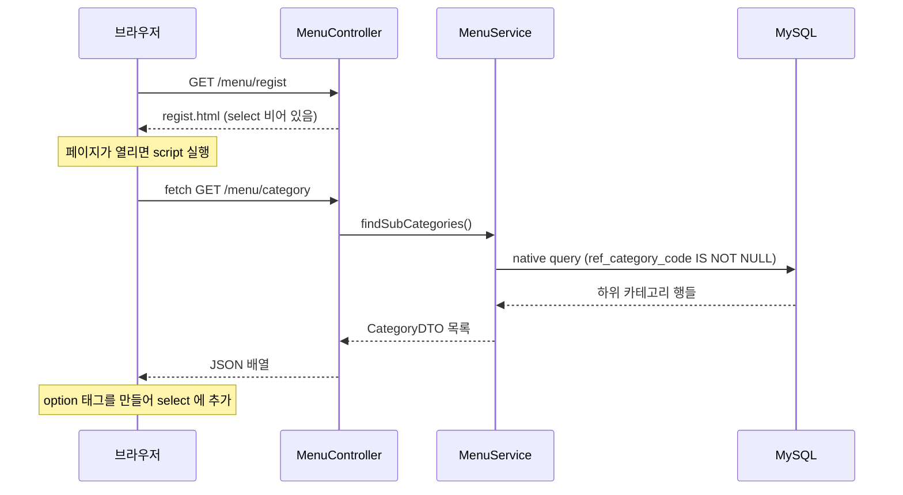
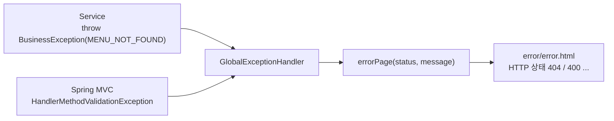

## 들어가며 (Situation)

[미니 프로젝트 설계 글]({{ site.baseurl }})과 [Spring Data JPA 글]({{ site.baseurl }})에 이어, 이번에는 메뉴 관리 프로젝트의 **Controller 쪽**을 정리합니다. 수업에서 구현한 내용은 다음과 같습니다.

| API | 요청 | 이 글에서 다루는 기술 |
|-----|------|---------------------|
| API-02 | `GET /menu/{menuCode}` | `@PathVariable`, `ModelAndView` |
| API-05 | `GET /menu/search?menuPrice=...` | `@RequestParam` + `@Min` 검증 |
| API-07 | `GET /menu/category` | `@ResponseBody` JSON 응답 + `fetch` |
| 에러 | (예외 발생 시) | `@ControllerAdvice` 전역 예외 처리 |

> 실제 서비스에서 겪은 문제가 아니라, 수업 미니 프로젝트를 정리한 글입니다. Spring Boot 3.5(Spring Framework 6.2)를 사용했고, 동작 설명은 Spring 공식 문서와 소스 코드로 보완했습니다. 등록·수정·삭제 등 수업 시점에 구현하지 않은 API는 PRD 설계로만 언급합니다.

## 문제 상황 (Task)

- 가격 검색에 `-1000`처럼 잘못된 값이 들어오면 어디서 막을까요? 화면의 `<input type="number">`만으로 충분할까요?
- 메뉴 등록 화면의 카테고리 선택지를 DB에서 가져와야 하는데, Controller는 지금까지 **화면(View)**만 반환했습니다.
- 없는 메뉴, 잘못된 입력, 규칙 위반이 생길 때마다 Controller에 `try-catch`를 쓰면 정상 흐름이 묻힙니다. 에러 화면은 어디서 만들까요?

## 해결 과정 (Action)

### 1. Controller의 책임과 생성자 주입

```java
@Controller
@RequiredArgsConstructor
@RequestMapping("/menu/*")
public class MenuController {

    private final MenuService menuService;
}
```

클래스 주석에 정리된 Controller의 책임은 이렇습니다.

- 요청 파라미터를 받고, 입력값 검증을 **선언**한다.
- 어떤 화면으로 보낼지(View 이름, redirect) 결정한다.
- 비즈니스 로직, 트랜잭션, Entity는 다루지 않는다. (Controller는 DTO만 사용)
- `try-catch`를 쓰지 않는다. 예외는 `GlobalExceptionHandler`가 처리한다.

`final` 필드는 반드시 초기화해야 하는데, 코드에는 생성자가 보이지 않습니다. Lombok의 `@RequiredArgsConstructor`가 **`final` 필드를 받는 생성자**를 컴파일 시점에 만들어 주기 때문입니다. [DI 글]({{ site.baseurl }})에서 정리한 생성자 주입을 Lombok으로 줄여 쓴 것입니다. 생성자가 하나면 `@Autowired`도 생략할 수 있습니다.

### 2. 메뉴 1건 조회: @PathVariable

```java
@GetMapping("/{menuCode}")
public ModelAndView findByMenuByPathVariable(@PathVariable int menuCode, ModelAndView mv) {

    MenuDTO findMenu = menuService.findMenuByMenuCode(menuCode);

    mv.addObject("result", findMenu);
    mv.setViewName("menu/detail");

    return mv;
}
```

PRD의 화면 설계가 Model 이름(`result`)과 템플릿(`menu/detail`)까지 정해 두었으므로, Controller는 그대로 옮기기만 하면 됩니다. 템플릿은 [Thymeleaf 글]({{ site.baseurl }})에서 본 문법으로 값을 출력합니다.

```html
<td th:text="${result.menuCode}"></td>
<td th:text="${result.menuName}"></td>
<td th:text="${result.menuPrice} + '원'"></td>
<td>
    <span th:classappend="${result.orderableStatus} == 'Y' ? 'status available' : 'status unavailable'"
          th:text="${result.orderableStatus} == 'Y' ? '판매중' : '판매중지'"></span>
</td>
```

없는 메뉴 번호면 Service가 `BusinessException(MENU_NOT_FOUND)`을 던지므로 Controller에는 예외 처리 코드가 없습니다.

수업 주석에는 값을 받는 두 방식의 구분법도 있었습니다. **`?`가 있으면 쿼리 스트링, 없으면 경로 변수**입니다.

| 방식 | URL 예 | 받는 방법 | 주로 쓰는 경우 |
|------|--------|----------|---------------|
| 경로 변수 | `/menu/13` | `@PathVariable` | 특정 자원 하나를 가리킬 때 |
| 쿼리 스트링 | `/menu/search?menuPrice=1000` | `@RequestParam` | 검색·필터 조건 |

### 3. 가격 검색: @RequestParam에 직접 검증 걸기

```java
@GetMapping("/search")
public ModelAndView findByMenuPrice(@RequestParam
                                    @Min(value = 0, message = "가격은 0원 이상 입력!") int menuPrice,
                                    ModelAndView mv) {

    List<MenuDTO> menuList = menuService.findByMenuPrice(menuPrice);

    mv.addObject("menuList", menuList);
    mv.addObject("price", menuPrice);
    mv.setViewName("menu/searchResult");

    return mv;
}
```

검증 어노테이션(`@Min`)을 쓰려면 `spring-boot-starter-validation` 의존성이 필요합니다. 이 의존성이 Jakarta Bean Validation 구현체(Hibernate Validator)를 가져옵니다.

**왜 서버에서도 검증할까?**

수업 주석이 강조한 내용입니다.

> 유효성 검사는 front(js)에서도 진행할 수 있다. 다만, front에서만 진행하게 되면 url 조작, body 조작 시에는 막을 수 있는 방법이 없다. 따라서 백엔드에서도 유효성 검사를 진행해야 한다.

검색 화면의 입력칸은 `<input type="number">`입니다. 여기에 `min="0"`을 더하더라도 화면 쪽 제한은 사용자 편의를 위한 장치일 뿐입니다. 주소창에 `/menu/search?menuPrice=-1000`을 직접 입력하면 화면을 거치지 않고 요청이 들어옵니다. 서버가 **최종 방어선**이어야 합니다.

**어노테이션을 파라미터에 직접 붙이면 동작하는 이유**

Spring Framework 6.1부터 Spring MVC에 **메서드 검증(method validation)**이 내장되었습니다. 공식 문서에 따르면 `@Min`, `@NotBlank` 같은 제약 어노테이션을 컨트롤러 메서드 파라미터에 직접 붙이면 메서드 검증이 적용되고, 실패하면 `HandlerMethodValidationException`이 발생합니다. 예전처럼 클래스에 `@Validated`를 붙이지 않아도 됩니다.

| 검증 방식 | 붙이는 위치 | 실패 시 예외 |
|----------|------------|-------------|
| 메서드 검증 | `@RequestParam`, `@PathVariable` 등에 `@Min`, `@NotBlank` 직접 | `HandlerMethodValidationException` |
| 객체 검증 | `@Valid @ModelAttribute MenuDTO` (DTO 필드에 제약) | `MethodArgumentNotValidException` (`BindException`의 자식) |

> Applications should handle both `MethodArgumentNotValidException` and `HandlerMethodValidationException` since either may be raised depending on the controller method signature.
> — [Spring Framework Reference - Validation](https://docs.spring.io/spring-framework/reference/web/webmvc/mvc-controller/ann-validation.html)

PRD는 두 방식을 모두 쓰도록 설계되어 있습니다. 가격 검색과 이름 수정(`menuCode`, `menuName`을 `@RequestParam`으로 받음)은 메서드 검증, 메뉴 등록(폼 전체를 `MenuDTO`로 받음)은 `@Valid` 객체 검증입니다.

### 4. 카테고리 목록: @ResponseBody로 데이터만 응답

메뉴 등록 화면(`regist.html`)의 카테고리 `<select>`에는 **하위 카테고리만** 보여야 합니다(POL-09). 그 목록을 화면에 넣는 방법으로 이번에는 `@ResponseBody`를 썼습니다.

```java
@GetMapping("/category")
@ResponseBody
public List<CategoryDTO> findCategoryList() {
    return menuService.findSubCategories();
}
```

`@ResponseBody`가 붙으면 반환값을 **View 이름으로 해석하지 않고, 응답 본문(body)에 그대로 씁니다.** 객체는 Spring Boot에 기본 포함된 Jackson이 **getter**를 이용해 JSON으로 바꿉니다(`CategoryDTO`에 `@Getter`가 있는 이유). PRD에 정의된 응답 예시는 이렇습니다.

```json
[
  { "categoryCode": 4, "categoryName": "한식", "refCategoryCode": 1 },
  { "categoryCode": 5, "categoryName": "중식", "refCategoryCode": 1 }
]
```

**왜 화면이 아니라 데이터를 응답할까?**

수업 주석이 든 예는 이렇습니다. 메인 페이지에 메뉴 목록, 주문 목록, 회원 목록을 모두 보여 주기로 기획했다면, 각 목록을 만드는 코드를 화면마다 반복해서 작성해야 합니다. 데이터만 응답하는 API가 있으면 어느 화면이든 필요한 데이터를 가져다 쓸 수 있습니다. Controller에서 **"화면을 만드는 책임"을 떼어 내고 데이터만 책임지게** 하는 것입니다.

| 구분 | `@Controller` 기본 | `@ResponseBody` |
|------|-------------------|-----------------|
| 반환값의 의미 | View 이름 (또는 `ModelAndView`) | 응답 본문에 쓸 데이터 |
| 응답 형태 | HTML (Thymeleaf 렌더링) | JSON 등 |
| 받는 쪽 | 브라우저가 바로 화면 표시 | JavaScript가 받아서 가공 |

**화면에서 fetch로 받기**

```html
<select name="categoryCode" id="categoryCode"></select>

<script>
    fetch('/menu/category')
        .then(res => res.json())          // 응답 본문(JSON 문자열) → JavaScript 객체
        .then(data => {
            const $categoryCode = document.getElementById("categoryCode");

            for (let index in data) {
                const $option = document.createElement("option");
                $option.value = data[index].categoryCode;
                $option.textContent = data[index].categoryName;
                $categoryCode.appendChild($option);
            }
        });
</script>
```



`fetch`는 **비동기**로 동작합니다. 페이지를 새로 고치지 않고 백그라운드에서 요청을 보내고, 응답이 오면 `.then()`에 넘긴 함수가 실행됩니다. 앞서 배운 프론트엔드 DOM 조작(`createElement`, `appendChild`)이 여기서 서버 데이터와 만납니다.

**화면이 하위 카테고리만 보여 줘도 서버는 다시 검사한다**

PRD의 정책 보충에는 이런 문장이 있습니다.

> 등록 화면은 하위 카테고리만 보여주지만, 서버도 반드시 다시 검사한다. 요청은 화면을 거치지 않고도 보낼 수 있다.

3번의 가격 검증과 같은 원칙입니다. 메뉴 상세 화면도 같은 원칙으로 설계되어 있습니다. 판매중지·판매재개 버튼은 **현재 상태와 상관없이 항상 둘 다 보이고**, 이미 판매중지된 메뉴를 또 판매중지하는 요청은 서버의 `Menu.stopSelling()`이 막습니다(POL-05). 화면의 제한은 편의 기능이고, 규칙은 서버가 지킵니다.

### 5. 전역 예외 처리: 에러 화면은 한 곳에서

```java
@Slf4j
@ControllerAdvice
public class GlobalExceptionHandler {

    @ExceptionHandler(BusinessException.class)
    public ModelAndView handleBusinessException(BusinessException e) {
        return errorPage(e.getErrorCode().getStatus(), e.getMessage());
    }

    @ExceptionHandler(HandlerMethodValidationException.class)
    public ModelAndView handleMethodValidation(HandlerMethodValidationException e) {
        String message = e.getMessage();
        return errorPage(HttpStatus.BAD_REQUEST, message);
    }

    /* 에러 화면(error/error) 에 상태코드와 메시지를 담아 반환한다. */
    private ModelAndView errorPage(HttpStatus status, String message) {
        ModelAndView mv = new ModelAndView("error/error");
        mv.setStatus(status);
        mv.addObject("status", status.value());
        mv.addObject("message", message);
        return mv;
    }
}
```

[예외 처리 글]({{ site.baseurl }})에서 본 `@ControllerAdvice` + `@ExceptionHandler`를 프로젝트 규모로 쓴 형태입니다.



`errorPage()`에서 눈여겨볼 줄은 `mv.setStatus(status)`입니다. 이 줄이 없으면 에러 화면이 보이더라도 HTTP 응답 상태는 **200 OK**입니다. 브라우저나 다른 프로그램은 응답 코드로 성공·실패를 판단하므로, 화면 안의 숫자와 실제 상태 코드를 맞춰야 합니다. `ErrorCode`에 담아 둔 상태(404, 409 등)가 여기서 실제 응답 코드가 됩니다.

**알아 둘 점: `e.getMessage()`에는 @Min의 문구가 없다**

PRD는 검증 실패 시 "첫 번째 검증 에러의 message"를 보여 주도록 정했습니다. 그런데 수업 코드의 `handleMethodValidation()`은 `e.getMessage()`를 그대로 씁니다. Spring Framework 6.2 소스 코드를 확인해 보면 두 값은 다릅니다.

- `HandlerMethodValidationException`은 생성될 때 상위 클래스(`ResponseStatusException`)에 사유 문자열로 `"Validation failure"`를 넘깁니다.
- `ResponseStatusException.getMessage()`는 `상태 코드 + " \"" + 사유 + "\""` 형태를 반환합니다.

따라서 에러 화면에는 `@Min`에 적은 "가격은 0원 이상 입력!"이 아니라 `400 BAD_REQUEST "Validation failure"`가 표시될 것으로 보입니다(소스 기준이며, 화면을 직접 캡처하지는 않았습니다). `@Min`의 문구를 보여 주려면 검증 결과에서 꺼내야 합니다.

```java
// 예시 코드 — 직접 실행해 확인하지 않음
@ExceptionHandler(HandlerMethodValidationException.class)
public ModelAndView handleMethodValidation(HandlerMethodValidationException e) {
    String message = e.getAllErrors().get(0).getDefaultMessage();   // "가격은 0원 이상 입력!"
    return errorPage(HttpStatus.BAD_REQUEST, message);
}
```

`getAllErrors()`는 검증 실패 목록을 돌려주고, `getDefaultMessage()`는 어노테이션의 `message` 속성 값입니다. 공식 문서는 파라미터별로 결과를 다루는 `getParameterValidationResults()`나 `visitResults()`도 소개합니다.

**PRD가 정한 나머지 예외 처리**

나머지 핸들러는 PRD 7장에 설계가 정해져 있습니다.

| 상황 | 예외 | 상태 | 메시지 |
|------|------|------|--------|
| 등록 입력값 검증 실패 (POL-01~03) | `BindException` (`MethodArgumentNotValidException`) | 400 | 첫 번째 필드 에러의 message |
| 등록 시 숫자 칸에 문자 입력 | `BindException` (바인딩 실패) | 400 | `{필드명} 의 입력 형식이 올바르지 않습니다.` |
| 필수 값 누락, 타입 불일치 (`/menu/abc`) | `MissingServletRequestParameterException`, `MethodArgumentTypeMismatchException` | 400 | 요청 값을 확인해주세요. |
| 정책이 막지 못한 DB 제약조건 위반 | `DataIntegrityViolationException` | 409 | 다른 데이터와 연결되어 있어 처리할 수 없습니다. |
| 없는 URL | `NoResourceFoundException` | 404 | 요청하신 페이지를 찾을 수 없습니다. |
| 그 외 모든 예외 | `Exception` | 500 | 일시적인 오류가 발생했습니다. (원인은 `log.error`로 기록) |

마지막 줄이 중요합니다. 예상하지 못한 예외는 **로그에 원인을 남기고, 화면에는 스택 트레이스 같은 내부 정보를 노출하지 않습니다.** 사용자에게는 쓸모없고 공격자에게는 힌트가 되는 정보이기 때문입니다.

`@ExceptionHandler`는 발생한 예외와 **가장 가까운 타입**의 핸들러를 고릅니다. 그래서 `Exception` 핸들러가 있어도 `BusinessException`은 전용 핸들러로 갑니다.

### 6. 등록·수정·삭제 이후: PRG 패턴

PRD의 API 명세는 등록·수정·삭제·상태 변경이 성공하면 **redirect** 하도록 정했습니다.

| API | 요청 | 성공 응답 |
|-----|------|----------|
| API-08 | `POST /menu/regist` | redirect `/menu/{새 menuCode}` |
| API-10 | `POST /menu/modify` | redirect `/menu/{menuCode}` |
| API-12 | `POST /menu/delete` | redirect `/menu/list` |
| API-13, 14 | `POST /menu/stop`, `/menu/resume` | redirect `/menu/{menuCode}` |

POST 요청에 바로 화면을 응답하면, 사용자가 새로고침할 때 브라우저가 같은 POST를 다시 보내 메뉴가 두 번 등록될 수 있습니다. POST 처리 후 GET 주소로 redirect 하면 새로고침해도 GET만 반복됩니다. [forward와 redirect 글]({{ site.baseurl }})과 [Spring MVC redirect 글]({{ site.baseurl }})에서 정리한 **PRG(Post-Redirect-Get)** 패턴입니다. 등록 후 이동할 주소에 새 `menuCode`가 들어가는데, [IDENTITY 전략]({{ site.baseurl }})이라 `save()` 직후 생성된 번호를 알 수 있어 가능한 설계입니다.

## 결과 (Result)

정량 지표는 없고, 아래를 정리했습니다.

- Controller는 요청을 받고 검증을 선언하고 화면을 고르기만 합니다. 로직·트랜잭션·Entity·`try-catch`는 다른 계층의 몫입니다.
- 화면의 입력 제한은 편의 기능이고, 검증과 규칙은 서버가 다시 확인합니다(가격 `@Min`, 하위 카테고리 재검사, 판매상태 버튼).
- Spring Framework 6.1부터 `@RequestParam`에 제약 어노테이션을 직접 붙이면 메서드 검증이 동작하고, 실패하면 `HandlerMethodValidationException`이 발생합니다. 이 예외의 `getMessage()`는 `@Min`의 문구가 아니므로, 문구가 필요하면 검증 결과에서 꺼내야 합니다.
- `@ResponseBody`는 반환값을 View 이름이 아닌 응답 본문(JSON)으로 보냅니다. 화면은 `fetch`로 받아 DOM을 만듭니다.
- `@ControllerAdvice`에서 `ErrorCode`의 상태 코드를 `setStatus()`로 실제 응답에 반영하고, 예상 못한 예외는 로그만 남기고 내부 정보는 숨깁니다.

## 더 학습하면 좋은 개념

- **`@RestController`와 `@RestControllerAdvice`** — 모든 메서드에 `@ResponseBody`를 적용하는 방법입니다. 화면 없이 JSON만 주고받는 API 서버를 만들 때의 기본입니다.
- **`ResponseEntity`와 ProblemDetail(RFC 9457)** — JSON API에서 상태 코드·헤더·에러 본문을 표준 형식으로 응답하는 방법입니다.
- **Bean Validation 심화(그룹, 커스텀 제약)** — 등록과 수정에서 검증 규칙을 다르게 하거나, `@UniqueMenuName` 같은 제약을 직접 만드는 방법입니다.
- **`HttpMessageConverter`와 Jackson** — `@ResponseBody`가 객체를 JSON으로 바꾸는 내부 구조와, 필드 이름·날짜 형식을 바꾸는 설정입니다.
- **`async`/`await`와 fetch 에러 처리** — `.then()` 체인을 더 읽기 쉽게 쓰는 방법과, 서버가 4xx·5xx를 응답했을 때 화면에서 처리하는 방법입니다.

## 참고 자료

- [Spring Framework Reference - Validation (Annotated Controllers)](https://docs.spring.io/spring-framework/reference/web/webmvc/mvc-controller/ann-validation.html)
- [Spring Framework API - HandlerMethodValidationException (6.2)](https://docs.spring.io/spring-framework/docs/6.2.x/javadoc-api/org/springframework/web/method/annotation/HandlerMethodValidationException.html)
- [Spring Framework Reference - @ResponseBody](https://docs.spring.io/spring-framework/reference/web/webmvc/mvc-controller/ann-methods/responsebody.html)
- [Spring Framework Reference - Exceptions (@ExceptionHandler)](https://docs.spring.io/spring-framework/reference/web/webmvc/mvc-controller/ann-exceptionhandler.html)
- [Spring Boot Reference - Validation](https://docs.spring.io/spring-boot/reference/io/validation.html)
- [MDN - Using the Fetch API](https://developer.mozilla.org/en-US/docs/Web/API/Fetch_API/Using_Fetch)
