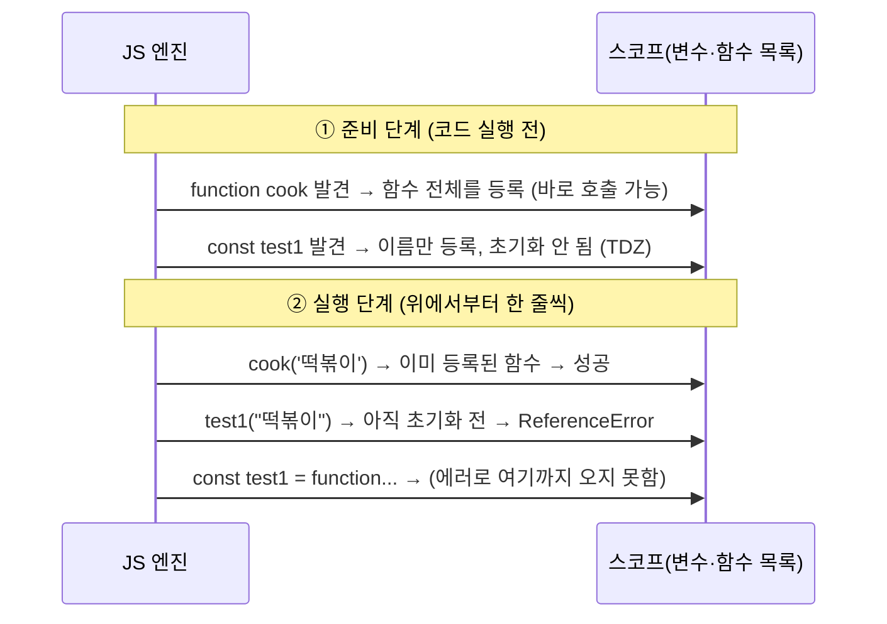
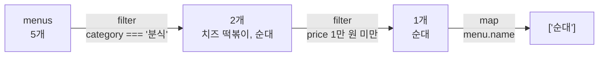

## 들어가며 (Situation)

[앞 글]({{ site.baseurl }})에서 JavaScript의 동작 원리, 동적 타입, 객체를 Java와 비교했습니다. 이 글은 같은 수업(`11_JavaScript/01_Core`)의 나머지인 **함수, 화살표 함수, 배열, 고차 함수**를 Java의 메서드, 람다, 배열, Stream과 나란히 놓고 정리합니다.

수업 주석은 이렇게 시작합니다.

> JavaScript에서의 function은 굉장히 중요한 요소이다. Java는 Class 기반의 객체지향 언어라고 한다면, JS는 function 기반의 객체지향 언어라고 할 수 있다.

> 실제 서비스에서 겪은 문제가 아니라, 수업 실습을 정리한 글입니다. JavaScript 코드의 실행 결과와 에러 메시지는 Node.js(v24)로 다시 실행해 확인했고, 설명은 MDN·Oracle 공식 문서를 기준으로 했습니다. 비교를 위해 직접 작성한 Java 코드는 "예시 코드"로 표시했습니다.

## 문제 상황 (Task)

Java에서 "함수"는 항상 클래스 안의 **메서드**였습니다. 그런데 JavaScript 실습 코드에는 이런 줄들이 있었습니다.

```javascript
const welcome2 = function (name) { ... };      // 함수를 변수에 담는다?
console.log(cook('떡볶이'));                    // 아직 선언하지 않은 함수를 호출?
function cook(menuName) { ... }
menus.filter(menu => menu.price < 10000);       // 함수를 인자로 넘긴다?
```

- 함수를 변수에 담고 인자로 넘긴다는 것은 무슨 뜻일까요?
- 선언보다 위에서 호출했는데 왜 동작할까요? 그리고 왜 어떤 함수는 같은 방식으로 호출하면 에러가 날까요?
- `=>`는 Java 람다의 `->`와 무엇이 같고 무엇이 다를까요?

## 해결 과정 (Action)

### 1. 함수는 값이다: 선언문과 표현식

**함수 선언문**

```javascript
function welcome(name) {
    return `${name} 님 , 반갑습니다~~!`
}

console.log(welcome("홍길동"));   // 홍길동 님 , 반갑습니다~~!
```

```java
// 예시 코드 — Java 에서는 반드시 클래스 안에
public class Greeter {
    public static String welcome(String name) {
        return name + " 님 , 반갑습니다~~!";
    }
}
```

JavaScript 함수는 클래스에 속하지 않아도 됩니다. 매개변수와 반환 타입도 적지 않습니다(동적 타입).

**함수 표현식: 함수를 변수에 담는다**

```javascript
const welcome1 = function welcome1(name) {
    return `${name} 님 , 반갑습니다~~!`
}

const welcome2 = function (name) {          // 이름 없는(익명) 함수
    return `${name} 님 , 반갑습니다~~!`
}

const welcome3 = function hello(name) {     // 변수 이름과 함수 이름이 다르다
    return `${name} 님 , 반갑습니다~~!`
}

console.log(welcome1("홍길동"));
console.log(welcome2("홍길동"));
// console.log(hello("홍길동"));   // ReferenceError: hello is not defined
```

`function (...) { }` 자체가 **값**이고, 그 값을 변수에 넣는 문법입니다. 그래서 `typeof`로 확인하면 `"function"`이라는 타입이 나옵니다. 이렇게 함수를 숫자나 문자열처럼 변수에 담고, 인자로 넘기고, 반환할 수 있는 성질을 **일급 함수(first-class function)**라고 합니다.

`welcome3`처럼 표현식에 이름(`hello`)을 붙이면, 그 이름은 **함수 본문 안에서만** 쓸 수 있습니다(재귀 호출 등). 바깥에서 `hello()`를 부르면 `ReferenceError`가 나서, 수업 코드에서도 그 줄은 주석으로 막혀 있었습니다. 바깥에서는 변수 이름 `welcome3`으로 호출합니다.

**Java에서 "함수를 변수에 담으려면"**

Java의 메서드는 값이 아니어서 변수에 직접 넣을 수 없습니다. Java 8부터는 **함수형 인터페이스** 타입의 변수에 람다나 메서드 참조를 담는 방식으로 비슷한 일을 합니다.

```java
// 예시 코드
Function<String, String> welcome2 = name -> name + " 님 , 반갑습니다~~!";
System.out.println(welcome2.apply("홍길동"));

Function<String, String> welcome = Greeter::welcome;   // 메서드 참조
```

| 비교 | JavaScript | Java |
|------|-----------|------|
| 함수가 있는 곳 | 어디든 (전역, 객체 안, 함수 안) | 클래스 안 (메서드) |
| 함수를 변수에 담기 | 바로 가능 (함수 자체가 값) | 함수형 인터페이스 타입 변수에 람다·메서드 참조 |
| 호출 | `welcome2("홍길동")` | `welcome2.apply("홍길동")` (인터페이스의 메서드 호출) |
| 타입 | `typeof` → `"function"` | `Function<String, String>` 같은 인터페이스 타입 |

수업 주석의 "JS는 function 기반의 객체지향 언어"라는 말은 이 차이를 가리킵니다. 정확한 용어로는 JavaScript는 **프로토타입 기반** 객체지향 언어이고, 함수가 일급 객체라서 다른 값처럼 자유롭게 다룰 수 있다는 점이 Java와 가장 크게 다릅니다.

### 2. 호이스팅: 선언보다 먼저 호출할 수 있는 이유

```javascript
console.log(cook('떡볶이'));          // 떡볶이 조리 시~작~!  ← 선언보다 위인데 동작

function cook(menuName) {
    return `${menuName} 조리 시~작~!`
}

console.log(test1("떡볶이"));         // ReferenceError: Cannot access 'test1' before initialization

const test1 = function (menuName) {
    return `${menuName} 조리 시~작~!`
}
```

같은 모양의 호출인데 함수 선언문은 동작하고 함수 표현식은 에러가 났습니다.

**JS 엔진은 코드를 두 단계로 처리한다**

[앞 글]({{ site.baseurl }})에서 JS 엔진이 실행 시점에 코드를 해석한다고 했습니다. 엔진은 코드를 한 줄씩 실행하기 **전에**, 먼저 그 범위(스코프)에 어떤 선언이 있는지 훑어 준비합니다. 이 준비 과정 때문에 선언이 코드 맨 위로 끌어올려진 것처럼 보이는 현상을 **호이스팅(hoisting)**이라고 합니다.



| 선언 방식 | 준비 단계에서 | 선언 전에 호출하면 |
|----------|--------------|------------------|
| `function cook() {}` (선언문) | 함수 **전체**가 등록됨 | 정상 동작 |
| `const test1 = function() {}` | 이름만 등록, 초기화 전 상태(TDZ) | `ReferenceError: Cannot access 'test1' before initialization` |
| `let test1 = function() {}` | `const`와 같음 | `ReferenceError` |
| `var test1 = function() {}` | 이름이 등록되고 `undefined`로 초기화 | `TypeError: test1 is not a function` |

`const`·`let`으로 선언한 변수는 선언 줄이 실행되기 전까지 **TDZ(Temporal Dead Zone, 일시적 사각지대)**에 있어 접근하면 에러가 납니다. `var`는 `undefined`로 미리 초기화되므로 접근은 되지만, `undefined`를 함수처럼 호출하니 `TypeError`가 납니다. `var`의 경우 에러 위치가 실제 원인(선언 순서)과 멀어져 찾기 어렵기 때문에, TDZ로 바로 알려 주는 `const`·`let`이 더 안전합니다.

> 수업 코드의 마지막 `test1("떡볶이")` 호출은 이 에러를 확인하기 위한 줄입니다. 에러가 나면 그 아래 코드는 실행되지 않습니다.

**Java는 어떨까?**

```java
// 예시 코드
public class Kitchen {
    public static void main(String[] args) {
        System.out.println(cook("떡볶이"));   // 정상 — 메서드는 선언 순서와 무관

        // System.out.println(menu);          // 컴파일 에러 — 지역 변수는 선언 후에만
        String menu = "떡볶이";
    }

    static String cook(String menuName) {     // main 보다 아래에 있어도 된다
        return menuName + " 조리 시~작~!";
    }
}
```

결과만 보면 비슷합니다. Java도 메서드는 클래스 안 어디에 있든 호출할 수 있고, 지역 변수는 선언 전에 쓸 수 없습니다. 하지만 **이유가 다릅니다.**

| 관점 | Java | JavaScript |
|------|------|-----------|
| 메서드/함수 선언 순서 | 무관 — `javac`가 **컴파일할 때** 클래스 전체를 보고 메서드를 안다 | 선언문은 무관 — **실행 직전 준비 단계**에서 등록된다 |
| 선언 전 지역 변수 사용 | **컴파일 에러** (실행 전 발견) | `const`/`let`은 **런타임** `ReferenceError` |
| 함수를 담은 변수 | (해당 없음) | 변수 규칙을 따름 → 선언 전 호출 불가 |

Java는 컴파일러가 실행 전에 막아 주고, JavaScript는 실행 중에 에러로 알려 줍니다. [앞 글]({{ site.baseurl }})에서 본 "검사 시점의 차이"가 여기서도 그대로 나타납니다.

### 3. 화살표 함수와 Java 람다

```javascript
let message;

message = function() {
    return '주문 접수 OK!👌'
}

message = () => {                         // function 키워드 대신 =>
    return '주문 접수 OK!👌'
}

message = () => '주문 접수 OK!👌'          // 본문이 식 하나면 { } 와 return 생략

message = (menuName, menuPrice) => `${menuName} 의 가격 ${menuPrice}`

message = menuName => `${menuName} !!`     // 매개변수가 하나면 ( ) 도 생략

console.log(message("신전떡볶이"));         // 신전떡볶이 !!
```

화살표 함수는 `function` 키워드, 중괄호, `return`을 생략할 수 있는 짧은 함수 표현식입니다. 본문에 문장이 여러 개면 중괄호와 `return`을 생략할 수 없습니다.

Java 람다와 나란히 놓으면 모양이 거의 같습니다.

| 형태 | JavaScript 화살표 함수 | Java 람다 (예시 코드) |
|------|----------------------|---------------------|
| 매개변수 없음 | `() => '주문 접수 OK!'` | `() -> "주문 접수 OK!"` |
| 매개변수 하나 | `menuName => menuName + '!!'` | `menuName -> menuName + "!!"` |
| 매개변수 여러 개 | `(name, price) => ...` | `(name, price) -> ...` |
| 본문이 여러 줄 | `(x) => { ...; return y; }` | `(x) -> { ...; return y; }` |
| 화살표 | `=>` | `->` |

수업 주석에서는 "화살표 함수를 본따서 Java에서는 람다 표현식이 등장했다"고 소개했습니다. 발표 시점을 확인해 보면 Java 8의 람다(2014년 3월)가 ECMAScript 2015의 화살표 함수(2015년 6월)보다 먼저 정식 출시되었습니다. 한쪽이 다른 쪽을 따라 했다기보다, 두 언어 모두 함수형 프로그래밍의 람다 표기를 각자 도입해 모양이 닮았다고 보는 편이 정확합니다.

**모양은 같아도 다른 점**

| 비교 | JavaScript 화살표 함수 | Java 람다 |
|------|----------------------|----------|
| 정체 | 그 자체로 함수(값) | 함수형 인터페이스의 구현 객체 |
| 변수에 담기 | `const f = x => x * 2;` | `Function<Integer, Integer> f = x -> x * 2;` (타입 필요) |
| 타입 표기 | 없음 | 대상 인터페이스로 추론 |
| `this` | **자기 `this`가 없음** (바깥의 `this`를 그대로 씀) | 람다를 감싼 클래스의 인스턴스 |

마지막 줄은 JavaScript에서 실수하기 쉬운 부분입니다. [앞 글]({{ site.baseurl }})의 `store.getInfo`처럼 `this`로 자기 객체에 접근하는 메서드를 화살표 함수로 바꾸면 동작하지 않습니다.

```javascript
// 예시 코드 — 하면 안 되는 패턴
const store = {
    name : '원티드 식당',
    getInfo : () => `${this.name} 입니다`     // this 가 store 가 아니다
};
// store.getInfo() 는 '원티드 식당 입니다' 를 출력하지 않는다
```

화살표 함수는 자기만의 `this`를 만들지 않아서, `this`가 `store`가 아니라 객체 리터럴 **바깥**의 `this`가 됩니다. 그래서 객체의 메서드에는 `function`(또는 메서드 축약 문법)을 쓰고, 화살표 함수는 아래의 콜백처럼 짧은 함수를 넘길 때 주로 씁니다.

### 4. 배열: 아무 타입이나, 길이도 자유롭게

```javascript
const menus = ['제육', '떡볶이', '순대', 1, {name : 'hi'}, function() {}];

for (let i = 0; i < menus.length; i++) {
    console.log(menus[i]);
}
```

반복문 모양은 Java와 같습니다(`int i` 대신 `let i`). 다른 점은 배열 안의 값입니다. 문자열, 숫자, 객체, 함수가 한 배열에 섞여 있습니다.

```java
// 예시 코드
String[] menus = {"제육", "떡볶이", "순대"};
// menus[3] = 1;                       // 컴파일 에러 — String 배열에는 String 만
// 길이도 3으로 고정, 늘리려면 새 배열이나 ArrayList 필요
```

| 비교 | Java 배열 | Java `ArrayList` | JavaScript 배열 |
|------|----------|------------------|----------------|
| 요소 타입 | 선언한 타입 하나 | 제네릭 타입 하나 | 제한 없음 |
| 길이 | 생성 시 고정 | 가변 (`add`) | 가변 (`push`) |
| 길이 확인 | `length` | `size()` | `length` |
| `typeof` | — | — | `"object"` (배열 판별은 `Array.isArray()`) |

JavaScript 배열은 [Java 배열]({{ site.baseurl }})보다 [`ArrayList`]({{ site.baseurl }})에 가깝고, 거기에 타입 제한까지 없는 형태입니다. 유연하지만, 한 배열에 여러 타입을 섞으면 꺼내 쓰는 쪽에서 매번 타입을 확인해야 하므로 실무에서는 **같은 모양의 값끼리** 담는 것이 일반적입니다. 아래 고차 함수 실습의 `menus`처럼요.

### 5. 고차 함수: 배열의 forEach, map, filter

> 고차 함수란 함수를 인자로 전달받거나, 함수를 반환하는 함수이다. 배열의 고차 함수는 콜백 함수를 인자로 받아 배열의 요소를 순회하며 처리한다.

함수가 값이기 때문에 가능한 문법입니다. 실습 데이터는 메뉴 객체 5개의 배열입니다.

```javascript
const menus = [
    { name: '치즈 떡볶이', category : '분식', price : 14000 },
    { name: '순대',       category : '분식', price : 3000 },
    { name: '파스타',     category : '양식', price : 19000 },
    { name: '제육볶음',   category : '한식', price : 10000 },
    { name: '김치찜',     category : '한식', price : 8000 }
];
```

| 메서드 | 콜백이 하는 일 | 반환값 | 실습 |
|--------|--------------|--------|------|
| `forEach` | 요소마다 실행 | `undefined` (반환값 없음) | 메뉴 하나씩 출력 |
| `map` | 요소를 **변환**한 값 반환 | 변환된 값의 **새 배열** | 메뉴 이름만 뽑기 |
| `filter` | 남길지 `true`/`false` 반환 | `true`인 요소만 모은 **새 배열** | 분식만, 1만 원 미만만 |

```javascript
menus.forEach(menu => console.log(menu));

const names = menus.map(menu => menu.name);
// ['치즈 떡볶이', '순대', '파스타', '제육볶음', '김치찜']

const snacks = menus.filter(menu => menu.category === '분식');
const cheap  = menus.filter(menu => menu.price < 10000);     // 순대, 김치찜
```

화살표 함수 실습의 할인 계산도 같은 `map`입니다. 일반 함수와 화살표 함수로 같은 결과를 냅니다.

```javascript
const menuPriceList = [4000, 5000, 140000];
console.log(menuPriceList.map(function(price) { return price * 0.9 }));  // [3600, 4500, 126000]
console.log(menuPriceList.map(price => price * 0.9));                     // [3600, 4500, 126000]
```

**체이닝: 분식 중 1만 원 미만인 메뉴의 이름**

```javascript
const result = menus
    .filter(menu => menu.category === '분식')   // 분식만 → [치즈 떡볶이, 순대]
    .filter(menu => menu.price < 10000)          // 1만 원 미만 → [순대]
    .map(menu => menu.name);                     // 이름만 → ['순대']

console.log(result);   // [ '순대' ]
```



`filter`와 `map`은 **새 배열**을 반환하므로 결과에 바로 다음 메서드를 이어 붙일 수 있습니다. 원본 `menus`는 바뀌지 않습니다.

**Java Stream과 비교**

같은 처리를 Java로 쓰면 Stream API가 됩니다. [Spring Data JPA 글]({{ site.baseurl }})에서 엔티티 목록을 DTO 목록으로 바꿀 때 쓴 그 문법입니다.

```java
// 예시 코드
record Menu(String name, String category, int price) {}

List<Menu> menus = List.of(
        new Menu("치즈 떡볶이", "분식", 14000),
        new Menu("순대", "분식", 3000),
        new Menu("파스타", "양식", 19000),
        new Menu("제육볶음", "한식", 10000),
        new Menu("김치찜", "한식", 8000)
);

List<String> result = menus.stream()
        .filter(menu -> menu.category().equals("분식"))
        .filter(menu -> menu.price() < 10000)
        .map(Menu::name)
        .toList();                                  // [순대]
```

메서드 이름(`filter`, `map`, `forEach`)과 체이닝 모양이 거의 같습니다. 그래서 둘 중 하나를 알면 다른 하나는 금방 읽힙니다. 하지만 동작 방식에는 차이가 있습니다.

| 비교 | JavaScript 배열 메서드 | Java Stream |
|------|----------------------|-------------|
| 어디에 있나 | 배열 자체의 메서드 | `stream()`으로 Stream을 만든 뒤 |
| 실행 시점 | 호출할 때마다 **바로** 실행, 단계마다 새 배열 생성 | **최종 연산**(`toList()`, `forEach()` 등)을 호출해야 실행 (지연 실행) |
| 결과 | 배열 (바로 사용) | 최종 연산으로 `List` 등으로 모아야 함 |
| 재사용 | 결과 배열은 몇 번이든 사용 | Stream은 한 번 쓰면 재사용 불가 |
| 비교 연산 | `===` | 문자열은 `equals()` |

위 JavaScript 체이닝은 `filter` 결과 배열 → 다시 `filter` 결과 배열 → `map` 결과 배열로 중간 배열이 매번 만들어집니다. Java Stream은 최종 연산 전까지 아무것도 실행하지 않다가, 최종 연산 때 요소 하나씩 파이프라인 전체를 통과시킵니다. 작은 배열에서는 차이가 거의 없지만, "JS 배열 메서드 = 즉시 실행, Java Stream = 지연 실행"이라는 차이는 알아 둘 만합니다.

## 결과 (Result)

정량 지표는 없고, 아래를 정리했습니다.

- JavaScript 함수는 **값**입니다. 변수에 담고 인자로 넘길 수 있으며(일급 함수), Java는 같은 일을 함수형 인터페이스 + 람다로 합니다.
- 함수 선언문은 실행 전 준비 단계에서 함수 전체가 등록되어 선언 전에 호출할 수 있습니다(호이스팅). `const`·`let`에 담은 함수 표현식은 TDZ 때문에 `ReferenceError`, `var`는 `TypeError`가 납니다. Java는 같은 상황을 컴파일 단계에서 처리합니다.
- 화살표 함수와 Java 람다는 모양이 거의 같지만, 화살표 함수는 그 자체가 함수이고 **자기 `this`가 없어서** 객체 메서드에는 맞지 않습니다.
- JavaScript 배열은 타입·길이 제한이 없어 Java 배열보다 `ArrayList`에 가깝습니다.
- `forEach`·`map`·`filter`는 Java Stream과 메서드 이름·체이닝이 같지만, JS는 즉시 실행·새 배열 반환이고 Java Stream은 최종 연산 때 실행되는 지연 실행입니다.

## 더 학습하면 좋은 개념

- **`reduce`, `find`, `some`, `every`, `sort`** — 다른 배열 고차 함수들입니다. 합계·검색·조건 검사를 반복문 없이 처리하며, Java Stream의 `reduce`, `findFirst`, `anyMatch`, `allMatch`, `sorted`와 짝지어 익히면 빠릅니다.
- **실행 컨텍스트와 스코프 체인** — 호이스팅의 "준비 단계"를 정확히 설명하는 개념이며, 클로저를 이해하는 바탕입니다.
- **클로저(Closure)** — 함수가 자신이 만들어진 환경의 변수를 기억하는 성질로, 함수가 값인 언어에서 가장 중요한 개념 중 하나입니다. Java 람다의 "사실상 final 변수만 캡처" 규칙과 비교해 볼 수 있습니다.
- **`this` 바인딩 규칙** — 일반 호출, 메서드 호출, `new`, `call`/`apply`/`bind`, 화살표 함수에서 `this`가 각각 어떻게 정해지는지입니다.
- **Java Stream의 지연 실행과 중간·최종 연산** — 위 비교표의 차이를 Java 쪽에서 더 깊이 이해하는 주제입니다.

## 참고 자료

- [MDN - Functions (Guide)](https://developer.mozilla.org/en-US/docs/Web/JavaScript/Guide/Functions)
- [MDN - function expression](https://developer.mozilla.org/en-US/docs/Web/JavaScript/Reference/Operators/function)
- [MDN - Hoisting (Glossary)](https://developer.mozilla.org/en-US/docs/Glossary/Hoisting)
- [MDN - let: Temporal dead zone (TDZ)](https://developer.mozilla.org/en-US/docs/Web/JavaScript/Reference/Statements/let#temporal_dead_zone_tdz)
- [MDN - Arrow function expressions](https://developer.mozilla.org/en-US/docs/Web/JavaScript/Reference/Functions/Arrow_functions)
- [MDN - Array.prototype.map()](https://developer.mozilla.org/en-US/docs/Web/JavaScript/Reference/Global_Objects/Array/map)
- [MDN - Array.prototype.filter()](https://developer.mozilla.org/en-US/docs/Web/JavaScript/Reference/Global_Objects/Array/filter)
- [MDN - Array.prototype.forEach()](https://developer.mozilla.org/en-US/docs/Web/JavaScript/Reference/Global_Objects/Array/forEach)
- [Oracle - Lambda Expressions (The Java Tutorials)](https://docs.oracle.com/javase/tutorial/java/javaOO/lambdaexpressions.html)
- [Oracle - java.util.stream (Java SE 21)](https://docs.oracle.com/en/java/javase/21/docs/api/java.base/java/util/stream/package-summary.html)
- [ECMAScript 2015 Language Specification](https://262.ecma-international.org/6.0/)
