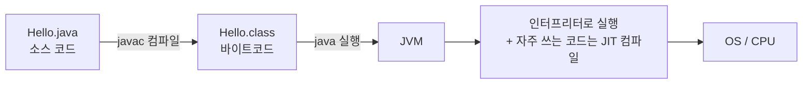
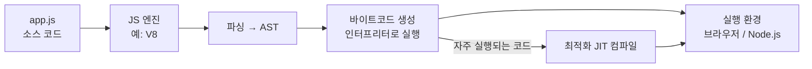
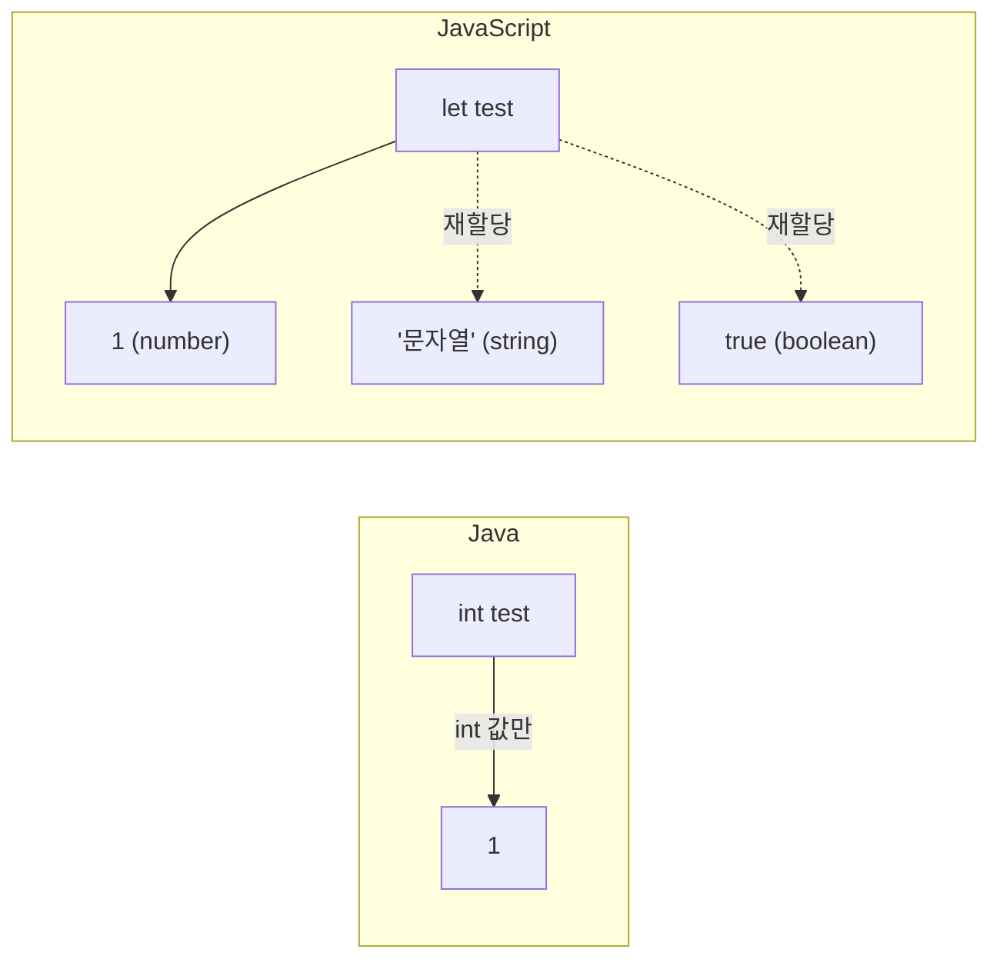
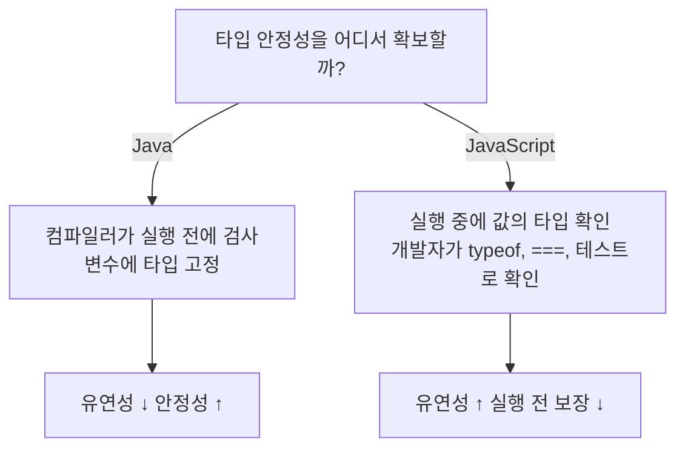

## 들어가며 (Situation)

Java, JDBC, Servlet, Spring, JPA까지 백엔드를 한 바퀴 돌고 JavaScript 수업(`11_JavaScript/01_Core`)이 시작됐습니다. 첫 수업은 변수, 객체, 함수, 화살표 함수, 배열, 고차 함수였습니다. 수업 코드에는 이런 미션이 적혀 있었습니다.

> 오늘의 미션 - Java 언어의 동작 원리와 JavaScript 언어의 동작 원리를 비교하고 서로에게 이해시킬 수 있는 자료를 구성하기

그래서 이 글은 JavaScript 문법을 **Java 코드와 나란히 놓고** 정리합니다. 두 편으로 나눴고, 이 글은 동작 원리·변수·타입·객체를 다룹니다. 함수·화살표 함수·배열·고차 함수는 [다음 글]({{ site.baseurl }})에서 이어집니다.

> 실제 서비스에서 겪은 문제가 아니라, 수업 실습을 정리한 글입니다. JavaScript 설명은 MDN과 V8 공식 문서, Java 설명은 Oracle 공식 문서를 기준으로 했습니다. 수업 코드 외에 비교를 위해 직접 작성한 코드는 "예시 코드"로 표시했습니다.

## 문제 상황 (Task)

Java에 익숙한 상태에서 JavaScript 코드를 처음 보면 이런 점이 낯섭니다.

```javascript
let test = 1;
test = "문자열";      // 숫자를 넣었던 변수에 문자열을? 에러가 안 난다
```

```java
int test = 1;
test = "문자열";      // Java : 컴파일 에러 (incompatible types)
```

- 왜 JavaScript는 타입이 바뀌어도 에러가 나지 않을까요?
- Java는 `javac`로 컴파일한 뒤 실행하는데, JavaScript는 `.js` 파일을 바로 실행합니다. 무엇이 다를까요?
- 클래스도 없이 `{ }`만으로 객체가 만들어지는 건 어떤 구조일까요?

## 해결 과정 (Action)

### 1. 동작 원리: 컴파일 후 실행 vs 실행하면서 해석

**Java**



Java는 **실행 전에** `javac`가 소스 전체를 바이트코드(`.class`)로 컴파일합니다. 이 단계에서 타입 검사가 끝납니다. `int`에 문자열을 넣는 코드는 실행해 볼 기회조차 없이 컴파일 단계에서 거절됩니다. 컴파일된 바이트코드는 JVM 위에서 실행되므로, OS가 달라도 JVM만 있으면 같은 `.class` 파일이 동작합니다. [형변환 글]({{ site.baseurl }})에서 겪은 컴파일 에러들이 이 단계에서 나온 것입니다.

**JavaScript**



JavaScript는 개발자가 따로 컴파일 명령을 실행하지 않습니다. 소스 코드를 **JS 엔진**에 넘기면 엔진이 실행 시점에 파싱하고 실행합니다. 크롬과 Node.js가 쓰는 V8 엔진은 소스를 바이트코드로 바꿔 인터프리터(Ignition)로 실행하다가, 자주 실행되는 코드는 최적화 컴파일러(TurboFan)로 기계어를 만듭니다. 내부적으로 컴파일을 하긴 하지만 **실행 직전·실행 중에** 일어나며, Java의 `javac` 같은 별도 타입 검사 단계는 없습니다.

| 항목 | Java | JavaScript |
|------|------|-----------|
| 실행 전 단계 | `javac`로 바이트코드 컴파일 (개발자가 실행) | 없음 (엔진이 실행 시점에 처리) |
| 실행 주체 | JVM | JS 엔진 (V8, SpiderMonkey 등) |
| 실행 환경 | JVM이 설치된 곳 | 브라우저, Node.js |
| 타입 검사 시점 | **컴파일 시점** | **실행 시점** |
| 타입 오류를 발견하는 때 | 실행 전 (컴파일 에러) | 그 코드가 실제로 실행될 때 (런타임 에러) |
| 성능 최적화 | JVM의 JIT 컴파일 | 엔진의 JIT 컴파일 |

두 언어 모두 "인터프리터 + JIT"를 쓴다는 점은 비슷합니다. 결정적인 차이는 **타입을 언제 확인하느냐**이고, 이 차이가 아래의 변수 문법으로 이어집니다.

### 2. 변수 선언: 자료형 대신 변수 표현식

수업 주석이 두 언어의 선언 형태를 이렇게 대비했습니다.

```text
Java       : 자료형     변수명 = 리터럴;
JavaScript : 변수표현식 변수명 = 리터럴;
```

```javascript
const shop = "원티드 식당";
// shop = 1;           // TypeError: Assignment to constant variable.

let test = 1;
test = "문자열";        // 가능
console.log(test);     // 문자열
```

```java
// 예시 코드 — 같은 의도를 Java 로
final String shop = "원티드 식당";
// shop = "다른 식당";   // 컴파일 에러: cannot assign a value to final variable

String str = "문자열";
// str = 1;             // 컴파일 에러: incompatible types
```

JavaScript의 변수 선언 키워드는 세 가지입니다.

| 키워드 | 재할당 | 스코프 | 선언 전 접근 | Java로 치면 |
|--------|--------|--------|-------------|------------|
| `const` | 불가 | 블록 `{ }` | 에러 (TDZ) | `final` 변수 |
| `let` | 가능 | 블록 `{ }` | 에러 (TDZ) | 일반 지역 변수 (단, 타입 없음) |
| `var` | 가능 | **함수** | `undefined` | 대응 없음 (옛 방식) |

`var`는 블록이 아니라 함수 단위로 스코프가 잡히는 등 Java 개발자의 직관과 다르게 동작하는 부분이 많아, 지금은 `const`를 기본으로 쓰고 재할당이 필요할 때만 `let`을 씁니다. TDZ(Temporal Dead Zone)는 [다음 글]({{ site.baseurl }})의 호이스팅에서 자세히 다룹니다.

**`const`와 `final`의 공통점: 막는 것은 "재할당"이다**

```javascript
const order = { menuName : '치킨' };
order.sauce = '뿌링클 시즈닝';    // 가능!
// order = {};                   // TypeError
```

```java
// 예시 코드
final List<String> orders = new ArrayList<>();
orders.add("치킨");              // 가능!
// orders = new ArrayList<>();    // 컴파일 에러
```

`const`는 변수에 **다른 값을 다시 넣는 것**을 막을 뿐, 변수가 가리키는 객체의 내용 변경은 막지 않습니다. [final 글]({{ site.baseurl }})에서 본 Java의 `final` 참조 변수와 정확히 같은 개념입니다. 아래 객체 실습에서 `const order`에 프로퍼티를 추가할 수 있었던 이유가 이것입니다.

### 3. 동적 타입: 타입은 값에 붙는다

> JavaScript는 동적 타입을 지원하는 언어이다. 변수의 선언 시점에 타입이 결정되는 것이 아닌, 변수의 할당 시점에 타입이 결정된다.

정확히 말하면, JavaScript에서 타입은 **변수가 아니라 값에** 붙어 있습니다. 변수는 어떤 타입의 값이든 담을 수 있는 이름표일 뿐입니다. Java는 반대로 **변수에 타입이 고정**되고, 그 변수에는 그 타입의 값만 들어갈 수 있습니다.



`typeof` 연산자로 값의 타입을 확인한 실습 결과는 다음과 같습니다.

```javascript
let test1;
console.log(typeof test1);   // undefined

test1 = 1;                   // number
test1 = "java";              // string
test1 = true;                // boolean
test1 = null;                // object   ← !
test1 = {};                  // object
test1 = [];                  // object   ← 배열도 object
test1 = function() {};       // function
```

| 값 | `typeof` 결과 | Java에서 비슷한 것 |
|----|--------------|------------------|
| 선언만 한 변수 | `"undefined"` | (지역 변수는 초기화 전 사용 시 컴파일 에러) |
| `1`, `3.14` | `"number"` | `int`, `double` 등 (JS는 숫자 타입이 하나) |
| `"java"` | `"string"` | `String` |
| `true` | `"boolean"` | `boolean` |
| `null` | `"object"` | `null` |
| `{}` | `"object"` | 객체 |
| `[]` | `"object"` | 배열 / `ArrayList` |
| `function() {}` | `"function"` | (메서드는 값이 아님) |

두 군데를 짚어 둡니다.

- **숫자 타입이 하나뿐입니다.** Java는 `int`, `long`, `double`을 구분하지만 JavaScript의 `number`는 정수와 실수를 모두 담는 64비트 부동소수점 하나입니다. (아주 큰 정수용 `bigint`는 따로 있습니다.)
- **`typeof null`이 `"object"`입니다.** MDN은 이를 JavaScript 첫 구현부터 이어진 동작으로 설명하며, 표준에서 고치자는 제안이 있었지만 받아들여지지 않았다고 합니다. `null` 여부는 `value === null`로 확인하고, 배열 여부는 `Array.isArray(value)`로 확인합니다.

**동적 타입의 장단점**

수업 주석의 정리를 Java와 비교하면 다음과 같습니다.

| 관점 | JavaScript (동적 타입) | Java (정적 타입) |
|------|----------------------|-----------------|
| 선언 | 타입을 신경 쓰지 않고 바로 선언 | 타입을 반드시 명시 |
| 유연성 | 한 변수에 여러 타입을 담을 수 있음 | 정해진 타입만 |
| 오류 발견 | 해당 코드가 **실행될 때** | **컴파일할 때** |
| 코드 신뢰도 | 값을 확인하기 전에는 타입을 확신할 수 없음 | 타입이 보장됨 |

수업에서 든 예가 단점을 잘 보여 줍니다. 문자열이던 변수에 숫자가 들어간 뒤 문자열 전용 기능을 쓰면, 그 줄이 **실행되는 순간에야** 문제가 드러납니다.

```javascript
// 예시 코드
let test = "문자열";
console.log(test.length);        // 3

test = 10;
console.log(test.length);        // undefined (에러도 안 나고 엉뚱한 값)
console.log(test.toUpperCase()); // TypeError: test.toUpperCase is not a function
```

Java였다면 `test = 10;` 줄에서 컴파일이 실패했을 것입니다. 이런 단점 때문에 JavaScript에 정적 타입을 더한 TypeScript가 많이 쓰입니다.

### 4. 비교 연산자: `==`와 `===`

고차 함수 실습 중에 비교 연산자도 다뤘습니다.

```javascript
console.log(1 == '1');    // true   — 동등 비교 (타입을 바꿔서 비교)
console.log(1 === '1');   // false  — 일치 비교 (타입과 값이 모두 같아야)
```

`==`는 두 값의 타입이 다르면 **암묵적으로 타입을 변환**한 뒤 비교합니다. 숫자 `1`과 문자열 `'1'`이 같다고 나오는 이유입니다. `===`는 타입이 다르면 바로 `false`입니다. 동적 타입 언어에서 `==`의 자동 변환은 예상하지 못한 결과를 만들기 쉬우므로 **`===`를 기본으로 씁니다.**

Java의 `==`와는 의미가 또 다릅니다.

| 비교 | Java | JavaScript |
|------|------|-----------|
| 숫자와 문자열 | `1 == "1"` → 컴파일 에러 | `1 == '1'` → `true`, `1 === '1'` → `false` |
| 기본형 값 | `==` 값 비교 | `===` 값 비교 |
| 객체 | `==` 참조 비교, 내용은 `equals()` | `===` 참조 비교 (내용 비교 메서드는 없음) |
| 문자열 내용 | `equals()` 사용 (`==`는 참조 비교) | `===`로 내용 비교 (문자열은 원시 값) |

Java에서 문자열은 `equals()`로 비교해야 했지만, JavaScript의 문자열은 원시 값이라 `===`로 내용을 비교합니다.

### 5. 객체: 클래스 없이 바로 만드는 Key-Value 묶음

```javascript
const store = {
    name : '원티드 식당',
    category : '분식',
    getInfo : function() {
        return `${this.name} 은 ${this.category} 전문점 입니다!`
    }
};

console.log(store.getInfo());   // 원티드 식당 은 분식 전문점 입니다!
```

JavaScript에서 `{ }`는 **객체 리터럴**입니다. 클래스를 먼저 정의하지 않고 그 자리에서 객체를 만듭니다. 객체는 **프로퍼티(key-value)의 집합**이고, key는 문자열, value에는 숫자·문자열·함수까지 무엇이든 들어갑니다.

같은 것을 Java로 만들려면 클래스부터 정의해야 합니다.

```java
// 예시 코드
public class Store {
    private String name;
    private String category;

    public Store(String name, String category) {
        this.name = name;
        this.category = category;
    }

    public String getInfo() {
        return name + " 은 " + category + " 전문점 입니다!";
    }
}

Store store = new Store("원티드 식당", "분식");
System.out.println(store.getInfo());
```

| 개념 | Java | JavaScript |
|------|------|-----------|
| 객체를 만드는 방법 | 클래스 정의 → `new` | 객체 리터럴 `{ }`로 바로 생성 |
| 데이터 | 필드 | 프로퍼티 (value가 데이터) |
| 동작 | 메서드 | 프로퍼티 (value가 함수) |
| 구조 변경 | 컴파일 후 고정 | **실행 중에 추가·수정·삭제 가능** |
| 접근 제어 | `private` 등 | 리터럴 프로퍼티는 모두 공개 |

**실행 중에 프로퍼티를 추가할 수 있다**

```javascript
const order = { menuName : '치킨' };

order.sauce = "뿌링클 시즈닝";     // 추가
console.log(order);               // { menuName: '치킨', sauce: '뿌링클 시즈닝' }

order.sauce = '맛초킹 시즈닝';     // 수정
console.log(order);               // { menuName: '치킨', sauce: '맛초킹 시즈닝' }
```

Java 객체는 클래스에 없는 필드를 실행 중에 추가할 수 없습니다. JavaScript 객체는 **Java의 객체보다 `Map<String, Object>`에 더 가깝게** 동작한다고 생각하면 이해하기 쉽습니다. [HashMap 글]({{ site.baseurl }})에서 `put()`으로 키를 추가하던 것을 `객체.키 = 값`으로 하는 셈입니다. 다만 `Map`과 달리 함수를 value로 넣어 메서드처럼 호출할 수 있고, `this`로 자기 프로퍼티에 접근합니다.

**`this`와 템플릿 리터럴**

`getInfo` 안의 `this.name`은 "이 함수를 호출한 객체의 `name`"입니다. `store.getInfo()`로 호출했으므로 `this`는 `store`입니다. Java의 `this`는 항상 그 메서드를 가진 인스턴스지만, JavaScript의 `this`는 **함수를 어떻게 호출했는지에 따라** 정해집니다. 이 차이는 다음 글의 화살표 함수에서 다시 등장합니다.

문자열을 만드는 백틱(`` ` ``) 문법은 **템플릿 리터럴**입니다.

```javascript
`${this.name} 은 ${this.category} 전문점 입니다!`
```

```java
// 예시 코드 — Java 에서 같은 문자열 만들기
name + " 은 " + category + " 전문점 입니다!"
String.format("%s 은 %s 전문점 입니다!", name, category)
"%s 은 %s 전문점 입니다!".formatted(name, category)   // Java 15+
```

`${ }` 안에 변수나 식을 바로 넣을 수 있어 `+` 연결보다 읽기 쉽습니다. [Thymeleaf 글]({{ site.baseurl }})의 `|...${값}...|` 리터럴 치환과 비슷한 모양입니다.

> 참고로 JavaScript에도 ES2015부터 `class` 문법이 있습니다. 하지만 내부적으로는 Java 같은 클래스 기반이 아니라 **프로토타입** 기반으로 동작합니다. 이번 수업은 객체 리터럴까지 다뤘습니다.

### 6. 정리: 같은 문제를 두 언어는 이렇게 푼다



## 결과 (Result)

정량 지표는 없고, 아래를 정리했습니다.

- Java는 실행 전에 `javac`가 컴파일하며 타입을 검사하고, JavaScript는 JS 엔진이 실행 시점에 해석·컴파일합니다. 두 언어 모두 JIT로 성능을 높이지만 **타입 검사 시점**이 다릅니다.
- JavaScript 변수는 `const`(재할당 불가, `final`과 같은 개념) → `let` 순으로 쓰고, `var`는 피합니다. `const`는 재할당만 막고 객체 내용 변경은 막지 않습니다.
- JavaScript에서 타입은 변수가 아니라 값에 붙습니다. `typeof null`은 `"object"`, 배열도 `"object"`라는 점에 주의합니다.
- 비교는 암묵적 타입 변환이 없는 `===`를 기본으로 씁니다.
- JavaScript 객체는 클래스 없이 `{ }`로 만드는 프로퍼티 묶음이고, 실행 중에 프로퍼티를 추가·수정할 수 있어 Java의 `Map`에 가깝게 동작합니다.

## 더 학습하면 좋은 개념

- **실행 컨텍스트(Execution Context)** — JS 엔진이 코드를 실행하기 전에 변수·함수를 준비하는 과정입니다. 다음 글의 호이스팅이 여기서 나옵니다.
- **프로토타입(Prototype)** — JavaScript 객체 상속의 실제 구조이며, `class` 문법이 내부에서 어떻게 동작하는지 이해하는 열쇠입니다.
- **원시 값과 참조 값** — JavaScript의 원시 값(`number`, `string` 등)은 불변이고 객체는 참조로 다뤄집니다. Java의 기본형·참조형과 비교해 볼 수 있습니다.
- **TypeScript** — JavaScript에 정적 타입을 더해, Java처럼 실행 전에 타입 오류를 잡는 언어입니다.
- **이벤트 루프(Event Loop)** — 싱글 스레드인 JavaScript가 비동기 작업을 처리하는 방식으로, 멀티 스레드인 Java와 가장 크게 다른 동작 원리입니다.

## 참고 자료

- [MDN - JavaScript 데이터 타입과 자료구조](https://developer.mozilla.org/ko/docs/Web/JavaScript/Guide/Data_structures)
- [MDN - typeof](https://developer.mozilla.org/en-US/docs/Web/JavaScript/Reference/Operators/typeof)
- [MDN - let](https://developer.mozilla.org/en-US/docs/Web/JavaScript/Reference/Statements/let)
- [MDN - const](https://developer.mozilla.org/en-US/docs/Web/JavaScript/Reference/Statements/const)
- [MDN - Equality comparisons and sameness](https://developer.mozilla.org/en-US/docs/Web/JavaScript/Guide/Equality_comparisons_and_sameness)
- [MDN - Working with objects](https://developer.mozilla.org/en-US/docs/Web/JavaScript/Guide/Working_with_objects)
- [MDN - Template literals](https://developer.mozilla.org/en-US/docs/Web/JavaScript/Reference/Template_literals)
- [V8 - Ignition](https://v8.dev/docs/ignition)
- [Oracle - The javac Command (Java SE 21)](https://docs.oracle.com/en/java/javase/21/docs/specs/man/javac.html)
- [Oracle - The Java Virtual Machine Specification (Java SE 21)](https://docs.oracle.com/javase/specs/jvms/se21/html/index.html)
