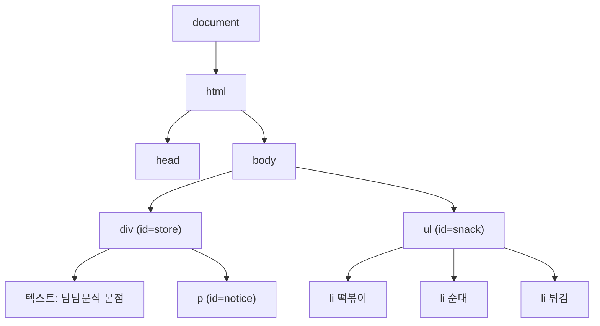
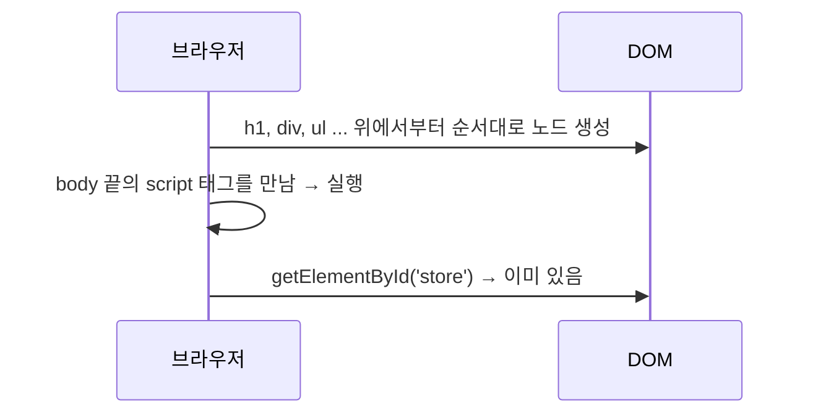

## 들어가며 (Situation)

[스프레드·구조 분해 글]({{ site.baseurl }})까지는 `.js` 파일을 실행해 콘솔로 결과를 보는 **언어 문법** 수업이었습니다. 이번 `02_Web` 실습부터는 HTML 파일 안의 `<script>`에서 JavaScript를 실행해 **화면을 직접 바꿉니다.** 첫 주제는 HTML 요소를 JavaScript로 가져오는 방법(요소 노드 취득)입니다.

> 실제 서비스에서 겪은 문제가 아니라, 수업 실습을 정리한 글입니다. 설명은 MDN과 HTML·DOM 표준 문서를 기준으로 했고, 수업 코드 외에 직접 작성한 코드는 "예시 코드"로 표시했습니다.

## 문제 상황 (Task)

실습 페이지에는 분식집 메뉴가 담긴 HTML이 있습니다.

```html
<div id="store" class="area">
    냠냠분식 본점
    <p id="notice">오늘의 공지 : 떡볶이 1+1</p>
</div>

<ul id="snack">
    <li>떡볶이</li>
    <li>순대</li>
    <li>튀김</li>
</ul>
```

- JavaScript에서 이 `<div>`나 `<li>`를 어떻게 가리킬까요?
- 여러 요소를 한꺼번에 가져오면 어떤 형태로 돌아오고, 배열처럼 `forEach`를 쓸 수 있을까요?
- 방법이 여러 가지인데 무엇을 쓰는 게 좋을까요?

## 해결 과정 (Action)

### 1. DOM: HTML을 객체 트리로 만든 것

브라우저는 HTML을 읽으면 태그 하나하나를 **객체(노드)**로 만들고, 부모-자식 관계에 따라 **트리**로 연결합니다. 이 구조를 **DOM(Document Object Model)**이라고 합니다. JavaScript는 이 객체들에 접근해 내용, 스타일, 속성을 바꿉니다.

> JS는 html + css로 구성되어 있는 Document에 접근할 수 있는 프로그래밍 언어이다. — 수업 주석



이 트리의 맨 위에 있는 `document` 객체가 출발점입니다. `document.getElementById(...)`처럼 `document`의 메서드로 원하는 노드를 찾습니다. 태그에 해당하는 노드를 **요소 노드**, 태그 사이의 글자는 **텍스트 노드**라고 합니다.

**서버 렌더링과 무엇이 다를까?**

지금까지 화면은 서버에서 만들었습니다. [Thymeleaf]({{ site.baseurl }})가 `th:text`를 처리해 완성된 HTML을 내려보내면, 브라우저는 받은 그대로 보여 줬습니다. DOM 조작은 **HTML이 브라우저에 도착한 뒤** 브라우저 안에서 화면을 바꿉니다.

| 구분 | 서버 렌더링 (Thymeleaf) | DOM 조작 (JavaScript) |
|------|----------------------|---------------------|
| 실행 위치 | 서버 (Java) | 브라우저 |
| 실행 시점 | 응답을 보내기 전 | 페이지를 받은 후 |
| 바꾸려면 | 새 요청 → 새 페이지 | 페이지 이동 없이 즉시 |
| 예 | 메뉴 목록을 HTML로 만들어 응답 | 클릭하면 글자색 변경, 입력 글자 수 표시 |

[미니 프로젝트 글]({{ site.baseurl }})에서 `fetch`로 받은 카테고리 목록을 `createElement`와 `appendChild`로 `<select>`에 넣었던 것이 바로 DOM 조작이었습니다.

### 2. `<script>`를 왜 `</body>` 바로 위에 둘까

실습 파일은 모두 `<script>`를 `<body>`의 **맨 끝**에 두었습니다. 브라우저는 HTML을 위에서부터 읽으며 DOM을 만들다가 `<script>`를 만나면 그 자리에서 실행합니다. 만약 `<head>`에 스크립트가 있으면, 아직 `<div id="store">`가 DOM에 만들어지기 전이라 `getElementById('store')`가 `null`을 반환합니다.



`<head>`에 두고 싶다면 `<script defer src="...">`처럼 `defer` 속성을 쓰면, HTML을 끝까지 읽은 뒤에 실행됩니다.

### 3. 요소를 가져오는 네 가지 방법

**① id로 하나: `getElementById`**

```javascript
const $store = document.getElementById('store');
console.log($store);
$store.style.backgroundColor = 'yellow';
```

변수 이름 앞의 `$`는 문법이 아니라 **"DOM 요소가 담긴 변수"라는 표시**로 쓰는 관례입니다. 실습 HTML에는 `id="store"`인 `<div>`가 일부러 두 개 있었는데, 노란색은 **첫 번째(본점)에만** 칠해집니다. `getElementById`는 같은 id가 여러 개면 문서에서 가장 먼저 나오는 요소 하나만 반환하기 때문입니다. HTML 표준에서 id는 문서 안에서 **유일해야** 하므로, 중복 id는 처음부터 만들지 않는 것이 맞습니다.

**② 태그 이름으로 여러 개: `getElementsByTagName`**

```javascript
const $li = document.getElementsByTagName('li');     // 문서의 모든 li
console.log($li);                                    // HTMLCollection

const $snack = document.getElementById('snack');
const $snackLiList = $snack.getElementsByTagName('li');   // #snack 안의 li 만
```

메서드 이름이 `Element`**s**로 복수형이고, 결과는 **HTMLCollection**입니다. `document` 대신 특정 요소(`$snack`)에서 호출하면 그 요소의 **하위에서만** 찾습니다.

**③ class로 여러 개: `getElementsByClassName`**

```javascript
const $menus = document.getElementsByClassName('menu');   // class 에 menu 가 있는 모든 요소
```

`class="menu coffee"`처럼 class가 여러 개인 요소도 `menu`가 포함되어 있으면 찾습니다.

**④ CSS 선택자로: `querySelector` / `querySelectorAll` (권장)**

```javascript
const $box = document.querySelector('.box');    // .box 중 첫 번째 하나
$box.style.backgroundColor = 'green';
```

```javascript
// 예시 코드
const $drinks = document.querySelectorAll('#list .drink');   // #list 안의 .drink 전부
$drinks.forEach(li => li.style.fontWeight = 'bold');
```

[CSS 기본 선택자]({{ site.baseurl }})와 [속성·자손 선택자]({{ site.baseurl }})를 그대로 쓰므로 id(`#`), class(`.`), 태그, 자손(공백), 속성(`[name=query]`) 조건을 자유롭게 조합할 수 있습니다. 실습 제목이 "권장"인 이유입니다. `querySelector`는 조건에 맞는 **첫 번째 요소 하나**(없으면 `null`), `querySelectorAll`은 **전부**를 반환합니다.

| 메서드 | 기준 | 반환 | 없을 때 |
|--------|------|------|--------|
| `getElementById('id')` | id | 요소 1개 | `null` |
| `getElementsByTagName('li')` | 태그 | HTMLCollection | 빈 컬렉션 |
| `getElementsByClassName('menu')` | class | HTMLCollection | 빈 컬렉션 |
| `querySelector('.box')` | CSS 선택자 | 첫 번째 요소 1개 | `null` |
| `querySelectorAll('.box')` | CSS 선택자 | NodeList | 빈 NodeList |

### 4. HTMLCollection은 배열이 아니다

```javascript
const $snackLiList = $snack.getElementsByTagName('li');
// $snackLiList.forEach(...)   // TypeError: forEach is not a function

const liList = Array.from($snackLiList);          // 진짜 배열로 변환
liList.forEach(li => li.style.color = 'red');     // 떡볶이, 순대, 튀김이 빨간색으로
```

HTMLCollection은 `length`와 인덱스(`[0]`)는 있지만 **배열이 아닌 유사 배열 객체**라서 `forEach`, `map`, `filter` 같은 [배열 고차 함수]({{ site.baseurl }})가 없습니다. `Array.from()`으로 배열을 만들어야 고차 함수를 쓸 수 있습니다.

| 비교 | 배열 (Array) | HTMLCollection | NodeList (`querySelectorAll`) |
|------|-------------|----------------|------------------------------|
| `length`, `[i]` | O | O | O |
| `forEach` | O | **X** | O |
| `map`, `filter` | O | X | X |
| DOM 변경 반영 | — | **실시간 반영 (live)** | 반영 안 됨 (static) |
| 배열로 바꾸기 | — | `Array.from()` | `Array.from()` |

마지막에서 두 번째 줄은 실수하기 쉬운 부분입니다. HTMLCollection은 **살아 있는(live)** 컬렉션이라, 가져온 뒤에 DOM에서 요소가 추가·삭제되면 컬렉션 내용도 따라 바뀝니다. 반복문을 돌면서 요소를 지우면 인덱스가 밀리는 문제가 생길 수 있습니다. `querySelectorAll`의 NodeList는 가져온 순간의 **스냅샷**이라 이런 문제가 없습니다.

> Java에 비유하면 `Array.from()`은 배열 비슷한 것을 진짜 컬렉션으로 옮겨 담는 일입니다. Java에서 `Arrays.asList(arr)`로 배열을 `List`로 바꿔야 `List`의 메서드를 쓸 수 있는 것과 비슷한 맥락입니다.

### 5. 가져온 요소 바꾸기

```javascript
$store.style.backgroundColor = 'yellow';   // 인라인 스타일 변경
li.style.color = 'red';
```

CSS 속성 `background-color`는 JavaScript에서 **카멜 표기** `backgroundColor`가 됩니다. 이 외에도 [다음 글]({{ site.baseurl }})에서 쓰는 `textContent`(글자 바꾸기), `classList`(class 추가·제거)가 자주 쓰입니다. 스타일을 하나씩 바꾸기보다는 CSS에 class를 정의해 두고 `classList`로 붙였다 뗐다 하는 방식이 관리하기 쉽습니다.

## 결과 (Result)

정량 지표는 없고, 아래를 정리했습니다.

- 브라우저는 HTML을 객체 트리(DOM)로 만들고, JavaScript는 `document`에서 시작해 요소를 찾아 바꿉니다. 서버 렌더링과 달리 페이지를 받은 뒤 브라우저 안에서 즉시 바뀝니다.
- 요소가 DOM에 만들어진 뒤에 찾아야 하므로 `<script>`는 `</body>` 직전에 두거나 `defer`를 씁니다.
- 하나는 `getElementById`·`querySelector`, 여러 개는 `getElementsBy...`·`querySelectorAll`로 가져오며, CSS 선택자를 쓰는 `querySelector` 계열이 가장 유연합니다.
- id는 문서에서 유일해야 하고, 중복되면 `getElementById`는 첫 번째만 반환합니다.
- HTMLCollection은 배열이 아니고 실시간으로 바뀌는 컬렉션입니다. 고차 함수를 쓰려면 `Array.from()`으로 변환합니다.

## 더 학습하면 좋은 개념

- **DOM 탐색(`parentElement`, `children`, `closest()`)** — 이미 가져온 요소에서 부모·자식·가장 가까운 조상을 찾는 방법입니다.
- **요소 생성과 삽입(`createElement`, `append`, `remove`)** — 찾은 요소를 바꾸는 것을 넘어 새 요소를 만들고 지우는 방법입니다.
- **`textContent` vs `innerHTML`** — `innerHTML`에 사용자 입력을 넣으면 XSS 위험이 있습니다. [Thymeleaf의 `th:text` vs `th:utext`]({{ site.baseurl }})와 같은 문제입니다.
- **`<script>`의 `defer`와 `async`** — 스크립트 로딩이 HTML 해석을 막지 않게 하는 두 속성의 차이입니다.
- **가상 DOM** — React 같은 라이브러리가 DOM을 직접 조작하는 대신 변경 사항을 모아 반영하는 방식입니다.

## 참고 자료

- [MDN - Introduction to the DOM](https://developer.mozilla.org/en-US/docs/Web/API/Document_Object_Model/Introduction)
- [MDN - Document.getElementById()](https://developer.mozilla.org/en-US/docs/Web/API/Document/getElementById)
- [MDN - Element.getElementsByTagName()](https://developer.mozilla.org/en-US/docs/Web/API/Element/getElementsByTagName)
- [MDN - Document.querySelector()](https://developer.mozilla.org/en-US/docs/Web/API/Document/querySelector)
- [MDN - Document.querySelectorAll()](https://developer.mozilla.org/en-US/docs/Web/API/Document/querySelectorAll)
- [MDN - HTMLCollection](https://developer.mozilla.org/en-US/docs/Web/API/HTMLCollection)
- [MDN - NodeList](https://developer.mozilla.org/en-US/docs/Web/API/NodeList)
- [MDN - Array.from()](https://developer.mozilla.org/en-US/docs/Web/JavaScript/Reference/Global_Objects/Array/from)
- [MDN - script: defer](https://developer.mozilla.org/en-US/docs/Web/HTML/Element/script#defer)
- [HTML Standard - The id attribute](https://html.spec.whatwg.org/multipage/dom.html#the-id-attribute)
