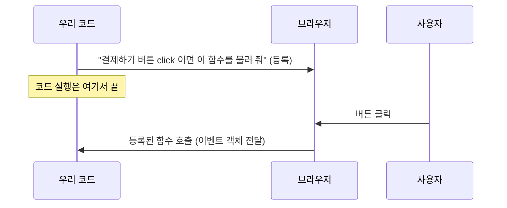
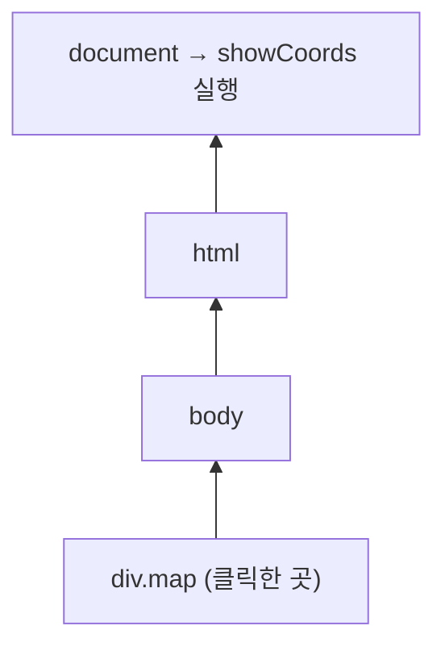
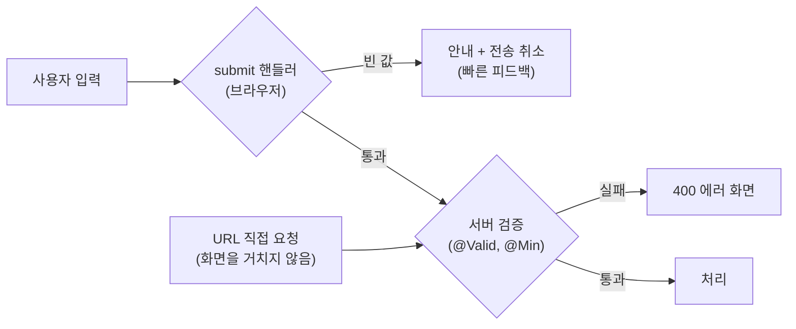

## 들어가며 (Situation)

[DOM 요소 취득 글]({{ site.baseurl }})에서 HTML 요소를 JavaScript로 가져와 스타일을 바꿨습니다. 그런데 지금까지의 코드는 페이지가 열리자마자 한 번 실행되고 끝났습니다. 이번 실습(`02_Web/02_EVENT`)은 **사용자가 클릭하거나 입력할 때** 코드가 실행되게 만드는 **이벤트**를 다룹니다. 분식집 주문서와 맛집 검색 폼을 예제로 했습니다.

> 실제 서비스에서 겪은 문제가 아니라, 수업 실습을 정리한 글입니다. 설명은 MDN과 HTML 표준 문서를 기준으로 했고, 수업 코드 외에 보충을 위해 직접 작성한 코드는 "예시 코드"로 표시했습니다.

## 문제 상황 (Task)

- "버튼을 클릭하면 이 함수를 실행해 줘"를 어떻게 등록할까요? 방법이 세 가지인데 무엇이 다를까요?
- 클릭한 위치나 클릭한 요소 같은 정보는 어디서 얻을까요?
- 주문서의 입력값을 읽고 바꾸려면, 그리고 입력이 비어 있으면 제출을 막으려면 어떻게 할까요?

## 해결 과정 (Action)

### 1. 이벤트 핸들러: 호출을 브라우저에 맡기는 함수

> 이벤트 핸들러: 이벤트가 발생했을 때 브라우저에 호출을 위임한 함수 — 실습 페이지 설명

지금까지는 우리가 함수를 직접 호출했습니다. 이벤트 핸들러는 다릅니다. 함수를 **등록만** 해 두면, 클릭이 일어났을 때 **브라우저가** 그 함수를 호출합니다.



Java로 치면 [Spring IoC]({{ site.baseurl }})와 같은 구조입니다. 우리가 만든 Controller 메서드를 우리가 부르지 않고, 요청이 오면 Spring이 불렀습니다. 이벤트 핸들러도 **호출의 주도권이 브라우저에** 있습니다. 함수를 값으로 넘길 수 있는 [일급 함수]({{ site.baseurl }})라서 가능한 방식이기도 합니다. Java였다면 리스너 인터페이스의 구현 객체(또는 람다)를 넘겼을 것입니다.

### 2. 등록 방법 세 가지

**① 이벤트 핸들러 어트리뷰트 방식**

```html
<button onclick="alert('주문 완료!'); console.log('주문 완료!');">주문하기</button>
<button onmouseover="recommend('김자바');">오늘의 추천 메뉴 (마우스를 올려보세요!)</button>

<script>
    function recommend(name) {
        alert(`${name} 님 , 오늘은 제육을 먹어봐요!`);
    }
</script>
```

HTML 속성 중 `on` + 이벤트 이름(`onclick`, `onmouseover`)인 속성에 **실행할 코드(함수 호출문)**를 문자열로 적습니다. 함수 이름만이 아니라 `recommend('김자바')`처럼 호출하는 형태로 적는다는 점이 아래 방식들과 다릅니다. HTML과 JavaScript가 섞이므로 지금은 잘 쓰지 않습니다.

**② 이벤트 핸들러 프로퍼티 방식**

```javascript
const $btnProp = document.getElementById('btn-prop');

$btnProp.onclick = function() {
    alert("프로퍼티 방식으로 이벤트 핸들러 등록!!");
};

$btnProp.onclick = () => alert("두번째 이벤트 핸들러 등록!!");   // 덮어씀
```

요소 객체의 `onclick` 프로퍼티에 **함수 자체**를 대입합니다. 프로퍼티는 값을 하나만 담으므로, 두 번째 대입이 첫 번째를 **덮어씁니다.** 버튼을 누르면 "두번째" 알림만 뜹니다.

**③ `addEventListener` 방식 (권장)**

```javascript
const $btnListener = document.getElementById('btn-listener');

$btnListener.addEventListener('click', function() {
    alert('결제 완료!');
});

$btnListener.addEventListener('click', function() {
    alert('2번째 addEvent 동작!');
});
```

첫 번째 인자는 이벤트 종류(`'click'` — `on` 없이), 두 번째 인자는 실행할 함수입니다. 같은 이벤트에 **여러 개를 등록**할 수 있고, 등록한 순서대로 둘 다 실행됩니다.

| 비교 | 어트리뷰트 | 프로퍼티 | `addEventListener` |
|------|-----------|---------|-------------------|
| 작성 위치 | HTML 태그 속성 | JS | JS |
| 이벤트 이름 | `onclick` | `onclick` | `'click'` |
| 넘기는 것 | 함수 **호출문** (코드) | 함수 **참조** | 함수 **참조** |
| 같은 이벤트에 여러 개 | — | X (덮어씀) | O |
| 제거 | 속성 제거 | `null` 대입 | `removeEventListener` |

### 3. 이벤트 핸들러 제거

```javascript
const $btnRemove = document.getElementById('btn-remove');

const handleMouseOver = () => alert('결제 버튼에 마우스 호버!');

$btnRemove.addEventListener('mouseover', handleMouseOver);
$btnRemove.removeEventListener('mouseover', handleMouseOver);
```

`removeEventListener`는 **등록할 때와 같은 함수 참조**를 넘겨야 제거됩니다. 그래서 함수를 변수(`handleMouseOver`)에 따로 담아 두고 등록과 제거에 같은 것을 썼습니다. `addEventListener('mouseover', () => ...)`처럼 익명 함수로 등록하면, 나중에 똑같이 생긴 익명 함수를 넘겨도 **다른 함수 객체**라서 제거되지 않습니다. [스프레드 글]({{ site.baseurl }})의 "내용이 같아도 다른 객체"와 같은 이야기입니다.

실습 코드는 등록 직후 바로 제거하므로 마우스를 올려도 아무 일도 일어나지 않습니다. 실제로는 "쿠폰을 한 번 받으면 더 이상 반응하지 않게" 같은 조건과 함께 `if` 문 안에서 제거합니다.

### 4. 이벤트 객체: 무슨 일이 어디서 일어났나

```javascript
const $msg = document.querySelector('.message');

function showCoords(e) {
    console.log(e);
    $msg.textContent = `배달 위치 : ${e.clientX} , ${e.clientY}`;
}

document.onclick = showCoords;     // 문서 어디를 클릭하든
```

이벤트가 발생하면 브라우저는 그 정보를 담은 **이벤트 객체**를 만들어 핸들러의 첫 번째 인자로 넘겨 줍니다. 마우스 이벤트라면 클릭 좌표(`clientX`, `clientY`), 이벤트 종류(`type`), 이벤트가 일어난 요소(`target`) 등이 들어 있습니다.

`document.onclick = showCoords`에서 `showCoords` 뒤에 `()`가 **없다**는 점을 눈여겨봅니다. `showCoords()`라고 쓰면 그 자리에서 함수를 실행하고 **반환값**(`undefined`)을 등록해 버립니다. 등록할 때는 함수를 **참조**로 넘겨야 합니다.

어트리뷰트 방식에서는 `event`라는 이름으로 이벤트 객체를 넘길 수 있습니다.

```html
<div class="map" onmouseover="showMapCoords(event)">지도 영역</div>
```

```javascript
function showMapCoords(e) {
    $map.textContent = `지도 : ${e.clientX} , ${e.clientY}`;
}
```

이벤트 객체의 `clientX`, `type` 같은 표준 속성은 MDN에서 **읽기 전용(read-only)**으로 정의되어 있습니다. 핸들러에서 값을 읽어 활용하는 것이 주된 용도이고, 대입해도 실제 이벤트 정보가 바뀌지는 않습니다.

**알아 둘 점: 이벤트 버블링**

지도 영역을 클릭해도 위쪽 "배달 위치" 메시지가 바뀝니다. 클릭 핸들러는 `document`에만 등록했는데 왜일까요? 대부분의 이벤트는 실제로 발생한 요소에서 시작해 **부모 → 그 부모 → … → `document`** 순서로 올라가며 각 요소의 핸들러를 실행합니다. 이를 **이벤트 버블링**이라고 합니다. 아래 폼 이벤트에서 `focusin`을 폼에 한 번만 등록하는 방식이 이 성질을 이용합니다.



### 5. 이벤트 핸들러 안의 `this`

```html
<button onclick="handleClick1()">떡볶이</button>
<button onclick="handleClick2(this)">순대</button>
```

```javascript
function handleClick1() {
    console.log('click1', this);    // window (전역 객체)
}

function handleClick2(btn) {
    console.log('click2', btn);     // <button>순대</button>
}
```

`handleClick1()`은 어트리뷰트 안에서 **일반 함수로 호출**되었기 때문에 `this`가 전역 객체 `window`입니다. [앞 글]({{ site.baseurl }})에서 정리한 대로 JavaScript의 `this`는 **함수를 어떻게 호출했느냐**로 정해지기 때문입니다. 어트리뷰트 코드 자체에서 쓰는 `this`는 그 버튼 요소이므로, `handleClick2(this)`처럼 인자로 넘기면 함수 안에서 클릭된 버튼을 받을 수 있습니다. 클릭된 요소를 알면 그 요소를 지우거나 스타일을 바꾸는 등 추가 동작을 할 수 있습니다.

프로퍼티 방식과 `addEventListener`에서는 규칙이 하나 더 있습니다.

```javascript
// 예시 코드 (보충)
$btn.addEventListener('click', function() {
    console.log(this);        // $btn — 핸들러가 등록된 요소
});

$btn.addEventListener('click', () => {
    console.log(this);        // $btn 이 아님 — 화살표 함수는 바깥의 this
});

$btn.addEventListener('click', (e) => {
    console.log(e.currentTarget);   // $btn — this 대신 이벤트 객체로 확실하게
});
```

| 등록 방식 | 핸들러 안의 `this` |
|----------|------------------|
| 어트리뷰트 안에서 일반 함수 호출 | `window` |
| 프로퍼티 / `addEventListener` + `function` | 핸들러가 등록된 요소 |
| 프로퍼티 / `addEventListener` + 화살표 함수 | 바깥 스코프의 `this` (요소 아님) |

[화살표 함수 글]({{ site.baseurl }})에서 "화살표 함수는 자기 `this`가 없다"고 정리했던 내용이 여기서 실제로 차이를 만듭니다. 헷갈린다면 `this` 대신 이벤트 객체의 `e.currentTarget`(핸들러가 등록된 요소)이나 `e.target`(이벤트가 실제로 일어난 요소)을 쓰는 것이 확실합니다.

### 6. 폼 요소 값 다루기

```html
<form name="orderForm">
    <input type="text" name="username" id="username" value="김자바">
    <input type="radio" name="payment" id="card" value="card" checked>
    <input type="radio" name="payment" id="cash" value="cash">
    <select id="menu" name="menu">
        <option value="tteokbokki">떡볶이</option>
        ...
        <option value="ramen">라면</option>
    </select>
    <textarea name="request" id="request">맵지 않게 해주세요!</textarea>
    <span>0</span>/200자
    <input type="submit" value="주문하기">
</form>
```

**폼과 입력 요소 가져오기**

```javascript
console.log(document.forms);              // 문서의 모든 form (HTMLCollection)
console.log(document.forms.orderForm);    // name 속성으로
console.log(document.forms[0]);           // 인덱스로

const $form = document.forms.orderForm;
console.log($form.elements);              // 폼 안의 입력 요소들
const $username = $form.username;         // name 속성으로 바로 접근
```

`document.forms`와 `폼.name값`으로 `querySelector` 없이 폼과 입력 요소를 가져올 수 있습니다. 여기서 쓰는 **`name` 속성**은 폼을 제출할 때 서버로 가는 **파라미터 이름**이기도 합니다. [Servlet 파라미터 글]({{ site.baseurl }})에서 `request.getParameter("username")`으로 받던 바로 그 이름입니다.

**값 읽고 바꾸기**

```javascript
console.log($username.value);       // 김자바
$username.value = '김코틀린';

const $payment = $form.payment;     // 같은 name 의 라디오 버튼들
console.log($payment[1].checked);   // false
$payment[1].checked = true;         // 현금 선택

const $menu = $form.menu;
$menu.options[2].selected = true;   // 튀김
$menu.selectedIndex = 3;            // 김밥
$menu.value = 'ramen';              // 라면 (최종)

$form.request.value = '단무지 많이 주세요!';
```

| 요소 | 읽기·쓰기 | 의미 |
|------|----------|------|
| `input`, `textarea` | `.value` | 입력된 글자 |
| checkbox, radio | `.checked` | 선택 여부 (`true`/`false`) |
| `select` | `.value` | 선택된 option의 `value` |
| `select` | `.selectedIndex` | 선택된 option의 번호 |
| `select` | `.options[i].selected` | i번째 option 선택 여부 |

`select`는 세 가지 방법으로 연달아 바꿨으므로 마지막에 대입한 `'ramen'`(라면)이 선택된 상태로 남습니다.

### 7. 포커스 이벤트: focus·blur와 focusin·focusout

```javascript
$username.onfocus = (e) => e.target.classList.toggle('lightgray');   // 들어가면 회색
$username.onblur  = (e) => e.target.classList.toggle('lightgray');   // 나가면 원래대로

$form.addEventListener('focusin',  (e) => e.target.classList.add('focused'));
$form.addEventListener('focusout', (e) => e.target.classList.remove('focused'));
```

- `focus`: 클릭이나 Tab으로 입력 요소에 들어갔을 때
- `blur`: 다른 곳을 클릭하거나 Tab으로 빠져나갔을 때

`focus`와 `blur`는 **버블링되지 않습니다.** 그래서 폼 안의 모든 입력칸에 효과를 주려면 입력칸마다 핸들러를 달아야 합니다. `focusin`과 `focusout`은 같은 시점에 발생하지만 **버블링됩니다.** 그래서 부모인 `<form>`에 **한 번만** 등록해도 안의 어느 입력칸이든 포커스를 받으면 폼의 핸들러가 실행되고, `e.target`으로 실제로 포커스를 받은 입력칸을 알 수 있습니다.

| 이벤트 | 시점 | 버블링 | 쓰는 방식 |
|--------|------|--------|----------|
| `focus` / `blur` | 들어감 / 나감 | X | 입력칸 각각에 등록 |
| `focusin` / `focusout` | 들어감 / 나감 | O | 부모(form)에 한 번 등록 |

이렇게 부모에 하나만 등록해 자식들의 이벤트를 처리하는 방식을 **이벤트 위임**이라고 합니다. `classList.add()`, `remove()`, `toggle()`은 [DOM 글]({{ site.baseurl }})에서 말한 class 붙이기·떼기 방식입니다.

### 8. change와 input: 언제 값이 바뀌었다고 볼까

```javascript
$menu.addEventListener('change', () => alert('메뉴 변경!'));
$request.addEventListener('change', () => alert('요청사항 변경!'));

// 요청사항 글자 수 세기
$request.addEventListener('input', (e) => {
    let len = e.target.value.trim().length;
    $form.querySelector('span').textContent = len;
});
```

| 이벤트 | `select`, checkbox, radio | 텍스트 입력 (`input`, `textarea`) |
|--------|--------------------------|--------------------------------|
| `change` | 선택이 바뀐 **직후** | 내용을 바꾸고 **포커스를 잃을 때** |
| `input` | 값이 바뀔 때마다 | **한 글자 바뀔 때마다** (붙여 넣기, 음성 입력 포함) |

요청사항 칸에서 글자를 입력하는 동안에는 `change` 알림이 뜨지 않다가, 다른 곳을 클릭하는 순간 "요청사항 변경!"이 뜹니다. 반면 글자 수 표시는 `input` 이벤트라서 **타이핑할 때마다** 숫자가 바뀝니다. 실시간 반응이 필요하면 `input`, 입력이 끝난 뒤 한 번 처리하면 되는 일에는 `change`를 씁니다.

`trim()`은 앞뒤 공백을 제거하므로 스페이스만 입력한 것은 글자 수에 세지 않습니다. 키보드 이벤트(`keydown`)가 아니라 `input`을 쓴 이유는 마우스로 붙여 넣기 같은 키보드 외 입력에도 반응하기 때문입니다.

### 9. submit: 서버로 보내기 전에 검사하고 막기

```html
<form method="GET" action="https://search.naver.com/search.naver" name="search">
    <input type="text" name="query" placeholder="검색할 메뉴를 입력하세요">
    <button type="submit">네이버에서 맛집 검색하기</button>
</form>
```

```javascript
const $searchForm = document.forms.search;

$searchForm.onsubmit = function() {
    let keyword = this.querySelector('input[name=query]').value;

    if (!keyword) {
        alert('검색할 메뉴를 입력하지 않았습니다!');
        return false;   // 폼 전송 취소
    }
};
```

`submit` 이벤트는 폼이 **서버로 전송되기 직전**에 발생합니다(제출 버튼 클릭 또는 입력칸에서 Enter). 핸들러에서 내용을 검사하고, 문제가 있으면 전송을 취소합니다. 입력이 있으면 폼이 GET으로 전송되어 `https://search.naver.com/search.naver?query=입력값`으로 이동합니다.

- `function`으로 등록했으므로 `this`는 폼 요소입니다(5번의 규칙).
- `!keyword`는 빈 문자열 `''`이 **falsy**(조건식에서 `false`로 취급되는 값)라서 입력이 비었을 때 `true`가 됩니다.
- 프로퍼티 방식(`onsubmit`)에서는 `return false`로 기본 동작(전송)을 취소할 수 있습니다. `addEventListener` 방식에서는 반환값이 무시되므로 `e.preventDefault()`를 씁니다.

```javascript
// 예시 코드 — addEventListener 로 같은 검사
$searchForm.addEventListener('submit', (e) => {
    const keyword = e.currentTarget.query.value;
    if (!keyword.trim()) {
        alert('검색할 메뉴를 입력하지 않았습니다!');
        e.preventDefault();     // 전송 취소
    }
});
```

**화면 검증은 편의, 최종 검증은 서버**

[미니 프로젝트 글]({{ site.baseurl }})에서 "화면의 입력 제한은 편의 기능이고, 검증은 서버가 다시 한다"고 정리했습니다. `submit` 검증이 바로 그 화면 쪽 검증입니다. 사용자는 전송 전에 바로 안내를 받아 편하지만, 주소창에 URL을 직접 입력하거나 JavaScript를 끄면 이 검사를 건너뛸 수 있습니다. 서버의 `@Min`, `@Valid` 같은 검증은 여전히 필요합니다.



## 결과 (Result)

정량 지표는 없고, 아래를 정리했습니다.

- 이벤트 핸들러는 등록만 하고 호출은 브라우저가 하는 함수입니다(호출 주도권이 브라우저에 있다는 점에서 Spring IoC와 비슷합니다).
- 등록은 어트리뷰트(호출문), 프로퍼티(하나만, 덮어씀), `addEventListener`(여러 개, 제거 가능) 세 가지이며 `addEventListener`를 권장합니다. 제거하려면 같은 함수 참조가 필요합니다.
- 등록할 때는 `fn()`이 아니라 `fn`(참조)을 넘깁니다. 핸들러는 첫 인자로 이벤트 객체를 받습니다.
- 대부분의 이벤트는 부모로 전파됩니다(버블링). `focus`/`blur`는 전파되지 않고 `focusin`/`focusout`은 전파되어 폼 하나에 등록하는 이벤트 위임이 가능합니다.
- 핸들러 안의 `this`는 등록 방식과 함수 종류에 따라 다르므로, `e.currentTarget`·`e.target`을 쓰는 편이 확실합니다.
- `change`는 입력이 끝났을 때, `input`은 값이 바뀔 때마다 발생합니다.
- `submit`에서 검증 후 `return false`(프로퍼티) 또는 `e.preventDefault()`(addEventListener)로 전송을 막습니다. 화면 검증은 편의이고 서버 검증을 대신하지 않습니다.

## 더 학습하면 좋은 개념

- **이벤트 전파 3단계(캡처링 → 타깃 → 버블링)와 `stopPropagation()`** — 버블링을 멈추거나 캡처 단계에서 먼저 처리하는 방법입니다.
- **이벤트 위임 심화** — 목록에 항목이 계속 추가될 때 각 항목이 아니라 부모 하나에 핸들러를 다는 패턴입니다.
- **`FormData`와 `fetch`로 폼 전송** — 페이지 이동 없이 폼 데이터를 서버로 보내는 방법입니다. `preventDefault()`와 함께 씁니다.
- **HTML 기본 검증 속성(`required`, `minlength`, `pattern`)** — JavaScript 없이 브라우저가 해 주는 입력 검증입니다.
- **디바운스(Debounce)** — `input` 이벤트처럼 자주 발생하는 이벤트에서 마지막 입력 후 잠시 기다렸다가 한 번만 처리하는 기법입니다(검색어 자동완성 등).

## 참고 자료

- [MDN - Introduction to events](https://developer.mozilla.org/en-US/docs/Learn_web_development/Core/Scripting/Events)
- [MDN - EventTarget.addEventListener()](https://developer.mozilla.org/en-US/docs/Web/API/EventTarget/addEventListener)
- [MDN - EventTarget.removeEventListener()](https://developer.mozilla.org/en-US/docs/Web/API/EventTarget/removeEventListener)
- [MDN - Event bubbling](https://developer.mozilla.org/en-US/docs/Learn_web_development/Core/Scripting/Event_bubbling)
- [MDN - MouseEvent.clientX](https://developer.mozilla.org/en-US/docs/Web/API/MouseEvent/clientX)
- [MDN - Element: focusin event](https://developer.mozilla.org/en-US/docs/Web/API/Element/focusin_event)
- [MDN - HTMLElement: change event](https://developer.mozilla.org/en-US/docs/Web/API/HTMLElement/change_event)
- [MDN - Element: input event](https://developer.mozilla.org/en-US/docs/Web/API/Element/input_event)
- [MDN - HTMLFormElement: submit event](https://developer.mozilla.org/en-US/docs/Web/API/HTMLFormElement/submit_event)
- [MDN - Event.preventDefault()](https://developer.mozilla.org/en-US/docs/Web/API/Event/preventDefault)
- [MDN - Document.forms](https://developer.mozilla.org/en-US/docs/Web/API/Document/forms)
