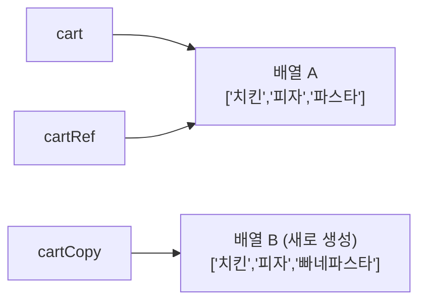
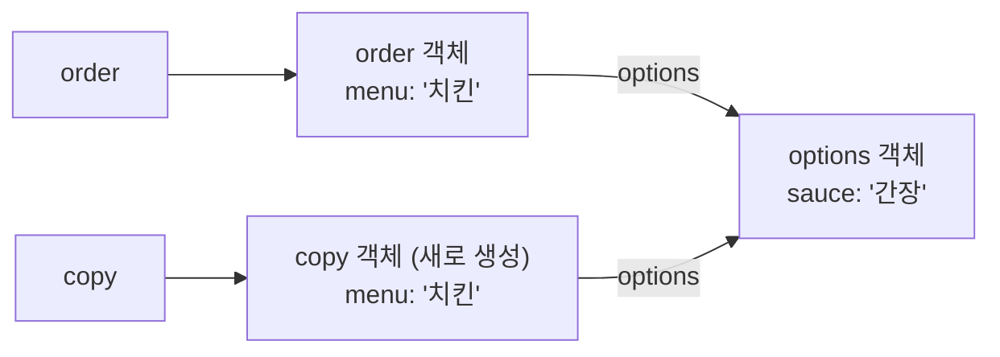

## 들어가며 (Situation)

[JavaScript 첫 수업 글]({{ site.baseurl }})에 이어, `01_Core`의 마지막 두 실습인 **스프레드 문법**과 **구조 분해 할당**을 정리합니다. 둘 다 `...`나 `{ }`, `[ ]` 같은 짧은 기호로 배열·객체를 다루는 문법이라 처음 보면 낯설지만, 이후 수업(DOM, 이벤트, 프레임워크)에서 계속 나옵니다.

지난 글들처럼 Java에서 같은 일을 하는 코드와 비교하며 정리했습니다.

> 실제 서비스에서 겪은 문제가 아니라, 수업 실습을 정리한 글입니다. JavaScript 실행 결과는 Node.js(v24)로, Java 비교 코드는 javac 21로 직접 실행해 확인했습니다. 설명은 MDN과 Oracle 공식 문서를 기준으로 했고, 수업 코드 외에 직접 작성한 코드는 "예시 코드"로 표시했습니다.

## 문제 상황 (Task)

```javascript
const cart = ['치킨', '피자'];
const cartRef = cart;
cartRef.push('파스타');

console.log(cart);   // ['치킨', '피자', '파스타']  ← cart 에는 아무것도 안 넣었는데?
```

- `cartRef`에 넣었을 뿐인데 왜 `cart`까지 바뀔까요?
- 원본에 영향을 주지 않는 "복사본"은 어떻게 만들까요?
- 배열이나 객체에서 값을 하나씩 꺼내 변수에 담는 코드(`const a = arr[0]; const b = arr[1];`)를 더 짧게 쓸 수는 없을까요?

## 해결 과정 (Action)

### 1. 대입은 복사가 아니다: 참조 공유

```javascript
const cart = ['치킨', '피자'];
const cartRef = cart;          // 같은 배열을 가리키는 이름이 하나 더 생김
const cartCopy = [...cart];    // 새 배열을 만들고 요소를 복사

cartRef.push('파스타');
console.log(cart, cartRef);    // ['치킨','피자','파스타'] ['치킨','피자','파스타']

cartCopy.push('빠네파스타');
console.log(cart, cartCopy);   // ['치킨','피자','파스타'] ['치킨','피자','빠네파스타']
```

JavaScript에서 배열과 객체는 **참조 값**입니다. 변수에는 배열 자체가 아니라 배열이 있는 곳을 가리키는 참조가 들어 있습니다. `cartRef = cart`는 그 참조를 복사할 뿐이라, 두 변수가 **같은 배열 하나**를 함께 가리킵니다.



`===`로 확인하면 차이가 분명합니다.

```javascript
const order = { menuName : '뿌링클', qty : 2 };
const orderRef = order;
const orderCopy = {...order};

console.log(order === orderRef);    // true  — 같은 객체
console.log(order === orderCopy);   // false — 내용은 같지만 다른 객체
```

[앞 글]({{ site.baseurl }})에서 정리한 대로 객체끼리의 `===`는 내용이 아니라 **같은 객체인지**를 비교합니다.

**왜 문제가 될까?** 같은 메뉴 데이터를 여러 곳에서 쓰는데 모두 참조로 공유하고 있다면, 한 곳에서 수정할 때 다른 곳의 값도 **영문도 모른 채** 바뀝니다. 장바구니 화면에서 메뉴를 하나 지웠는데 추천 목록에서도 사라지는 식입니다.

**Java도 똑같다**

```java
// 예시 코드
String[] cart = {"치킨", "피자"};
String[] ref = cart;                                   // 참조 공유
String[] copy = Arrays.copyOf(cart, cart.length);      // 새 배열

ref[0] = "파스타";
System.out.println(Arrays.toString(cart));   // [파스타, 피자]  ← 원본도 바뀜
System.out.println(Arrays.toString(copy));   // [치킨, 피자]
System.out.println(cart == ref);             // true
System.out.println(cart == copy);            // false
```

Java의 배열과 객체 변수도 참조를 담으므로 동작이 같습니다. [ArrayList 글]({{ site.baseurl }})에서 다룬 리스트도 `new ArrayList<>(list)`로 새로 만들어야 별개의 리스트가 됩니다.

### 2. 스프레드 문법 `...`: 펼쳐서 새로 담기

`...`은 배열이나 객체의 내용을 **낱개로 펼치는** 문법입니다. 펼친 것을 `[ ]`나 `{ }`로 다시 감싸면 새 배열·새 객체가 됩니다.

```javascript
[...cart]           // ['치킨', '피자'] 를 펼쳐서 새 배열에 담기
{...order}          // { menuName, qty } 를 펼쳐서 새 객체에 담기
```

복사 말고도 자주 쓰는 형태가 있습니다.

```javascript
// 예시 코드
const snacks = ['떡볶이', '순대'];
const drinks = ['콜라'];
const all = [...snacks, ...drinks, '김밥'];        // 배열 합치기 + 요소 추가

const menu = { name: '치즈알밥', price: 7500, category: '퓨전한식' };
const sale = { ...menu, price: 8000 };             // 복사하면서 일부만 바꾸기
// { name: '치즈알밥', price: 8000, category: '퓨전한식' }
```

마지막 형태처럼 **원본은 두고 바뀐 새 객체를 만드는** 방식은 이후 React 같은 프레임워크에서 상태를 바꿀 때 기본으로 쓰입니다.

| 하고 싶은 일 | JavaScript | Java (예시) |
|-------------|-----------|-------------|
| 배열 복사 | `[...arr]` | `Arrays.copyOf(arr, arr.length)`, `arr.clone()` |
| 리스트 복사 | (배열과 같음) | `new ArrayList<>(list)` |
| 두 배열 합치기 | `[...a, ...b]` | `Stream.concat(...)`, `addAll()` |
| 객체 복사 | `{...obj}` | 복사 생성자, 직접 필드 복사 |
| 복사하며 일부 변경 | `{...obj, price: 8000}` | 새 객체 생성 시 값 지정 (record라면 새 인스턴스) |

### 3. 스프레드 복사는 "얕은 복사"다

스프레드 복사는 **한 단계만** 새로 만듭니다. 객체 안에 객체가 또 있으면, 안쪽 객체는 여전히 참조를 공유합니다.

```javascript
// 예시 코드
const order = { menu: '치킨', options: { sauce: '양념' } };
const copy = { ...order };

copy.options.sauce = '간장';
console.log(order.options.sauce);                // '간장'  ← 원본도 바뀜
console.log(copy.options === order.options);     // true
```



안쪽까지 모두 새로 만드는 것을 **깊은 복사**라고 합니다. 최신 브라우저와 Node.js에는 내장 함수 `structuredClone()`이 있습니다.

```javascript
// 예시 코드
const deep = structuredClone(order);
deep.options.sauce = '반반';
console.log(order.options.sauce);   // '간장' (영향 없음)
```

세 가지를 정리하면 다음과 같습니다.

| 구분 | 방법 | 바깥 객체 | 안쪽 객체 | 원본 영향 |
|------|------|----------|----------|----------|
| 참조 공유 (대입) | `const b = a` | 같은 객체 | 같은 객체 | 어디를 바꾸든 영향 |
| 얕은 복사 | `[...a]`, `{...a}` | **새 객체** | 같은 객체 | 안쪽을 바꾸면 영향 |
| 깊은 복사 | `structuredClone(a)` | 새 객체 | **새 객체** | 영향 없음 |

Java도 구조가 같습니다. `Arrays.copyOf()`나 `new ArrayList<>(list)`는 얕은 복사라서, 요소가 객체면 그 객체는 공유됩니다. Java에는 범용 깊은 복사 메서드가 없어 필요하면 복사 생성자 등으로 직접 구현합니다.

> 실습의 메뉴 배열처럼 요소가 문자열·숫자 같은 원시 값뿐이면 얕은 복사만으로 충분합니다. 원시 값은 공유될 일이 없기 때문입니다.

### 4. 구조 분해 할당: 배열은 순서로, 객체는 이름으로

**배열 구조 분해**

```javascript
const menuArr = ['치킨', '피자'];

// 기존 방식
const chi = menuArr[0];
const piz = menuArr[1];

// 구조 분해 할당
const [chi1, piz1] = menuArr;
console.log(chi1);   // 치킨
console.log(piz1);   // 피자
```

`=` 왼쪽에 `[ ]`를 쓰면, 오른쪽 배열의 요소가 **순서대로** 변수에 들어갑니다.

**객체 구조 분해**

```javascript
const menu = {
    name : '치즈알밥',
    price : 7500,
    category : '퓨전한식'
};

// 기존 방식
// const name = menu.name;
// const price = menu.price;
// const category = menu.category;

const {name, price, category} = menu;
console.log(name, price, category);   // 치즈알밥 7500 퓨전한식
```

객체는 순서가 아니라 **프로퍼티 key와 같은 이름의 변수**에 값이 들어갑니다. 그래서 key에 없는 이름을 쓰면 값이 들어가지 않습니다.

```javascript
// 예시 코드
const {nam} = menu;
console.log(nam);    // undefined — 'nam' 이라는 key 가 없음
```

다른 변수 이름을 쓰고 싶거나, 값이 없을 때의 기본값이 필요하면 이렇게 씁니다.

```javascript
// 예시 코드
const {name: menuName, spicy = '보통'} = menu;
console.log(menuName);   // 치즈알밥   (name 을 menuName 이라는 변수로)
console.log(spicy);      // 보통       (menu 에 spicy 가 없어서 기본값)
```

| 구분 | 배열 구조 분해 | 객체 구조 분해 |
|------|--------------|--------------|
| 기호 | `const [a, b] = arr` | `const {a, b} = obj` |
| 기준 | **위치(순서)** | **key 이름** |
| 이름 바꾸기 | 변수 이름 자유 | `{key: 새이름}` |
| 기본값 | `[a = 1] = arr` | `{a = 1} = obj` |

### 5. 나머지 `...`: 구조 분해와 함께 쓰기

```javascript
const {...rest} = menu;
console.log(rest);            // { name: '치즈알밥', price: 7500, category: '퓨전한식' }
console.log(rest === menu);   // false — 새 객체
```

구조 분해 왼쪽에 `...`을 쓰면 **남은 프로퍼티를 모두 모아 새 객체**를 만듭니다. 위 코드는 남은 것이 전부라서 결과적으로 얕은 복사가 됩니다. 같은 `...` 기호지만 위치에 따라 이름이 다릅니다.

| 위치 | 이름 | 하는 일 | 예 |
|------|------|--------|-----|
| 값을 만드는 쪽 (`=` 오른쪽, 함수 호출 인자) | 스프레드 (spread) | **펼친다** | `[...arr]`, `{...obj}` |
| 값을 받는 쪽 (`=` 왼쪽, 함수 매개변수) | 나머지 (rest) | **모은다** | `const [first, ...others] = arr` |

```javascript
// 예시 코드
const [first, ...others] = ['떡볶이', '순대', '튀김'];
console.log(first);    // 떡볶이
console.log(others);   // ['순대', '튀김']

const {name, ...detail} = menu;   // name 만 빼고 나머지를 detail 로
// detail = { price: 7500, category: '퓨전한식' }
```

### 6. Java에는 구조 분해가 있을까?

Java에는 일반 배열·객체에 대한 구조 분해 문법이 없어서 하나씩 꺼내야 합니다. 대신 Java 21에서 **레코드 패턴**이 정식 기능이 되어, 레코드에 한해 비슷한 일을 할 수 있습니다.

```java
// 예시 코드 (Java 21)
record Menu(String name, int price, String category) {}

Object o = new Menu("치즈알밥", 7500, "퓨전한식");

if (o instanceof Menu(String name, int price, String category)) {
    System.out.println(name + " " + price + " " + category);   // 치즈알밥 7500 퓨전한식
}
```

| 비교 | JavaScript 구조 분해 | Java 레코드 패턴 |
|------|---------------------|-----------------|
| 대상 | 모든 배열, 객체 | 레코드 |
| 기준 | 배열은 순서, 객체는 key 이름 | 레코드 컴포넌트 **선언 순서** |
| 쓰는 곳 | 변수 선언, 함수 매개변수 등 어디서나 | `instanceof`, `switch`의 패턴 |
| 타입 확인 | 없음 | 타입이 맞을 때만 분해 |

Java는 "이 객체가 정말 `Menu`인지" 타입 검사와 분해를 함께 하고, JavaScript는 타입 검사 없이 이름만으로 꺼냅니다. [앞 글]({{ site.baseurl }})에서 정리한 정적 타입과 동적 타입의 차이가 여기서도 보입니다.

## 결과 (Result)

정량 지표는 없고, 아래를 정리했습니다.

- 배열·객체를 다른 변수에 대입하면 복사가 아니라 **같은 객체를 함께 가리키는 것**입니다. 한쪽을 바꾸면 다른 쪽도 바뀝니다. Java도 같습니다.
- 스프레드 `[...arr]`, `{...obj}`는 새 배열·객체를 만드는 **얕은 복사**입니다. 안쪽 객체까지 새로 만들려면 `structuredClone()`(깊은 복사)을 씁니다.
- 스프레드는 합치기(`[...a, ...b]`)와 "복사하며 일부만 바꾸기"(`{...obj, price: 8000}`)에도 씁니다.
- 구조 분해 할당은 배열은 **순서**, 객체는 **key 이름**으로 값을 꺼냅니다. `{key: 새이름}`, `= 기본값`을 붙일 수 있습니다.
- `...`은 값을 만드는 쪽에서는 펼치는 스프레드, 받는 쪽에서는 모으는 나머지(rest)입니다.
- Java는 Java 21의 레코드 패턴으로 레코드에 한해 비슷한 분해를 할 수 있습니다.

## 더 학습하면 좋은 개념

- **불변성(Immutability)과 상태 관리** — 원본을 바꾸지 않고 새 객체를 만드는 방식이 왜 React 등에서 필수인지와 연결됩니다.
- **함수 매개변수 구조 분해** — `function order({menuName, qty}) { ... }`처럼 객체를 받으면서 바로 꺼내는 문법으로, 실무 코드에서 매우 자주 보입니다.
- **나머지 매개변수(Rest parameters)** — `function sum(...nums)`처럼 개수가 정해지지 않은 인자를 배열로 받는 방법입니다. Java의 가변 인자(`int... nums`)와 비교해 볼 수 있습니다.
- **`Object.freeze()`** — 객체 자체를 변경 불가로 만드는 방법입니다. `const`가 재할당만 막는다는 점과 함께 이해하면 좋습니다.
- **Java의 복사 생성자와 `clone()`의 한계** — Java에서 깊은 복사를 직접 구현하는 방법과, `Cloneable`이 권장되지 않는 이유입니다.

## 참고 자료

- [MDN - Spread syntax (...)](https://developer.mozilla.org/en-US/docs/Web/JavaScript/Reference/Operators/Spread_syntax)
- [MDN - Destructuring](https://developer.mozilla.org/en-US/docs/Web/JavaScript/Reference/Operators/Destructuring)
- [MDN - Shallow copy (Glossary)](https://developer.mozilla.org/en-US/docs/Glossary/Shallow_copy)
- [MDN - Deep copy (Glossary)](https://developer.mozilla.org/en-US/docs/Glossary/Deep_copy)
- [MDN - structuredClone()](https://developer.mozilla.org/en-US/docs/Web/API/Window/structuredClone)
- [Oracle - Record Patterns (Java SE 21)](https://docs.oracle.com/en/java/javase/21/language/record-patterns.html)
- [Oracle - java.util.Arrays (Java SE 21)](https://docs.oracle.com/en/java/javase/21/docs/api/java.base/java/util/Arrays.html)
