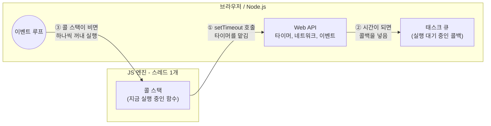
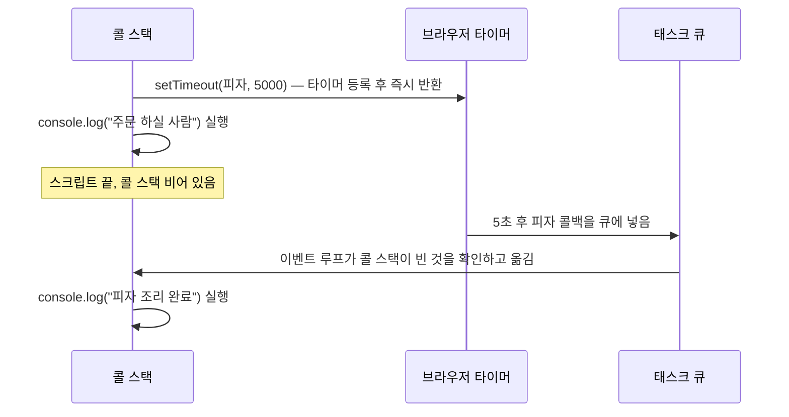

## 들어가며 (Situation)

JavaScript 수업이 `03_Async`로 넘어왔습니다. [이벤트 글]({{ site.baseurl }})에서 "함수를 등록해 두면 나중에 브라우저가 호출한다"는 방식을 봤는데, 이번에는 그 "나중에"가 어떻게 동작하는지를 다룹니다. 타이머 함수로 **비동기**를 체험하고, 그 뒤에 있는 **이벤트 루프**를 정리했습니다.

JavaScript 시리즈에서 해 온 것처럼 Java와도 비교합니다. Java는 여러 스레드로 일을 나누는 언어이고, JavaScript는 스레드 하나로 일하는 언어라서 이 주제에서 차이가 가장 크게 드러납니다.

> 실제 서비스에서 겪은 문제가 아니라, 수업 실습을 정리한 글입니다. 실습은 브라우저에서 했고, 글에 적은 출력 순서와 시간은 같은 코드를 Node.js(v24)로 다시 실행해 확인했습니다. Java 비교 코드는 javac 21로 실행해 확인했습니다. 설명은 MDN과 HTML 표준, Oracle 문서를 기준으로 했습니다.

## 문제 상황 (Task)

```javascript
setTimeout(() => console.log('5초 경과! 피자 조리 완료~~🍕'), 5000);
console.log("주문 하실 사람~~~!");
```

코드는 위에서 아래로 실행된다고 배웠으니, 5초를 기다려 피자 메시지가 나온 뒤에 주문 메시지가 나와야 할 것 같습니다. 실제로는 **주문 메시지가 먼저** 나옵니다.

- 왜 아래 줄이 먼저 실행될까요?
- 5초 동안 기다리는 일은 누가 하고 있을까요?
- 스레드가 하나뿐인 JavaScript에서 이게 어떻게 가능할까요?

## 해결 과정 (Action)

### 1. 타이머 함수: setTimeout, setInterval

```javascript
// setTimeout(실행할 함수, 지연 시간(ms) [, 함수에 넘길 인자...])
setTimeout(() => console.log('5초 경과! 피자 조리 완료~~🍕'), 5000);
console.log("주문 하실 사람~~~!");

setTimeout((menuName) => console.log(`3초 경과! ${menuName} 조리 완료~~🍕`), 3000, "치킨");
```

`setTimeout`은 "이 함수를 n밀리초 **뒤에** 실행해 줘"라고 **예약**만 하고 바로 끝납니다. 그래서 다음 줄로 곧장 넘어갑니다. 세 번째 인자부터는 예약한 함수에 전달할 값입니다("치킨").

```javascript
let count = 1;

const interval = setInterval(() => {
    console.log(`배달 도착까지 ${5 - count} 초`);
    count++;

    if (count == 5) {
        clearInterval(interval);      // 반복 중지
        console.log('배달 완료~~~🛒');
    }
}, 1000);
```

`setInterval`은 같은 간격으로 **반복** 실행합니다. 반환값(타이머 ID)을 `clearInterval()`에 넘기면 반복이 멈춥니다. 종료 조건을 달지 않으면 페이지를 닫을 때까지 계속 실행되므로, 수업 주석대로 **종료 조건이 중요합니다.**

세 타이머를 한 파일에서 실행한 결과입니다.

```text
0.0s 주문 하실 사람~~~!
1.0s 배달 도착까지 4 초
2.0s 배달 도착까지 3 초
3.0s 3초 경과! 치킨 조리 완료~~🍕
3.0s 배달 도착까지 2 초
4.0s 배달 도착까지 1 초
4.0s 배달 완료~~~🛒
5.0s 5초 경과! 피자 조리 완료~~🍕
```

코드에 적힌 순서가 아니라 **예약한 시간 순서**대로 출력됩니다.

| 함수 | 동작 | 취소 |
|------|------|------|
| `setTimeout(fn, ms, ...args)` | `ms` 뒤에 **한 번** 실행 | `clearTimeout(id)` |
| `setInterval(fn, ms, ...args)` | `ms`마다 **반복** 실행 | `clearInterval(id)` |

지연 시간은 "정확히 그 시간에 실행"이 아니라 "**최소한** 그 시간이 지난 뒤 실행"입니다. 그 시점에 다른 코드가 실행 중이면 끝날 때까지 기다립니다. 이유는 아래 이벤트 루프에서 나옵니다.

### 2. 동기와 비동기: 떡볶이 가게로 비교하기

| 방식 | 떡볶이 가게 | 코드 |
|------|-----------|------|
| **동기** | 떡볶이 조리(3초)가 끝날 때까지 다음 손님 주문을 **못 받는다** | 앞 작업이 끝나야 다음 줄 실행 |
| **비동기** | 떡볶이를 불에 올려 두고 그동안 다음 손님 주문을 **먼저 받는다** | 오래 걸리는 작업은 맡겨 두고 다음 줄 실행 |

**동기: 3초 동안 아무것도 못 한다**

```javascript
function sleep(func, delay) {
    const delayUntil = Date.now() + delay;
    while (Date.now() < delayUntil);    // 3초 동안 계속 시간만 확인
    func();
}

function cook()      { console.log("떡볶이 조리 완료!!(3초)"); }
function takeOrder() { console.log("다음 손님 주문 하세요~"); }

sleep(cook, 3000);
takeOrder();
```

`sleep`은 `while`문으로 3초 동안 현재 시각만 계속 확인하는 함수입니다. 그동안 JavaScript는 이 반복문 말고 아무것도 실행할 수 없습니다. 주문은 무조건 3초 뒤에야 받습니다. 브라우저였다면 그 3초 동안 **버튼 클릭이나 스크롤 같은 화면 반응도 멈춥니다.** JavaScript는 화면 처리와 같은 스레드에서 실행되기 때문입니다.

**비동기: 맡겨 두고 바로 다음 일**

```javascript
setTimeout(cook, 3000);
takeOrder();
takeOrder();
takeOrder();
// ... takeOrder() 7번
```

```text
다음 손님 주문 하세요~   (×7, 바로 출력)
떡볶이 조리 완료!!(3초)  (3초 뒤)
```

`setTimeout`에 조리를 맡기고 곧바로 주문을 7번 받습니다. 3초가 지나면 조리 완료가 출력됩니다.

**왜 비동기가 중요할까?**

실습 페이지의 설명을 정리하면 이렇습니다. 프론트엔드는 화면을 그리고, 백엔드는 화면에 쓸 데이터를 돌려줍니다. 프론트가 백엔드에 데이터를 요청했는데 응답이 느리다면, 동기 방식에서는 응답이 올 때까지 **화면 전체가 멈춥니다.** 사용자는 영문도 모른 채 굳은 화면을 보게 됩니다. 그래서 JavaScript에서 서버 API 호출은 모두 비동기로 처리합니다. 이 부분은 [다음 글]({{ site.baseurl }})의 `fetch`로 이어집니다.

### 3. 이벤트 루프: 스레드 하나로 기다리는 방법

JavaScript는 코드를 실행하는 스레드가 **하나**입니다. 그런데 어떻게 5초를 기다리면서 다른 코드를 실행할 수 있을까요? **기다리는 일은 JavaScript 엔진이 아니라 브라우저(또는 Node.js)가 합니다.**



실습 페이지에 정리된 개념은 다음과 같습니다.

| 구성 요소 | 역할 |
|----------|------|
| **콜 스택** | 지금 실행 중인 함수들이 쌓이는 곳. JavaScript는 여기서 한 번에 하나씩만 실행합니다. |
| **Web API** | 타이머, 네트워크 요청, DOM 이벤트처럼 오래 걸리거나 언제 일어날지 모르는 일을 맡아 처리하는 브라우저 기능 |
| **태스크 큐** | 비동기 함수의 콜백이나 이벤트 핸들러가 **실행을 기다리며 보관**되는 곳 |
| **이벤트 루프** | 콜 스택이 비어 있는지, 태스크 큐에 대기 중인 함수가 있는지를 **반복해서 확인**하고, 콜 스택이 비면 태스크 큐의 함수를 **들어온 순서대로(FIFO)** 콜 스택으로 옮깁니다. |

피자 예제를 이 흐름에 대입하면 다음과 같습니다.



이제 문제 상황의 답이 나옵니다. `setTimeout`은 타이머를 브라우저에 맡기고 즉시 끝나므로 다음 줄이 먼저 실행됩니다. 5초가 지나도 콜백은 바로 실행되지 않고 태스크 큐에서 **콜 스택이 빌 때까지** 기다립니다. 그래서 지연 시간이 "최소" 시간인 것이고, 콜 스택을 3초 동안 붙잡는 `sleep` 같은 코드가 있으면 그동안 쌓인 콜백도, 클릭 이벤트도 모두 기다려야 합니다.

[이벤트 글]({{ site.baseurl }})의 클릭 핸들러도 같은 길을 지납니다. 클릭이 일어나면 핸들러가 태스크 큐에 들어가고, 이벤트 루프가 콜 스택으로 옮겨 실행합니다.

**보충: 마이크로태스크 큐**

실습 자료는 태스크 큐 하나로 설명했지만, 다음 글에서 다룰 **Promise**의 콜백은 별도의 **마이크로태스크 큐**에 들어가고, 일반 태스크보다 **먼저** 처리됩니다.

```javascript
// 예시 코드
setTimeout(() => console.log('task: setTimeout 0'), 0);
Promise.resolve().then(() => console.log('microtask: then'));
console.log('sync: 마지막 줄');
```

```text
sync: 마지막 줄
microtask: then
task: setTimeout 0
```

지연 시간이 0인 `setTimeout`보다 Promise의 `then`이 먼저 실행됩니다. 이벤트 루프는 현재 코드가 끝나면 마이크로태스크 큐를 **전부** 비운 다음에 태스크 큐에서 하나를 꺼내기 때문입니다.

### 4. Java는 어떻게 기다릴까: 스레드 여러 개

같은 상황을 Java로 만들어 보면 접근 방식이 다릅니다.

```java
// 예시 코드 — 동기: 현재 스레드가 3초 동안 멈춘다
Thread.sleep(3000);
System.out.println("떡볶이 조리 완료!!(3초)");
System.out.println("다음 손님 주문 하세요~");
```

```java
// 예시 코드 — setTimeout 과 비슷한 예약 실행
ScheduledExecutorService scheduler = Executors.newSingleThreadScheduledExecutor();
scheduler.schedule(() -> System.out.println("3초 경과! 치킨 조리 완료"), 3, TimeUnit.SECONDS);
System.out.println("주문 하실 사람~~~!");     // 먼저 출력
// ... 작업이 끝나면 scheduler.shutdown();
```

결과 순서는 JavaScript와 같습니다. 하지만 3초를 기다렸다가 콜백을 실행하는 주체가 다릅니다. Java의 `ScheduledExecutorService`는 **별도의 스레드**를 만들어 그 스레드가 기다렸다가 실행합니다. `main` 스레드와 예약 스레드가 **동시에** 돌아갑니다.

| 비교 | JavaScript | Java |
|------|-----------|------|
| 코드를 실행하는 스레드 | **1개** (메인 스레드) | 여러 개 가능 |
| 기다리는 방법 | 브라우저에 맡기고 콜백을 큐에서 대기 | 다른 스레드가 대기 (`Thread.sleep`, `schedule`) |
| `sleep`의 의미 | 쓰면 화면까지 멈춤 (금지) | 현재 스레드만 멈춤, 다른 스레드는 계속 |
| 예약 실행 | `setTimeout`, `setInterval` | `ScheduledExecutorService.schedule`, `scheduleAtFixedRate` |
| 동시에 같은 변수를 건드릴 위험 | 없음 (한 번에 하나만 실행) | 있음 (동기화 필요) |

마지막 줄이 중요합니다. Java는 스레드가 여러 개라 동시에 여러 일을 할 수 있는 대신, 여러 스레드가 같은 데이터를 건드리면 문제가 생깁니다. [싱글톤 Bean 글]({{ site.baseurl }})에서 "싱글톤 Bean에 상태를 두면 안 된다"고 했던 이유가 이것입니다. JavaScript는 한 번에 하나의 코드만 실행하므로 이런 동시성 문제가 없는 대신, **오래 걸리는 코드 하나가 전체를 멈추게** 합니다.

서버도 비교해 볼 수 있습니다. [Servlet 글]({{ site.baseurl }})에서 본 Tomcat은 요청마다 스레드를 하나씩 배정합니다. 한 요청이 DB 응답을 기다리며 멈춰 있어도 다른 요청은 다른 스레드에서 처리됩니다. Node.js는 스레드 하나와 이벤트 루프로 많은 요청을 처리하기 때문에, 기다리는 작업을 모두 비동기로 작성해야 합니다.

## 결과 (Result)

정량 지표는 없고, 아래를 정리했습니다.

- `setTimeout`은 실행을 **예약만** 하고 즉시 끝나므로 다음 줄이 먼저 실행됩니다. `setInterval`은 반복 실행이며 `clearInterval`로 멈출 종료 조건이 필요합니다.
- 동기 방식은 오래 걸리는 작업이 끝날 때까지 다음 작업을 막고, 비동기 방식은 맡겨 두고 다음 작업을 진행합니다. 서버 API 호출은 화면이 멈추지 않도록 비동기로 처리합니다.
- JavaScript는 스레드 하나로 실행되며, 기다리는 일은 브라우저가 하고, 완료된 콜백은 태스크 큐에서 기다리다 **콜 스택이 비면** 이벤트 루프가 하나씩 실행합니다.
- Promise 콜백은 마이크로태스크 큐에 들어가 일반 태스크보다 먼저 실행됩니다.
- Java는 기다리는 작업을 다른 스레드에 맡기므로 동시에 실행되지만 동시성 문제를 신경 써야 하고, JavaScript는 동시성 문제가 없는 대신 메인 스레드를 막는 코드를 쓰면 안 됩니다.

## 더 학습하면 좋은 개념

- **콜 스택과 실행 컨텍스트** — 함수가 호출될 때 스택에 쌓이고 빠지는 과정입니다. 이벤트 루프의 "콜 스택이 비면"이 무슨 뜻인지 정확히 알 수 있습니다.
- **`requestAnimationFrame`** — 화면을 다시 그리기 직전에 실행되는 콜백으로, 애니메이션에서 `setInterval` 대신 쓰입니다.
- **Web Worker** — 무거운 계산을 별도 스레드에서 실행해 메인 스레드(화면)를 막지 않는 방법입니다. Java의 스레드와 비교해 볼 만합니다.
- **Java의 가상 스레드(Virtual Thread, Java 21)** — 스레드를 아주 가볍게 만들어, 기다리는 코드를 동기 방식으로 써도 많은 요청을 처리할 수 있게 한 기능입니다. 이벤트 루프와 다른 방향의 해결책입니다.
- **Node.js 이벤트 루프의 단계(phases)** — 브라우저와 Node.js의 이벤트 루프가 세부적으로 어떻게 다른지입니다.

## 참고 자료

- [MDN - setTimeout()](https://developer.mozilla.org/en-US/docs/Web/API/Window/setTimeout)
- [MDN - setInterval()](https://developer.mozilla.org/en-US/docs/Web/API/Window/setInterval)
- [MDN - Introducing asynchronous JavaScript](https://developer.mozilla.org/en-US/docs/Learn_web_development/Extensions/Async_JS/Introducing)
- [MDN - JavaScript execution model](https://developer.mozilla.org/en-US/docs/Web/JavaScript/Reference/Execution_model)
- [MDN - Using microtasks in JavaScript with queueMicrotask()](https://developer.mozilla.org/en-US/docs/Web/API/HTML_DOM_API/Microtask_guide)
- [HTML Standard - Event loops](https://html.spec.whatwg.org/multipage/webappapis.html#event-loops)
- [Oracle - ScheduledExecutorService (Java SE 21)](https://docs.oracle.com/en/java/javase/21/docs/api/java.base/java/util/concurrent/ScheduledExecutorService.html)
- [Oracle - Thread.sleep (Java SE 21)](https://docs.oracle.com/en/java/javase/21/docs/api/java.base/java/lang/Thread.html)
