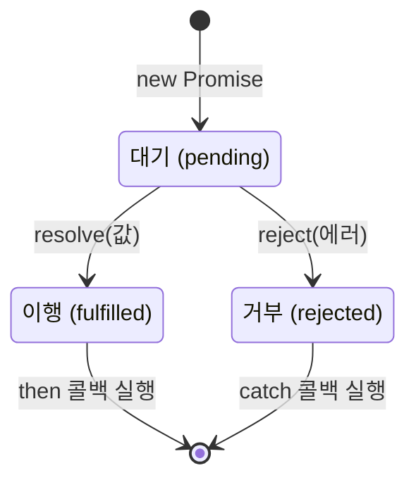
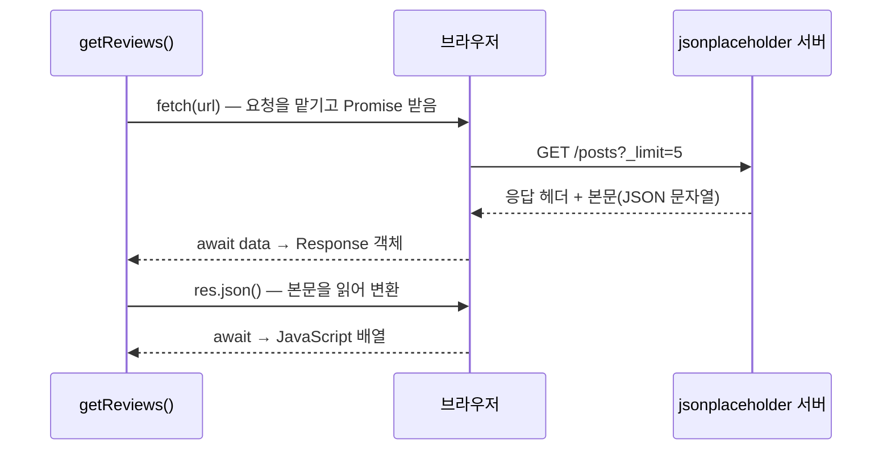
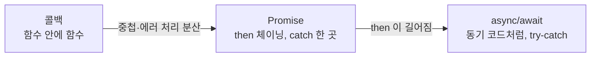

## 들어가며 (Situation)

[앞 글]({{ site.baseurl }})에서 `setTimeout`으로 비동기와 이벤트 루프를 정리했습니다. 비동기 덕분에 화면은 멈추지 않지만, 새로운 문제가 생깁니다. **언제 끝날지 모르는 작업들의 순서를 어떻게 맞출까?** 이번 실습은 같은 요구사항을 세 가지 방식(콜백 → Promise → async/await)으로 차례로 바꿔 보고, 마지막에 실제 외부 API를 `fetch`로 호출했습니다.

> 실제 서비스에서 겪은 문제가 아니라, 수업 실습을 정리한 글입니다. 실습은 브라우저에서 했고, 글의 실행 결과는 같은 코드를 Node.js(v24)로 다시 실행해 확인했습니다. Java 비교 코드는 javac 21로 실행해 확인했습니다. 설명은 MDN과 Oracle 공식 문서를 기준으로 했습니다.

## 문제 상황 (Task)

실습의 요구사항은 이렇습니다.

> 주문할 때마다 **1초 뒤에** 포인트가 10P씩 적립된다. (적립 한도는 50P)

적립은 1초가 걸리는 비동기 작업입니다. 그런데 20P를 적립하려면 **10P 적립이 끝난 결과**가 필요합니다. 즉, 비동기 작업인데 **순서가 중요**합니다.

- 앞의 비동기 작업이 끝난 뒤에 다음 작업을 실행하려면 어떻게 할까요?
- 50P를 넘는 경우 같은 실패는 어디서 처리할까요?
- 서버 API를 호출해 데이터를 받는 것도 같은 방식일까요?

## 해결 과정 (Action)

### 1. 콜백: 끝나면 이 함수를 불러 줘

```javascript
function pointCallback(point, func) {
    setTimeout(() => {
        const result = point + 10;
        if (func) {
            func(result);          // 1초 뒤, 결과를 다음 함수에 넘긴다
        }
    }, 1000);
}
```

작업이 끝났을 때 실행할 함수(콜백)를 인자로 받아, 결과를 넘겨주는 방식입니다. [이벤트 핸들러]({{ site.baseurl }})와 같은 아이디어입니다. 10P → 20P → … → 50P를 순서대로 적립하려면, 콜백 안에서 다음 적립을 호출해야 합니다.

```javascript
function runCallback() {
    pointCallback(0, point => {
        console.log(`${point}P`);                         // 10P
        pointCallback(point, point => {
            console.log(`${point}P`);                     // 20P
            pointCallback(point, point => {
                console.log(`${point}P`);                 // 30P
                pointCallback(point, point => {
                    console.log(`${point}P`);             // 40P
                    pointCallback(point, point => {
                        console.log(`${point}P`);         // 50P
                    })
                })
            })
        })
    });
}
```

동작은 하지만 단계가 늘어날수록 코드가 **오른쪽으로 계속 파고듭니다.** 이를 **콜백 지옥**이라고 부릅니다.

- 읽기 어렵습니다. 어디서 무엇이 실행되는지 괄호를 세어야 합니다.
- 실패 처리를 단계마다 따로 넣어야 합니다. 한도 초과 같은 에러를 한곳에서 잡을 방법이 없습니다.
- 중간에 단계를 추가하거나 빼기 어렵습니다.

### 2. Promise: 미래의 결과를 담는 객체

**Promise**는 "지금은 없지만 나중에 완료될 작업의 결과"를 담는 객체입니다. 같은 적립 함수를 Promise로 바꾸면 이렇습니다.

```javascript
function earnPoint(point) {
    return new Promise((resolve, reject) => {
        setTimeout(() => {
            const result = point + 10;

            if (result > 50) {
                return reject(new Error("적립 한도 초과"));   // 실패
            }
            return resolve(result);                            // 성공
        }, 1000);
    });
}
```

`new Promise`에 넘긴 함수는 `resolve`와 `reject` 두 함수를 받습니다. 작업이 성공하면 `resolve(결과)`, 실패하면 `reject(에러)`를 호출합니다. 콜백 방식과 달리 **다음에 무엇을 할지는 받지 않고**, 결과만 Promise에 담아 돌려줍니다.

Promise는 세 가지 상태 중 하나입니다.



한 번 이행이나 거부가 되면 상태는 다시 바뀌지 않습니다.

**then 체이닝으로 순서 잡기**

```javascript
function runPromise() {
    earnPoint(0)
        .then(point => {
            console.log(`${point}P`);     // 10P
            return earnPoint(point);      // 다음 Promise 를 반환
        })
        .then(point => {
            console.log(`${point}P`);     // 20P
            return earnPoint(point);
        })
        // ... 30P, 40P
        .then(point => {
            console.log(`${point}P`);     // 50P
            return earnPoint(point);      // 60 > 50 → reject
        })
        .catch(e => console.log(e, '발생~!!!!!!'))
        .finally(() => console.log("포인트 적립 종료"));
}
```

```text
10P
20P
30P
40P
50P
Error: 적립 한도 초과 (스택 정보 생략) 발생~!!!!!!
포인트 적립 종료
```

핵심은 `then` 안에서 **Promise를 반환**하는 부분입니다. 그러면 다음 `then`은 반환된 Promise가 이행될 때까지 기다렸다가 그 값을 받습니다. 그래서 중첩 없이 **위에서 아래로** 순서가 표현됩니다.

| 메서드 | 실행 시점 | 용도 |
|--------|----------|------|
| `.then(fn)` | 이행되면 | 성공 결과 처리, 다음 작업 반환 |
| `.catch(fn)` | 체인 어디서든 거부되면 | 에러 처리 (한 곳에서) |
| `.finally(fn)` | 성공·실패와 관계없이 마지막에 | 정리 작업 (로딩 표시 끄기 등) |

다섯 번째 `then`의 `earnPoint(50)`에서 60P가 되어 `reject`가 호출되자, 나머지 `then`을 건너뛰고 `.catch()`로 바로 넘어갔습니다. 콜백 방식에서는 단계마다 넣어야 했던 실패 처리가 **한 곳**으로 모였습니다. Java의 `try-catch`에서 예외가 나면 나머지 문장을 건너뛰고 `catch`로 가는 것과 같은 흐름입니다.

### 3. async/await: Promise를 동기 코드처럼 쓰기

```javascript
async function runAsync() {
    try {
        let point = await earnPoint(0);
        console.log(`${point}P`);          // 10P
        point = await earnPoint(point);
        console.log(`${point}P`);          // 20P
        // ... 30P, 40P, 50P
        point = await earnPoint(point);    // 60 > 50 → reject → catch 로
    } catch (e) {
        console.log(e, '발생!!!');
    }
}
```

결과는 Promise 체이닝과 같습니다. `then`을 이어 붙이는 대신 일반 변수 대입처럼 씁니다.

| 키워드 | 의미 |
|--------|------|
| `await promise` | Promise가 끝날 때까지 **이 함수의 실행을 멈추고**, 이행되면 그 값을 반환. 거부되면 에러를 던짐 |
| `async function` | 안에서 `await`를 쓰는 함수 앞에 붙임. 이 함수는 **항상 Promise를 반환**함 |

`then`/`catch`와 비교하면 다음과 같습니다.

| 비교 | Promise 체이닝 | async/await |
|------|---------------|-------------|
| 결과 받기 | `.then(point => ...)` | `const point = await ...` |
| 에러 처리 | `.catch()` (메서드 체이닝) | `try-catch` (일반 문법) |
| 정리 작업 | `.finally()` | `finally { }` |
| 읽는 느낌 | 단계가 메서드로 이어짐 | 위에서 아래로 순서대로 |

**주의: "동기처럼 보일" 뿐, 멈추는 건 그 함수 하나**

수업 주석에서는 async/await를 "비동기 처리를 동기 방식으로 동작하게 만드는 문법"이라고 설명했습니다. 정확히는 **동기 코드처럼 읽히게 쓰는 문법**입니다. `await`는 그 `async` 함수 안의 다음 줄만 기다리게 할 뿐, JavaScript 스레드 전체를 멈추지 않습니다.

```javascript
// 예시 코드
runAsync();
console.log('runAsync 호출 직후');
```

```text
runAsync 호출 직후     ← 먼저 출력
10P                    ← 1초 뒤
```

`runAsync()`는 첫 번째 `await`를 만나는 순간 Promise를 반환하고 빠져나옵니다. 그동안 다음 줄과 다른 이벤트가 계속 실행되고, `earnPoint`가 끝나면 이벤트 루프가 `runAsync`의 남은 부분을 이어서 실행합니다. [앞 글]({{ site.baseurl }})의 `while`문 `sleep`처럼 화면이 멈추는 일은 일어나지 않습니다.

### 4. fetch: 외부 API 호출

> 가장 대표적인 비동기 처리는 외부 서버의 API를 호출하는 것이다. — 실습 설명

```javascript
async function getReviews() {
    const data = fetch('https://jsonplaceholder.typicode.com/posts?_limit=5');
    console.log(data);                    // Promise { <pending> }

    const res = await data;               // Response 객체 (응답 도착)
    const reviews = await res.json();     // 본문 JSON → JavaScript 객체

    console.log(reviews);                 // 5개짜리 배열
    console.log(reviews[0].title);
}
```

`jsonplaceholder`는 연습용 가짜 데이터를 JSON으로 돌려주는 공개 테스트 API입니다. 실습에서는 게시글 5개를 "리뷰 목록"으로 삼았습니다.

`fetch()`는 응답을 기다리지 않고 **Promise를 바로 반환**합니다. 그래서 `await` 없이 출력하면 결과가 아니라 대기 중인 Promise가 보입니다. 값을 꺼내려면 `await`(또는 `then`)가 필요합니다. 그리고 **`await`가 두 번** 필요합니다.



1. `await fetch(...)`: 서버가 응답하면 `Response` 객체를 받습니다. 상태 코드와 헤더는 들어 있지만, 본문은 아직 다 읽지 않은 상태입니다.
2. `await res.json()`: 본문을 끝까지 읽어 JSON 문자열을 JavaScript 객체로 바꿉니다. 이것도 시간이 걸리는 작업이라 Promise를 반환합니다.

같은 코드를 `then`으로 쓰면 이렇습니다(수업 코드에 주석으로 남아 있던 방식).

```javascript
fetch('https://jsonplaceholder.typicode.com/posts?_limit=5')
    .then(res => res.json())
    .then(json => console.log(json));
```

[미니 프로젝트]({{ site.baseurl }})의 메뉴 등록 화면이 `fetch('/menu/category').then(res => res.json())`으로 카테고리 목록을 받아 `<select>`를 채웠던 코드가 바로 이 형태였습니다. 그때 서버 쪽은 Spring Controller가 `@ResponseBody`로 Java 객체를 JSON 문자열로 바꿔 보냈고, 브라우저 쪽은 `res.json()`으로 그 문자열을 다시 객체로 바꿨습니다.

**알아 둘 점: fetch는 404에서도 실패하지 않는다**

`fetch`의 Promise는 **네트워크 오류**(서버에 연결할 수 없음 등)일 때만 거부됩니다. 서버가 404나 500을 응답해도 "응답은 받았으므로" **이행**됩니다. 직접 확인해 보면 이렇습니다.

```javascript
// 예시 코드
const res = await fetch('https://jsonplaceholder.typicode.com/posts/999999');
console.log(res.status, res.ok);   // 404 false   ← 에러가 아니라 정상 이행
```

그래서 `try-catch`만으로는 HTTP 에러를 잡을 수 없고, `res.ok`(상태 코드가 200~299이면 `true`)를 직접 확인해야 합니다.

```javascript
// 예시 코드
async function getReviews() {
    try {
        const res = await fetch('https://jsonplaceholder.typicode.com/posts?_limit=5');
        if (!res.ok) {
            throw new Error(`리뷰 조회 실패 : ${res.status}`);
        }
        const reviews = await res.json();
        // 화면에 표시
    } catch (e) {
        console.log(e);   // 네트워크 오류 + 위에서 던진 HTTP 오류 모두 여기로
    }
}
```

### 5. Java와 비교: CompletableFuture

Java에도 "나중에 완료될 결과"를 담는 객체가 있습니다. Java 8의 `CompletableFuture`입니다. 같은 포인트 적립을 Java로 만들어 보면 구조가 거의 같습니다.

```java
// 예시 코드
static CompletableFuture<Integer> earnPoint(int point) {
    return CompletableFuture.supplyAsync(() -> {
        sleep(1000);                                   // 별도 스레드에서 1초 대기
        int result = point + 10;
        if (result > 50) throw new IllegalStateException("적립 한도 초과");
        return result;
    });
}

earnPoint(0)
    .thenCompose(p -> { System.out.println(p + "P"); return earnPoint(p); })
    .thenCompose(p -> { System.out.println(p + "P"); return earnPoint(p); })
    // ... 30P, 40P, 50P
    .exceptionally(e -> { System.out.println(e.getCause().getMessage() + " 발생"); return null; })
    .whenComplete((r, e) -> System.out.println("포인트 적립 종료"))
    .join();
```

```text
10P
20P
30P
40P
50P
적립 한도 초과 발생
포인트 적립 종료
```

| 하는 일 | JavaScript Promise | Java CompletableFuture |
|---------|-------------------|------------------------|
| 비동기 작업 시작 | `new Promise((resolve, reject) => ...)` | `CompletableFuture.supplyAsync(() -> ...)` |
| 성공 / 실패 알리기 | `resolve(값)` / `reject(에러)` | `return 값` / 예외 던지기 |
| 결과로 다음 비동기 작업 | `.then(v => 다른Promise)` | `.thenCompose(v -> 다른Future)` |
| 결과를 값으로 변환 | `.then(v => 값)` | `.thenApply(v -> 값)` |
| 에러 처리 | `.catch(e => ...)` | `.exceptionally(e -> ...)` |
| 마지막 정리 | `.finally(() => ...)` | `.whenComplete((r, e) -> ...)` |
| 결과를 기다려 받기 | `await promise` | `future.join()` / `get()` |

모양은 거의 일대일로 대응하지만, 마지막 줄에 결정적인 차이가 있습니다.

- **Java의 `join()`은 호출한 스레드를 실제로 멈춥니다.** 결과가 나올 때까지 그 스레드는 아무것도 하지 않습니다. 스레드가 여러 개라서 가능한 방식입니다.
- **JavaScript의 `await`는 그 async 함수만 잠시 빠져나올 뿐**, 스레드는 다른 일을 계속합니다. 스레드가 하나뿐이라 멈추면 안 되기 때문입니다.

또 Java의 `supplyAsync`는 작업을 **다른 스레드**(기본 스레드 풀)에서 실행하지만, JavaScript Promise의 콜백은 모두 **같은 메인 스레드**에서 이벤트 루프를 통해 실행됩니다. [앞 글]({{ site.baseurl }})에서 정리한 "멀티 스레드 vs 이벤트 루프"의 차이가 여기서도 그대로 이어집니다. Java에는 `async`/`await` 문법이 없지만, Java 21의 가상 스레드를 쓰면 `join()`처럼 기다리는 코드를 써도 스레드 비용이 매우 작아져, 다른 방식으로 같은 문제를 풉니다.

### 6. 세 방식 한눈에 보기



| 비교 | 콜백 | Promise | async/await |
|------|------|---------|-------------|
| 순서 표현 | 중첩 (오른쪽으로 깊어짐) | 체이닝 (아래로) | 일반 문장처럼 (아래로) |
| 에러 처리 | 단계마다 | `.catch()` 한 곳 | `try-catch` 한 곳 |
| 기반 | 함수 | Promise 객체 | Promise 객체 (문법만 다름) |

async/await는 Promise를 대체하는 것이 아니라 **Promise 위에서 동작하는 문법**입니다. `await`할 대상은 Promise이고, `async` 함수는 Promise를 반환합니다.

## 결과 (Result)

정량 지표는 없고, 아래를 정리했습니다.

- 순서가 중요한 비동기 작업을 콜백으로 이으면 중첩이 깊어지고 에러 처리가 흩어집니다(콜백 지옥).
- Promise는 미래의 결과를 담는 객체이고, `resolve`/`reject`로 성공·실패를 알립니다. `then`에서 Promise를 반환하면 순서대로 이어지고, 실패는 `.catch()` 한 곳에서 처리합니다.
- async/await는 Promise를 동기 코드처럼 읽히게 쓰는 문법입니다. `await`는 그 함수만 멈추고 스레드는 막지 않습니다. 에러는 `try-catch`로 처리합니다.
- `fetch`는 Promise를 반환하며, `await fetch()`로 응답을, `await res.json()`으로 본문 객체를 받습니다. 404·500에서도 거부되지 않으므로 `res.ok`를 확인해야 합니다.
- Java의 `CompletableFuture`는 Promise와 메서드가 거의 일대일로 대응하지만, 다른 스레드에서 실행되고 `join()`은 스레드를 실제로 멈춘다는 점이 다릅니다.

## 더 학습하면 좋은 개념

- **`Promise.all` / `Promise.allSettled` / `Promise.race`** — 순서가 상관없는 여러 비동기 작업을 **동시에** 실행하고 모두(또는 가장 먼저) 끝나기를 기다리는 방법입니다. Java의 `CompletableFuture.allOf()`와 비교할 수 있습니다.
- **`fetch`로 POST 보내기 (`method`, `headers`, `body: JSON.stringify`)** — 조회뿐 아니라 데이터를 서버로 보내는 방법이며, Spring의 `@RequestBody`와 짝을 이룹니다.
- **CORS** — 브라우저가 다른 도메인의 API 호출을 제한하는 보안 정책입니다. 프론트와 백엔드를 다른 주소로 띄우면 바로 만나게 됩니다.
- **axios** — 실습 설명에 함께 언급된 HTTP 라이브러리로, 4xx·5xx 응답을 자동으로 에러로 처리하는 등 `fetch`와 동작이 다른 부분이 있습니다.
- **`AbortController`** — 오래 걸리는 `fetch` 요청을 취소하거나 시간 제한을 거는 방법입니다.

## 참고 자료

- [MDN - Using promises](https://developer.mozilla.org/en-US/docs/Web/JavaScript/Guide/Using_promises)
- [MDN - Promise](https://developer.mozilla.org/en-US/docs/Web/JavaScript/Reference/Global_Objects/Promise)
- [MDN - async function](https://developer.mozilla.org/en-US/docs/Web/JavaScript/Reference/Statements/async_function)
- [MDN - await](https://developer.mozilla.org/en-US/docs/Web/JavaScript/Reference/Operators/await)
- [MDN - Using the Fetch API](https://developer.mozilla.org/en-US/docs/Web/API/Fetch_API/Using_Fetch)
- [MDN - Response.ok](https://developer.mozilla.org/en-US/docs/Web/API/Response/ok)
- [MDN - Response.json()](https://developer.mozilla.org/en-US/docs/Web/API/Response/json)
- [JSONPlaceholder](https://jsonplaceholder.typicode.com/)
- [Oracle - CompletableFuture (Java SE 21)](https://docs.oracle.com/en/java/javase/21/docs/api/java.base/java/util/concurrent/CompletableFuture.html)
