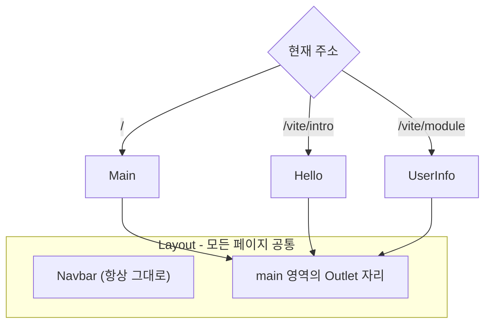
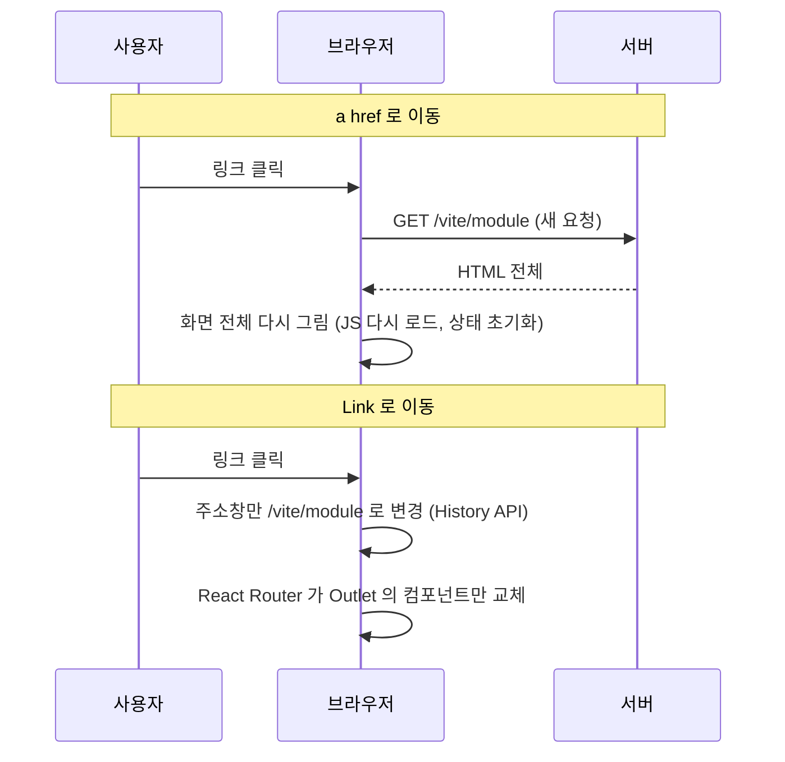

## 들어가며 (Situation)

[Vite 프로젝트 글]({{ site.baseurl }})에서 컴포넌트를 파일로 나눴습니다. 그런데 화면에 보여 주려면 모든 컴포넌트를 `App`에 직접 넣어야 했습니다. 수업 주석은 이 한계를 이렇게 짚었습니다.

> 현재 02_module 폴더까지 진행했을 때, 사용자 화면에 우리가 만든 컴포넌트를 보여주기 위해서는 App 컴포넌트에 집어 넣어야 한다. 하지만 현실 세계의 프로젝트는 여러 페이지가 존재하며, 페이지 별로 보여야 하는 컴포넌트, 보이면 안 되는 컴포넌트가 존재한다.

이번 글은 주소에 따라 다른 컴포넌트를 보여 주는 **React Router**와, 컴포넌트마다 스타일이 섞이지 않게 하는 **CSS Module**을 정리합니다.

> 실제 서비스에서 겪은 문제가 아니라, 수업 실습을 정리한 글입니다. react-router-dom 7 버전을 사용했고, 설명은 React Router·Vite 공식 문서와 MDN을 기준으로 했습니다. 수업 코드 외에 직접 작성한 코드는 "예시 코드"로 표시했습니다.

## 문제 상황 (Task)

```jsx
// 라우팅 전 App.jsx
function App() {
    return (
        <>
            <Hello/>
            <UserInfo/>
        </>
    )
}
```

- 모든 컴포넌트가 한 화면에 한꺼번에 나옵니다. `/vite/intro`에서는 `Hello`만, `/vite/module`에서는 `UserInfo`만 보이게 하려면?
- 왼쪽 메뉴(Navbar)는 모든 페이지에 그대로 두고 오른쪽 본문만 바꾸려면?
- 메뉴를 누를 때마다 서버에서 페이지를 새로 받아 오면 느리고 깜빡입니다. 페이지 이동 없이 화면만 바꿀 수 없을까요?
- `Navbar.css`의 `.nav` 클래스가 다른 컴포넌트의 `.nav`와 겹치면?

## 해결 과정 (Action)

### 1. 라우팅이란: 주소에 따라 보여 줄 것을 정하기

> 라우팅 : 요청한 URL 주소에 따라 보여줄 컴포넌트를 정의하는 것이다. — 수업 주석

[Spring MVC 요청 매핑 글]({{ site.baseurl }})에서 `@GetMapping("/menu/list")`로 "이 주소면 이 메서드"를 정한 것도 라우팅이었습니다. React Router는 같은 일을 **브라우저 안에서** 합니다.

```bash
npm install react-router-dom
```

### 2. BrowserRouter, Routes, Route

```jsx
// src/App.jsx
import { BrowserRouter, Routes, Route } from 'react-router-dom';
import Layout from "./layouts/Layout";
import Main from "./pages/Main";
import Hello from "./module/01_intro/01_intro";
import UserInfo from "./module/02_module/UserInfo";

function App() {
    return (
        <BrowserRouter>
            <Routes>
                <Route path="/" element={<Layout/>}>
                    <Route index element={<Main/>}/>
                    <Route path="vite/intro" element={<Hello/>}/>
                    <Route path="vite/module" element={<UserInfo/>}/>
                </Route>
            </Routes>
        </BrowserRouter>
    )
}

export default App
```

| 컴포넌트 | 역할 |
|---------|------|
| `BrowserRouter` | 라우팅을 쓰는 영역 전체를 감싸는 **최상위**. 브라우저 주소창의 주소를 읽고 바꿈 |
| `Routes` | 여러 `Route`를 묶는 부모. 현재 주소와 **가장 잘 맞는** Route를 골라 그림 |
| `Route` | `path`(주소)와 `element`(보여 줄 컴포넌트 엘리먼트)를 연결 |

`element`에는 컴포넌트 이름(`Main`)이 아니라 **엘리먼트**(`<Main/>`)를 넣습니다. [createElement 글]({{ site.baseurl }})에서 `render()`에 컴포넌트가 아니라 엘리먼트를 넘겼던 것과 같은 이유입니다.

**중첩 Route와 index**

`Route` 안에 `Route`를 넣으면 경로가 **이어집니다.**

| 바깥 path | 안쪽 Route | 최종 주소 | 그려지는 것 |
|----------|-----------|----------|------------|
| `/` | `index` | `/` | `Layout` 안에 `Main` |
| `/` | `path="vite/intro"` | `/vite/intro` | `Layout` 안에 `Hello` |
| `/` | `path="vite/module"` | `/vite/module` | `Layout` 안에 `UserInfo` |

안쪽 `path`는 `/`로 시작하지 않는 **상대 경로**로 써서 부모 경로 뒤에 붙습니다. `index`는 "부모 경로 그 자체일 때 보여 줄 기본 자식"입니다. `path` 대신 `index`를 씁니다.

Spring으로 비유하면 클래스의 `@RequestMapping("/menu")`과 메서드의 `@GetMapping("/list")`이 합쳐져 `/menu/list`가 되던 것과 같은 구조입니다.

### 3. Layout과 Outlet: 공통 틀은 그대로, 가운데만 교체

중첩 Route에서 바깥 `Route`의 `element`인 `Layout`은 **모든 하위 페이지가 공유하는 틀**입니다.

```jsx
// src/layouts/Layout.jsx
import { Outlet } from 'react-router-dom';
import Navbar from '../components/Navbar';
import styles from './Layout.module.css';

function Layout() {
    return (
        <div className={styles.layout}>
            <Navbar/>
            <main className={styles.content}>
                {/*
                JSX 내부의 주석
                Outlet 엘리먼트는 경로(Path) 에 따라서
                다른 컴포넌트로 대체되는 엘리먼트이다.
                */}
                <Outlet/>
            </main>
        </div>
    );
}

export default Layout;
```

`<Outlet/>` 자리에 현재 주소와 일치하는 **자식 Route의 `element`**가 그려집니다. 메뉴를 클릭하면 `Navbar`는 그대로 있고 `Outlet` 부분만 바뀝니다.



[Thymeleaf fragment 글]({{ site.baseurl }})에서는 페이지마다 `th:replace`로 헤더·푸터를 **포함**시켰습니다. React Router의 `Layout` + `Outlet`은 방향이 반대입니다. 공통 틀이 하나 있고, 그 **안에 페이지를 끼워 넣습니다.** 공통 틀을 여러 페이지에 반복해 적을 필요가 없습니다.

```css
/* src/layouts/Layout.module.css */
.layout {
    display: flex;
    min-height: 100vh;
}

.content {
    flex: 1;
    padding: 20px;
}
```

`display: flex`로 Navbar(고정 너비 180px)와 본문을 가로로 놓고, 본문(`.content`)은 `flex: 1`로 남은 공간을 모두 차지합니다. [Flex·Grid 글]({{ site.baseurl }})의 배치를 레이아웃 컴포넌트에 적용한 것입니다.

### 4. Link와 NavLink: 새로고침 없는 이동

```jsx
// src/components/Navbar.jsx
import { NavLink } from 'react-router-dom';
import styles from './Navbar.module.css';

const activeStyle = ({isActive}) =>
    isActive ? {backgroundColor: 'orangered', color: 'white'} : undefined;

function Navbar() {
    return (
        <nav className={styles.nav}>
            <h2><NavLink to="/">React 챕터</NavLink></h2>

            <h4>01. Vite</h4>
            <NavLink to="/vite/intro" style={activeStyle}>프로젝트 생성</NavLink>
            <NavLink to="/vite/module" style={activeStyle}>모듈</NavLink>
        </nav>
    );
}

export default Navbar;
```

**`<a href>`와 `Link`의 차이**

수업 주석의 설명입니다.

> `<a href>`는 페이지 전체를 새로 불러오지만, Link는 새로고침 없이 주소만 바꿔 컴포넌트를 교체한다.



`Link`도 실제로는 `<a>` 태그로 그려지지만, 클릭하면 브라우저의 기본 이동을 막고([이벤트 글]({{ site.baseurl }})의 `preventDefault`), 브라우저의 **History API**로 주소만 바꿉니다. 서버 요청이 없으므로 빠르고, Navbar 같은 공통 부분은 다시 그려지지 않습니다. 뒤로 가기·앞으로 가기도 정상 동작합니다.

| 비교 | `<a href="/x">` | `<Link to="/x">` | `<NavLink to="/x">` |
|------|----------------|------------------|--------------------|
| 이동 방식 | 서버에 새 요청, 페이지 전체 로드 | 주소만 변경, 컴포넌트 교체 | Link와 같음 |
| 화면 깜빡임 | 있음 | 없음 | 없음 |
| JS 상태 | 초기화 | 유지 | 유지 |
| 현재 위치 표시 | 직접 구현 | 직접 구현 | **`isActive` 제공** |
| 쓰는 곳 | 외부 사이트 링크 | 앱 안 이동 | 메뉴·탭 |

**NavLink와 isActive**

`NavLink`는 `Link`에 기능이 하나 더 있습니다. 현재 주소가 `to`와 일치하면 `isActive`가 `true`가 됩니다. `style`이나 `className`에 객체 대신 **함수**를 넘기면, React Router가 `{ isActive }`를 넣어 그 함수를 호출하고 반환값을 스타일로 씁니다.

```javascript
const activeStyle = ({isActive}) =>
    isActive ? {backgroundColor: 'orangered', color: 'white'} : undefined;
```

- 매개변수 `({isActive})`는 넘어온 객체에서 `isActive`만 꺼내는 [구조 분해 할당]({{ site.baseurl }})입니다.
- [화살표 함수]({{ site.baseurl }})와 삼항 연산자로, 현재 메뉴면 주황 배경·흰 글자, 아니면 `undefined`(스타일 없음)를 반환합니다.
- 함수를 값으로 넘기고 라이브러리가 필요할 때 호출하는 [콜백]({{ site.baseurl }}) 패턴입니다.

> 예시 코드 — `/` NavLink 는 기본적으로 `/vite/intro` 에서도 활성화됩니다. 하위 경로도 "일치"로 보기 때문입니다. 정확히 `/` 일 때만 활성화하려면 `<NavLink to="/" end>` 처럼 `end` 속성을 씁니다.

### 5. 없는 주소 처리 (보충)

```jsx
// 예시 코드
<Route path="*" element={<NotFound/>}/>
```

`path="*"`는 위의 어떤 Route와도 맞지 않는 모든 주소에 일치합니다. [미니 프로젝트]({{ site.baseurl }})의 `NoResourceFoundException` → 404 화면에 해당하는 역할을 브라우저에서 합니다.

### 6. CSS Module: 컴포넌트 전용 클래스

```css
/* src/components/Navbar.module.css */
.nav {
    width: 180px;
    padding: 10px;
    background-color: #f2f2f2;
    display: flex;
    flex-direction: column;
}

.nav h4 {
    margin: 16px 0 4px;
}

.nav a {
    padding: 2px 6px;
}
```

```jsx
import styles from './Navbar.module.css';

<nav className={styles.nav}> ... </nav>
```

수업 주석의 설명입니다.

> 파일명을 '이름.module.css'로 작성하고 객체로 import 해서 className에 넣는다. 클래스명이 고유한 이름으로 바뀌어(Navbar-module__nav__xxxxx) 다른 컴포넌트와 충돌하지 않는다.

`import styles from '...module.css'`의 `styles`는 **원래 클래스 이름 → 바뀐 고유 이름**을 담은 객체입니다.

```javascript
// 예시 코드 — styles 객체의 모습 (이름은 빌드 도구가 생성)
{ nav: "Navbar-module__nav__xxxxx" }
```

```html
<!-- 실제로 그려지는 HTML -->
<nav class="Navbar-module__nav__xxxxx"> ... </nav>
```

CSS 파일 안의 `.nav`도 같은 고유 이름으로 바뀌므로, `Layout`이나 다른 컴포넌트에 `.nav`라는 클래스가 있어도 서로 영향을 주지 않습니다. `.nav h4`, `.nav a`처럼 [자손 선택자]({{ site.baseurl }})는 그대로 쓸 수 있고, 바깥 클래스만 고유화됩니다.

| 방식 | import | 적용 범위 | 클래스명 충돌 |
|------|--------|----------|-------------|
| 일반 CSS | `import './style.css'` | **페이지 전체** | 같은 이름이면 충돌 ([우선순위 규칙]({{ site.baseurl }})으로 결정) |
| CSS Module | `import styles from './X.module.css'` | 그 클래스를 쓴 컴포넌트만 | 없음 (이름 자동 고유화) |
| 인라인 스타일 | `style={{ ... }}` | 그 요소만 | 없음, 대신 재사용·hover 등 불가 |

일반 CSS를 import 하면 컴포넌트 파일에서 불러왔더라도 **페이지 전체**에 적용됩니다. 컴포넌트가 수십 개가 되면 `.title`, `.card` 같은 흔한 이름이 겹치기 쉬운데, CSS Module은 이를 파일 이름 규칙 하나로 막습니다. Vite는 `.module.css`로 끝나는 파일을 자동으로 CSS Module로 처리하므로 별도 설정이 필요 없습니다.

### 7. 서버 라우팅과 클라이언트 라우팅 비교

| 비교 | Spring MVC + Thymeleaf (서버 라우팅) | React Router (클라이언트 라우팅) |
|------|--------------------------------------|-------------------------------|
| 주소 → 화면 연결 | `@GetMapping` + View 이름 | `<Route path element>` |
| 결정하는 곳 | **서버** | **브라우저** |
| 메뉴 클릭 시 | 서버에 요청 → 새 HTML 페이지 | 주소만 변경 → 컴포넌트 교체 |
| 공통 레이아웃 | 페이지마다 fragment 포함 | `Layout` + `Outlet` 한 곳 |
| 데이터 | 서버가 Model에 담아 HTML로 렌더링 | 필요하면 [`fetch`]({{ site.baseurl }})로 API 호출해 받아옴 |
| 서버의 역할 | 화면(HTML) + 데이터 | 처음에 HTML 한 장 + JS, 이후엔 데이터(JSON) API |

React Router로 만든 앱은 서버가 처음에 HTML 한 장(`index.html`)과 JavaScript만 내려주고, 이후의 화면 전환은 전부 브라우저에서 일어납니다. 그래서 **SPA(Single Page Application)**라고 부릅니다. 이렇게 되면 Spring 서버는 HTML을 만들 필요 없이 [`@ResponseBody`로 JSON만 응답]({{ site.baseurl }})하는 API 서버가 됩니다.

**알아 둘 점: 새로고침하면?**

`/vite/module`에서 새로고침하면 브라우저는 서버에 `/vite/module`을 **직접 요청**합니다. 서버에는 그런 파일이 없습니다. Vite 개발 서버는 이런 요청에 `index.html`을 돌려줘서 문제가 없지만, 실제 배포 서버(정적 호스팅, Spring Boot static 등)에서는 **모든 경로를 `index.html`로 보내는 설정**을 따로 해야 404가 나지 않습니다.

## 결과 (Result)

정량 지표는 없고, 아래를 정리했습니다.

- 라우팅은 주소에 따라 보여 줄 컴포넌트를 정하는 것이며, React Router는 `BrowserRouter`(최상위) / `Routes`(묶음, 선택) / `Route`(`path`와 `element` 연결)로 구성합니다.
- 중첩 Route의 경로는 부모 뒤에 이어지고, `index`는 부모 경로 자체의 기본 화면입니다.
- 바깥 Route의 `Layout`에 `<Outlet/>`을 두면, 공통 틀(Navbar)은 그대로 두고 Outlet 자리만 주소에 맞는 컴포넌트로 바뀝니다.
- `Link`는 History API로 주소만 바꿔 새로고침 없이 이동하고, `NavLink`는 `isActive`로 현재 메뉴를 표시할 수 있습니다(`style`에 함수를 넘김).
- CSS Module(`*.module.css`)은 클래스 이름을 고유하게 바꿔, 컴포넌트 간 스타일 충돌을 막습니다.
- React Router 앱은 브라우저가 화면 전환을 맡는 SPA이며, 서버는 API(JSON)를 담당하게 됩니다. 배포 시에는 모든 경로를 `index.html`로 보내는 설정이 필요합니다.

## 더 학습하면 좋은 개념

- **`useParams`** — `/menu/:menuCode`처럼 주소 일부를 변수로 받는 방법입니다. Spring의 `@PathVariable`에 해당합니다.
- **`useNavigate`** — 버튼 클릭이나 등록 완료 후 코드로 페이지를 이동하는 방법입니다. Spring의 `redirect:`에 해당합니다.
- **`useSearchParams`** — `?keyword=떡볶이` 같은 쿼리 스트링을 읽고 쓰는 방법입니다. `@RequestParam`에 해당합니다.
- **History API(`pushState`)** — `Link`가 새로고침 없이 주소를 바꾸는 브라우저 기능입니다.
- **SPA와 SSR, SEO** — 클라이언트 라우팅의 장단점과, 검색 엔진·첫 화면 속도 문제를 해결하는 서버 렌더링(Next.js 등)입니다.

## 참고 자료

- [React Router - Routing (Declarative)](https://reactrouter.com/start/declarative/routing)
- [React Router - Navigating (Link, NavLink)](https://reactrouter.com/start/declarative/navigating)
- [React Router - Outlet](https://reactrouter.com/api/components/Outlet)
- [React Router - NavLink](https://reactrouter.com/api/components/NavLink)
- [Vite - CSS Modules](https://vite.dev/guide/features.html#css-modules)
- [MDN - History API](https://developer.mozilla.org/en-US/docs/Web/API/History_API)
- [MDN - SPA (Single-page application)](https://developer.mozilla.org/en-US/docs/Glossary/SPA)
